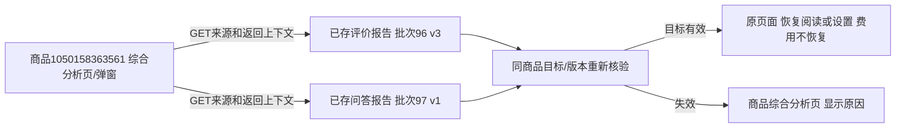

# 来源报告返回与阅读状态恢复

2026-11-02，用户确认来源报告应返回进入位置，并保留滚动、折叠和弹窗设置；费用勾选不恢复。本轮只改Web导航，不更改报告正文、提示、分析流程、数据库结构或业务记录。

## 修复

原三个入口（综合页来源卡、分析设置的所选报告、综合报告的基础报告）只传任务和版本，没有进入位置；评价与问大家报告的返回按钮写死为原模块明细。现在三入口均携带受控返回上下文：

- 综合分析页 → 来源报告 → 返回综合分析，恢复页面阅读位置。
- 综合报告 → 基础报告 → 返回原综合任务和报告版本，恢复已展开来源区及位置。
- 综合分析弹窗 → 所选来源报告 → 返回并恢复原弹窗，保留两份报告选择、模型、输出和展开设置、弹窗内部滚动；费用始终未勾选。
- 独立设置页也保留当前选择；设置变化后返回目标使用新的选择，不用旧参数覆盖。

弹窗恢复先还原背景位置，再打开模态框；打开后只恢复弹窗内部滚动，关闭后回到原背景位置。已补充两帧稳定后的完整视口边界检查，避免弹窗或遮罩因背景滚动偏移。

来源报告顶部显示“来自：综合分析／综合报告／综合分析设置”。原“返回评价明细／问大家”和分析记录作为其他入口保留，直接从原模块进入时不增加综合返回按钮。问大家版本链接、刷新进度与免费本地重查都携带原返回参数；评价本地重查原本保留查询，继续沿用。下载仍为附件，不改变当前页或返回上下文，离线正文不包含返回导航。

## 状态与安全

共用 `web/report_navigation.py`、`templates/report_navigation.html`、`static/report_navigation.js`。公共按钮样式沿用form_controls，无页面专用控件外观。

服务端只重建同商品综合页、综合报告和独立设置页三类目标。综合报告核对商品/类型和版本，设置页核对基础报告归属并在点击返回时预检可读性，带搜索观察上下文时核对该观察同商品。拒绝外站、协议相对、控制字符、重复参数、过长地址、跨商品、非综合模块或返回入口自身，不能循环跳转。目标消失/设置失效时回该商品综合分析页并明确提示；数据库读取失败仍按现有503处理，不伪装为无资料。

浏览器在当前标签页sessionStorage保存短期阅读状态：滚动位置、折叠键、必要选择和弹窗滚动，不保存正文、密钥、费用确认或分析结果。四小时过期、最多十份；不改localStorage业务偏好。返回后校验页面身份、清除临时URL参数、恢复界面，免费勾选不受此前状态影响。无本地存储时仍可服务端返回原页面；状态缺失/损坏/过期时明确提示，不能恢复的弹窗要求重新选择，不发AI请求。Ctrl/中键另开仍保留原标签页，不强制接管浏览器原生行为。

## 验证

- 44项分析/导航相关检查通过；其中6项新用例覆盖双向返回、原入口、固定版本、离开后目标删除、严格同商品白名单、非法URL/重复参数/失效观察、独立设置更新、版本/免费检查以及附件下载。最后新增的非法观察检查已在6项组中复测。
- 公共控件与资料浏览33项回归通过。
- 隔离1440/390/320：两份来源返回/刷新/版本、本地免费重查、原滚动位置、弹窗模型/输出/选择/高级展开恢复且费用清除、综合报告固定版本/折叠恢复、下载不导航、状态丢失提示均通过。每视口唯一POST是临时库的免费check，无付费或采集提交。使用真实临时WSGI服务验证302链，不依赖route.fulfill模拟跨页重定向。
- 实际商品1050158363561三视口只读往返及弹窗恢复通过；真实POST=0，外部请求阻止，页面无脚本错误或横向溢出。已检查返回提示与恢复界面截图，人工体验待用户确认。
- 两库均保持0020，验证库32表指纹一致，正式库含全部分析表的30表数量及指纹一致；最终快照tasks为129→131、task_events为12780→12787，来自并行YouTube操作。对应新增任务为 `1bf6103009464944a849b12d854ab34f`（tools.youtube.resolve，2026-11-02 20:26:24）和 `0627b6d9506f4465828ed910eb7aa0ba`（tools.youtube.video，20:27:21，核对时仍执行）。两任务当时分别5/2个事件；这是本轮快照差异，不把其他操作计为本功能写入，也不回退或删除其数据，不据此宣称旧任务字段全部不变。无DDL、旧分析报告修复/覆盖或真实AI。证据位于 `workspace/output/reports/report_navigation`，日志在workspace对应report_navigation文件，不提交业务原文/状态到Git。
- 重启仅针对进程归属核对后的本项目8000 Web，保留采集和其他任务。工作区并行的视频工具改动不纳入本轮提交。

## 本轮实际只读数据流

实际来源见同目录 `real_sources.json`；评价报告任务 `d9d86912040b4eeb8b5d34b14b4b4e18`（批次96、版本3），问答报告任务 `f1ca3e80b7004fb99ba63a0ee5b9ae21`（批次97、版本1）。这些编号为已有记录，本轮不新建任务、采集批次、观察、调用或报告版本。临时库的免费检查新增版本不计入正式数据。

平台商品编号用于定位products，报告任务编号定位analysis_tasks，版本定位已有analysis_reports。return_to/state只是Web导航和短期浏览器状态，不是新外键、分析输入或持久化业务字段。
