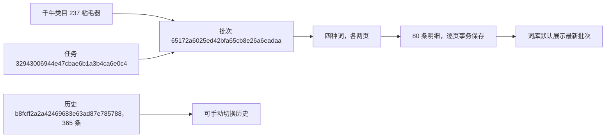

# 生意参谋搜索排行

在「市场与选品」新增搜索排行入口。默认 7 天、四类词、每类前 10 页，支持 30 天及日榜。首版读取搜索人气榜。页面已核对四类表头，均含排名、各自词列、搜索人气、点击率、支付转化率和操作列。采集保存各类词和指标原值。前三名的奖牌转数字，操作列略过。

2026-11-06 在验证库运行 0028 并通过实际结构检查。选中的千牛「粘毛器」本地编号为 237，对应生意参谋实际路径「宠物/宠物食品及用品 > 猫/狗美容护理工具 > 粘毛器」。页面确认的统计类目编号留空。

| 周期及范围 | 批次 | 任务 | 实际结果 |
|---|---|---|---|
| 7 天，各 2 页 | `25eab47958bf4a1989ca1d58322a1f33` | `f052f8c1bf4e466cbf84f46f6fac1398` | 10 月 30 日至 11 月 5 日，8 页、80 条 |
| 30 天，搜索词 1 页 | `26ba069bbf67439e8abf40325b16f6b4` | `8c48abf3981a4be79b8d0e118d64c315` | 10 月 7 日至 11 月 5 日，1 页、10 条 |
| 日，搜索词 1 页 | `e77a7396b64843ae93d3e2f1c045397f` | `f7852a8a3a6649cba5133f4d92e1bb8d` | 11 月 5 日，1 页、10 条 |
| 7 天，各最多 10 页 | `b8fcff2a2a42469683e63ad87e785788` | `79b848e68a6b4681983cc0e6bb12dcaa` | 搜索词和趋势词各 10 页、100 条。核心词 9 页、81 条，修饰词 9 页、84 条，两者均到末页。共 38 页、365 条 |
| 7 天，重采各 2 页 | `65172a6025ed42bfa65cb8e26a6eadaa` | `32943006944e47cbae6b1a3b4ca6e0c4` | 8 页、80 条，作为同类目与周期的最新批次 |

默认 10 页的早期试采发现平台会跳号或在页内显示 35、34 的顺序。保留这两轮部分批次以供回查。最终读取保留页面名次及原顺序，按页码及前后内容核对翻页，并检查跨页重复的词与名次、首页变化。

例如，7 天样本首行「猫毛清理器」的搜索人气为 `2500 ~ 5000`、点击率 `77%`、支付转化率 `30% ~ 35%`。这些值对应上述实际统计日期。CSV 按当前批次及所选词类型导出。23 项相关单元测试通过，网页在 1440、390、320 像素宽度核对了批次顺序、历史分页、任务链接及 CSV。

## 采集节奏复核

验证库批次 `2f5a5077d8174fb0ba8b43f4f115bb79` 按新节奏读取搜索词、趋势词各两页，两个类型相邻页保存时间分别相差 9.960 秒和 10.993 秒，包含页面加载、节奏等待和复核。千牛美容护理工具分支批次 `0c2f0037b016486bb5ca8ec189f080c2` 完整重采通过。限流响应和 Retry-After 通过本地模拟测试验证。

## 正式部署

2026-11-06 用户确认验收。统一升级报告 `d015712c03fb409fbc58d0ba2b2d0663` 确认正式、人工测试和自动验证三库均为 0028，结构一致。8000、8001、9000 的搜索排行、发布类目、上架和任务记录均已核对返回正常。正式库已有 384 条发布类目，搜索排行首批由用户从正式页面发起。
