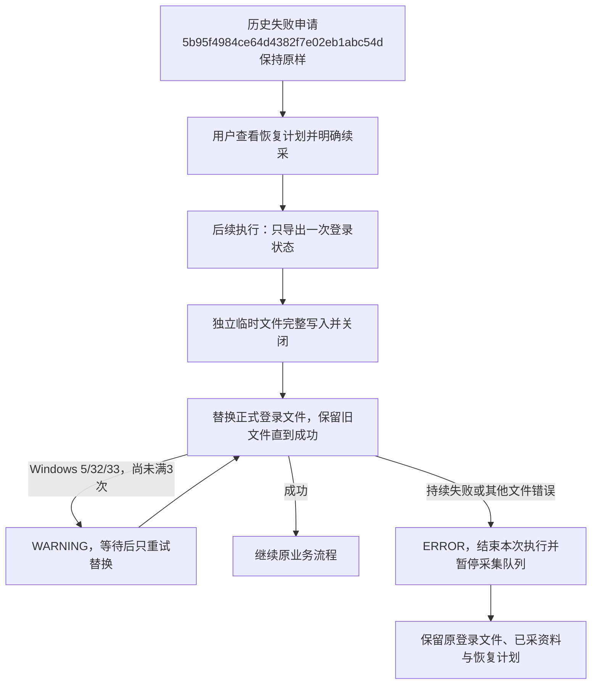

# 登录状态保存冲突重试

2026-10-27，用户确认并授权修复登录状态保存时的Windows拒绝访问问题。实际失败申请`5b95f4984ce64d4382f7e02eb1abc54d`于13:33:23在详情入口保存后、继续模块采集前，将taobao.tmp替换为taobao.json时失败。13:33:10曾成功保存，原正式文件与故障临时文件均为有效JSON；排查时当前访问权限正常，没有当前占用者或相应Defender拦截记录，无法据此确定历史占用进程。

## 实现范围

只修改共享登录状态保存方法，不改账号验证、浏览器资源锁、采集模块或数据库结构。淘宝和千牛继续使用各自独立正式路径，现有JSON结构保留。

- 每次只读取一次浏览器状态快照，验证并序列化后，以独立随机名称在正式文件同目录排他创建临时文件；完整写入、flush/fsync并关闭写入句柄后才尝试替换。
- Windows错误5/32/33允许总计3次替换尝试，等待0.2/0.5秒；其他错误不重试。不重新导出状态、登录、导航或采集，不删除原正式文件来绕过替换失败。
- 重试记WARNING，持续失败记ERROR，保留原文件并向统一执行器抛出可读错误。采集失败和暂停队列沿用原机制，已有恢复计划仍可使用，不将全局保存异常当作模块跳过。
- 只清理本次确实创建的临时文件；名称碰撞时不删除他人文件，清理失败另记警告，不掩盖原错误。当前故障taobao.tmp不复用、不删除。
- 日志只记录路径、阶段、次数和系统错误代码，不记录Cookie或localStorage内容。旧失败申请与原错误保持不变。

## 验证范围

使用临时目录、合成状态及独立MySQL验证库，覆盖访问/共享/锁冲突后恢复、持续冲突失败、不可重试错误、同步失败、编号碰撞、清理失败、无效快照、并发独立临时文件、两平台路径隔离。Windows专项用真实系统文件句柄阻止删除共享，再在等待阶段释放，验证第二次替换成功。

独立库验证真实事件流水中的WARNING/ERROR级别、失败任务和队列暂停、后续申请暂停、短暂冲突成功后不误报失败；不启动采集或访问淘宝。现有系统Chrome本地验证使用临时资料和本地页面，检查会话状态恢复、持久资料保留及人工验证守卫，未使用真实账号资料。

本轮报告保存在workspace/output/reports/session_save_retry_20261027/。不升级数据库，不修改0001～0009或冻结模型，不改原39项真实平台人工验收结论。

## 交付核对

466项完整单元、26项作业MySQL、3项本地系统Chrome验证通过，共495项；新增11项保存专项和2项任务/日志协作回归。Windows文件句柄专项实际阻止正式样例文件的删除共享，第一次替换受阻后在等待阶段释放，第二次成功；其他分支用合成异常确定性核对重试次数、失败保护及日志。

Web已在原8000端口重启。正式页面只读核对实际失败申请5b95f4984ce64d4382f7e02eb1abc54d，199字符旧错误及恢复入口保留，未向正式接口发送POST，也未由助手启动真实采集。历史失败不是本轮修复后自动成功，后续操作仍以最新恢复计划为准。

本轮基线与部署后快照一致：25张业务表计数、申请状态/关联/版本/更新时间、队列完整记录、任务结论/结束时间及0009版本保持不变。基线为任务43条、采集申请22条、批次134条、文件登记769条，这些是本轮已有累计值，不归入本轮测试新增。独立验证库业务表已清空。

本轮基线只有正式taobao.json，大小1999229字节，修改时间14:12:46；其内容SHA256、大小及修改时间部署前后相同。原taobao.tmp在本轮基线时已经不存在，不推断由哪个操作移除，本次代码/测试没有删除该历史路径。正式登录内容未输出或写入测试报告，报告仅保留哈希及文件元信息。淘宝/千牛恢复测试使用的是临时目录中的合成资料。

图中申请编号来自真实故障记录；重试分支由临时样例验证，并不表示本轮已实际续采。任务和批次的数据库关系不变，登录快照仍为本地会话文件，不关联为商品素材；本轮未新建正式采集任务或批次。
