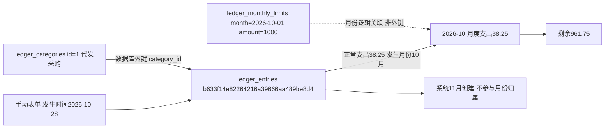

# 经营账本

2026-11-04后续调整见[账本弹窗与分类占比](账本弹窗与分类占比.md)：网页额度填写入口已移除，由数据库维护；新增修改改用弹窗，分类汇总改为分方向占比。以下内容是2026-11-03初版实施记录。

2026-11-03。用户明确执行已讨论方案：手动收支、数据库分类、可编辑月度止损线、手工发生时间与录入时间分开；不扩展订单库存、退款关联、用途、导入导出、强提醒或限制记账。

## 行为

原地址`/plans/ledger`升级为实际账本；分类入口`/ledger/categories`，写入入口`POST /ledger/write`。菜单ledger更新为available，其余人工名称归属排序开关保留。正常账目按发生月份统计收入、支出、结余；分类和收支筛选仅作用于明细，概况保持整月。金额以Decimal和数据库DECIMAL(12,2)处理，输入最多两位小数，不静默舍入。发生时间由用户手动填写，北京时间，允许补记；创建与修改时间系统保存。原分类停用后不能新选，编辑可保留原分类；改名同步历史显示。正常记录支持修改与作废，作废不再统计或编辑；没有逐次审计历史表。

止损线每月独立手动设置，允许0元，未设置不假设1000元或继承上月；额度只减支出，收入不增加额度。仅数字展示剩余/超出，无预算弹窗或阻断。提现按用户所选方向记账并可按分类查看，不自动判断交易内容。明细每页50笔。控件复用全站宏及可搜索分类下拉，CSS只维护布局。

## 数据库

0026_ledger/schema_v26新增ledger_categories（6列）、ledger_entries（10列）、ledger_monthly_limits（4列）。当前37业务/配置表、1技术表、423字段、70外键；字段字典、取值、关系与原生中文COMMENT同步。旧迁移和模型冻结。分类唯一名称，明细分类外键更新/删除RESTRICT，收支/作废状态和金额等有CHECK；月度首日归一化由程序保证。无商品/订单/任务关系，无新统计表。

统一升级报告`b6c36cafd12e4c6180b5c9c4120a29f1`确认三库0026、schema_errors空、实际结构规范比较一致。首次检查识别NUMERIC与MySQL反射DECIMAL名称差异；修正通用等价类型规范化后，按统一升级流程重试成功解除维护，未改写已执行0026迁移。

检查快照：正式、人工测试、验证三库各5分类、0明细、0月度额度。初始化只有分类（代发采购、补单、其他支出、提现、其他收入）和菜单建设状态更新，不填默认预算或示例账目。未取得升级前全表内容指纹，不宣称三库全部业务数据指纹相同。

## 真实验证库事务证据

以下是本轮真实验证库合成样例，已全部回滚，正式库无该样例；不是实际经营记录。

- 明细主键`b633f14e82264216a39666aa489be8d4`；分类id=1、名称代发采购。
- 用户发生时间`2026-10-28 12:00:00`，系统创建时间`2026-11-03 19:39:34.719134`；支出38.25元计入2026-10，不计入创建月份11月。
- 同事务设置2026-10额度1000.00元，剩余961.75元。回滚后按主键查询为0。
- 本功能没有任务、采集批次、商品身份或文件索引记录；账目主键代表一次手动收支，分类主键代表可维护分类，月初日期代表独立额度月份。

## 验证与边界

29项相关测试通过，覆盖精度输入、补记、跨月修改、收入不加预算、独立月份/零额度、幂等重复提交、并发旧版本拒绝、作废排除、分类维护及停用历史、数据库CHECK/外键、非法来源/令牌和HTML转义、菜单启停。真实MySQL测试只在验证库事务内，全部回滚。

实际8000/8001两环境、明细和分类页、1440/1024/768/390/320共20项只读布局检查通过，页面无整体横向溢出或脚本异常，两环境分类搜索选择通过。截图位于workspace_test/output/reports/ledger。应用浏览器连接组件缺失，独立浏览器初始启动受限后经自动审核授权启动，未使用用户登录资料。实际网页只GET与未提交选择操作，没有写入正式账目。

写入复用维护禁写与菜单归属检查，追加本机来源和页面令牌；数据库故障明确报错，不伪造空数据。明细主键兼作同表单幂等标识，修改/作废以revision防旧页面覆盖。用户实际经营数据、人工视觉和日常记账验收待用户确认。

独立验证库真实浏览器完整流程通过：新增支出100.25元、修改金额150.25元并移动到下月、作废排除、网页新增分类；有账目及超出止损线状态在1440/390/320三视口无整体溢出。全部使用单一验证事务，结束回滚；见workspace_test/output/reports/ledger/interactive-check.log及filled截图。

最终全量单元846项通过（506.882秒），最终相关29项通过；git diff --check通过。本轮第一次全量是在旧规划测试夹具仍载入时启动，出现11项账本菜单状态相关失败；已将通用规划测试改用仍待建设的经营数据入口，并在菜单测试夹具登记账本已接入，重跑全量通过。最后仅重启已核对归属的正式/测试Web进程，保留8000/8001，各账本与分类入口GET均200；未启动真实采集、付费AI或商品提交。收尾三库均5分类、0账目、0月度额度，验证样例未残留。
