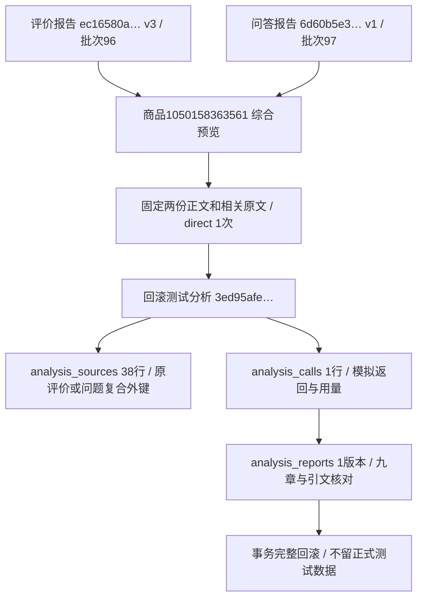

# 综合选品分析

2026-11-02，用户确认来源选择、九章提示、按模型容量优先一次发送，以及费用与旧记录保护后实施。第一版范围为同商品评价报告＋问大家报告，未接入图片/视频分析，未进行真实付费调用。

## 功能与使用

商品详情新增“综合分析”Tab。两侧来源卡显示最近已结束且有Markdown正文的报告；缺任一来源时提示先生成对应报告，不自动补跑。弹窗可搜索选择其他任务的最新主报告，明确指定旧版本的链接也保留旧选项；来源、模型、输出改变即重新预检、清除费用确认。正文可读但不完整、引文待核对的来源可以使用，限制会随消息发送；旧分类JSON/只有组稿/尚运行的任务不能作为主报告来源。

输入来自MySQL的固定报告版本，不生成供API上传的中间资料文件。发送必要商品背景、两份报告正文、实际被引用的原文段；评价加类别前缀，问题/回答保留原归属。初评/追评、问题/回答是独立段，同一段被多次引用只发送一份。未引用的评价、回答段不发送，基础完整来源快照仅在本地留作回查。未识别引用时明确提示依据未核对，不编造原文。

提示文件为 `src/ecommerce/modules/composite_analysis/prompts/report.txt` 和 `group.txt`。主稿严格九章：总体判断、使用场景与核心需求、评价与问大家的交叉发现、产品优势与采购底线、缺点/痛点/风险、选品与调整方向、拿样验证清单、供应商确认与信息缺口、下一步行动。先现成款，再包装/组合，最后定制；问题不能当缺陷，两类样本不直接相加计人数或销量，缺报价等不计算利润。原稿与连续引文检查不能保证事实真实性或语义正确。

正文优先一次生成；超容量才N组整理＋1次汇总，长段保存原位置、不丢字。复用现有模型能力、本地Token估算、输出/余量和16MiB网络保护，预检最终汇总空间。汇总也放不下时，在任何付费请求前拒绝，不自动加层、截断、重试或扩额。预留量不是账单金额。每次实际调用先持久化消息和额度，再发送；响应先保存本地收据，再入库。未知响应仍占预留，失败不自动重发。

固定来源＋提示＋模型＋输出的进行中任务复用；成功结果提供查看/再次计费另建的明确选择，失败默认新建。旧数据不恢复、不删除、不覆盖。新基础报告出现只提示，旧综合报告固定原版本。历史仅查询轻量列并投影来源元信息，不对大正文排序；最近成功不受100条列表上限遮挡。

报告阅读支持目录、总体判断重点卡、原文默认折叠/逐条成行、来源和请求详情折叠，以及Markdown/安全HTML/JSON下载。引文指向本次实际发送原文的对照项。免费重新检查追加报告版本并在同事务更新终态，不重写AI返回；旧页面版本冲突拒绝。未实现本地修正引用或逐项人工复核流程。

## 分层与存储

- 业务：`modules/composite_analysis`，Web仅负责受保护入口和展示。
- 通用 `analysis_tasks/sources/calls/reports` 复用，`analysis_details` 不写；后台复用原分析进程及 `TaskEvents`，不占浏览器资源锁。
- 新类型 `composite`、规则 `composite-v1`、输入 `composite-input-v1`、报告 `composite-report-v1`、检查 `composite-local-check-v1`。
- `parameters.plan.input` 保存两份报告的逻辑身份、版本、哈希、正文、限制、去重依据与背景；来源行仍用既有评价/问题互斥外键。本次报告引用的上游报告编号是JSON逻辑引用，不是新增外键。
- `0020_composite_analysis/schema_v20` 仅七条字段COMMENT更新；32业务表、386字段（含技术版本列）、67外键保持。0019及之前冻结，两库已升级并实际核对 `schema_errors=[]`。
- `source_count` 表示冻结的相关评价或问题行数，不是2份报告数量，不是全批分析通过数。`processed_count=0`，生成状态与引文状态分开。

## 本轮验证

- 全套unit目录762项通过；最终38项相关检查通过，包含新增N组＋1执行用例，结果见 `workspace/composite_related_final.log`。
- 1440/390/320隔离页面：来源弹窗、模型搜索/二次展开、改设置清费用、未勾选不提交、模拟生成、引用折叠与跳转、本地免费重查、已有成功选择/取消均通过。每视口3次POST仅进入临时SQLite；模拟AI，不是付费调用。
- 同三视口真实商品只读页面与弹窗通过，真实POST=0，外部请求阻止。已检查实际截图，公共控件及窄屏无横向溢出。
- 正式商品1050158363561只读来源：评价批次96、100条，任务 `d9d86912040b4eeb8b5d34b14b4b4e18`，报告 `ec16580a84274b658d410dd589a59677` v3；问答批次97、5题23回答，任务 `f1ca3e80b7004fb99ba63a0ee5b9ae21`，报告 `6d60b5e3c5e84a4cb6090b63ea8a957d` v1。引用原文33个评价段及10个问题/回答段，38行固定来源。当前计划direct、1次。
- 真实MySQL约束下事务回滚验证：模拟分析 `3ed95afe7c8f480691077169a0b23213`，38来源、1调用、1报告、成功选择均通过，随后完整回滚。该编号不是正式保存的报告；`tasks/task_events`未新建，真实AI=0。
- 两库前后32业务表逐行内容指纹与数量一致，技术版本行0019→0020。证据在 `workspace/output/reports/composite_analysis/before.json`、`after.json`、`transaction.json` 和截图；不保存凭据或将业务资料提交Git。
- 仅重启经进程归属核对的本项目Web，保持8000端口，不停止采集任务。人工样式体验及真实付费报告质量待用户确认，不标通过。

商品平台编号不同于内部products主键；批次96/97是采集来源，分析任务编号与报告编号各有独立身份。来源行通过原评价/问题与批次复合外键定位；两份上游报告身份由JSON及哈希固定，不将逻辑引用写成数据库外键。
