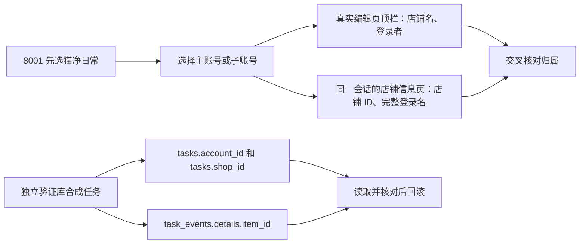
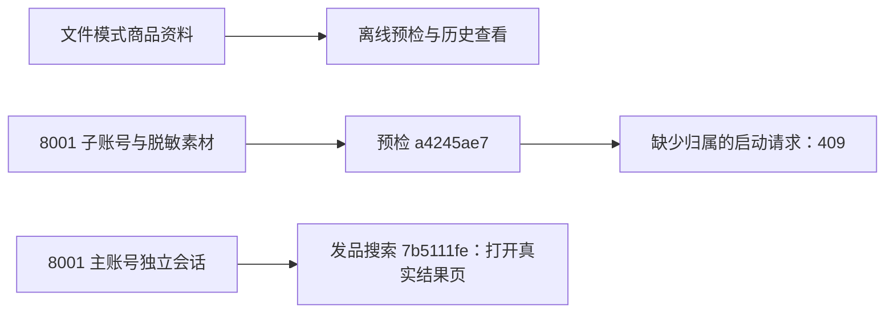

# 网页上架多账号归属

先选目标店铺，再选该店的千牛账号。账号列表优先显示可用账号，店内上次完成填写或入仓的可用账号排在最前。停用、需重新登录和本机会话缺失的账号置灰并显示原因。切换店铺或账号后，需要对当前文件重新预检。

预检封存店铺与账号的本地 ID、当时的名称以及千牛店铺 ID。后台在千牛资源锁内核对当时选定的账号、当前店铺关系及独立会话。提交前交叉核对编辑页顶栏和同一会话下的「店铺信息」页。只有千牛给出明确的本次回执才标记已入仓，回执中的商品 ID 与任务关联。

同店铺同商家编码有入仓结果待核对时，会链接旧任务并要求人工核对后明确确认。原任务保留。检测到登录失效时结束本次自动操作并释放会话资源。重新登录后，如果无法可靠定位同一编辑现场，重新预检。实测新建编辑页只有类目和路由参数，跨登录恢复原草稿仍待验证。

## 验证

- 测试环境与独立验证库升级到 `0031_listing_account_scope` 并通过实际结构核对。正式环境继续运行原版本。
- 66 项相关单元测试通过。独立验证库事务内写入了合成任务、账号和店铺，验证了外键约束、历史空归属、回执商品 ID 读取，最后回滚。
- 用测试库已登记的主账号、子账号分别只读打开千牛商品页，观察到顶栏店铺和登录者，两者均与同一会话的「店铺信息」页相符。实际 8001 页面验证了桌面和手机窗口，以及切换店铺和不可选账号的状态。没有提交真实商品。

## 关闭默认千牛会话入口

文件或 SQLite 环境提供离线预检和已有任务查看。开始填写或入仓需要 MySQL、已绑定的店铺和账号，以及账号独立目录下的有效登录资料。执行层拒绝默认浏览器资料，登录失效时引导到账号管理重新登录。使用指南、商品填写说明及命令提示补齐店铺 ID 和完整登录名。

文件环境的旧上架任务编号可以从任务记录打开，详情转到对应的本地上架记录。历史链接、页面布局及任务分页复测通过。

2026-11-15 测试环境回归通过 124 项，另有 13 项浏览器测试通过，覆盖文件模式预检和禁用启动、历史保留、模拟已绑定账号填写和人工反馈。8001 脱敏预检 `a4245ae71f2f4adb87a7582f88689a58` 绑定猫净日常子账号，直接提交缺少归属的启动请求返回 409。主账号千牛发品搜索任务 `7b5111fe4bf94bc89d25f86c9fbda907` 到达真实搜索结果页。实际验证未上传素材或提交商品。8001 已更新，本轮无需数据库迁移。

