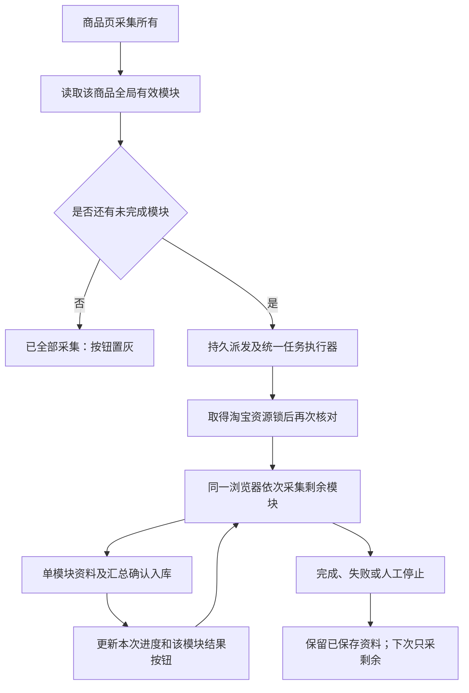

# 网页剩余模块补采说明

状态：2026-10-25实现与本地验证；未发起真实淘宝采集，不代表真实平台人工验收通过。数据库沿用0007，无表或字段变更。

商品详情标题右侧、“打开淘宝商品”左侧提供绿色“采集所有（剩余 N 项）”。按商品全局有效完成结果跳过，确认无内容也算完成；部分/失败/未采集且无有效结果的模块加入计划。最近失败不影响旧有效结果。九模块均完成时按钮置灰。

请求只派发后台任务，服务端计算范围，取得淘宝资源锁后再次核对；一个任务、一个浏览器按原顺序采集。默认评价100条、问答50题，不开启全量。页面显示本次完成/计划数、跳过数及当前模块，已入库的单模块结果可立即查看。刷新、跨页面人工弹窗、继续/停止及存储暂停规则沿用。

中途失败/停止保留之前保存的资料，再次点击重新计算剩余项；不重放旧浏览器动作。不同来源页面仍按商品全局判断跳过，新的模块结果链接不绑定旧搜索运行，旧来源归属不修改。

本地派发JSON与事件扩展统一登记在[字段取值说明](../数据库字段取值说明.md#网页补采所有剩余模块无ddl沿用0007)。旧单模块请求及旧任务文件继续兼容。

本轮验证只使用临时目录、临时查询样例及隔离浏览器，没有真实业务新增编号，图为实现流程，不以模拟编号冒充正式采集结果。

本轮验证结果：333项单元测试通过，其中新增10项计划/派发/结果测试和3项真实调度边界测试；6项隔离浏览器交互测试通过，覆盖新按钮、原单模块、全完成置灰、全局跳过、刷新恢复、人工停止及再次补采。真实调度测试核对模块结束进度必须在入库检查点之后，阻断/停止不执行后续模块。页面按钮位置已截图检查。没有启动真实淘宝采集、没有执行数据库迁移，也没有重启用户Web服务。
