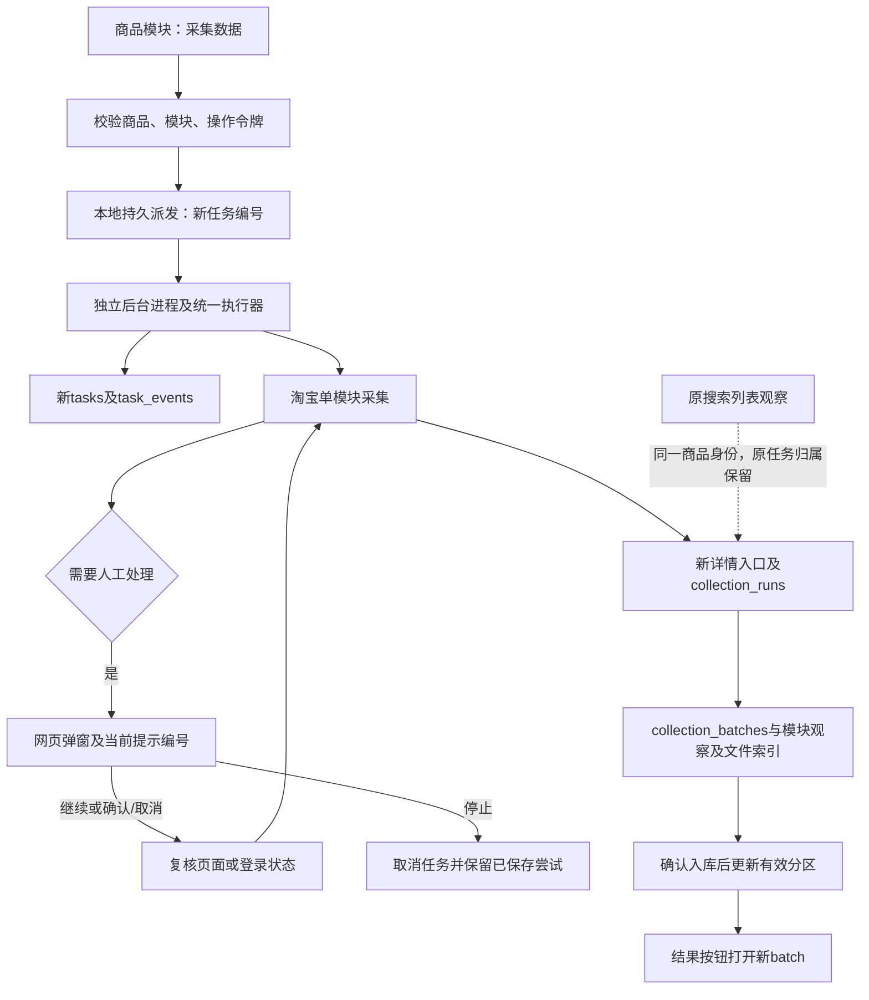

# 网页单模块采集说明

状态：2026-10-25实现及本地隔离验证；未执行真实淘宝采集，待用户实际验收。适用结构版本0006_list_sales，无新增数据库字段。

商品资料概况中，无有效资料的模块显示“采集数据”；SKU同时提供基本信息。有资料显示“查看资料”，确认无内容显示“查看采集结果”。部分尝试单独保留，不冒充有效结果。选择模块后只派发当前商品该模块，评价/问答沿用既有默认限制。

网页POST短请求校验本机来源、页面操作令牌、商品编号和模块白名单，再以跨进程短锁派发独立Python后台进程。重复点击复用在途任务；新进程复用统一执行器及淘宝资料目录资源锁。网页重启、刷新或关闭不会自动停止采集；同一页面令牌失效需刷新。任务状态和人工弹窗跨页面恢复，继续/确认须匹配当前提示编号；旧反馈、其他商品任务和数据库暂停不能放行。

后台任务只认统一执行器结论及本任务已发布批次。确认入库后显示结果入口；无内容也保留明确结果；失败和停止保留历史。后台退出或结果文件未写完时只读核对数据库，不自动重放采集。登录等待亦由网页人工反馈，继续后再次判断登录状态。

本轮验证使用临时目录、临时查询样例、模拟任务和隔离浏览器，不写正式业务数据，不产生真实淘宝任务或批次编号。测试样例中的编号只用于本地回归，不是生产记录。

上图是实现流程，不使用虚构正式编号。派发文件用于跨进程控制，业务资料以数据库及本地素材原件为准；具体JSON取值见数据库字段取值说明。

本轮验证结果：312项单元测试通过，其中22项新增网页采集测试；3项隔离浏览器交互测试通过，覆盖继续、确认/取消选项、停止、刷新/切页恢复、成功结果与部分结果重试。另以独立Python子进程执行模拟worker，核对配置重建、进程归属和结果落盘。所有平台动作和业务任务写入均替换为临时样例；未访问真实平台、未写正式或验证MySQL业务数据、未重启用户8000服务。真实淘宝端到端采集仍待用户发起并验收。
