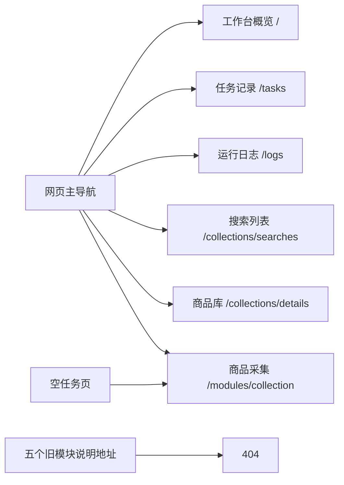

# 网页菜单与占位入口精简

2026-10-26，按用户确认范围清理网页入口：移除账号与会话、商品管理、选品分析、后台报表、经营分析的菜单和首页卡片，并关闭对应说明页。网页不再展示“规划中”菜单、“从Excel到商品草稿”和“账号准备情况”两块旧内容。

## 入口与边界

保留六个主菜单，顺序为工作台概览、任务记录、运行日志、搜索列表、商品库、商品采集。导航直接维护在`src/ecommerce/web/templates/base.html`，不再用包含命令行能力和规划项的共享FEATURES生成网页菜单。首页保留任务统计和可用的商品采集入口。任务记录为空时引导进入商品采集，避免指向已关闭的账号说明页。

`/modules/collection`继续打开现有采集配置页；`/modules/account`、`/modules/product`、`/modules/selection`、`/modules/reports`、`/modules/analysis`返回404，移除仅供这些说明页使用的`module.html`。资料详情、任务、日志、采集接口及人工处理和停止入口继续使用现有流程。

共享FEATURES、命令行和商品业务实现继续保留。网页清理不执行登录、采集或商品提交，不改数据库结构、记录、历史文件或登录资料。操作说明已同步[使用指南](../使用指南.md#网页查看采集资料)。

## 验证范围

临时应用验证六个入口可访问、旧地址返回404、公共页面不含旧链接、首页不含规划卡片和旧登录提示，空任务页跳转到商品采集；命令行登录和商品填写的帮助入口、原模拟发品流程继续核对。浏览器检查复用隔离页面与本地只读网页，禁止触发真实采集或商品操作。

本轮78项相关检查与2项隔离浏览器测试通过，日志为`workspace/web-menu-cleanup-tests.log`、`workspace/web-menu-cleanup-browser.log`。Web重启后只读核对六个实际页面：均返回200，导航名称、顺序和选中状态一致；五个旧模块地址均返回404，页面未残留旧链接。桌面1440像素与手机390像素页面检查通过，无浏览器脚本错误、外部请求或提交请求。截图及验证记录保存于`workspace/output/reports/web-menu-cleanup-20261026/`，访问地址仍为http://127.0.0.1:8000。

此图说明本轮网页导航，不使用虚构业务记录或真实采集编号作为测试结果。
