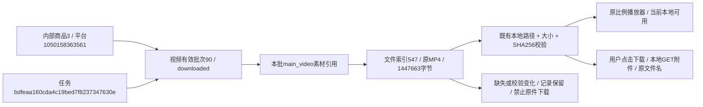

# 视频页布局与本地下载整理

2026-11-01按用户确认的原方案整理视频Tab。未加入后续被用户暂缓的文件大小/时长/分辨率信息、额外加载及格式状态、播放位置/音量保持、新下载命名规则等功能。原生播放器控制继续保留。

## 页面

独立product_video模板整合批次选择、数量、采集时间、中文状态及任务/日志入口；不再堆叠两张大说明卡。公共搜索下拉框直接展示已加载批次，选择后明确点击“查看”才GET切换。复用basic_batch.js的待查看/防重复提交逻辑，基本信息批次行为回归保持；待切换期间播放器、正文、任务及日志不改源。

大播放器保持原比例、电脑端限高560px并与素材操作左右排列，手机上下排列，原生controls/playsinline/preload=metadata且无autoplay。播放器旁只显示原序号、本地文件状态、打开原件和下载视频。来源说明默认折叠，部分采集或文件异常直接可见。已确认no_video显示明确空态，素材记录仍保留，不把缺文件当未采集。

视频记录SQL只读限定本批role=main_video，封面或其他媒体不计入本批视频数量。整批只有1个时隐藏排序，大于1时保留原顺序正倒序；分页仍每20条，第二页仅剩1条也不会错误隐藏排序。默认模块查看当前有效视频，显式历史批次继续读对应原件，不被最新任务轮询覆盖。数量和文件可用性不代表平台全量。

外观使用form_controls.css公共批次/视频组件，product_detail.css只维护布局。其他模块沿原模板和原预览路径。

## 原件下载

既有/collections/files/<file_id>增加可选download=1（默认0），严格只接受0/1。附件必须关联已发布video批次的main_video，文件索引availability=present，后缀MP4/WebM。沿原路径解析守卫，禁止workspace/output之外或跨根文件；文件存在且大小/SHA256与索引一致才发送。download=1设置attachment和原文件名，保持Range/HEAD；默认预览仍inline，不扩大图片或评价/回答视频下载范围。

页面只在既有媒体校验通过且后缀符合时显示原件与下载按钮，文件缺失/变化时显示对应提示并保留批次。下载只读取已有文件，不访问淘宝、不采集、不调用AI、不增加持久下载记录或文件索引。

records内部main_video_only默认false，with_batch_note的原说明读取扩展视频media；默认通用API/CLI返回保持。video_view为临时展示模型，不改批次、媒体及文件索引语义。没有DDL、表列/COMMENT、持久JSON或采集状态变更，仍0019_question_analysis/schema_v19。

## 本轮验证

- 718项全量单元通过；37项相关回归通过；最后4项原件/来源边界复核通过。新增4项验证旧批与新批文件/任务不混、主视频计数不含其他媒体、21条第二页单行仍有排序、原位置倒序、附件文件名/字节/Range/HEAD、预览inline、非法参数、变更/缺失/未发布/评价视频/图片后缀及越界文件拒绝，no_video空态明确。
- 隔离1440/390/320核对页面尺寸/无自动播放、批次搜索待查看与原src/日志不变、明确切换、正确下载链接和服务附件字节/名称、原件缺失后的按钮隐藏及记录保留。共用基本信息批次三视口回归通过。浏览器附件请求可能越过模拟路由，因此隔离测试不以模拟点击下载冒充实际下载验证；真实下载另通过已部署本地Web核对。
- 实际商品1050158363561（内部商品3）的有效视频批次90，采集于2026-10-26 09:42:03，原任务bdfeaa160cda4c19bed7f8237347630e。关联文件547，原名1050158363561.mp4，1447663字节，SHA256为9414fa2c546fc884cad8da3d8de5ac358f41b1aa02ce102c074fadd4816c0555。
- 已部署本地Web在1440/390/320逐项核对默认暂停、视频可播放、布局及单视频无排序；点击下载实际收到上述原名/字节数/哈希完全相同的文件。下载验证仅使用浏览器临时文件，不生成新业务文件记录。选择默认有效资料未应用时保持播放器/日志；展开来源不撑宽手机。所有实际请求只允许本地GET/HEAD，没有采集或AI请求。
- 正式库及验证库各32业务表本轮前后行数/全行SHA256完全相同，新增0/修改0/删除0，版本均0019。原任务、批次、文件索引、分析及采集数据保持。证据位于workspace/output/reports/video_layout及workspace/development/runs/undated-video-layout/logs/video-layout-*.log。仅隐藏重启已确认的项目8000 Web，未停止采集进程；人工样式体验待用户确认。

商品是跨批次统一身份，90是独立视频采集来源，547是本地原件索引；main_video引用连接两者。图中记录均来自本轮实际只读核对，不是新的采集结果。
