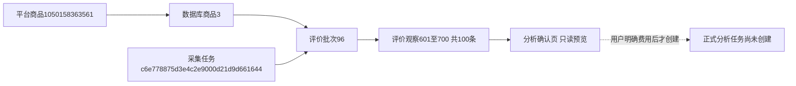
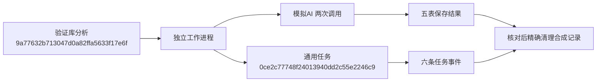
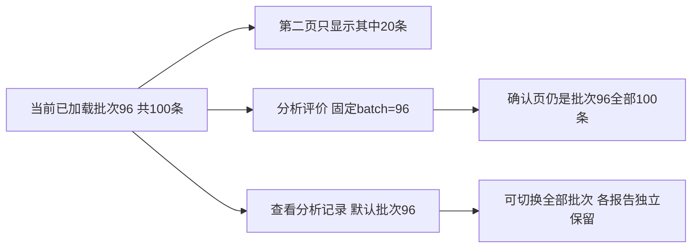
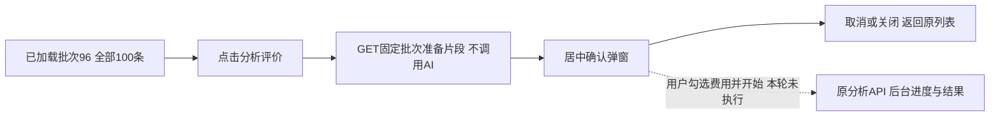
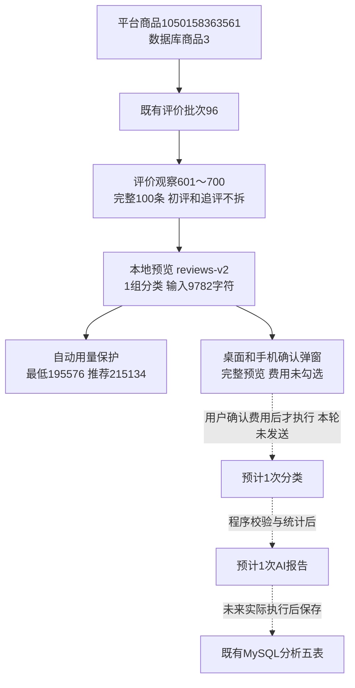

# 评价分析MySQL与入口实施记录

日期：2026-10-29。用户授权通用分析框架与评价首版及六项补充优化。本轮包括代码、两库迁移、文档、本地模拟和独立验证库验证，不启动正式付费分析或平台采集。

## 入口与结果

商品库→单商品→评价明细新增“分析评价”“查看分析记录”。确认页带入所选评价批次，可切换历史完整发布批次，显示实际条数、范围、模型、预计调用和预算，明确费用确认后才启动。每批最多10条，首版整批最多1000条；单条过长时阻止不截断。初评与追评一起理解、整体算一条，不同批次不混合，同文不同观察不自动删除。只发送编号、文字、规格和追评，不发昵称媒体链接。

Web与CLI共用modules/review_analysis/service；独立worker复用TaskEvents、tasks/task_events、本地流水和进程身份，使用分析独立锁与执行资源键，不获取浏览器资料锁。查看、刷新、导出、人工修订及重新统计都不调用AI。输入、模型、规则和输出参数相同默认复用，运行中不能重复启动，明确重新分析另建记录。

结果页展示已保存范围、逐条分类、引用、主题统计、发现和建议、调用记录和历史报告。主题依据可跳转原评价；未知同义名称保留原名、提示人工复核。可下载完整JSON及可读HTML。人工修改分类、主题、倾向或排除整条须提供原因及版本，原结果不变；追加修订历史和报告，移除可能过时的综合文字，旧文字仍保留旧版本。报告只标未复核或部分修正，不自动宣称全部审核通过。

## 五表与执行

0011_analysis/schema_v11在0010新增analysis_tasks、analysis_sources、analysis_calls、analysis_details、analysis_reports。当前31业务表、1版本表、373字段、64外键。旧迁移与模型冻结；全部原生中文备注、索引、唯一键、检查约束、RESTRICT外键和三份数据库文档同步。

快照保留来源批次和原评价关联，任务固定实际提示全文、主题映射、模型与规则版本。密钥只读本机私有配置，不进入任务、数据库或日志；子进程仅传应用配置文件引用。

每次请求先提交inflight记录，再联网；响应先落workspace/output/analysis_receipts/分析编号/调用编号.json，再事务保存响应、用量与整批校验分类。没有自动重试。格式、编号、截断或原文引用不通过则停止，保存原响应和已知用量。未知请求可能已计费，不按零费用处理。恢复前核对PID和创建时间，身份未知不重发；用户明确费用及未知请求风险后，先补写响应收据，跳过已有分类与报告，只处理缺少阶段。通用旧日志同样先补写，不重放网络请求。

每次预留提示UTF8字节数＋输出上限4096＋256请求开销，已有调用取保守预留与已知实际用量较大值，占用次数和token预算。未知请求也占预算，达到上限不发送下一次。预算不是人民币费用承诺；首版不追加预算，耗尽需明确另建分析。主题合并按保存词典，未知名称不强合并，综合报告拿到有界统计和部分已校验引文；引用存在不代表语义推断必然正确，仍需人工复核。

## 数据变化与实际来源

两库0010→0011，每库新增五表，原26表逐行内容哈希汇总与数量核对不变。迁移报告：workspace/output/reports/analysis_migration_20261029_155706.json。database check返回31业务表、32总表、373字段、64外键，所有备注存在，schema_errors为空。原聊天样例没有导入正式分析表。

正式只读预览商品1050158363561，库内商品3，评价批次96，原采集任务c6e778875d3e4c2e9000d21d9d661644，观察601～700共100条。预计10批分类＋1次报告。没有为该商品创建正式分析任务或新的AI请求。

平台编号用于平台定位，商品3是库内身份；采集任务是一轮执行，批次96是评价模块资料，观察编号定位原文。analysis_tasks.id是新的分析编号，execution_task_id是每轮后台运行的通用任务编号，不能混用。尚未发生的调用没有正式编号。

## 验证记录

- 全量570项unit通过。预算裕量调整后再次通过20项相关单元及1项真实MySQL专项。覆盖追评变化、原文校验、来源变更、复用、预算、未知请求确认、收据补写、人工修正及旧版本冲突、重统计无AI、后台进程参数不含密钥。
- 真实MySQL专项仅在_verify库回滚事务，AI模拟；活动任务唯一键、来源复合外键、原评价删除保护、分类及修订追加报告通过。最后合成分析dec5af10a7c2443c95a254dcfa9f0157已回滚，不是正式商品分析。
- 独立真实子进程验证：验证库合成分析9a77632b713047d0a82ffa5633f17e6f，通用执行0ce2c77748f24013940dd2c55e2246c9，模拟AI两次调用、六条通用事件，两任务均succeeded。为了跨进程可见短暂提交合成资料，核对后按真实ID依赖顺序精确清理。证据workspace/output/reports/analysis_worker_verify_20261029.json；无官方AI请求。
- 正式商品入口及确认页1440桌面/390手机通过，模型切换正常、费用未默认勾选。隔离SQLite结果页及人工修正报告1→2通过，未调用AI；JSON/HTML导出通过。截图workspace/logs/screenshots/review-analysis-*，手机表格局部滚动不扩宽整页。
- 两库五表目前均0；旧26表再次核对数量及内容哈希不变。最终快照workspace/output/reports/analysis_final_audit_20261029.json；独立子进程测试后再次核对见workspace/output/reports/analysis_final_audit_after_worker_20261029.json。

本地验证不等于人工验收。正式新流程的真实AI语义质量、耗时及计费待用户明确范围后启动。问大家、图片、多商品、自动触发、自动完整语义合并、人民币硬费用上限未实现。

## 2026-10-29 评价明细入口与当前批次固定

用户明确要求先方案后执行，本节方案确认后实施。当前交互以本节为准：分析评价和查看分析记录分别位于评价明细操作栏；确认页不再切换资料批次，换批次需返回评价明细并点击查看。只改变下拉框、翻页或排序，不改变已经加载列表所绑定的分析来源。显示本批全部数量，包含所有分页，不混入其他采集批次。

修复collection.js将同batch参数的分析链接误识别为采集结果链接的问题：采集与分析操作分组，采集匹配明确排除data-review-analysis链接；状态文本单独放在操作栏下，刷新不改名也不替换分析入口。分析状态通过只读摘要接口查询，正在运行时轮询，结束后停止；无记录、已有报告及中断/失败分别提示。

记录入口携带实际批次，默认只显示本批，可选择全部批次。来源批次、模型、时间、数量及状态分别展示；最近完整成功报告优先，之后的新失败不遮住它。成功报告即使在最近100条列表以外仍单独查询并提供直达入口；仅有零条有效分类的失败空报告不当作已有结果。不同批次独立记录，同批明确重分析新增记录，复用与后台费用授权规则不变。结果页返回链接也固定到自身来源批次。

没有新增或修改数据库结构、持久JSON字段或付费执行规则，本轮正式操作仅GET查询，不创建分析任务，不调用AI。记录查询增加batch_id/has_report是内存查询派生，不是新数据库字段。

验证：43项相关单元通过（包含14项评价分析），覆盖两批记录隔离、失败保留成功、超出100条仍找成功报告、进程提示、固定确认页、25条跨两页完整范围及非法批次。隔离浏览器样例验证批次5共25条，第二页仅5条仍分析全部25条；下拉改6未查看时仍绑定5，应用后绑定6的全部1条，另开确认页仍固定5；注入采集刷新后按钮仍为分析评价，桌面/手机无整页横向溢出。

正式只读验证：商品1050158363561、评价批次96、全部100条；在第二页入口仍带96、确认页为100条且无批次选择控件；等待采集状态刷新后按钮不变。历史页当前批次96与全部批次切换通过，数据库check仍为0011、31业务表、373字段、64外键、schema_errors为空。截图workspace/logs/screenshots/review-analysis-batch96-desktop.png、review-analysis-batch96-mobile.png、review-analysis-history-all.png；隔离切批截图review-analysis-batch-actions*.png。Web原8000端口重启，人工验收待用户确认。

上述商品编号是平台定位，批次96是已保存评价范围，观察601～700为原评价证据；这次没有新增分析编号、调用编号或报告文件，不能把只读页面检查当成付费分析。

## 2026-10-29 移除重复的采集成功资料链接

用户明确要求去掉评价概览和评价明细中两个“查看资料”。两个资料区域标记data-hide-success-result，collection.js成功结果刷新时不创建资料跳转链接并清除已有成功链接；保留原来的日志、分析评价、分析记录、资料批次选择和失败尝试入口。其他模块的成功资料入口沿用原行为。没有数据库变更或AI调用。

验证：17项相关单元通过；正式商品1050158363561、批次96的概览与明细都等待实际采集状态刷新完成后核对，两处均无data-job-result及查看资料链接，各保留1个任务日志；分析两个按钮保留、无脚本错误、桌面1440与手机390无整页横向溢出。截图workspace/logs/screenshots/review-remove-result-links-desktop.png和review-remove-result-links-mobile.png。原8000端口Web重启，人工验收待刷新查看。只读检查不生成分析任务或调用编号。

## 2026-10-29 居中评价分析确认弹窗

用户确认方案后实施：商品评价明细及历史页的“分析评价”在当前页面打开居中弹窗，来源批次固定、全部分页数量和采集时间突出展示；默认仅显示模型，高级设置折叠预算和重新分析。底部费用勾选及取消/开始按钮，桌面宽680，手机适配视口、内部滚动、底部按钮保持可见。白底、深绿操作、浅绿来源卡、圆角阴影和遮罩由公共控件样式统一定义。

原new?batch=编号独立确认页保留，与弹窗复用review_analysis_form.html。dialog=1仅返回明确标记的同源模板片段；GET预览不创建任务或调用AI，无效来源返回可关闭的安全错误片段。只接收带X-Review-Analysis-Fragment标记的服务器片段，不嵌入其他错误整页。打开后异步读取，关闭中止读取、清理控件、恢复原按钮焦点；重新打开重新读取以保持输入哈希有效。取消、关闭、Esc和遮罩可退出，提交中禁用关闭和重复提交；费用未勾选由原生表单阻止，提交成功沿用原API进入结果页。

form_controls新增共享modal_shell、ui-modal及ui-confirm组件；动态搜索下拉复用原控件，通过ui:controls-added/remove初始化、去重和释放，浮层归属于dialog以支持原生模态焦点，关闭释放窗口和文档监听，避免多次打开累积。高级区内无效输入会展开该区供修正。后台预算、固定来源、原文校验和数据库结构均不变。

验证：59项相关单元通过；新增弹窗GET不付费/不建任务、固定批次表单与安全错误片段验证。临时SQLite浏览器验证桌面1440/手机390、模型搜索、默认折叠、未勾选无提交、内部滚动与固定底栏、取消/Esc/遮罩/焦点返回、多次开关无残余下拉浮层、无效来源错误、提交中Esc与重复submit拦截、成功跳转。最后一次POST被浏览器模拟响应，不到达业务API，AI客户端全程未调用。

正式只读验证商品1050158363561批次96全部100条，从评价明细和本批历史均可打开，URL保持原页、无第二批次选择、模型可搜索、桌面/手机不溢出、关闭回到原按钮；原搜索词分析下拉回归通过，原8000端口Web重启。截图workspace/logs/screenshots/review-analysis-modal-batch96-desktop.png和review-analysis-modal-batch96-mobile.png。无新增数据库记录、迁移或真实AI调用，人工验收待查看。

商品编号用于平台定位、批次96表示采集范围，观察601～700仍是原始依据；弹窗准备不创建新的任务、调用或报告编号。本轮模拟提交不等于正式付费分析。

## 2026-10-29 分析模型反复点击修复

用户反馈模型首次展开后再次点击失效，确认是公共搜索下拉将已被浏览器收起的原生Popover误设hidden，后续展开受隐藏样式影响。已分离原生/兼容关闭状态、展开清除隐藏并同步实际浮层状态；完整原因与验证见[公共控件修复记录](Web筛选控件统一规范.md#2026-10-29-修复搜索下拉反复开关后不可见)。59项相关单元、8项隔离浏览器检查通过；正式商品批次96/100条的桌面及手机重复开关与弹窗重开通过，原8000端口已重启，无AI调用或数据库结构变更，人工确认待查看。

## 2026-10-29 合并发送自动预算与发送预览

用户明确确认并下达“可以，执行”。本轮完成按输入/预计输出长度合并、通用规则及商品背景、自动用量保护、实际发送预览、JSON模式及明确追加额度后继续；“仅重做已成功任务的AI报告”仍留待后续。真实付费分析未执行，程序完成不等于人工或模型质量验收通过。

### 最终行为

- 新任务reviews-v2：分类规则补充类型边界、统一主题参考、否定与上下文引文、初追评分别保留变化、商品背景仅用于理解及JSON格式。参考覆盖通用主题并按已有背景补充产品主题，允许新主题。标题优先已有基本信息，类目只读明确参数，缺失不猜。
- planning本地计算，不额外调用AI。取消固定10条；每组输入最多60000字符，按原文量及结构估算4096～65536输出Token。单条超限直接拒绝，不截断；整批最多1000条。完整分组prompt、来源编号、输出上限、背景、参考主题及规则版本固定写入任务参数，恢复不重排。旧无plan任务沿用原10条和18000字符及输出4096，不改写历史规则。
- 默认自动预算：所有组输入的UTF8字节数、各组最大输出、报告完整输入上界和8192输出，加10%余量且至少4096。report输入资料限制32000字符，最坏按4字节估算；用量上限不是人民币或服务商账户硬费用限额。确认实际total_tokens后释放未用预留，结果或用量未知时继续占预留；分类开始前为报告留足额度。手动低于最低需求时显示差额，不发送。
- 两阶段保持：AI逐条归类→程序核对编号和连续原文、统计→AI整理报告。报告引文轮流选取正负、变化和待确认，每主题每倾向最多3条，不用引文数量代表分布。完整统计保存，报告输入受长度限制时明确摘要范围。格式校验不能保证结论语义正确，保留人工复核。
- 弹窗展示预计分组及总请求数，“查看发送内容”可展开完整分类请求和报告模板。报告实际输入在分类完成后生成，实际调用记录可查看文字及输出/JSON参数。公共text_preview组件负责转义、换行、360px限高和滚动，适配商品页弹窗、历史页弹窗和独立确认页。高级默认自动、不要求手填，切回自动时还原计算值。
- 明确费用后才启动，失败无自动重试/提高上限/服务商切换。结果页显示总数、成功分析、未完成及报告状态；逐条已齐但报告失败明确“总报告未完成”。追加后的累计用量/次数上限必须覆盖剩余计划且不小于原值，明确确认后记录time/before/after/reason，只继续缺少阶段；未知结果需额外确认重发风险。
- Web/CLI共用业务。CLI preview完整只读；start省略上限即自动；resume可显式追加--max-calls/--max-tokens。AI客户端启用JSON返回模式，新分析等待上限analysis_timeout_seconds默认180、30～600秒，模板与本机文件同步；已有密钥和有效值保留。连接检查仍使用原20秒及32输出Token。配置变化在新任务生效，已有计划固定。

### 数据库与版本

新增0012_analysis_sending/schema_v12，只更新六条原生字段备注以表达版本化规则、计划、预算追加与报告完成状态；0001～0011及冻结模型未修改。没有新增/删除表列、类型、索引、约束或外键。字段字典、取值说明、表关系、指南和模块说明同步更新。新JSON键完整契约见[0012字段取值](../数据库字段取值说明.md#2026-10-29-评价合并发送与自动预算0012)。

两库在持有两平台资源锁后由0011升级到0012，升级与database check均通过：31张业务表、1张版本表、373字段、64个外键，所有备注存在、schema_errors为空。仅alembic_version.version_num各更新1行，六条字段COMMENT各更新一次；各库31张业务表前后行数及完整内容SHA256一致，新增/修改/删除均0。正式和验证库analysis_tasks/sources/calls/details/reports最终各0条。没有生成正式分析任务或报告编号。

### 本轮验证

全量589项单元通过；最终公共预览调整后再次通过31项相关单元。6项隔离浏览器检查覆盖默认自动、手动不足差额、模拟提交仅一次、完整预览、390/1440长文本不撑宽且限高滚动、原生及兼容模型反复开关、Esc/外部关闭、弹窗重开、结果页明确追加及搜索词共用控件回归。浏览器POST仅被模拟响应，不到达真实业务接口。

真实验证库专项1项通过：事务内模拟AI完成两阶段、原生唯一键/来源外键/删除保护、实际用量释放预留、人工修订及新任务报告阶段预算不足后追加继续；后者只新增缺少的报告请求，不重复保存评价。最终一轮合成任务d7b02cbae59a4af88bdc1f4d9fa3180f及同事务其他记录全部回滚，两库业务哈希核对不变。模拟AI返回不代表模型实际效果。

正式只读来源：平台商品1050158363561，数据库商品3，评价批次96，观察601～700共100条；实际计算1组分类+1次报告、共2次请求，完整分类输入9782字符、分类输出上限38912 Token，最低预留195576、推荐上限215134。这些为发送前估算，不是实际消耗或费用。桌面1440/手机390展开实际长文本、预算不足切回自动、模型反复开关、关闭焦点恢复及无横向溢出核对通过，脚本错误0；所有写请求和外站请求被阻止，远程缩略图不在本轮验收范围，真实AI调用0。

原8000端口Web已核对归属后重启，独立采集进程未操作。CLI真实只读preview与Web的100条、来源分组和预计2次请求一致。证据位于Git忽略目录workspace/output/reports/review_sending/20261029/：before.json、after.json、preview.json、cli-preview.json、browser.json、unit-tests.log、review-sending-1440.png/390.png及review-sending-preview-1440.png/390.png；独立验证配置只在workspace/verification/review_sending.toml，不提交凭据。人工验收仍待用户查看弹窗和明确启动实际分析。

平台编号用于定位淘宝商品，商品3为本库身份，批次96为采集范围，601～700为逐条原文依据；发送分组只是分析计划，不是新增采集批次。实线为本轮只读验证路径，虚线为尚未执行的正式付费路径，不能把预览估算或合成回滚任务当成正式分析结果。
