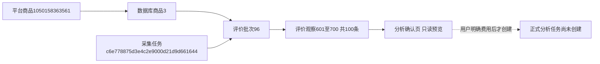
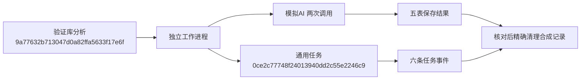

# 评价分析MySQL与入口实施记录

日期：2026-10-29。用户授权通用分析框架与评价首版及六项补充优化。本轮包括代码、两库迁移、文档、本地模拟和独立验证库验证，不启动正式付费分析或平台采集。

## 入口与结果

商品库→单商品→评价明细新增“分析评价”“查看分析记录”。确认页带入所选评价批次，可切换历史完整发布批次，显示实际条数、范围、模型、预计调用和预算，明确费用确认后才启动。每批最多10条，首版整批最多1000条；单条过长时阻止不截断。初评与追评一起理解、整体算一条，不同批次不混合，同文不同观察不自动删除。只发送编号、文字、规格和追评，不发昵称媒体链接。

Web与CLI共用modules/review_analysis/service；独立worker复用TaskEvents、tasks/task_events、本地流水和进程身份，使用分析独立锁与执行资源键，不获取浏览器资料锁。查看、刷新、导出、人工修订及重新统计都不调用AI。输入、模型、规则和输出参数相同默认复用，运行中不能重复启动，明确重新分析另建记录。

结果页展示已保存范围、逐条分类、引用、主题统计、发现和建议、调用记录和历史报告。主题依据可跳转原评价；未知同义名称保留原名、提示人工复核。可下载完整JSON及可读HTML。人工修改分类、主题、倾向或排除整条须提供原因及版本，原结果不变；追加修订历史和报告，移除可能过时的综合文字，旧文字仍保留旧版本。报告只标未复核或部分修正，不自动宣称全部审核通过。

## 五表与执行

0011_analysis/schema_v11在0010新增analysis_tasks、analysis_sources、analysis_calls、analysis_details、analysis_reports。当前31业务表、1版本表、373字段、64外键。旧迁移与模型冻结；全部原生中文备注、索引、唯一键、检查约束、RESTRICT外键和三份数据库文档同步。

快照保留来源批次和原评价关联，任务固定实际提示全文、主题映射、模型与规则版本。密钥只读本机私有配置，不进入任务、数据库或日志；子进程仅传应用配置文件引用。

每次请求先提交inflight记录，再联网；响应先落workspace/output/analysis_receipts/分析编号/调用编号.json，再事务保存响应、用量与整批校验分类。没有自动重试。格式、编号、截断或原文引用不通过则停止，保存原响应和已知用量。未知请求可能已计费，不按零费用处理。恢复前核对PID和创建时间，身份未知不重发；用户明确费用及未知请求风险后，先补写响应收据，跳过已有分类与报告，只处理缺少阶段。通用旧日志同样先补写，不重放网络请求。

每次预留提示UTF8字节数＋输出上限4096＋256请求开销，已有调用取保守预留与已知实际用量较大值，占用次数和token预算。未知请求也占预算，达到上限不发送下一次。预算不是人民币费用承诺；首版不追加预算，耗尽需明确另建分析。主题合并按保存词典，未知名称不强合并，综合报告拿到有界统计和部分已校验引文；引用存在不代表语义推断必然正确，仍需人工复核。

## 数据变化与实际来源

两库0010→0011，每库新增五表，原26表逐行内容哈希汇总与数量核对不变。迁移报告：workspace/output/reports/analysis_migration_20261029_155706.json。database check返回31业务表、32总表、373字段、64外键，所有备注存在，schema_errors为空。原聊天样例没有导入正式分析表。

正式只读预览商品1050158363561，库内商品3，评价批次96，原采集任务c6e778875d3e4c2e9000d21d9d661644，观察601～700共100条。预计10批分类＋1次报告。没有为该商品创建正式分析任务或新的AI请求。

平台编号用于平台定位，商品3是库内身份；采集任务是一轮执行，批次96是评价模块资料，观察编号定位原文。analysis_tasks.id是新的分析编号，execution_task_id是每轮后台运行的通用任务编号，不能混用。尚未发生的调用没有正式编号。

## 验证记录

- 全量570项unit通过。预算裕量调整后再次通过20项相关单元及1项真实MySQL专项。覆盖追评变化、原文校验、来源变更、复用、预算、未知请求确认、收据补写、人工修正及旧版本冲突、重统计无AI、后台进程参数不含密钥。
- 真实MySQL专项仅在_verify库回滚事务，AI模拟；活动任务唯一键、来源复合外键、原评价删除保护、分类及修订追加报告通过。最后合成分析dec5af10a7c2443c95a254dcfa9f0157已回滚，不是正式商品分析。
- 独立真实子进程验证：验证库合成分析9a77632b713047d0a82ffa5633f17e6f，通用执行0ce2c77748f24013940dd2c55e2246c9，模拟AI两次调用、六条通用事件，两任务均succeeded。为了跨进程可见短暂提交合成资料，核对后按真实ID依赖顺序精确清理。证据workspace/output/reports/analysis_worker_verify_20261029.json；无官方AI请求。
- 正式商品入口及确认页1440桌面/390手机通过，模型切换正常、费用未默认勾选。隔离SQLite结果页及人工修正报告1→2通过，未调用AI；JSON/HTML导出通过。截图workspace/logs/screenshots/review-analysis-*，手机表格局部滚动不扩宽整页。
- 两库五表目前均0；旧26表再次核对数量及内容哈希不变。最终快照workspace/output/reports/analysis_final_audit_20261029.json；独立子进程测试后再次核对见workspace/output/reports/analysis_final_audit_after_worker_20261029.json。

本地验证不等于人工验收。正式新流程的真实AI语义质量、耗时及计费待用户明确范围后启动。问大家、图片、多商品、自动触发、自动完整语义合并、人民币硬费用上限未实现。
