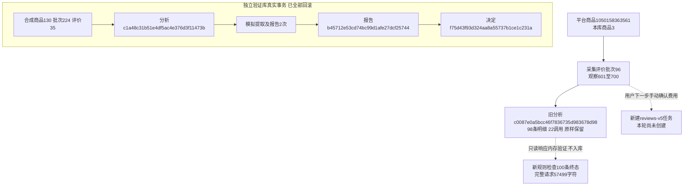

# 评价分析流水线修复记录

2026-10-30。本轮按用户最新要求只修程序，已生成的数据不恢复，真实付费复测由用户手动新建。新任务采用 reviews-v5 / reviews-validation-v5.1；旧任务、原返回、明细及报告保持原样。

## 问题与修改

只读参考任务为 c0087e0a5bcc46f7836735d983678d98，平台商品1050158363561、本库商品3、评价批次96、来源观察601～700。旧任务提取98/100，来源690/691分别出现2/3个同源片段，独立逐字引文可校验，但旧规则整条拒绝重复身份。已发11次提取及11次分段报告，真实用量290117 Tokens；尚无总报告调用。原完整总报告请求234759字符，旧分段汇总进一步膨胀到465811字符，超过程序60000边界；原因是重复附带全量统计索引、完整分段稿及原观点，阶段稿又没有独立展示。本轮没有新发这些请求。

- 新任务的各重复片段必须独立通过完整结构、原文引文及引用检查，才能归并。只重编e/o引用编号并保存映射；原文、观点及原响应不改写，不按语义挑选片段。
- 单条或局部无法可靠利用时保留问题及原文，明确本轮排除或局部保留，不自动付费重发。空白/笼统是已处理无具体信息。响应截断、根格式错误、网络未知及存储失败仍按执行故障处理。
- 报告实际发送采用有列名和枚举代码表的行数组，完整保留观点文字、引文、疑点、比较、关系、阶段信息。只去除重复结构键及服务端可查询的重复来源索引；统计保留数量，不当作独立买家数。实际prompt、完整后台校验视图分别落库。
- 全量紧凑请求能放入60000字符时直接总稿；否则最多原提取组分段及一次总稿。总稿仅带必要分段事实，不再次嵌套整个报告。生成汇总后再量实际完整请求，不能缩小或仍超限就停止，不自动加层、加预算或截断。
- 分段稿生成后立即追加本地报告版本，并可独立查看、复核和导出。segment:N:复核身份隔离同名f1/p1；采用阶段选品方向同样须核对依据、动作条件和淘汰范围。
- 页面分开列有效、局部保留、无具体信息、排除、执行未完成；本轮结束不宣称全部评价成功。整批没有具体观点时不凑方向，也不请求AI报告。

V1.2业务提示及输出契约不改；新输入格式声明随请求发送。旧V4执行分支保留，新任务版本及规则参与指纹，不能复用旧失败任务。本轮未执行任何旧任务恢复、继续、重新统计或人工决定。

## 验证

| 检查 | 本轮结果 |
|---|---|
| 全部单元 | 626项通过，含模拟故障日志，非真实异常 |
| 最终针对检查 | 35项通过，涵盖V4/V5及MySQL元数据 |
| 只读真实响应内存回放 | 100条形成终态：有效95、局部保留2、无具体信息3；690/691可安全归并；334个观点及221段引文全部逐字段往返核对；未写回旧任务 |
| 完整实际发送长度 | 234759降至57499字符，包含业务提示及输出契约，低于60000；不是只量输入JSON |
| 实际MySQL事务 | V3/V4/V5共3项通过，AI模拟，合成记录全部回滚 |
| 桌面1440/手机390 | 2份阶段稿可见、同名条目不串段、采用前声明强制、保存决定、费用默认未勾、HTML导出无表单、无横向溢出及JS错误 |
| 正式Web | 已核实路径后重启127.0.0.1:8000，仅本项目Web；新确认页/旧结果页HTTP200，未提交POST或AI调用 |
| 真实AI | 本轮新增0次、0 Tokens；没有验证新版模型实际语义表现，留待用户手动复测 |

浏览器插件因本机缺少browser-service.mjs而不能连接；页面改用项目已有Playwright隔离测试，全部请求仅本机临时服务。完整证据保存在Git忽略的workspace/output/reports/review_pipeline_fix/20261030/154737-eb28c264/，包括database-before/after、reference-task、replay、schemas-after、unit/focused-final日志、mysql-v4/v5、browser-v5及formal-http。离线回放只在内存检查，不连接数据库或AI。

## 数据库及原记录保护

新增0016_review_pipeline/schema_v16，仅更新rules、parameters、request、result、content的5条原生备注及技术版本号；无表列或外键增删。两库均已执行并检查schema_errors为空，仍32业务表、1技术表、385字段、66外键。0015及以前迁移、模型冻结。

两库32张业务表逐表按主键排序计算全行SHA256，修改前后数量和内容哈希完全相同；正式库累计22421行、验证库0行。单独读取旧任务的完整聚合并比较，完全相同。

| 正式库分析表 | 修改前 | 修改后 | 本轮业务增/改/删 |
|---|---:|---:|---|
| analysis_tasks | 3 | 3 | 0/0/0 |
| analysis_sources | 300 | 300 | 0/0/0 |
| analysis_calls | 24 | 24 | 0/0/0 |
| analysis_details | 288 | 288 | 0/0/0 |
| analysis_reports | 4 | 4 | 0/0/0 |
| analysis_review_decisions | 0 | 0 | 0/0/0 |

旧任务仍98条明细、22次调用、原报告不变。本轮没有把内存回放100条转换为正式分析记录；验证库事务回滚后也没有遗留合成业务行。字段取值的唯一维护入口为[取值说明](../数据库字段取值说明.md)，类型/备注见[完整字典](../数据库字段字典.md)，关联见[表关系](../数据库表关系说明.md)。

平台商品号用于定位淘宝商品；本库商品3是products主键；批次96表示一次评价采集，观察601～700是该批的明细主键。analysis_sources冻结这些来源；analysis_details经source_id关联来源、经call_id关联原调用；analysis_reports按analysis_id保存版本；analysis_review_decisions通过报告/分析复合外键保证归属。图中的验证编号为本轮真实合成事务编号，已回滚，不是正式商品记录。

## 用户复测入口

刷新评价明细，选择批次96，点击“分析评价”，核对发送内容后按需要确认费用并开始。将创建新规则任务；不要通过旧任务的恢复或继续按钮来验证新规则。旧记录继续查看。新AI结果的内容质量及用户业务验收仍待本次手动复测，不能用离线结构测试代替。
