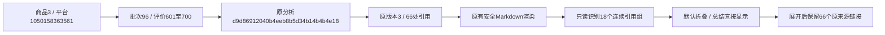

# 评价原文依据分组折叠

日期：2026-10-31。用户确认将正文连续引用按组默认折叠，总结和分析保持可见。本轮只调整V6安全HTML读模型和公共报告样式，原Markdown、AI响应、来源、检查、预算和数据库结构均不改；不执行真实AI请求或正式本地重查。

## 展示规则

每个顶层独立引用段落必须能明确识别编号、初评/追评标签、完整引号及已有来源链接，整段没有额外分析文字，才参加分组。相邻的独立引用合并为一个原生details，默认不带open，标题为“查看原文依据（N处引用）”，点击/键盘Enter展开，再次点击收起。遇到章节、分析段、列表、分隔线或其他内容就结束分组；不跨主题或吞入分析。嵌在分析中的引用、格式不明段落保留可见。引文是否匹配原文仍由已有检查判断，不以折叠资格假装质量通过。

明确紧邻引文前的段末“原文依据：”提示并入折叠标题，只处理该展示提示，不改分析文字或原稿。引用原HTML和来源链接原样保留，顶部待核对提示、目录、来源自动展开及历史/本地检查守卫继续使用原流程。分组由内容自动识别，不写死18组；V6今后报告和分组要点采用相同规则，V5及以前不改。

HTML下载同样使用原生折叠，无脚本也能展开；Markdown下载仍为原文，完整JSON中的持久报告/检查不改，既有派生html字段反映新展示。公共外观在form_controls.css中，模块样式及数据库无需变更。

## 当前真实报告只读核对

原分析d9d86912040b4eeb8b5d34b14b4b4e18、报告版本3，商品1050158363561/数据库身份3、批次96/评价601～700共100条。纯本地读取原稿后识别18组、66处引用；组大小依次8、5、5、5、4、5、4、4、2、2、5、3、2、3、2、3、2、2。所有66个来源链接及7章标题保留。原Markdown SHA256仍为0637e6777d5dbbb0bf1558b51742400491808b970fdf5ac9f805caadfd64e22d。

| 部分 | 折叠组数 | 引用次数 |
|---|---:|---:|
| 使用场景与需求 | 1 | 8 |
| 产品优点 | 5 | 24 |
| 产品缺点 | 5 | 17 |
| 用户痛点 | 4 | 10 |
| 改进与选品方向 | 3 | 7 |
| 合计 | 18 | 66 |

总体判断及采购拿样没有独立引用组。引用检查仍65处匹配、1处待核对（评价610）、有效来源33条，折叠不改这些含义。没有因本轮生成新的业务记录或改写原调用0b041c21062f422d8784d6cd049ca2aa。

## 验证和部署

35项相关单元通过，包含6项新增边界：连续合并、分析/标题/列表/分隔线边界、行内分析不隐藏、排版/实体/原链接保留、单独提示合并、目录和无脚本折叠。全量及桌面1440/手机390检查结果随本轮证据保存；浏览器验证默认关闭、鼠标/键盘展开收起、来源跳转、待核对、目录、检查/历史、HTML离线展开及原模型/输出弹窗回归。正式页面只GET核对，不代用户点击重查、恢复或付费按钮。

全量665项单元通过。原8000已重启，4项正式GET覆盖当前报告、旧版本、HTML下载及旧V5报告；真实页面两视口均确认18组默认关闭、首组8处引用，展开收起有效且无横向溢出。部署截图deployed-folded-1440/390.png和deployment.json留存。两库32表数量/逐行哈希及0018版本前后完全相同；没有业务新增/修改/删除。

本机证据目录workspace/output/reports/review_evidence_folding/20261031/093116，包含real-readonly.json、unit.log/unit-full.log、browser和browser-regression；database-before/after记录两库32表的数量及有序行SHA256。结构继续0018，无迁移/原生备注/字段或约束变化，业务记录前后相同；真实AI0。

部署后在原8000页面Ctrl+F5刷新即可。无需重新分析或重新检查，人工阅读效果待用户确认；“本地修正引用”仍暂缓。
