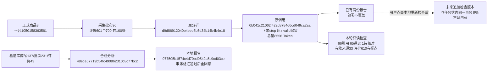

# 评价引用兼容与本地检查实施记录

用途：记录用户批准的格式兼容、生成/引用分离、问题对照及本地检查审计。日期：2026-10-31。适用reviews-v6；程序及隔离验证完成，真实报告人工复核待用户操作。本轮真实AI调用0，部署不自动更新既有任务。

## 原因和修复边界

真实任务 `d9d86912040b4eeb8b5d34b14b4b4e18`，平台商品1050158363561、数据库商品3、批次96全100条。原接口一次正常stop，输入4774、输出3782、总量8556 Token，输出上限8192，没有截断。七章齐全，但模型引用为 `【601｜初评】`，旧程序只识别 `【评价601｜初评】`，因此保存为partial/引用0；原调用 `0b041c21062f422d8784d6cd049ca2aa` 的旧invalid状态和错误不回填。

新本地规则 `reviews-local-check-v2` 支持有/无“评价”前缀、空格、竖线全半角、明确包裹编号/标签的Markdown排版及标签/引号间换行；不把数字中间的排版符号合并成另一编号，不补猜缺失编号、错误来源或追评序号。引号内容保持原样，必须在该初评/追评中逐字连续出现；不改词、标点、空格，不消除否定或拼接。原文自己含省略号且逐字对应时可以通过，不能只凭省略号认定拼接。

从已存返回只读复现：共66处引用，65处连续匹配、1处待核对，有效引用来源33条。待核对为评价610，AI引文“包装完好无损……服务周到，物流快速”未连续对应原文。程序不自动放行，也不为了它重新请求AI。这些计数只证明文字对应，不证明结论含义、材料性能、买家身份或采购方向已验证。

## 行为

- generation只判断正文是否正常完整返回、七章节是否齐全；完整稿available，截断interrupted，缺章节incomplete_sections，空稿empty，未生成not_generated，整批空白本地说明insufficient_information。
- validation只保存引用/比例等本地核对。引用缺失或不合格与正文状态独立，不能把完整稿当作需要付费补写。新成功任务仅表示正文完成，质量仍可needs_review。引用全部未通过也不会隐瞒质量疑点；原文、问题和待核对数量独立展示。
- 总览区分来源条数、提交尝试涉及数、引文次数、通过/待核对次数及有效引用评价数。重复引用同一评价不增买家数。格式不明的疑似引用单独计入unrecognized_count，不把无法识别当成已核实。
- 待核对卡片可展开AI引文、对应完整初评或追评、具体原因，并定位原评价；未知编号明确无对应来源。报告内两种引用格式均能跳转，模型原始文字和响应不改写。
- 正文完整时剩余请求为0；旧partial也不推荐付费继续，resume明确拒绝不必要的继续请求。整批重新生成仍须用户明确费用确认，不自动重试、补写或启动进程。
- 每份新报告保存inspection：规则版本、北京时间、检查来源、来源/响应哈希、本地重查所基于的前报告身份。每次明确重新检查追加一个报告版本，原始调用和历史报告不改写。
- 旧报告没有inspection时，GET只保留其当时保存的引用结果并说明“旧规则检查结果”；仅由原正文及相同已存响应派生正文生成提示，不偷偷运行新引用检查或改任务。历史版本无重新检查按钮，历史及导出按该版本数据展示。
- 用户在最新报告点击“重新检查已有报告（不调用AI）”后，检查当前已存返回；任务行锁内核对最新报告身份、来源和原调用快照，原子追加报告及更新终态。运行中、原进程存活/身份未知、过期页面或检查期间输入变化拒绝写入；失败回滚报告和状态，不留下半步更新。Web提交report_id防过期页面，CLI无页面时读取最新身份后使用同样事务保护。

没有修改AI提示词、发送计划、模型、预算、来源快照或成品指纹，已有相同成品无需因检查规则变化重新计费。V5及更早规则和展示分支保留。

## 数据库

新增有序迁移0018_report_checks及冻结schema_v18，仅更新analysis_tasks.status、analysis_calls.status、analysis_reports.content三条MySQL原生COMMENT，不改旧0017及以前模型/迁移，无表、列、索引或外键增删；仍32业务表、1技术表、385字段、66外键。检查记录复用analysis_reports.content，没有另建检查专属表。字段字典、取值、关系、使用指南同步更新。

本机证据目录 `workspace/output/reports/review_citation_checks/20261031/075223`，不提交Git。database-before/after及schemas-final为两库前后行数/有序行SHA256及实际备注/约束核对；目标任务target-before.json保留本轮读取时两份报告。正式目标未执行recount/recover/resume或重新生成，原任务、调用、快照、历史及32表业务行均保留。验证库样例在外层真实事务中全回滚，只有自动编号序列可能出现正常空洞。

| 表 | 正式库前后相同 | 验证库前后相同 | 业务新增/修改/删除 |
|---|---:|---:|---|
| tasks | 62 | 0 | 0 / 0 / 0 |
| products | 495 | 0 | 0 / 0 / 0 |
| collection_runs | 35 | 0 | 0 / 0 / 0 |
| collection_steps | 300 | 0 | 0 / 0 / 0 |
| collection_batches | 155 | 0 | 0 / 0 / 0 |
| product_current_sections | 107 | 0 | 0 / 0 / 0 |
| search_records | 37 | 0 | 0 / 0 / 0 |
| list_observations | 519 | 0 | 0 / 0 / 0 |
| sku_observations | 344 | 0 | 0 / 0 / 0 |
| parameter_observations | 118 | 0 | 0 / 0 / 0 |
| review_summaries | 10 | 0 | 0 / 0 / 0 |
| review_observations | 888 | 0 | 0 / 0 / 0 |
| question_observations | 200 | 0 | 0 / 0 / 0 |
| answer_observations | 1210 | 0 | 0 / 0 / 0 |
| file_assets | 1294 | 0 | 0 / 0 / 0 |
| media_references | 3078 | 0 | 0 / 0 / 0 |
| collection_checkpoints | 1515 | 0 | 0 / 0 / 0 |
| task_events | 11362 | 0 | 0 / 0 / 0 |
| product_info_observations | 20 | 0 | 0 / 0 / 0 |
| collection_plans | 10 | 0 | 0 / 0 / 0 |
| collection_plan_executions | 16 | 0 | 0 / 0 / 0 |
| collection_discarded_batches | 1 | 0 | 0 / 0 / 0 |
| collection_jobs | 36 | 0 | 0 / 0 / 0 |
| collection_queue_states | 1 | 0 | 0 / 0 / 0 |
| collection_job_controls | 6 | 0 | 0 / 0 / 0 |
| product_favorites | 1 | 0 | 0 / 0 / 0 |
| analysis_tasks | 6 | 0 | 0 / 0 / 0 |
| analysis_sources | 600 | 0 | 0 / 0 / 0 |
| analysis_calls | 29 | 0 | 0 / 0 / 0 |
| analysis_details | 306 | 0 | 0 / 0 / 0 |
| analysis_reports | 8 | 0 | 0 / 0 / 0 |
| analysis_review_decisions | 0 | 0 | 0 / 0 / 0 |

## 验证

- 全量659项单元通过，包含14项新增格式/状态/审计检查；有前缀与无前缀、空白、换行、Markdown、初追评、嵌套引号、非连续引用、错编号、无引用、截断、缺章节、按次数/来源分别统计、安全渲染、存活进程、输入/版本冲突及事务中途故障回滚均覆盖。
- 最终29项V6及引用针对检查通过，另覆盖空值/非文字异常返回的本地检查与安全显示；不把异常对象伪装成可读正文。
- 最终29项V6及引用针对检查通过，另覆盖空值/非文字异常返回的本地检查与安全显示；不把异常对象伪装成可读正文。
- 真实返回只读核对66/65/1/33及问题评价610，原Markdown SHA256为0637e6777d5dbbb0bf1558b51742400491808b970fdf5ac9f805caadfd64e22d。没有重新请求AI或将真实评价写入测试代码，提交的66处样例全部脱敏。
- 实际独立MySQL保存点/外层事务，合成任务 `48ece57719b54fc490862310c8c77bc2`，数据库商品137、批次231、原评价43、本地新报告 `977505b1574c4d70bd0542a5c9cd03ce`；模拟一次API，2处引用1处匹配/1处待核对，原旧检查/调用不改、本地重查与状态更新通过，随后全回滚。它们不是正式商品记录。
- 桌面1440/手机390实际点击旧版读取、本地检查、66/65/1/33总览、AI/原文对照、原文定位、历史只读、付费继续入口隐藏及安全导出通过；原模型切换/输出重规划/确认弹窗流程另做回归。真实AI0、正式写入0、外网请求0。
- 原127.0.0.1:8000已重启，6项部署GET核对当前报告、历史版本、HTML导出、新分析确认页、旧V5报告及脚本均200；仅GET，不代用户点击正式重查。正式目标任务、原调用/来源及两份旧报告完整快照相同。两库32表前后数量/全行哈希完全一致，版本行0017→0018及三条备注变化；实际32表/385字段/66外键和字典一致。

实线表示已存在或实际验证的链路，虚线是用户未来操作。源评价编号与analysis_sources自身UUID不同；检查次数不是API次数，报告版本不是新采集批次，记录写入不代表人工采用或实物验证通过。

## 用户操作

更新后Ctrl+F5打开当前报告，先保留旧版检查提示。点击一次“重新检查已有报告（不调用AI）”，应新增版本并显示“报告已生成；65处引用通过，1处待核对”，有效引用来源33条；展开问题评价610对照原文。其他旧任务不批量处理。人工判断报告是否适合选品仍待用户确认。
