# 评价报告正式Web与MySQL接入实施记录

日期：2026-10-30。用户确认七步接入方案并下达“可以，执行”。本轮完成正式代码、两库迁移、页面、离线/模拟验证与100条来源预览；**真实AI调用0次、实际新增Tokens 0，尚未进行新版100条模型质量、耗时及计费验收。** 原独立样例不自动灌入正式记录。

## 最终行为

- 评价明细保留“分析评价”和“查看分析记录”；当前已加载批次全部保存评价包含所有分页，不跟随未应用的下拉值或只分析当前页。弹窗默认不勾选费用，打开/关闭及查看历史不创建任务。
- 新任务reviews-v4，任务中冻结已批准V1.2提示及完整契约，生产模块不导入tests或读取docs。旧reviews-v1/v2/v3任务及原规则快照继续旧分支，旧0013及以前迁移/模型不改写。
- AI提取→程序逐条校验/统计→必要分段AI报告→总报告→程序局部检查/保存→用户复核。自述、外观、转述、期望与性能独立验证分开；局部疑点限制相关字段，格式错误不把整份有效报告丢掉。
- 状态分提取保存、AI报告生成、人工复核，待复核项不是未分析评价。程序从结构化来源生成资料说明，拒绝沿用模型自由文字错误编号；提及/正负面分别去重、各自可查原文，相同观点集合集中索引，不假称同义语义合并。
- 报告先核对报价、规格、起订量及补货条件，再看方向/验证安排。AI动作和反证仍是候选，不自动套用助手对独立样例的手工修订；采用前明确核对依据，方向还需确认问题对应动作/条件和淘汰范围，范围可为当前款/供应商/包装组合/产品方向。多个不同范围须在意见逐项说明，程序不冒充自然语言逻辑证明。
- pending/adopted/rejected逐项决定及意见追加保存。任务行锁检查当前报告、明细版本、候选/来源哈希与旧决定序号；历史/过期报告只读，并发旧页面拒绝写入。填写人是本机声明，不代表账户认证。
- 明细修正不改原文、原AI返回或原result；修正副本和本地报告另存版本，旧AI推断移除，不自动付费重写。历史报告使用该版本提取快照；新报告不自动继承旧决定。HTML/JSON及CLI导出不调用AI。

## 代码与存储

正式入口仍是service/worker，新增v4、v4_runtime、v4_view、冻结v4_contracts/v4_processing及打包prompts。analysis_store原事务继续复用，analysis_review_store负责新复核表。Web路由、模板及JS使用公共表单/搜索控件，页面CSS只维护布局。没有增加CLI复核子命令，原CLI预览、执行、状态、恢复和导出共用新业务分支。

0014_analysis_review新增analysis_review_decisions的12个非空字段，保留原五表；两个新外键均RESTRICT，其中(report_id,analysis_id)复合关联analysis_reports，父报告新增对应唯一约束。条目决定序号唯一、状态及正序号由CHECK限制。report调用允许正数分段或0总报告；旧任务仍0。0014更新6条原生备注。

0014执行后核对发现原rules字段备注仍只描述旧schema_version=1。遵守已执行迁移冻结规则，另增0015_analysis_comments补齐规则快照、调用用途、逐条/报告复核边界和报告JSON共4条备注，没有回改0014或业务内容。两库当前0015/schema_v15，32业务表、1迁移表、385字段（含版本字段）、66外键，最终schema_errors为空。

完整表/字段/JSON取值见[取值说明](../数据库字段取值说明.md)，原生备注、类型和约束见[字段字典](../数据库字段字典.md)，父子关系见[关系说明](../数据库表关系说明.md)。原始返回、提取、报告版本及人工决定分别保存，不将机器检查成功记成人工验收。

## 发送与预算

提取按输入与原子观点输出估算分组，不固定10条、不截断或抽样。当前完整单请求文字边界60000字符；提取预留最多12288、报告16384输出Tokens。为最坏每组一段加一次总报告预留槽位；若全部提取能完整放入直接请求总报告，未用槽位不调用。

分段报告均保留输入与原返回；总报告若基于分段发现筛选观点，明确展示所引/全部观点覆盖，原完整提取/全量统计继续保留。单条、分段或最后总报告仍超限时，保存已有统计、原文和阶段结果，明确停止，不静默截断、偷偷补请求、提高额度或切换模型。该边界不保证任意长文本都能一次生成总报告。

按UTF8字节、输出和余量保守预留，未知用量继续占额；已确认用量按实际释放。任务预览中的最大次数/Token不是实际消耗或人民币。重试、补处理、重新生成报告都需明确费用、计划及累计上限。

## 验证结果

- 全量617项单元通过，证据unit-final.log/json；最后补足调用完成事件后，33项新版/旧版针对性再次通过。覆盖完整/分段流程、过长本地停止、原响应保留、局部提取和推断隔离、预算未知、当前版本复核、明确声明/淘汰范围、并发旧序号、排除/修正、历史快照、CLI可序列化导出及旧任务兼容。
- 独立验证库两项真实MySQL事务验证通过，AI全部模拟，合成记录回滚。核对新旧流程、来源/候选绑定、复核版本冲突、复合归属外键、重复序号唯一约束、正数分段报告可写及负数被3819拒绝。首次测试只因MySQL将3819映射为OperationalError而非IntegrityError调整断言，实际约束生效；没有放宽约束。
- 新版真实事务合成任务29246902b08942b98e0e49bc38009c2d，对照任务2c5d0f8adb4142e6b1458e4e46e012e4；验证库商品126/平台合成编号231111375040813100、批次220、评价30，报告dd117b6e3a01405eb84918826fbe37c2、决定951ac287576c41339b27f8fc98957015。全部已回滚，不是正式付费或用户审核记录。
- 独立子进程最终探针：验证库合成分析a30c7ff1824c493fb161ab2f211f3a89，通用执行f84256b845574aa68ea920c8e60be69f，状态succeeded，模拟两次调用、六条通用事件（启动/两次请求起止/完成），真实客户端被封锁。为跨进程读取短暂提交合成资料，结束后仅按本次已记录主键依赖顺序精确清理；32表数量回到测试前，正式库未写。
- 隔离浏览器1440/390各验证结果、明确复核声明和保存、明细修正、历史版本只读、未勾费用确认页及HTML导出。8份截图，无整页横向溢出、脚本错误或外部请求；页面操作期间禁止创建AI客户端。
- 正式8000桌面/手机只做GET：商品明细打开新版弹窗、来源100条/批次96、费用未勾选、关闭正常；两个旧任务页面均200。浏览器禁止POST，真实新分析任务/调用/决定均0。原8000本项目Web隐藏重启，不停止采集进程；重启前核对两平台资源锁可获取、无分析任务运行。

独立试验的33份源文件/旧提示指纹保持不变，原样例及历史门禁不覆盖。上述检查不是新模型报告语义、实测性能或用户业务验收。

## 数据库前后与实际来源

正式源平台商品1050158363561，本库products.id=3；评价collection_batches.id=96，2026-10-26 10:11:58采集，review_observations.id=601～700共100条，达到采集上限，不能说平台全部评价。查看/预览使用这些已保存来源，不重新采集。

| 正式库累计 | 前 | 后 | 新增/修改/删除业务行 |
|---|---:|---:|---|
| products | 495 | 495 | 0/0/0 |
| collection_batches | 155 | 155 | 0/0/0 |
| review_observations | 888 | 888 | 0/0/0 |
| analysis_tasks | 2 | 2 | 0/0/0 |
| analysis_sources | 200 | 200 | 0/0/0 |
| analysis_calls | 2 | 2 | 0/0/0 |
| analysis_details | 190 | 190 | 0/0/0 |
| analysis_reports | 3 | 3 | 0/0/0 |
| 原31业务表合计 | 22152 | 22152 | 0/0/0 |
| analysis_review_decisions | 表不存在 | 0 | 只新增结构，业务0 |

原31表逐表数量及有序内容SHA256一致，新增表空；验证库32表最终全部0。真实事务回滚/探针精确清理后允许出现自增号间隙，不把合成编号当正式记录。结构版本由0013经0014到0015，新增12字段、2外键及关联/检查约束，原生备注按迁移更新；没有业务字段值更改。

旧正式任务0c327dafcdee4fd8945d4f7eca9584d1（reviews-v2）仍93条、2份报告；aeb7fe644284493eab6b6904f725d1e1（reviews-v3）仍97条、1份报告，没有补请求或自动升级。

## 100条真实付费验收预览（尚未执行）

| 项目 | 当前预览 |
|---|---|
| 商品/批次/记录 | 1050158363561 / 96 / 全100条，包含所有分页 |
| 提取分组条数 | 9、9、8、8、10、9、10、10、10、10、7，共11组 |
| 报告槽位 | 最多12次：可完整纳入时只生成总报告，否则最多11段+1总报告 |
| 最大总请求 | 23次；不意味着一定会发送23次 |
| 最低/推荐预留 | 3373286 / 3710615 Tokens；不是实际消耗或人民币费用 |
| 当前操作 | 只读GET/CLI preview，没有创建新版正式任务，无新服务商response_id |

完整发送文字、规则及预算保存在本机batch96-preview.json，可在正式弹窗“查看发送内容”核对。下一步只有用户明确确认本次100条范围、次数与费用上限后，才进行真实模型验收；本记录不自动授权。

```mermaid
flowchart TD
 subgraph 正式库只读
 P[平台1050158363561<br/>本库商品3] --> B[评价批次96 观察601至700]
 B --> V[新版确认弹窗 全100条<br/>11组提取 最大23次预留]
 V -.未勾费用 未执行.-> N[尚无新版正式分析或调用编号]
 end
 subgraph 验证库真实事务 已回滚
 S[合成商品126 批次220 评价30] --> T[分析29246902b08942b98e0e49bc38009c2d]
 T --> C[模拟提取及报告 共2次]
 C --> R[报告dd117b6e3a01405eb84918826fbe37c2]
 R --> D[复核951ac287576c41339b27f8fc98957015]
 D --> X[版本冲突及复合外键核对<br/>全部回滚]
 end
 subgraph 独立后台验证 已精确清理
 A[合成分析a30c7ff1824c493fb161ab2f211f3a89] --> W[真实子进程 强制模拟AI]
 W --> E[通用执行f84256b845574aa68ea920c8e60be69f<br/>6条事件 2次模拟调用]
 E --> Z[验证成功 按本次主键清理]
 end
```

## 本机证据及查看

证据根目录workspace/output/reports/reviews_v4_delivery/20261030/132254-df56cf49/：database-before/after.json、delivery-summary.json、两库最终schema、frozen-hashes、unit-final、mysql-v4-transaction、worker-probe-final、browser及formal-browser、batch96-preview和Web日志。真实来源、配置副本及业务报告保存在Git忽略的workspace，不提交凭据或数据。

正式入口：http://127.0.0.1:8000/collections/products/1050158363561?module=reviews&reviews_batch=96 。本轮没有新的正式报告地址；旧分析记录及本地样例继续可查。常用CMD和无费用预览见[使用指南](../使用指南.md)，完整参数见[命令参考](../操作参考/命令参考.md)。代码及文档本地提交，不自动推送。
