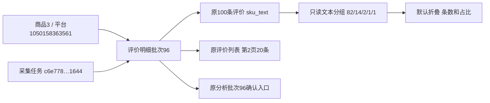

# 评价明细排版与SKU分布

日期：2026-10-31。用户批准明细顶部版式与默认折叠的本批SKU分布一起实施，以SKU分类、评价条数为主，保留两个日志入口和原分析行为。

## 结果与统计口径

明细按标题/单一采集状态、批次查看与原日志、时间及已保存条数/范围、默认关闭的SKU分布、浅色分析操作区、本批报告/进度提示、原评价表排列。完成状态不再重复展示，未完整/异常仍保留原说明；日志各自关联当前概览及明细，未去重。使用公共折叠/表格/按钮组件，紧凑折叠和分布表外观集中在form_controls，页面CSS仅布局和宽度，手机长规格换行，320px批次控件换行避免挤压。

以所选已发布批次的全部review_observations行为分母，每行一次；SKU来自评价保存的sku_text，不猜真实平台SKU编码。仅去除首尾空白，大小写、全半角、内部空格和其他文本差异保持；不同商品/批次不混合。NULL、空字符串和纯空白单列未记录规格，分母包含这些行；追评、套装内件数和购买数量不增加条数，不按买家或评价内容去重。数量降序，数量相同按规格文本稳定排序，缺失在同量时最后。

占比用Decimal按组条数/全批条数计算，1位四舍五入；正值舍入为0时显示<0.1%，空批次明确暂无评价可统计，未记录规格全部缺失时为100.0%。展示全部规格，长列表在自身区域滚动，不折成“其他”，不新增点击筛选。统计是样本分布，不能作为销量、订单、购买件数或独立买家占比。翻页和排序不变；换批次点击查看后重算并收起，下拉未应用不改变统计和分析范围。

## 实现与数据边界

collection_queries.records增加默认关闭的with_sku_counts参数，仅评价类型可用。核对批次发布/模块后，在同一读事务内只读取完整sku_text列并按原字符串计数，不读取整批长评/媒体/追评，也不在MySQL按可能忽略大小写的排序规则分组；原分页数据及所有其他调用默认行为不变。review_view派生只读分布及占比，最终分布不写库、不存缓存。已有原规格、记录、任务、来源、报告、预算和AI提示均不改，无新增表列/索引/迁移，仍0018_report_checks。

分析入口固定已查看批次全量评价，原模型/预算/费用确认和重复任务守卫不改；本批结果读取原summary接口，文案和入口集中排列，无额外付费动作。浏览和折叠不调用AI、不启动采集。

## 验证

44项相关单元、679项全量单元通过（全量107.304秒）。新增4项业务/查询回归覆盖整批25条与跨页排序稳定、另一批次排除、缺失/追评/精度、仅去首尾空白且大小写/全半角不合并、缺失不等于真实文本“未记录规格”、空批次/错误模块拒绝、长尾比例及HTML转义/原值不改。原商品评价6项隔离浏览器回归通过，新增分布表后将原评论定位收窄至review-comment-table，继续验证概览、历史、全文媒体、分页排序及采集异常提示。

新增tests/browser_review_detail.py在1440/390/320三个视口使用真实模块和临时SQLite/模拟报告，核对默认收起、鼠标/键盘、25条分成15/8/2、占比60/32/8、整批与5条第2页一致、排序后不变、下拉未应用仍保持原范围、换批变1条并收起、已有报告保留和原分析弹窗绑定新批次。查看时AI客户端/派发被强制阻断，浏览请求仅本机GET；报告、调用及来源前后完全相同。最终布局截图已查看。

## 实际来源与部署

商品平台编号1050158363561、数据库商品身份3，评价明细批次96，来源任务c6e778875d3e4c2e9000d21d9d661644；概览95及明细96的两个日志继续保留。当前已保存100条评价，5个规格文本组、缺失0条：

| 规格原文 | 条数 | 占比 |
|---|---:|---:|
| 1卷替换纸 / 1卷 | 82 | 82.0% |
| 1卷替换纸1卷 | 14 | 14.0% |
| 1卷替换纸+1个手柄 / 1卷 | 2 | 2.0% |
| 1卷替换纸+1个手柄 | 1 | 1.0% |
| 2卷替换纸 / 1卷 | 1 | 1.0% |

相似文字未自行合并。实际三视口只GET验证，第2页20条、后续翻页/规格排序都保持上述整批100条分布；换回最近资料恢复折叠，分析弹窗仍批次96且费用未勾选，未点击开始分析。远程评价媒体在验收时拦截，未访问平台。679全量后的最终紧凑样式又经44相关单元及三视口交互复核，实际截图已查看。

Web仍127.0.0.1:8000，当前启动器33076、监听29784，仅重启确认归属的项目Web，未停止采集。两库各32业务表数量及有序行SHA256前后一致、0018不变，正式新增/修改/删除记录0，真实AI/采集0。证据目录workspace/output/reports/review_detail_layout/20261031，包括unit-full.log、unit-related.log、browser/browser.json、browser-regression.log、real-distribution.json、deployment.json、deployed-closed/open截图、before/after.json及web_restart.json。

Ctrl+F5刷新原商品评价页即可。代码验证完成，用户人工样式与统计体验待确认。

