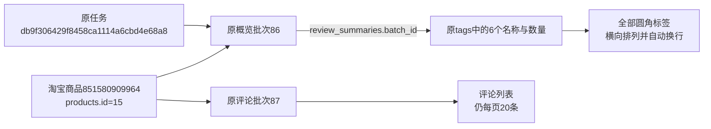

# 评价标签圆角展示

2026-10-26，用户明确执行参考图二的评价标签样式：浅橙色圆角、横向排列、自动换行、全部展示。

评价概览的四项信息继续保留。标签按原采集顺序展示名称和数量，不提供表格、序号、排序表头、分页或点击筛选。后端同时移除标签数量截断，超过20个也全部展示；旧tag_page、tag_sort、tag_order参数不再限制资料，并从后续翻页链接和资料选择表单清除。保留100+、0等数量原文，缺失数量仍显示未记录，不改数据库值。

下方评价明细继续每页20条，排序、历史资料选择、媒体预览及单模块采集流程不变。使用命令和示例地址见使用指南，无需数据库升级或重新采集。

## 验证

- 33项相关单元检查通过，包括25个标签全部返回、旧标签参数兼容、0与100+、HTML转义、资料边界和评论分页等。
- 4项评价浏览器检查通过，包括25个标签自动换行、窄屏无越界、没有标签分页或可点击筛选、评论排序分页、历史资料选择、图片预览和人工弹窗。
- 真实商品851580909964（products.id=15），原任务db9f306429f8458ca1114a6cbd4e68a8，概览批次86的6个标签全部显示：使用体验很好22、商家服务好5、便利使用4、粘性很好2、可以下单1、能伸缩1。标签名称和数量逐项与原记录一致。
- 使用旧tag_page=999链接仍显示全部6个标签；评论批次87下一页仍20条，后续链接不再带标签页码与排序参数。

平台编号识别淘宝商品，内部商品编号用于本库关联；任务是原采集执行；批次是相应模块一次保存结果；tags为该概览的已保存标签。本轮只读取这些资料，不创建任务、批次、评论或文件资产。

数据库结构及字段含义未改变，业务数据新增0、修改0、删除0，19张业务表数量前后一致。概览原行完整快照SHA256前后均为ce03c9dd7deea8fcb040821600eaa663ea1acc46f81262e86c1a93521e055a59。

证据位于workspace/output/reports：review_tags_unit_20261026.log、review_tags_browser_20261026.log、review_tags_live_20261026.json及review_tags_preview_20261026.png。没有重启用户原Web进程，重启并刷新后供用户查看确认。
