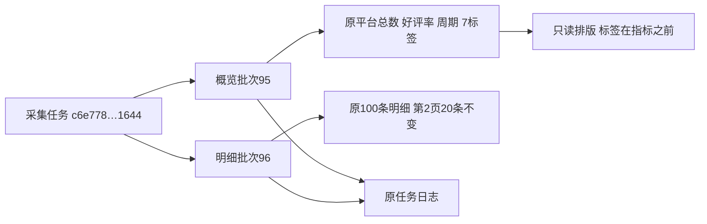

# 评价概览版式整理

日期：2026-10-31。用户批准按文字示意美化概览，并明确评价标签在平台评价总数/好评率之前；此前已决定两个日志入口不合并，本轮保留该决定。

## 版式与状态

概览按标题/单一状态、批次查看与原采集日志、批次和采集时间、全部标签、两张平台指标卡排列。删除原四列表格的展示形式，所有信息仍保留：平台评价总数保留原文，好评率及统计周期使用原保存值，时间移至元信息，不把样本数当平台总量。标签顺序和数量不变，名称/计数区分字重及浅底，全部自动换行，不新增筛选或折叠。

新增公共ui-review-tags和ui-summary-metric，外观集中在form_controls.css；app.css只负责排列、尺寸、间距和换行，移除原概览表格和标签专用外观。大屏操作左右对齐，小屏自动分行，两张指标卡在360px及以下变为单列。评价明细区域、独立批次/页码/排序、全文/媒体、分析入口和弹窗不改。

概览复用原module-job-status作为唯一动态状态，只在done、valid、state=succeeded且原stateLabel确为“采集完成”时压缩成功文字；缺少入库确认、模块错误、跳过或暂停时均保留原完整文字。其他模块不带此展示标记，行为不变。初始未完成资料仍保留scope及历史来源警告，无概览及确认无评价分别显示，不伪造0或成功。本轮不改变采集完成、入库、任务执行或数据库判定。

## 兼容与验证

31项相关单元通过，675项全量单元通过（111.911秒）。原商品评价隔离浏览器4项更新指标定位，并新增布局及状态两项，共6项最终通过（19.401秒）：25个标签全部显示，原数量/精度、历史缺省字段、明细分页排序、长文展开、初追评媒体、图片预览、原单模块模拟采集和人工提示仍正常。

新增验证覆盖1440/768/390/320屏宽，标签在指标上方、两个日志均保留、窄屏单列及容器无溢出。动态状态覆盖确认成功、成功但未确认、等待入库、失败、暂停，以及结束但存在模块错误/跳过/暂停，异常原文字不被覆盖为普通成功；纯临时库及模拟接口，不访问真实平台。截图已查看。

## 实际数据只读核对

商品平台编号1050158363561，数据库商品身份3；概览批次95采集于2026-10-26 10:05:43，保留7个标签、平台总数10万+、好评率99.6%及近3个月周期；明细批次96保留100条来源，当前查看第2页20条。两批次均关联采集任务c6e778875d3e4c2e9000d21d9d661644，因此两个日志入口仍可打开同一任务，未合并或改写归属。

实际1440/390/320页面仅放行本机GET，远程评价媒体主动拦截，不访问平台。读取任务状态后的成功提示一处，重复采集按钮按原规则隐藏，日志仍可用；切换概览为最近资料后，明细仍为批次96第2页且原20条编号不变。平台指标和标签全部原样，两库各32业务表数量及有序行SHA256前后相同，版本0018_report_checks不变，业务新增/修改/删除0，真实采集与AI调用0。

仅重启核对属于项目的原8000监听33516，本次启动器26564、监听24780；地址仍127.0.0.1:8000，未停止采集任务。证据目录workspace/output/reports/review_overview_layout/20261031，包括unit-full.log、browser.log、四种屏宽的隔离截图、deployed-overview-1440/390/320.png、deployment.json、before/after.json及web_restart.json。数据库结构、原生备注、JSON、原始来源和AI提示/报告/用量均不变，无迁移或历史维护。

Ctrl+F5刷新原商品评价页即可，原明细及报告继续使用。代码和页面验证已完成，用户人工样式确认待后续反馈。

