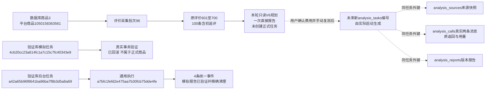

# 评价直接报告重构实施记录

用途：记录用户批准的新评价分析流程、数据库含义及本轮验证。2026-10-30批准实施，10-31完成收尾。适用新任务 `reviews-v6`；程序验证完成，真实AI报告质量和人工验收待用户复测。本轮真实AI调用为0。

## 新流程

从MySQL读取当前列表所选批次的全部评价，不因页面分页漏资料。固定来源快照后，仅发送商品标题、评价编号、初评正文、非空规格和非空追评；追评保留原序号，文字不改写。昵称、媒体地址、采集时间、内部商品身份及空字段不作为独立字段发送。正文自带的信息仍属于原文，不承诺自动删除。没有另生成评价输入文件，也不把数据库文件上传给AI。

默认一次请求，实际消息为一条 `system` 主报告要求和一条 `user` 紧凑JSON资料。接口返回可读Markdown，取消新流程的逐条分类JSON、主题资格阻断和分类后重复汇总。详细报告包含总体判断、使用场景与需求、产品优点、产品缺点、用户痛点、改进与选品方向、采购与拿样清单。事实、推测、行动分开；优先现成款，其次包装配件组合，后续才定制；没有证据的部分说明资料不足。

引用采用 `【评价601｜初评】原文：“连续原文”`，追评为 `追评1` 等。程序核对来源、连续原文和必要章节，不声称验证了语义、材料、实物性能、市场需求或利润。来源数、提交尝试涉及数和有效引用来源数分别展示；提交过不等于每条均获语义验证。规格分布及带追评数量在本地统计，不让模型编造主题次数或比例。

## 容量与用量

先核对选定模型的实际能力，再计算完整消息输入估算、报告最大输出和安全余量。能容纳则一次直接报告；确实超限才按完整评价分组，每组一次简短发现，最后一次总报告，即N+1次。单条过长才按语句/段落分片，同一原编号、初追评身份及位置保留，少量重叠且全文覆盖。分片不是额外买家。

分组前已预留全部归纳和最终汇总的容量及用量；汇总也容不下时，在任何付费请求前拒绝计划，不截断、不偷偷增加层级。汇总使用各组发现和必要原文引文，不再次塞入全量原始评价；实际发送前再检查真实汇总大小。分组可能丢失细节，阶段稿及全部原文仍可查看，未引用不等于不存在。

默认总报告输出8192 Token，分组要点2048 Token；输出上限不是实际消耗。模型/报告输出变化时先在本地重新规划，计划有效后才启用提交，提交时再次检查计划哈希、来源及背景。用量不足在调用前拒绝，不自动加额度；已完整确认的用量按实际占用，未知调用保留原预留。无自动付费重试、续写、修复或模型切换。继续需明确确认剩余计划及费用，未知调用额外确认重复计费风险。

新流程移除旧1000条及60000字符业务门槛。仍有独立保护：请求16MiB、响应4MiB、单任务最多200次和500万Token、每次等待30～600秒；这些是应用保护，不能说成DeepSeek上下文限制。官方当前1M上下文保守按1000000 Token，最大输出393216，普通非思考模式；依据为[官方模型与价格](https://api-docs.deepseek.com/quick_start/pricing/)，核对日期2026-10-30。页面按核对时的高峰未命中缓存USD单价和预留估算，实际账单以服务商为准，不换算人民币、不承诺精确上界。

本机安装 `tokenizers` 和 `Markdown`，依赖已登记。可选本地分词数据来自[官方用量说明](https://api-docs.deepseek.com/quick_start/token_usage/)链接的[官方V4压缩包](https://cdn.deepseek.com/api-docs/deepseek_v4_tokenizer.zip)。仅取其中 `tokenizer.json` 数据，不执行压缩包附带代码；本机路径 `workspace/models/deepseek-v4/tokenizer.json`，不提交Git。SHA256必须为 `89085f12ef79460ac5f66d1119325ddfc694b4ab209d80bbd81d35f081dc9614` 才启用。对3份历史请求的只读对照，本地计数均比当时API少28，故保留消息开销及至少2048/10%余量，标为估算。文件缺失、校验不符或模型族不符时退回UTF8字节保守估算加20%余量，不自动下载，不将旧分词配置的16384当模型容量。

## 保存和兼容

沿用通用分析表，没有新建每种报告专属表。`analysis_tasks` 保存模型、主报告/分组提示、完整发送计划、能力及估算工具快照、预算；`analysis_sources` 固定原文；`analysis_calls.request.messages` 保存真实消息，原返回、结束原因和用量保存到调用；`analysis_reports` 追加Markdown、检查、来源口径及阶段发现。收据仍先落本机再事务入库，可本地补写；结果页、历史、导出、本地检查不调用AI。新流程不写逐条 `analysis_details`，`processed_count`保持0，页面不用它冒充分析通过条数。

同资料、标题、规则、服务商、模型和报告输出上限识别成品；价格、容量、预算、分词器版本、超时不改变成品身份。活动任务防重复；已有终态记录明确选择查看、从头另建或继续。成功报告优先于后来的失败任务。从头另建全量计费；继续只复用消息完全相同、完整保存的阶段。旧任务、旧规则、旧原响应及报告全部保留，不恢复、不转换、不覆盖。V4/V5测试明确使用原预览入口，不能被新默认流程悄悄替换。

返回中断、缺必要章节或无有效原文引用时，保存可读部分并标记未完成，不缓存成完整报告、不自动再次计费；部分引文不合格但有有效引用且目录齐全时，报告可阅读，疑点明确列出。全批文字空白时仅保存本地资料不足说明，0次AI。显示Markdown前过滤HTML、图片及外部地址，仅允许本页来源链接；可下载Markdown、可读HTML、完整JSON及依据，历次版本独立保存。

新Markdown报告没有旧结构化逐项“采用/不采用”表单，`review_status=unreviewed`；人工核对通过不能由程序代填。旧V4/V5复核入口继续按旧规则使用。

## 数据库实际变化

两库均由0016升级为已冻结的 `0017_direct_review_report/schema_v17`。仅8个字段的MySQL原生COMMENT变化：任务rules/parameters/fingerprint/processed_count，调用kind/request/usage，报告content。没有表列、索引、约束或外键增删。仍32业务表、1版本表、385字段、66外键；两库实际备注/结构核对无差异。更新前后32张业务表数量及逐行有序SHA256完全相同，业务新增/修改/删除均0；技术版本行从0016变0017，8条备注变化。验证事务内合成样例全部回滚，子进程探针样例按本轮主键精确清理。

本机证据目录：`workspace/output/reports/review_direct_v6/20261030/194828`，不随Git分发。`database-before.json`、`database-after.json`、`database-comparison.json`及`schemas-final.json`为完整前后记录。以下全表数量是正式库本轮前后相同值，验证库32表前后均0：

| 表 | 正式库前后相同数量 | 验证库前后相同数量 | 业务新增/修改/删除 |
|---|---:|---:|---|
| tasks | 61 | 0 | 0 / 0 / 0 |
| products | 495 | 0 | 0 / 0 / 0 |
| collection_runs | 35 | 0 | 0 / 0 / 0 |
| collection_steps | 300 | 0 | 0 / 0 / 0 |
| collection_batches | 155 | 0 | 0 / 0 / 0 |
| product_current_sections | 107 | 0 | 0 / 0 / 0 |
| search_records | 37 | 0 | 0 / 0 / 0 |
| list_observations | 519 | 0 | 0 / 0 / 0 |
| sku_observations | 344 | 0 | 0 / 0 / 0 |
| parameter_observations | 118 | 0 | 0 / 0 / 0 |
| review_summaries | 10 | 0 | 0 / 0 / 0 |
| review_observations | 888 | 0 | 0 / 0 / 0 |
| question_observations | 200 | 0 | 0 / 0 / 0 |
| answer_observations | 1210 | 0 | 0 / 0 / 0 |
| file_assets | 1294 | 0 | 0 / 0 / 0 |
| media_references | 3078 | 0 | 0 / 0 / 0 |
| collection_checkpoints | 1515 | 0 | 0 / 0 / 0 |
| task_events | 11358 | 0 | 0 / 0 / 0 |
| product_info_observations | 20 | 0 | 0 / 0 / 0 |
| collection_plans | 10 | 0 | 0 / 0 / 0 |
| collection_plan_executions | 16 | 0 | 0 / 0 / 0 |
| collection_discarded_batches | 1 | 0 | 0 / 0 / 0 |
| collection_jobs | 36 | 0 | 0 / 0 / 0 |
| collection_queue_states | 1 | 0 | 0 / 0 / 0 |
| collection_job_controls | 6 | 0 | 0 / 0 / 0 |
| product_favorites | 1 | 0 | 0 / 0 / 0 |
| analysis_tasks | 5 | 0 | 0 / 0 / 0 |
| analysis_sources | 500 | 0 | 0 / 0 / 0 |
| analysis_calls | 28 | 0 | 0 / 0 / 0 |
| analysis_details | 306 | 0 | 0 / 0 / 0 |
| analysis_reports | 6 | 0 | 0 / 0 / 0 |
| analysis_review_decisions | 0 | 0 | 0 / 0 / 0 |

## 本轮验证与真实编号

- 全量645项单元通过；覆盖一次直接报告、1002条不截断、单条全文分片、最终汇总超容预拒绝、模型/输出重规划、预算及未知用量、真实消息保存、缓存、空白追评、空白整批、截断/缺章节、无付费重试、安全渲染、旧版本兼容。
- 独立MySQL真实事务，模拟一次API，验证真实消息、原响应、报告、语义缓存、0条假分类及本地新版本；外层回滚。最终任务 `4cb20cc23a614fc1a7c15c7fc40343e9`，其他实际主键见 `mysql-v6-final.json`，不是正式商品数据。
- 独立验证库实际后台子进程，任务 `a42a65b96f8641ba96ba7f8b3d5a8a69`，执行 `a7bfc1fefd2e475aa7b30fcb75dde4fe`，商品135、批次229，1次模拟API、1份报告、4条事件；精确清理后全表数量复原。
- 桌面1440与手机390隔离浏览器验证报告、原文跳转、历史、下载、模型/输出重规划、错误禁用、选定模型提交及未勾选计费默认；外网请求0、真实AI0、正式写入0。模块入口为 `python -m tests.browser_review_v6`，文件直接运行不提供项目tests包路径。
- 正式批次只读预览：平台商品1050158363561，对应数据库商品3，批次96、评价601～700共100条；全部初追评文字核对保留，预计1次请求，输入4961、输出上限8192、余量2048，最低预留15201、推荐15962 Token。估算0.011933 USD，非真实费用。没有创建新正式任务。
- 最终补查27项V5/V6回归通过（其中15项V6），确认本地重新检查保留报告原文且提示准确；依赖检查无冲突。原127.0.0.1:8000已重启，8项部署HTTP核对覆盖商品、新确认页、两模型/输出计划、错误JSON、两旧报告及脚本；仅GET，无真实AI。部署后两库32业务表再次逐行哈希核对不变，字段字典与0017模型完全一致、文档链接有效；见deployment-http.json、database-deployed.json及final-audit.json。

实线为本轮已存在或已实际验证的关系；虚线为用户未来复测路径，不把未发生的正式写入冒充结果。评价原编号是review_observations主键；未来来源表自身UUID与原编号不同。采集批次表示一次来源范围，分析任务表示一次独立分析，报告版本隶属该分析；截图和下载文件只作本机证据，无新增外键。

## 用户复测

重启原8000服务后按Ctrl+F5，进入该商品评价明细，选批次96并查看，点击“分析评价”，核对100条、预计1次、模型及8192输出上限。确认发送及费用后手动开始。本轮不代执行真实API，也不点击旧任务恢复或继续。真实报告是否符合选品要求、实际费用及长报告完整性仍须此次复测确认；程序测试不能替代模型语义验收。
