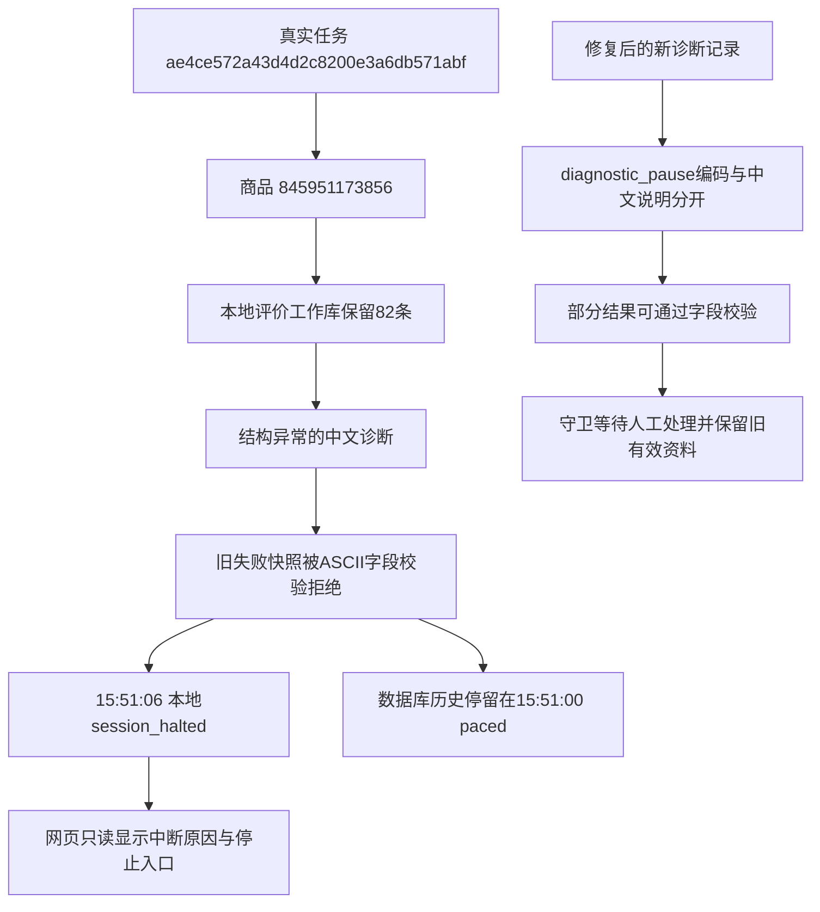

# 诊断暂停入库与网页中断提示修复

2026-10-26，按用户批准的修复方案实施。问题为评价结构异常后的诊断保存失败，以及网页把最后一条历史间隔日志留作看似仍在等待的提示。

## 实际故障证据

任务`ae4ce572a43d4d2c8200e3a6db571abf`的15:51:00滚动间隔为2.346秒，所用配置scroll为1.5～3秒。商品`845951173856`在本地评价批次`ae4ce572a43d4d2c8200e3a6db571abf-12b21ab4`已留82条评价，但遇到“评价含未识别内容结构”。该中文原因被写入要求ASCII的collection_batches.stop_reason，导致字段校验失败。

15:51:06产生session_halted，业务已经退出而浏览器仍保留现场。后续事件在本地流水内，未越过失败的采集快照；数据库已保存日志的末条仍为15:51:00 paced，tasks仍为running。以上是修复前只读查询及本地记录的真实快照，82条表示本地工作记录，不表示82条均已入库或本轮采集完整。

## 修复规则

1. 新评价、问答诊断记录使用stop_reason=diagnostic_pause，中文说明另存stop_reason_message；问答回答失去完整性时同样使用answer_stop_reason=diagnostic_pause和answer_stop_reason_message，重新确认完整后清除旧诊断说明。
2. 生成新快照和写入旧快照时，兼容旧来源的诊断文本：仅对collection_batches.stop_reason与question_observations.answer_stop_reason转换为diagnostic_pause，元数据和原文件保留来源。既有英文编码及NULL保留；其他ASCII代码列继续严格校验。旧快照文件、事件键、指纹和校验值不修改；后续既有补写流程可用该转换，避免新任务启动时又被同一坏诊断阻断。本轮没有实际补写或重放真实任务。
3. 新中断在本地控制状态写halted=true、prompt_id=null、allowed=[]及脱敏原因。网页仅对PID、启动时间、数据库和浏览器资源匹配的活动任务读取状态。
4. 兼容当前旧进程：只读同任务同库未入库流水末尾最多128KiB，识别session_halted及storage_wait/storage_resumed。确认位置和流水均不改动，不将本地提示当作成功入库证据。无法安全读取时显示待核实，不假定业务已经退出。
5. 采集任务栏及最近任务显示中断原因，仅提供停止入口；接口与命令行控制也拒绝用过期继续/确认恢复已退出业务。日志页另列本机任务提示，原有数据库历史、分页及筛选保持原口径。网页任务退出后，核实原进程确已退出、同库同资源且有未入库task_finished时，继续显示“任务已结束，结果待入库”，不回退为看似仍在等待。

业务结构异常仍须人工处理，不转为自动跳过。diagnostic_pause仍是partial/incomplete，不能覆盖旧的有效分区。滚动等待配置未变，修复不增加自动重试。

不新增表、列或迁移，不变更原生字段约束。代码和JSON取值已同步[字段取值说明](../数据库字段取值说明.md)，操作见[使用指南](../使用指南.md)。

## 验证与现场保留

本地验证仅使用临时数据、模拟依赖和拦截全部请求的页面；不访问真实淘宝，不控制用户的采集进程。覆盖中文和英文诊断、长诊断、既有编码、ASCII约束、原件保留、已采评价保留、旧有效结果保留、人工提示、断库等待、过期反馈、归属过滤、流水确认位置和网页展示。

421项全量单元回归通过；最后补充停止后的待入库提示，与受影响组共59项检查通过，记录在`workspace/diagnostic-stop-ended-status.log`。评价、问答及网页的116项隔离浏览器回归通过；旧快照兼容调整后，评价诊断、问答异常、多模块中断与未入库中断显示4项关键路径再次通过，记录在`workspace/diagnostic-stop-browser-final.log`。未使用旧结果替代本轮验证。

Web仍为http://127.0.0.1:8000。第一次只读网页核对时，原任务API为needs_attention、halted=true、done=false、prompt=null，日志页显示原入库错误。该次核对前后原事件流水、ack确认文件和失败快照的SHA-256均未变化，采集进程748及启动时间保留。后续17:02:57原日志出现stopped，17:02:58网页派发结束为needs_attention、done=true，说明实际cancelled而结果待入库；此后页面按停止后的真实状态展示。本轮助手没有向该任务发送停止、继续、重采或补写指令。

另对原失败快照执行离线字段校验：318条子记录（其中82条评价观察）全部通过，stop_reason转换为diagnostic_pause且诊断原文保留。只读取和校验，不连接数据库写入，原快照SHA-256不变。

验证文件在`workspace/diagnostic-stop-regression.log`、`workspace/diagnostic-stop-final-unit.log`、`workspace/diagnostic-stop-browser-focus.log`、`workspace/diagnostic-stop-browser.log`；网页截图及只读哈希证据在`workspace/output/reports/diagnostic-stop-20261026/`。

图中任务编号是统一执行任务身份，商品编号是淘宝平台商品ID；本地批次键标识此次评价尝试，不等于MySQL内部自增批次ID。82是本地已保存评价数量，不把未入库快照当成有效数据库记录，也不为新流程编造真实采集编号。
