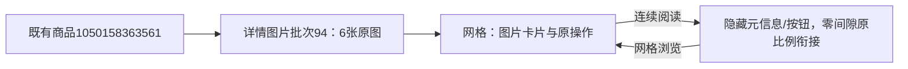

# 详情图片无缝连续阅读

2026-11-01，用户确认连续阅读采用淘宝详情页式纯图片衔接。

## 修改

- reading模式隐藏每张图片的编号、名称、原件状态与预览/下载按钮。顶部模式切换、排序和整批下载入口保留。
- 容器gap、卡片margin/padding归零，图片display:block、原比例等宽，移除图片基线间隙。继续保持连续阅读限宽与当前页/排序规则。
- 模式切换通过移除/恢复公共ui-image-card与ui-image-stage类去掉/恢复边框、圆角、阴影及底色，不复制公共控件外观。直接访问image_view=reading的服务端模板也不输出卡片装饰类，避免加载闪烁。
- 切回网格后恢复原图片信息、预览/下载和公共卡片样式。异常文件占位仍保留，原图片内容、文件、编号与下载范围不变。
- 不修改采集、AI、数据库、图片转换和分页业务逻辑。

## 验证

15项详情/图片工具相关单元检查通过。隔离浏览器1440/390/320验证长图原比例、相邻卡片边缘距离小于1px、无公共卡片装饰、信息和按钮隐藏、切回网格恢复，以及原预览下一张/放大、24张全批ZIP、JPG与记忆、历史批次绑定均通过。

实际商品1050158363561详情批次94的6张图片在三视口只读核对，全部相邻图片边缘距离小于1px；320完整拼接截图已目视确认无程序留白与边框。全部POST/外站请求拦截，正式采集/AI0。截图和指纹在workspace/output/reports/seamless_detail_reading。

两库各32业务表前后行数和全行SHA一致，0019保持。Web按实际专用进程归属核实后重启原8000端口（启动器34340、监听32364），只读健康查询通过。人工阅读体验待用户确认。

商品号、批次号及图片观察/文件身份全部沿原记录，本轮不产生新采集任务、批次、观察或文件索引，不修改原图像素。
