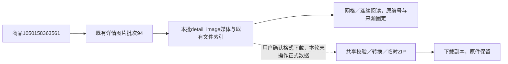

# 详情图片页整理与格式下载

2026-11-01，用户批准按主图/参数页风格整理详情图片，增加网格和连续阅读、长图预览、单张/整批格式下载。

## 页面与交互

专用product_detail_images.html合并标题、整批数量、状态、实际批次/时间、公共更新、来源任务和日志。公共搜索下拉选择后仍须点击查看，待查看不改变图片、下载URL或来源链接。来源与采集说明默认折叠；无图片、部分完成、读取失败及本地文件缺失/校验变化分别显示。标题和分页统计只计算当前批次role=detail_image，不混主图/SKU/视频。

默认网格，完整比例缩略图不裁剪拉伸；连续阅读居中限宽840px，原比例从上到下展示当前页，按当前排序。切换只改浏览器显示和image_view URL参数，不发采集请求；分页及排序链接保留模式，超过一页明确提示本页/全批数量。默认原始顺序，正倒序不重新编号。公共预览继续支持放大、上一张/下一张（本页）及键盘操作。

下载复用image_tools的格式控制、转换和ZIP：首次PNG，PNG/JPG/原格式可选，localStorage键toolbox.detail-images.format.v1独立记忆，与主图/工具箱互不覆盖。单张下载固定media_id，整批ZIP来自本批全部分页，不受当前显示顺序/页码影响。原件不覆盖。

## 复用与安全边界

公共modules/image_tools/collected_images.export_images共享归属查询、目录/文件大小/哈希核对、转换和临时打包。原export_main_images保留兼容委托。storage.main_image_export.sources沿原接口增加模块白名单，只允许main_images/main_image或detail_images/detail_image对应；固定平台商品、已发布批次、媒体类型与单张归属。

新增POST `/api/tools/images/products/<product_id>/detail-batches/<batch_id>/download`，正文沿主图format及可选media_id，无额外字段。沿本机Host、同源Origin及X-Collection-Token保护；主图旧路径不变。沿既有200张、原件单张10MB/总50MB、输出150MB限制，超限、缺失、校验或转换失败明确拒绝整包，不输出残缺ZIP。无AI、平台网络抓取或业务写入，临时产物由响应关闭释放。

内部records增加显式detail_image_only（默认False），仅允许详情图片批次的media查询；路由固定kind=media、role=detail_image、原position排序，清除外来question_id，并扩展原with_batch_note到详情图。普通查询默认结构不增键。main_image_presentation复用为两类图片模型，保留主图默认调用。主图无图片状态也按原状态识别。

无DDL/字段/COMMENT/持久JSON变更，数据库仍0019。来源筛选、临时派生和下载接口在字段取值文档登记，不新增数据库能力标记。

## 验证

- 754项全量单元、15项图片与详情相关检查通过。新增4项检查覆盖24张跨分页ZIP、PNG/JPG真实编码、原格式字节、原件不变、媒体角色/商品/批次/发布隔离、令牌、缺失/哈希变化整包拒绝、历史来源、倒序原编号、无图与读错。
- 隔离浏览器1440/390/320：60×1000合成长图比例、网格/连续及分页模式、预览下一张/放大、全24张ZIP、单张JPG、格式记忆、明确查看后切换历史任务/下载归属、无横向溢出通过。主图和工具箱原有上传/ZIP/JPG/原格式/独立记忆/预览三视口回归通过。
- 实际商品1050158363561详情批次94共6张，三视口网格和连续阅读只读通过，全部POST和外站请求拦截；桌面网格、手机连续图片截图已目视核对。证据位于workspace/output/reports/detail_images。
- 两库32业务表前后行数与全行SHA一致，仍0019，正式采集/AI/数据恢复0，实际商品未做转换下载写入。Web按专用启动器归属核实后重启原8000端口并通过只读查询。

程序检查完成，实际采集及人工样式/下载体验待用户操作确认。

平台商品号表示商品身份，批次94表示一次详情图片快照，media_id标识该批图片观察，file_asset_id指向实际本地文件。task_id为原采集执行，切换批次时这些身份成组对应；隔离90/91批与9001等编号仅为测试数据，不代表正式新增记录。
