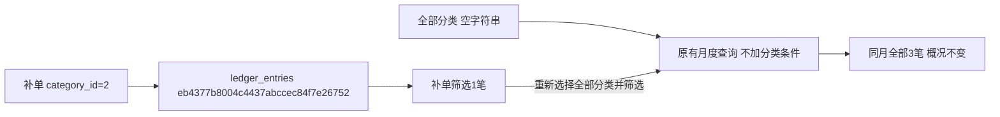

# 账本分类筛选恢复全部

2026-11-04。用户反馈选择分类后无法恢复查看全部，批准修复。

原因：原生筛选存在value为空字符串的“全部分类”，公共搜索下拉构造choices时统一排除了空值，将有效筛选误作占位项。此前页面验证覆盖单项选择，遗漏“全部→具体分类→全部”的恢复路径。

## 修改

公共searchable_select增加显式可选data-allow-empty-option="true"，只有非必填字段可启用，保留未禁用的空值选项并按真实选项文字与选中态显示，不再使用占位文字状态。未启用字段保持原逻辑；required字段即使误配开关也排除空值，disabled选项始终不可选。

只有账本明细分类筛选启用此参数，原生首项“全部分类”进入搜索列表。选择后点击筛选，提交category空字符串，复用原查询规则恢复所有分类。搜索框清空仅清查询文字，不取消已选分类；“全部分类”可按文字搜索、鼠标或键盘选择。新增记账分类仍必填，原生无脚本回退不变。

不改收支、月份、状态、金额和统计规则，无DDL或数据库字段变化，结构仍0026_ledger。使用指南和公共控件规范同步该参数及操作。

## 验证

- 34项账本规则、真实MySQL回滚、菜单/规划和公共控件相关检查通过。本轮未跑全量。
- 独立验证库浏览器1440/390/320三种宽度，“全部3笔→补单1笔→全部3笔”通过；概况仍为整月支出12元、收入1元。验证首项全部、当前勾选、搜索清空保留原选择、搜索全部、Enter选择、恢复后原生值为空及触发器文字正确。
- 同一浏览器核对记账弹窗没有全部或请选择占位候选，未选分类不能保存；共享控件默认、显式允许空、必填误配、禁用项三种组合通过。无脚本原生筛选同样可从单项恢复全部。
- 原测试9000网页在1440/390/320三种宽度只GET筛选，真实现有全部4笔→代发采购→全部4笔通过，无账目或额度提交，无脚本异常。仅重启已核对的本项目9000父子进程，原测试配置和端口保留。
- 三库结构检查schema_errors空；账本三表行数和全行SHA256前后一致：正式5分类/0账目/0额度，人工测试5分类/4账目/2额度，验证库5分类/0账目/0额度。所有合成写入只在验证库事务内，结束全部回滚。

三库37业务/配置表的逐表摘要核对发现一项并发差异：正式web_menu_items仍31行，内容摘要变化，其他表一致。本轮前基线为09:28:53；当前business-data、diagnosis、promotion的updated_at为09:31:03～09:31:05，is_visible均为false。本轮代码没有菜单写入、仅启动测试9000，未覆盖或回退这些变动。基线只保存摘要，不能据此还原字段旧值；并发变化单列记录于concurrent-menu-change.json，不将该项报为全库一致。

证据：workspace_test/output/reports/ledger_filter_20261104中的related-tests.log、ui-check.log/ui-evidence.json、三视口截图、live-check.json和database-before/after/check.json。运行资料不提交Git。

## 本轮验证记录

本轮验证库合成补单明细`eb4377b8004c4437abccec84f7e26752`，category_id=2，expense=2元，发生时间2040-10-28T12:34:56；另有代发采购支出10元和收入1元共3笔。按该分类筛选只返回该记录，选择全部后原生category值为空，恢复3笔；最终全回滚。真实操作不新增任务、采集批次、商品身份或文件关联。

分类编号对应数据库分类外键，明细UUID代表一次手动收支；空字符串仅是页面的无分类限制查询值，不是写入账目的分类编号。真实采集、AI及上架提交0；人工体验待用户确认。
