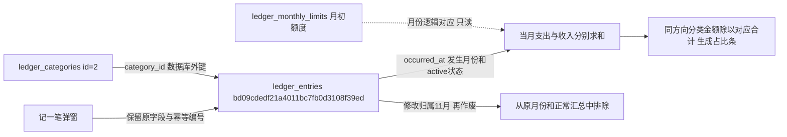

# 账本弹窗与分类占比

后续[账本页面布局整理](账本页面布局整理.md)已调整概况、明细顺序和手机显示；本记录对应首次弹窗与占比接入的验收快照。

2026-11-04。用户明确批准三项调整：移除网页止损线填写区、记账与修改共用弹窗、分类汇总改为收入支出分别计算的占比条。人工体验待用户确认。

## 最终行为

- 保留月度止损线、剩余或超出金额概况；移除整个额度输入卡片及说明，拒绝旧网页action=limit写请求。每月额度由用户直接维护ledger_monthly_limits，页面每次查询读取最新值，无记录显示未设置。使用指南提供月初日期、人民币金额、北京时间及两个时间字段的完整SQL示例；本轮未执行该手工示例。
- 页面上方“记一笔”打开原生dialog，复用全站公共弹窗、输入和可搜索选择组件。字段不变，打开空白新表单时默认当前北京时间；修改沿用原链接读取记录并自动打开弹窗，保留原值、版本及停用分类规则。
- 支持关闭、取消和Esc。分类下拉打开时第一次Esc关闭下拉，下一次关闭主弹窗。取消不写入，关闭后焦点返回记账入口；手机短屏弹窗内容可滚动。
- 异步提交仅用于保存账目；成功刷新所选月份明细与统计，校验失败、服务器错误或连接中断保留输入并显示安全错误，不自动重试。保存中禁用重复提交及关闭；幂等编号和并发版本校验继续生效。无脚本显式新增/编辑页保留原生表单提交。
- 分类汇总按expense支出、income收入分组，各以整月对应方向总额为分母，Decimal计算并四舍五入到两位小数，组内按金额降序、同金额按名称排序。复用公共meter占比条，名称、金额、百分比同时可读；空方向分别显示暂无支出/收入。明细筛选、作废排除、发生月份边界不变。桌面等宽两列，手机上下排列，长名称允许换行。

## 范围与数据

没有DDL或迁移，0026_ledger/schema_v26和历史模型保持冻结；37张业务/配置表、1技术表、423字段、70外键不变。本轮仅更新代码、页面、文档和验证。字段取值及关系说明同步预算字段维护来源和只读占比含义，原生COMMENT与字典结构不变。

修改前后分别逐表读取三库37张业务/配置表的行数和按主键排序的完整内容SHA256，三库差异均为空；实际结构逐库只读核对schema_errors为空。正式库账本5分类、0明细、0额度；人工测试库5分类、3明细、2额度；验证库5分类、0明细、0额度，均与本轮前一致。用户现有账目和额度不改写。

唯一运行的本项目网页是用户以config/settings.test.toml启动的9000端口；核对本项目父子进程后隐藏重启并保留9000和测试目录日志，没有自行改回8001或启动正式网页。实际9000两页GET均200，未提交实际库表单。

## 验证

- 30项相关验证通过：账本规则、真实MySQL回滚、月份/作废/筛选独立占比、JSON新增修改和错误、不接受网页额度写入、菜单与规划兼容。
- 55项公共控件及评价、问答、独立图片、交叉报告回归通过，确认公共弹窗宏新增可选参数的既有默认行为兼容。本轮未重跑全量，以上为本轮实际执行范围。
- 隔离验证库浏览器：1440/1024/768/390/320五种宽度检查占比、弹窗初始隐藏、打开、分类选择、Esc顺序、取消、焦点恢复、关闭重开清空；390×568与320×568检查短屏滚动及分类选择，页面与弹窗无整体横向溢出。新增、服务端校验失败保留、修改跨月、作废、网络失败保留和无脚本表单回退通过，脚本异常0。
- 9000实际网页：账本/分类管理两页×五种宽度共10项，只读检查和未提交的弹窗开关通过，无页面脚本异常，没有写入现有账目。
- 浏览器连接组件仍缺少browser-service，按技能读取说明并尝试连接后使用独立测试浏览器；启动经自动审核允许，未使用用户登录资料。
- 实际浏览器发现并修正表单名action遮蔽原生form.action属性的问题，改为读取HTML action属性；发现公共.card>div布局覆盖占比网格，调整局部选择器后重新截图验证通过。

证据目录workspace_test/output/reports/ledger_modal_20261104：related-tests.log、shared-regression.log、ui-check.log/ui-evidence.json、summary及modal截图、live-check.json、database-before/after/check.json。测试与截图均不提交Git，不包含凭据。

## 本轮真实验证库记录流

以下为本轮真实写入验证事务的合成样例，已全部回滚，非真实经营账目，无任务、采集批次、商品身份或文件关联。

- 明细`fab0ef39fe914a77864e89189963bd40`：分类id=1、支出10元，发生时间2040-10-28T12:34:56；另一个分类支出2元、收入1元，支出合计12元，比例83.33%/16.67%，收入比例100%。
- 浏览器新增明细`bd09cdedf21a4011bc7fb0d3108f39ed`：分类id=2、支出100.25元、发生时间2040-10-10 12:30:00、创建时间2026-11-04 08:55:21.016682、revision=1。随后修改金额为150.25元、发生时间为2040-11-01T00:00:00、revision=2，从10月移到11月；再作废，revision=3，排除统计。
- 验证额度2040-10-01=500元仅用于回滚事务，退出测试不保留；正式/人工测试额度均未改动。

账目UUID代表一笔手动收支，分类id代表可维护分类；两者是数据库外键关系。月份与额度是程序逻辑关联，百分比只读派生，不新增持久记录。所有本轮合成记录均事务回滚；真实采集、AI调用、上架提交均为0。
