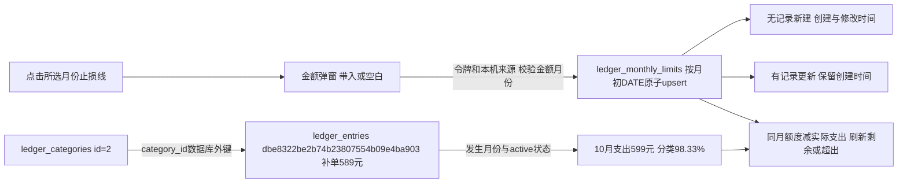

# 账本止损线编辑与视觉调整

2026-11-04，用户批准五项方案：点击止损线弹窗新建/更新、超支大红加粗、列表居中紧凑、修改/作废按钮配色、分类占比橙绿面板。本轮完成实现与验证，人工视觉及日常使用待用户确认。

## 最终行为

1. 花费卡片内的止损线文字和金额改为可点击行内入口，未设置显示未设置。弹窗明确所选年月，已有金额带入、无记录空白。保存复用service.save_limit与MySQL按月份主键的原子upsert，没有则新建、有则更新，更新保留created_at并刷新updated_at，不恢复大块填写卡片。允许0和两位小数，非法金额拒绝。分类管理页也可从概况打开同一编辑器；无脚本显式编辑页保留原生提交回退。
2. 超出文字及金额使用#dc2626，粗体，金额20px；只有remaining小于0时显示，其他情况普通剩余额度。不增加自动弹窗、预算阻断或收入抵扣。
3. 桌面六列表头和单元格水平垂直居中，固定列宽比例和约58px普通行高，分隔线减淡、悬停轻微高亮。备注默认一行，真正溢出、多行或较长内容显示展开入口，短备注不额外显示按钮；展开后完整安全文字居中。金额仍两位小数、千分位且不截断，长金额允许换行。手机继续逐笔网格，文字、金额和操作居中。系统创建/修改时间不显示，数据库继续保存；发生时间列表到分钟。
4. 修改浅蓝底深蓝字、作废浅红底深红字，使用公共紧凑尺寸并居中排列；记一笔保持主绿色。收支保留文字并以浅灰/浅绿标签区分。按钮悬停略加深，公共键盘聚焦行为保留。
5. 分类占比用浅橙支出、浅绿收入面板，桌面顶部对齐并排、手机上下排列；分组总额放大，分类名称、金额、百分比列稳定。百分比用浅色标签，条高9px、圆角、淡轨道，支出橙色/收入绿色，长度仍准确对应真实占比；右上角仅月份。分类按金额降序，同方向合计分别作为分母，正常状态/月份/明细筛选口径不变。

表单保存、关闭、错误处理提取为账本两个弹窗共用的轻量函数，不重复实现；保存中禁用重复提交与关闭，失败或断网保留输入，不自动重试。沿用本机来源、页面令牌、环境维护和菜单停用保护。预算保存沿用短期成功回执，原明细幂等与并发版本规则保留。

组件外观集中在form_controls：action_link和distribution_bar添加可选attrs，旧调用默认不变；可选ui-edit/ui-danger/ui-text/ui-compact、status_pill、ui-surface-panel和占比条tone/size只在账本显式启用。公共占比条默认仍原7px绿色，其他页面不切换新样式。模块CSS仅维护布局、普通文字及表格表现。

## 数据与结构

没有新表、新字段或迁移；0026_ledger/schema_v26与旧迁移冻结，37业务/配置表、1技术表、423字段、70外键不变，明细仍UUID。网页恢复额度写入符合用户最新要求，取值及关系文档更新为网页自动时间与SQL显式时间两种来源；原生COMMENT和完整字段字典结构未变，不执行此前手工SQL示例。

修改前后逐表读取三库37业务/配置表的行数与按主键排序的全行SHA256，三库差异均为空；实际结构逐库schema_errors为空。正式账本5分类/0明细/0额度；人工测试5分类/7明细/2额度；验证库5分类/0明细/0额度均保持。本轮未改写正式/人工测试现有记录，没有恢复此前已删除的历史数据。

## 验证

- 35项账本、真实MySQL回滚、菜单/规划和公共控件相关测试通过；新增覆盖网页额度新建、同月重复更新唯一行、保留创建时间、独立月份、零额度、精度/非法金额、无效来源/令牌、错误回显和分类管理返回。
- 52项评价V6、问答、独立图片和交叉报告公共回归通过，验证公共宏向后兼容。本轮合计87项相关/回归，未跑全量。
- 验证库独立浏览器1440/1024/768/390/320五视口：检查文字居中、普通行高56～64、彩色按钮、标签、9px橙绿占比条、备注展开、超出大红粗体、预算带入/取消；两种短屏390×568和320×568两个弹窗均可操作。没有页面整体横向溢出或脚本异常。
- 真实点击预算更新500→750.50、错误0.001保留→500、未设11月新建200→更新250→0，月份独立且每月仅一行；取消不改值、断网保留、无脚本保存550、分类管理页带入均通过。
- 原明细新增100.25、修改跨月150.25、作废及“全部→补单→全部”往返通过；记录与预算测试全在验证库事务内，结束全部回滚。
- 实际正式8000/测试9000，两页×五视口共20项只读验证通过，额度和记账弹窗仅打开/取消；实际测试分类筛选往返恢复7笔通过。没有在实际网页点击保存、修改或作废。只重启核对过的Web父子进程，端口配置不改，不停止采集进程，日志分别落正式/测试目录。

证据：workspace_test/output/reports/ledger_polish_20261104，含related-tests.log、shared-regression.log、ui-check.log/ui-evidence.json、summary和limit截图、live-check.json，以及database-before/after/check.json。独立测试浏览器沿用此前确认的应用浏览器组件缺失后备方式，不访问用户登录资料。运行数据和截图不提交Git。

## 本轮真实验证库记录

以下均为本轮真实验证库事务合成样例，不是实际经营记录，已全部回滚。

- 代发采购支出10元明细`06c05fdf0dee4f22bf60484c1fc59045`，分类id=1；补单支出589元明细`dbe8322be2b74b23807554b09e4ba903`，分类id=2；收入151元明细`1949f668bea44bd49a6a0ca5cd0307b8`，实际发生时间均2040-10-28T12:34:56。
- 10月支出合计599元，对应589/599=98.33%、10/599=1.67%；额度500元时超出99元，金额红色粗体。10月额度主键2040-10-01，最终无脚本保存为550.00元，created_at=2026-11-04 09:54:23.681608，updated_at=2026-11-04 09:54:33.489238；更新保留创建时间。
- 11月额度主键2040-11-01，本轮由无记录新建200，再更新250和0，最终0.00元，created_at=2026-11-04 09:54:29.018202、updated_at=2026-11-04 09:54:29.654394。不影响10月，验证退出后两行均不保留。

月度额度主键代表一个月份、与明细为月份逻辑关联而非外键；分类id与明细为真实外键；UUID代表一笔手动收支，没有采集任务、批次、商品或文件关系。真实采集、付费AI、商品提交均为0。人工验收不自动勾选通过。
