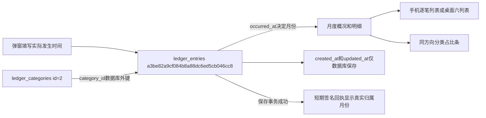

# 账本页面布局整理

后续用户确认[止损线编辑与视觉调整](账本止损线编辑与视觉调整.md)：额度恢复网页弹窗编辑，列表改为居中、彩色按钮及橙绿占比；以下为此前布局整理快照。

2026-11-04。用户批准页面层级、明细与手机布局优化，并明确系统创建/修改时间不需要在页面显示。

## 最终页面

- 顶部一行标题、月份、管理分类和“＋记一笔”；窄屏自然换行。移除重复介绍、小眉题、当前页账本明细按钮和查看月份按钮。月份选择后自动刷新，保留当前分类/收支/状态筛选并回到第一页；分类管理页同样可切换月份。无脚本时提供切换按钮。
- 三块概况：重点花费，旁边收入与收支结余；只读止损线和剩余/超出金额归在花费下方。零额度按0显示，缺失显示未设置；只有超出数字强调，不增加弹窗或预算阻断。
- 顺序为顶部、概况、明细、分类占比。明细标题明确所选年月，筛选放标题旁并自动换行。分类占比计算和金额排序、月度/作废/筛选口径保持原规则。
- 页面完全移除系统创建时间、修改时间；数据库仍自动保存这两个字段。只显示手工账目发生时间，列表精简到分钟，完整发生时间保留在time语义及悬停文本，弹窗仍可输入秒。
- 金额右对齐、等宽数字、统一两位小数和千分位，负数使用−¥金额；Decimal直接格式化，不转浮点。长备注默认两行预览，原生展开/收起查看完整安全文字。
- 宽屏使用六列明细表；窄屏（含手机）切换逐笔列表，分类和金额优先，下方收支、发生时间、备注和操作，不复制两套账目表单或重复元素编号。手机长备注、长分类可换行，保留原生表格语义及表头信息。
- 保存后显示实际记入年月，更新后显示已更新及归属年月，作废提示已作废。反馈只由已成功事务生成的120秒签名回执产生；脚本展示后移除地址回执，刷新不重复显示，不新增数据库字段。即使查看11月时补记10月，提示仍是已记入10月。

表单、下拉、按钮和占比条继续复用公共组件；本轮只调整账本局部布局，不修改公共控件外观。UUID明细主键、三张表结构、中文原生备注、迁移0026和数据字典结构不变。本轮不包含主键自增改造。

## 验证及数据保护

- 34项相关测试通过，包含账本规则、真实验证库事务、菜单/规划兼容及公共控件；新回执验证补记归属月份、修改反馈、无效回执忽略。未重跑全量测试。
- 验证库独立浏览器在1440/1024/768/390/320五种宽度检查新顺序、三块概况、系统时间隐藏、分钟显示、长备注展开、手机列表、弹窗开关/搜索/焦点/Esc/取消；同时验证月份自动切换和明确年月、保存与修改提示、服务端校验失败保留、修改跨月、作废、断网保留、无脚本回退。390×568和320×568短屏滚动通过，千分位/负数/零额度显示通过。页面脚本异常0，无整体横向溢出，全部合成写入在验证库事务结束回滚。
- 实际9000网页账本和分类两页、五种宽度共10项只读布局检查通过，包含未提交的记账弹窗开关；没有在实际网页保存账目或修改分类/额度。
- 三库37张业务/配置表，修改前后按主键排序计算行数与全行SHA256，差异均为空。三库均0026_ledger，schema_errors空；无DDL，正式/人工测试/验证库原记录不改写。正式账本5分类、0明细、0额度；人工测试5分类、3明细、2额度；验证库5分类、0明细、0额度。
- 原项目仅运行测试网页9000，核对父子进程后隐藏重启并保留9000与原测试配置；未自行启动正式网页。浏览器连接组件此前确认缺失，本轮继续使用独立测试浏览器，不访问用户登录资料；运行日志和证据在workspace_test。

证据目录：workspace_test/output/reports/ledger_layout_20261104，包含related-tests.log、ui-check.log/ui-evidence.json、summary和modal截图、live-check.json以及database-before/after/check.json。只保存摘要，不输出数据库凭据；运行资料不提交Git。

## 本轮真实验证记录流

以下是独立验证库合成记录，已全回滚，不是实际经营记录。

浏览器新增明细`a3be82a9cf084b8a88dc6ed5cb046cc8`：分类id=2，金额100.25元，发生时间2040-10-10 12:30:00；系统创建时间2026-11-04 09:20:25.730971，该时间只在数据库保存。保存提示“已记入2040年10月”；随后修改为2040-11-01T00:00:00及150.25元、revision=2，当前仍查看10月时提示“已更新，归入2040年11月”；切到11月可看到记录，再作废为revision=3并排除统计。

明细编号代表一次手动收支；分类编号代表可维护分类。没有任务、采集批次、商品或文件关系，月度额度仍仅按月份逻辑对应。所有真实采集、付费AI、商品提交为0；人工视觉和日常使用验收待用户确认。
