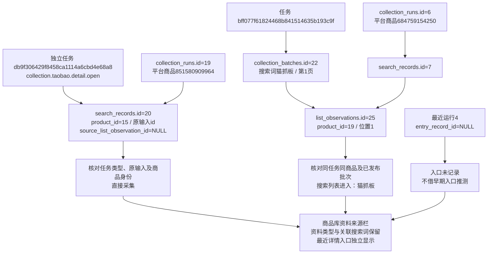

# 资料来源与详情入口区分

2026-10-26，用户确认执行。商品库保留八列，将来源列及筛选名称改为“资料来源”，在同一栏内增加最近详情入口及时间。实现与本地验证完成，等待用户查看；没有发起真实采集。

## 判定与边界

已有资料类型、全部关联搜索词、实际详情入口是不同信息。前两者继续按原规则展示；最近入口单独以原记录判定：

- 直接采集：明确详情入口，任务类型为collection.taobao.detail.open，原payload.record中input_type为id或url，原task_id与product_id能核对到入口归属和当前商品；不存在列表关联、list_source或冲突的搜索来源。
- 搜索列表进入：入口source_list_observation_id明确关联已发布list批次的列表观察，入口与列表为同任务同商品；已记录搜索词不能冲突。显示该列表批次的实际搜索词，不取商品所有历史搜索词。
- 入口未记录：最近运行缺少入口关联、入口或来源不存在、记录类型不符、任务／商品不一致、证据不足或有冲突。不因source_list_observation_id为NULL就判成直接采集，也不因输入为url就判成搜索进入。
- 尚无详情记录：商品只有列表或身份，尚无可显示详情活动。

使用最近运行的entry_record_id；若运行开始后有更新的明确detail_open访问，展示新入口。最近运行没有入口时不以早期已知入口替代；旧运行即使同任务有疑似入口也不自动补关联。对NULL时间保留未知，不使用Web访问时间伪造观察时间。分类只说明入口，不改变原采集状态或有效模块数量。

查询按当前页商品批量读取最近入口、实际关联入口和列表来源，不在模板查询数据库。不新增持久化字段、数据库状态、JSON键或表结构，沿用已有任务类型、输入类型及外键含义；所有展示字段均为只读派生值。原origin筛选参数、商品身份去重、八列表格、来源链接和补采流程继续可用。

## 本轮数据核对

本轮基线为29个商品，35条任务、24条详情运行、25条页面记录、99条批次；这是本轮开始时已存在的数据，与上轮28件的快照分开记录。最新分类为5个直接入口、6个搜索入口、1个入口未记录、17个尚无详情记录。

| 实际商品及内部身份 | 运行与入口 | 显示结果 |
|---|---|---|
| 851580909964，products.id=15 | collection_runs.id=19 → search_records.id=20；任务db9f306429f8458ca1114a6cbd4e68a8，类型collection.taobao.detail.open；原输入id | 资料来源“列表与详情”，保留关联词“粘毛器”，最近详情入口“直接采集” |
| 684759154250，products.id=19 | 运行6 → 入口7 → 列表观察25 → 批次22，第1页位置1；同任务bff077f61824468b841514635b193c9f | 最近详情入口“搜索列表进入”，入口词“猫抓板” |
| 1054304784602，products.id=29 | 运行24 → 入口25；独立任务d5007e5dc9e64044846296692dc2c8d7 | 资料来源“详情采集或访问”，最近详情入口“直接采集”，没有搜索词标签 |
| 996877163053，products.id=1 | 最近运行4的entry_record_id=NULL | 入口未记录，不拿同商品旧入口补齐 |

数据结构及原字段值没有改变，正式库新增、修改、删除均为0。前后19张业务表数量相同，15张商品、来源、批次、运行、观察、有效指针和素材表全记录哈希相同。before/after快照及分类详情见workspace/output/reports/catalog_entry_before.json、catalog_entry_after.json、catalog_entry_verification.json；源关联见catalog_entry_source_baseline.json、catalog_entry_examples.json。没有修改旧JSON原件、外键或任务记录。

任务代表业务执行类型，运行代表某商品一次模块执行；入口记录保存访问和原输入事实，列表观察保存某页某位置。三个外键分别为运行entry_record_id到入口、入口source_list_observation_id到观察、观察batch_id到列表批次；同任务同商品及已发布要求仍由程序核对。媒体与文件关联完全沿用上轮商品库逻辑，本轮没有下载或修改文件。

## 验证

41项相关单元验证、5项商品库隔离浏览器验证通过。覆盖已有搜索词但直接采集、只存在详情、实际列表进入、NULL不等于直接、输入类型不足以归类、较新运行不借旧入口、新访问尚未建立运行、跨商品／错误类型、原输入冲突、没有详情活动，以及原筛选分页、来源跳转和补采人工继续停止。

日志位于workspace/output/reports/catalog_entry_unit.log、catalog_entry_browser.log。Web自动重启并只读核对真实页面后，保留catalog_entry_live.json和catalog_entry_live.png；验证只允许本机GET，不触发采集或人工放行。没有将程序完成标记为用户验收通过。
