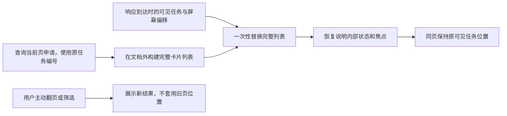
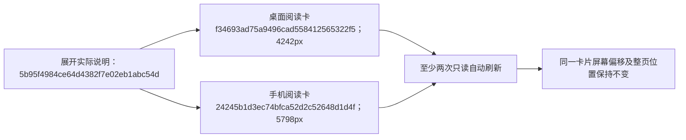

# 采集任务自动刷新保持整页滚动位置

2026-10-27，用户反馈任务列表向下滚动后每隔几秒被拉回筛选区。上一轮只保留了说明的展开、内部滚动及摘要焦点，未覆盖整页阅读位置；旧实现清空历史列表后逐条插入卡片，并立即恢复每条说明内部的scrollTop，触发半成品页面的布局计算，使浏览器按暂时变短的页面截断整页滚动位置。

隔离浏览器修复前已复现：滚动位置从5403变为2001像素，实际回滚3402像素。报告before-fix.txt保留失败断言。

## 最终行为

- 在脱离文档的DocumentFragment中完整构建本页卡片，再一次性替换列表；完整挂载后才恢复说明内部位置和键盘焦点，避免半成品页面高度参与恢复。
- 同一页、同一筛选刷新时，在开始渲染的当下记录可见任务编号和屏幕偏移，刷新后保持该任务的位置；当前任务不再属于本页时，保留原整页位置并接受文档实际高度限制。
- 新申请插入上方或上方内容高度变化时，当前阅读任务仍在本页就保持屏幕偏移。响应到达前用户继续滚动，使用渲染时的最新位置，不将用户拉回请求发出时的位置。
- 位置无需纠正时不调用滚动，避免打断正常滚动；主动翻页、筛选或自动返回有效末页时不套用旧页位置。说明展开/收起、内部滚动及摘要焦点仍按原规则保留。
- 只修改网页渲染，不新增数据库字段、接口参数、任务、批次或浏览器持久状态；不关闭自动刷新，不改变启动、停止或续采操作。

新增隔离回归覆盖桌面和390像素手机的连续刷新、上方新增申请及等待请求期间继续滚动；保留原说明展开、翻页、筛选和采集控制回归。报告目录为workspace/output/reports/collection_scroll_position_20261027/，正式页面核对仅允许本机GET，不启动真实采集。

上述为页面展示数据流，不是新采集流程。原39项真实平台人工验收结论保持不变。

## 交付验证

完整35项隔离网页用例通过，包括新增4项整页滚动回归；原有开始、停止、恢复、人工反馈、断库、分页、筛选及说明阅读状态验证均保留。专项4项先行验证通过，再完成完整回归，没有执行真实平台采集。

正式Web在原8000端口重启后，只读核对当前真实第一页20条任务。先展开实际失败申请`5b95f4984ce64d4382f7e02eb1abc54d`的任务说明，再滚动到列表下方，桌面与手机各等待至少两次完整列表刷新：

| 视口 | 当前阅读的实际申请 | 刷新前整页位置 | 刷新后整页位置 | 卡片屏幕顶部偏移（前后相同） |
| --- | --- | --- | --- | --- |
| 1440×1000 | f34693ad75a9496cad558412565322f5 | 4242px | 4242px | 0.28125px |
| 390×844 | 24245b1d3ec74bfca52d2c52648d1d4f | 5798px | 5798px | -0.46875px |

说明保持展开，页面无横向溢出及脚本错误；核对脚本阻止所有POST和外部地址，未点击启动、停止或恢复。桌面及手机前后截图、精确位置和原用例复现日志位于报告目录。

上述编号均来自实际页面记录，不是新造的采集结果；它们只用于在刷新前后识别同一任务卡片。数据库仍以原collection_jobs.task_id关联tasks，批次和素材关系不变。部署前后正式库表计数、申请版本/关联、队列、任务结论及当前登录文件哈希/大小/时间快照一致，版本仍为0009，独立验证库业务表为空。本轮不新增正式任务、批次或文件。

