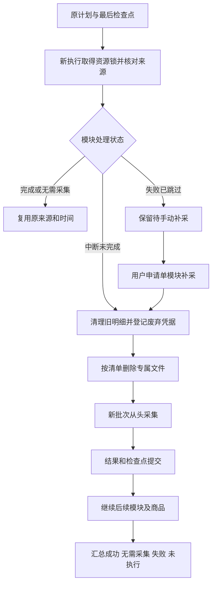

# 采集恢复、异常跳过与手动补采

2026-10-26，按用户确认的最终实施清单实现。真实淘宝采集另行确认，本轮仅本地模拟和独立验证库验证。

## 执行规则

- 成功模块保留；入口未找到按无需采集完成，WARNING黄色展示，实际数量不虚增。
- 模块自身的异常、未知结构、有限等待无进展，记录ERROR并跳过；重开核对当前详情后继续。无法恢复当前商品时，其余模块记录未执行，再处理下一商品。
- 验证码、登录、安全限流、未知弹窗和数据库持久保存问题仍由全局守卫暂停；不借助模块跳过绕过。
- 主动停止、关闭业务详情标签或浏览器结束整次执行，队列暂停；不自动重新打开或恢复。
- 从原计划已确认的页、商品、模块继续。完成和无需采集直接复用，已明确失败跳过留待手动补采，未开始正常执行。
- 未完成模块统一清理后新批次整模块重采。主图、视频、SKU等不复用旧未完成文件，评价/问答不拼接旧明细。数量范围沿用原计划。
- 新批次失败保留本次部分结果；已有完整资料及其他模块继续保留。

## 记录、清理和派发

新增0008_collection_recovery；0001～0007及其冻结模型保持不变。四张新表的全部字段取值统一见[字段取值说明](../数据库字段取值说明.md#采集恢复与补采0008)，物理外键见[关系说明](../数据库表关系说明.md#采集恢复与补采0008)。

原计划与每次执行通过collection_plan_executions关联。模块结果/汇总快照与检查点共用事务，独立检查点也先写本地流水再入库。列表清单保留原来源；跨执行来源只有同一计划且商品、页码、关键词核对通过才允许关联。

下载前写入批次目录归属凭据，解决文件已产生、尚未来得及登记数据库就退出的情况。清理先验证源任务已结束和目标范围，再事务删除旧明细、登记不可变文件清单与废弃标记；随后逐文件校验、删除并完成凭据。没有递归删除命令。共享文件、已完成批次及有效分区拒绝误删；文件被改写或占用则保留阶段，标红跳过，不在未清理干净时新增结果。旧不可变流水作为审计材料保留，废弃批次快照不能恢复旧明细。

补采队列按资源和商品/模块/数量配置合并在途请求。浏览器资源空闲后领取，停止或服务重启后持久暂停，须明确继续队列。补采成功同事务关联原错误为已解决，历史错误状态和日志保留。

## 操作

网页：商品采集 → 最近任务 → 查看恢复计划 → 按此计划继续。红色失败项可单独重新采集，当前任务运行时排队。底部可暂停/继续队列。

CLI：`python main.py taobao resume --task-id 原任务编号 --preview`只查看，去掉`--preview`执行恢复；`--no-wait`控制执行完成后关窗。旧任务无可靠计划时不猜测恢复，可选择单模块重采。

每个模块默认无进展预算120000毫秒，可在`[taobao.module_timeouts]`逐模块配置整数毫秒（至少1000）。真实新增记录、回答和下载字节刷新进展；人工验证时间不消耗预算，正常规定休息单独处理。没有新增盲目自动重试。

以上是结构示意，不是实际淘宝业务编号。验证结果、迁移前后数量及检查报告在本文件后续验收段登记。

## 本轮验证与升级证据

- 正式库由0007升级至0008，新增4张表，合计23张业务表及1张版本表、291字段。升级时无活动任务；升级前后原19张业务表的数量和逐行内容SHA256完全一致，仅版本记录变化及新增空表。独立验证库重复升级幂等，两个库结构、外键、约束及中文备注核对均无差异。
- 正式库升级前数据：任务40、商品33、采集批次130、运行30、步骤255、文件758、列表观察36、SKU211、参数118、评价884、问题200、回答1210。这里只是升级时点累计，不是本次新增采集；本次没有真实淘宝采集，未删除任何正式采集明细。
- [数据库升级报告](../../workspace/output/reports/collection_recovery_20261026/database_upgrade.json)记录前后逐表数量、校验摘要和结构检查；[最终服务与数据状态](../../workspace/output/reports/collection_recovery_20261026/final_state.json)记录页面与接口HTTP状态、活动任务及验证库清理结果。
- [完整单元回归](../../workspace/output/reports/recovery_unit_all.txt)：439项。另对恢复、流程完成数计入无入口、有效结果数不虚增进行64项专项核对（含全量回归后新增1例，合计440个不同单元用例），见[计数检查](../../workspace/output/reports/recovery_completion_counts_final.txt)。
- [数据库回归](../../workspace/output/reports/recovery_mysql_regression.txt)：36项中35项通过、1项需额外开启浏览器的用例跳过；[恢复故障链最终复核](../../workspace/output/reports/recovery_mysql_final.txt)8项通过。仅使用独立验证库合成记录，结束后23张业务表均为0。
- 隔离浏览器共91项覆盖通过：[主图与SKU](../../workspace/output/reports/recovery_images_skus_final.txt)56项、[列表与网页](../../workspace/output/reports/recovery_browser_final.txt)23项、[视频及访问限制](../../workspace/output/reports/recovery_media_access_final.txt)13项，其中SKU访问限制1项与前述56项重复，视频新增12项。使用本地业务页面及模拟媒体响应；真实平台验收仍未进行。
- 只读核对运行中工作台，采集页、恢复弹窗、队列入口、黄红日志均正常，页面脚本错误0；[在线检查报告](../../workspace/output/reports/collection_recovery_20261026/live_checks.json)、[错误日志截图](../../workspace/output/reports/collection_recovery_20261026/logs_error.png)、[警告截图](../../workspace/output/reports/collection_recovery_20261026/logs_warning.png)。Web使用原地址http://127.0.0.1:8000，未停止任何采集进程。

完整故障链使用真实任务执行器、持久流水和验证库事务，页面及采集内容为合成替身：SKU部分失败标红跳过 → 后续参数仍完成 → 问大家阶段主动停止 → 新执行复用视频和参数、清理后重采问大家 → 原SKU错误继续待补采 → 手动新执行清理旧SKU后新增完整结果 → 原待处理项关联新任务为已解决。原任务状态与错误日志保留，未将合成编号当作真实淘宝业务例子。

本轮本地实现及验证完成，不改变原功能清单的真实平台人工通过数。

最后增补核对：错误项展示最后进展时间及按单位区分的数量；无入口计入流程完成、有效结果为0；新增预览、补采队列及无入口网页3项复核通过，见[最新界面复核](../../workspace/output/reports/recovery_ui_latest.txt)。
