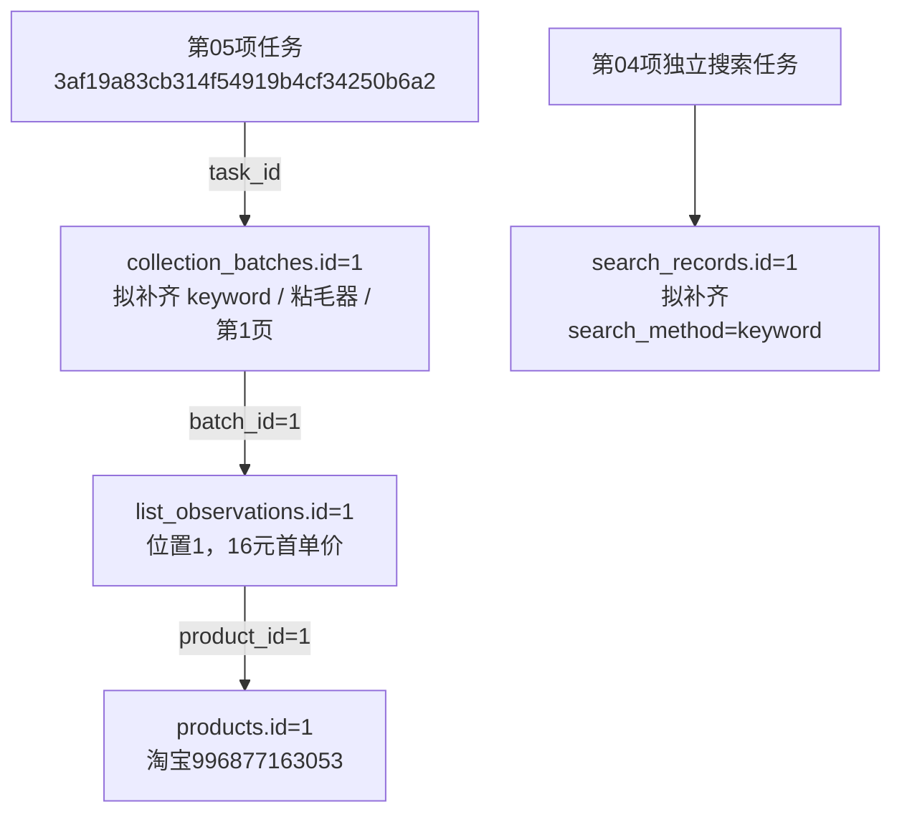

# 采集搜索来源数据库与数据填充方案

用途：已实施的数据库来源字段方案。以下范围、数据数量与测试进度均为2026-10-23方案实施时点；最新进度见[功能验收清单](../功能逐项验收清单.md)。

日期：2026-10-23。状态：用户已确认并完成实施。正式库和验证库均升级至0003_search_origin，新增7列及2个外键，完成可靠回填和新数据自动填充；实际字段、逐行对照及验证结果见[搜索来源升级验收报告](搜索来源字段升级验收报告.md)。Web页面与来源筛选留待后续；实施完成时第05项仍待人工验收，该进度是当时快照。

本方案取代《采集搜索来源与Web筛选扩展方案》作为本次实施依据。用户最新要求：Web页面暂时不修改，主要修改数据库和数据填充。

## 本次目标与范围

完成搜索来源独立存储、现有记录可靠回填，以及新采集数据自动填充；使后续能够直接使用数据库字段追溯关键词和搜索方式。

本次表结构改动限定为collection_batches、search_records两张表，共新增7列、2个图片文件外键及必要索引，不新增业务表。配套修改必要的来源数据生成、规范化和入库逻辑。

Web页面、样式、路由和筛选功能，以及CLI新增筛选参数均留待后续；本次仅验证现有读取行为兼容新结构。以图搜图预留字段和校验契约，实际上传图片、平台搜索和采集能力后续接入。

第05项仍是限定5条的人工验收，现有任务和批次继续保留；方案实施不等同于第05项通过，第06项尚未开始。

## 表一：collection_batches，新增5列

中文表名：采集模块批次表。负责保存一次采集的来源、范围及结果。搜索来源属于一次采集，商品身份不设置唯一搜索词。

| 新增字段 | 建议类型 | 中文名称及用途 | 填充与空值规则 |
|---|---|---|---|
| search_method | VARCHAR(24)，使用项目代码列规则，可空 | 搜索方式 | keyword=关键词搜索；image=以图搜图；unknown=已确认发生搜索但方式无法确定；NULL=来源未提供或不适用，不据此断言一定是非搜索入口 |
| search_keyword | VARCHAR(100)，可空 | 来源搜索词，保留实际输入文字 | 新关键词搜索必须有非空值；纯图片搜索为NULL；未来图片加文字时保存实际附加文字；不从商品标题推测 |
| page_number | INT，可空 | 实际采集页码 | 已明确时填大于等于1的整数；未知为NULL，不能默认第1页 |
| search_image_file_id | 与file_assets.id相同的编号类型，可空 | 实际用于搜索的图片文件编号 | 外键关联file_assets.id；关键词搜索为NULL；未来图片搜索保存实际输入图，不关联结果商品主图冒充输入图 |
| search_options | JSON，可空 | 实际生效的附加搜索条件 | 有明确记录时保存对象，例如价格、类目、地区或图片裁剪参数；未知为NULL，不能用空对象伪称已确认没有筛选 |

继续复用sort_label、requested_limit、scope、coverage_status、source_url、task_id和captured_at等已有列，不新增同义字段。collection_mode当前来源为空，不因本次增加搜索字段而猜测补齐。

## 表二：search_records，新增2列

中文表名：页面搜索与入口记录表。负责保存单独搜索或打开详情入口时的真实页面观察；不要求之后一定发生商品采集。

| 新增字段 | 建议类型 | 中文名称及用途 | 填充规则 |
|---|---|---|---|
| search_method | VARCHAR(24)，使用项目代码列规则，可空 | 搜索方式 | 与collection_batches使用相同代码和空值语义；直接商品入口不凭商品名称推测搜索方式 |
| search_image_file_id | 与file_assets.id相同的编号类型，可空 | 实际用于搜索的图片文件编号 | 外键关联file_assets.id；无搜索输入图时为空 |

已有keyword、page_number、sort_label继续复用，不新增同义关键词列。新记录的附加搜索条件放在现有payload内明确版本的业务结构中。旧payload、_logical_key和_fingerprint保留原值。

本次保持现有两种执行入口：独立搜索保存search_records；列表采集直接保存collection_batches及list_observations。不会因新增字段而为第05项补造一条搜索记录，也不把第04项和第05项认作同一次搜索。

## 文件关联、约束及索引

- 两个search_image_file_id分别建立数据库外键，目标均为file_assets.id；被搜索记录或批次引用的文件限制删除，不级联删除业务记录。
- file_assets、media_references、products、list_observations和任务日志表不改结构。未来图片搜索复用文件路径、SHA-256及可用性，媒体用途区分搜索输入图、原图和结果商品图。
- 搜索方式使用受控代码，页码非空时必须大于等于1；关键字长度、非空要求和图片归属在入库时验证。未知历史数据保持未知，新实时关键词流程明确写keyword。
- 为来源搜索词、搜索方式、采集时间等建立必要组合索引；复用search_records已有关键词时间索引，避免重复索引。图片外键配套索引，方便未来追溯文件引用。
- 不增加search_records与collection_batches的直接外键，不增加关键词管理表或任务分组表；这些关系后续单独设计。

## 现有数据怎样回填

先获取正式库实际基线，逐条核对原始记录、任务类型、来源链接和已保存证据。关键词来源使用已有record.keyword等明确值；搜索方式根据明确流程和一致的来源证据补齐，不能统一给所有记录填keyword。

回填仅填新增来源列，已有字段不因本次升级而重解释。没有足够证据时保持NULL或使用明确适用的unknown；证据冲突列出报告，在写入前处理。

本轮已知记录的预期如下，正式执行时仍须重新核对基线：

| 表与记录 | search_method | 关键词 | page_number | 搜索图片 | 附加条件 |
|---|---|---|---|---|---|
| collection_batches.id=1，第05项 | keyword | 新增search_keyword=粘毛器 | 新增列=1 | NULL | 新增search_options=NULL |
| search_records.id=1，第04项 | keyword | 已有keyword=粘毛器，保持原值 | 已有列仍为NULL | NULL | 已有payload保持原值 |

本次涉及的真实来源任务：第05项3af19a83cb314f54919b4cf34250b6a2，第04项fa9b513663cc405f8e06f6f2b8ec9906。二者任务与来源记录分别核对。

现有products.id=1至5、list_observations.id=1至5继续保留原主键和归属。本批次source_batch_key继续为3af19a83cb314f54919b4cf34250b6a2-694d54a9。

原JSON、CSV、截图、旧规范快照、旧指纹、scope_key及已有业务内容保持原样。回填更新的是数据库新增列，不通过改写原件制造依据。

## 后续新数据怎样自动填充

不能只建列并填一次旧数据，必须同步数据生成和入库路径：

1. 关键词搜索入口明确产生search_method=keyword，沿用实际keyword；新原始JSON记录明确搜索方式，页码只填写实际确认值。
2. 列表采集把实际关键词、页码、搜索方式和确认过的附加条件传入规范化与入库逻辑，分别写入collection_batches对应列。
3. 独立搜索把搜索方式写入search_records，继续使用已有keyword等列。直接详情入口缺少搜索上下文时保持相关列为空，不关联最近一次同商品或同关键词任务。
4. 统一校验重复的来源信息，例如数据库search_keyword与本次原始record.keyword须一致；不一致时报告冲突，不任选一个值保存。
5. 新写入的明确NULL与旧格式没有声明的字段分别处理；兼容旧快照补写时，不用缺失字段或默认NULL覆盖已回填来源。相同输入重复入库不新增同一业务记录。
6. 来源写入仍遵守现有持久事件流水和事务规则；连接中断后只补写数据，不重复浏览器搜索或采集动作。

必要修改位置：采集来源记录生成逻辑、database_records规范化映射、CollectionWriter入库与兼容校验、当前模型和新增迁移，以及对应验证和文档。Web相关文件不纳入本次开发。

新数据格式和范围契约明确版本。未来不同搜索方式、不同输入图片、关键词与筛选条件须能区分；图片使用内容指纹，不把数据库内部文件id当作跨库稳定身份。旧格式继续使用原有规范化与指纹规则，不因多了来源列导致同源异文或导入冲突；相关兼容行为纳入本次验证。

## 实施顺序和核对交付

1. 用户确认本方案后，先记录表结构、版本、相关原行、文件指纹及活动任务状态；核对没有正在写入的采集任务。
2. 编写新增有序迁移和当前模型，不修改已执行的0001、0002迁移。迁移中的结构变更、数据回填及版本推进按数据库实际事务能力处理，设计可识别的中断状态，不声称MySQL结构操作可以整体事务回滚。
3. 在独立验证库测试：新增列及外键、中文和空值、可靠回填、未知与冲突、重复升级、旧快照补写、新记录写入以及幂等。合成样例不写入正式库。
4. 正式升级并按核对过的证据回填。交付每张表的结构变化、新增/修改/删除记录数量、每个回填字段的前后值，以及只读SQL和真实关联图。
5. 新采集自动填充先用独立库验证；需要真实采集验证时仍属于当前第05项，先保留新基线和现场供用户查看，不自动进入第06项。

新增表字段的中文原生COMMENT、完整字段字典、每张表上下游关系、外键目标及删除规则，与迁移同时交付。同步必要的使用指南和数据契约说明。现有命令、日志北京时间和人工验证规则继续有效。

## 本轮真实关联示例

图中的任务、批次、观察和商品编号是本轮真实记录；拟补齐的独立字段尚未实施。第04项搜索记录和第05项采集批次之间目前没有直接外键，本次不建立或推断该关联。

## 后续范围

Web来源筛选与展示、实际以图搜图、关键词分组和批量计划、搜索记录到采集批次的直接关系、列表进入详情的精确来源关联，均后续另行设计和确认。
