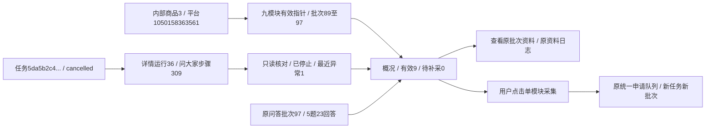

# 采集概况独立页签

2026-11-01完成用户批准的采集概况独立Tab及美化。原基本信息内“各模块资料与最近尝试”移至商品导航第一个“采集概况”；基本信息仍是默认页。

## 展示和操作

顶部为有效资料、待补采、最近尝试异常三项数字，下面是全部/待补采/最近异常筛选和原补采/选择范围入口。九模块顺序固定：基本信息、视频、主图、SKU、商品参数、详情图片、评价概览、评价明细、问大家。桌面五列列出模块、有效资料状态及数量、资料时间/批次、最近尝试和操作；中屏双列卡片，手机单列卡片，按钮自动换行。公共组件外观维护在form_controls.css，product_detail.css只安排布局。

有效资料与最近尝试独立：新任务停止或失败不覆盖旧有效批次。最近尝试没有新批次时仍可从requested步骤和统一任务状态核对；启动前失败没有步骤时显示最新申请失败，同任务已有具体模块结果时不被批量任务整体失败替代。成功长日志/本地路径不堆入概况，异常有简述和对应日志入口。

已有资料可查看原批次、资料日志；最近尝试来自其他任务时独立提供日志，相同任务不重复。按钮直接提交该模块原队列，已有申请时显示当前任务；尚未创建task_id时显示申请进度，不生成虚假/tasks/申请号链接。评价默认100条、问大家默认50题，修改上限进入已有范围配置页；不自动切换为无限量。补采只处理原remaining_plan的未满足项，不用当前可见筛选子集改变计划。

确认无内容计有效，确认无入口按原补采规则跳过，未采/无有效资料/异常分别显示。有效记录计数不是平台全量或文件可用性。只有已关联本地文件索引且availability非present或索引缺失才提示素材引用异常；线上图片未下载、file_asset_id=NULL不误报丢失。查询不扫描磁盘或计算素材哈希，需进入原资料页核对文件。

## 读取与保护

概况按当前商品全部历史中的current_ids有效资料展示，不继承某次搜索observation的详情运行；不接受历史batch筛选。离开概况查看具体资料时仍进入对应批次，不自动换源。旧模块浏览、评价/问答分析及其费用确认规则保留。

商品browse可选with_overview，原接口默认不新增额外查询；页面只在本Tab读取最新步骤核对和素材元信息。原商品jobs接口仅overview=1附加九行模型；复用已有2秒轮询，就地更新状态/数量/链接，保留筛选、固定顺序、不自动导航，也不启动采集。初始按钮等状态查询确认后才可用；初读资料失败返回明确503页，轮询失败保留已有显示并禁采集，恢复后重新核对。无脚本时筛选正常GET可用，采集改走配置页。

新增collection_overview业务读模型和Web展示适配；存储只负责真实记录，Web只补格式和链接。没有DDL、数据库字段/约束/原生备注或持久JSON含义变更，当前仍0019_question_analysis/schema_v19。没有修复旧任务、重采旧资料或调用AI。

## 本轮验证

- 711项全量单元通过；97项相关回归通过；最后的展示精简/线上文件引用区分另跑12项相关检查通过。新增5项概况测试覆盖九模块与默认页、旧资料/新失败分离、未生成批次的停止、活动单/多模块和异商品隔离、无入口嵌套/早期payload兼容、已确认文件缺失与未下载链接、读取错误和无脚本筛选。原参数计数测试改为在新Tab核对移动后的概况。
- 隔离浏览器1440/390/320：九模块、筛选、按钮实际白字、无溢出、单模块POST内容、只提交一次、排队申请入口、读取失败/恢复、申请终态后按钮恢复、旧资料链接保留均通过。原基本信息三视口的复制/展开、状态轮询、来源守卫和配置预选回归通过。模拟提交只进入临时隔离库/响应，无真实平台采集。
- 实际本机商品1050158363561在1440/390/320只读核对：overview API200，9有效/0待补采/1最近异常；九模块有效批次依次89～97。问大家旧批次97保留5题23回答，最近任务5da5b2c4b55249078af3c464574e88c2/运行36显示已停止，资料日志与最近尝试日志分开；点击资料正确回到97批。只允许本地GET/HEAD，阻止外部和写请求，未发生真实采集或AI。
- 本轮前后正式库及验证库各32业务表逐表行数/全行SHA256完全相同，新增0、修改0、删除0；技术迁移版本均0019。before.json/after.json只保存计数和指纹，不保存业务原文/凭据。旧任务/运行/步骤/资料及历史分析保持原样，状态差异只读显示。
- 截图/查询证据保存在workspace/output/reports/collection_overview，执行日志workspace/development/runs/undated-overview/logs/overview-*.log。仅隐藏重启已确认的本项目8000 Web，未停止采集进程。界面人工体验及真实单模块采集留待用户确认，不记作已完成平台采集验收。

商品是跨批次统一身份，批次是一次模块资料来源，运行/步骤是某次尝试，任务是后台执行身份。图中已有记录读取经过本轮真实核对；右侧按钮入队流程只用隔离样例验证，未在正式商品实际提交。
