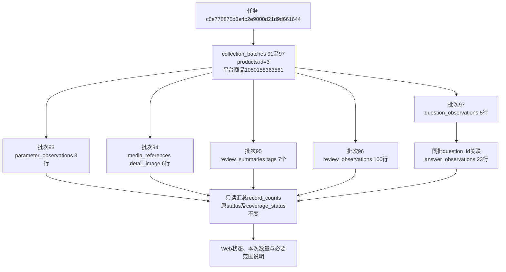

# 采集状态与本次数量展示

2026-10-26，用户确认后执行。调整商品采集历史、资料概况、模块结果、合并商品评价和独立批次页。完成实现及本地验证，等待用户查看；未执行真实采集。

## 显示规则

状态保留原值对应的中文名称，不以已有记录推断完成。参数、主图、详情图片、SKU、基本信息、视频和评价概览隐藏通用unknown提示；评价明细、问答及列表范围未记录时说明“采集范围未记录”。已记录的上限、人工确认和可见末尾保留，避免把本次完成等同于平台全量。范围与状态相同的说明不重复。

数量只按对应批次实际观察行统计，不取平台标称数量、任务摘要或当前分页条数；概览取已存标签数组长度。图片、视频仅数所属模块的main_image、detail_image、main_video引用，不计规格图、视频封面或证据文件；这是已存引用数量，不额外承诺文件下载成功。SKU缺货数仅统计stock_status=out_of_stock。回答同时按question_id及batch_id关联本批问题，排除跨批或孤立回答。缺少记录时省略数量；已存空标签数组可显示0个标签，NULL不当作0。明确无内容状态保留专用提示。

新增只读查询派生结果record_counts，不写入数据库或采集快照。批次数量按模块分组查询，避免按每行发起计数。没有DDL、数据库字段、状态取值、JSON存储格式或完成判定变化；数据库字典及取值说明无须变更。

## 本轮实际资料核对

正式商品1050158363561，products.id=3。下表均为本轮只读核对结果，不是示例数字：

| 批次 | 模块 | 原状态 / 原范围 | 本批实际数量 |
|---|---|---|---|
| 89 | 基本信息 | complete / unknown | 1条 |
| 90 | 视频 | downloaded / unknown | 1个视频引用 |
| 91 | 主图 | complete / unknown | 5张图片引用 |
| 92 | SKU | complete / unknown | 5种规格，0种明确缺货 |
| 93 | 商品参数 | complete / unknown | 3项 |
| 94 | 详情图片 | complete / unknown | 6张图片引用 |
| 95 | 评价概览 | complete / unknown | 7个评价标签 |
| 96 | 评价明细 | complete / limit_reached | 100条，本次上限100 |
| 97 | 问大家 | complete / visible_end_confirmed | 5个问题、23条回答，本次上限50 |

批次91～97来自任务c6e778875d3e4c2e9000d21d9d661644；批次90来自bdfeaa160cda4c19bed7f8237347630e；基本信息89来自f34693ad75a9496cad558412565322f5。它们属于同一商品，但不合并成同次采集。另核对商品851580909964：批次84有7项参数、86有6个标签、87有100条评价、88有18个问题及82条回答，全部保留原状态和范围。

核对前后，19张业务表数量一致；两件商品的批次身份、状态、范围、上限等字段快照一致，8类观察与媒体表的相关记录哈希一致。数据库新增、修改、删除均为0，无字段前后变更。完整累计数量、时点和哈希见本机workspace/output/reports/batch_scope_before.json、batch_scope_after.json；这是读取前后的对照，不追溯此前采集的数据变动。

任务表示一次执行；批次表示某模块当次结果；平台商品编号与products.id分别为外部和数据库商品身份。观察行及媒体引用保留各自批次，不用当前有效指针替换历史批次。图片文件仍通过media_references.file_asset_id关联file_assets；本轮不下载、修改或重新校验入库。

## 验证与页面

45项相关单元验证、17项隔离浏览器验证通过，覆盖整批数量不随翻页变化、概览标签与平台数量区分、跨批回答排除、媒体用途、缺货计数、缺失数量、明确无内容、状态不提升及一致展示。浏览器检查沿用现有人工弹窗和停止流程，不发起真实采集。

Web自动重启后，5处真实页面核对通过：商品历史、资料概况、参数独立批次、评价第5页及问大家；仅允许本机GET，拦截修改请求和外部资源。保留截图workspace/output/reports/batch_scope_history.png；核对记录batch_scope_live.json，测试日志batch_scope_unit.log、batch_scope_browser.log。页面仍为原地址http://127.0.0.1:8000。
