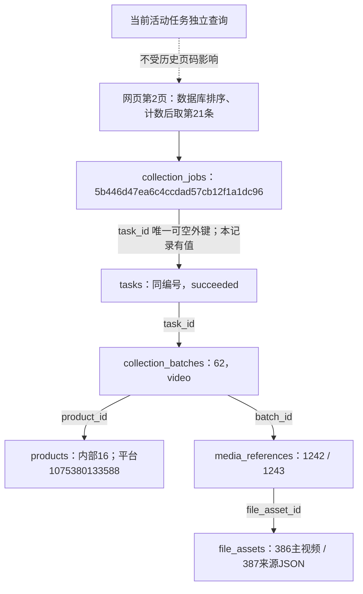

# 采集申请分页与状态筛选

2026-10-27，用户确认并授权将“最近采集任务”扩展为全部采集申请分页及状态筛选。原页面仅查询最近20条，更早的未执行申请没有完整入口；实际执行历史仍可在左侧“任务记录”查看。

## 最终行为

- 列表改名“采集任务”，按申请时间从新到旧，每页20条，显示符合条件的总数、页码和上一页/下一页。包括网页、CLI及既有核对记录，不凭空补造申请或执行。
- 状态可选全部、等待启动、运行中、需要人工处理、已停止、已结束、失败。结合申请和实际执行状态，在数据库中过滤、计数后分页；不先截取最近20或200条。相同时间按id倒序，保证确定顺序。
- 表单参数、页码和筛选保留在页面URL，自动刷新和重载保持选择。切换状态回到第一页；最后一页因任务状态变化消失时返回最后有效页。快速切换时忽略过时响应，列表不会混入其他页的历史记录。
- 当前运行任务继续在底部独立显示，查看旧页或空筛选不影响当前执行。超过200个等待申请也优先核对已领取/实际执行。
- 未启动申请保留单次开始；运行项保留停止；已停止且有计划的任务保留恢复；模块错误仍可定位和手动补采。翻页和筛选不触发这些写操作。
- “已结束”表示整次执行正常收尾，可含跳过、模块错误或资料待核对，卡片保留具体说明，不把它等同于所有模块采集成功。

## 查询契约与数据

`GET /api/collection-jobs?page=2&status=stopped`返回jobs/page/page_size/total/pages/status，各条分页记录增加计算字段history_status。无效参数或重复page/status返回409，数据库故障仍返回503并禁用派发，不伪装成空列表。页面对应参数为jobs_page/jobs_status。

不新增表、列、迁移或持久JSON键，0001～0009和冻结模型不变。仍由collection_jobs.task_id可空唯一外键关联tasks，未执行申请可独立显示；只有用户明确点击原启动、恢复或控制按钮才走已有写入流程。既有恢复核对和断库意图补写规则保留。

本轮验证和正式只读页面核对保存在`workspace/output/reports/collection_pagination_20261027/`。真实平台采集由用户手动操作，本轮本地测试不替代原39项人工验收。

## 验证结果与真实记录

455项完整单元、24项统一作业MySQL、29项隔离网页验证通过。覆盖45/47条跨页数据、相同申请时间的编号排序、跨资源排除、筛选早于分页、实际执行终态优先于旧提示、重复/错误参数、空结果、状态变更导致末页消失、自动刷新与重载、快速切换忽略旧响应、运行任务位于历史页外及超过200个等待申请、原开始/停止/恢复/人工反馈及断库入口。既有测试按新增分页返回结构和查询参数适配；网页排队断言改为明确查找新申请，避免相同时间下误取另一条记录。

正式Web已在原8000端口重启，正式浏览器核对只允许本机GET，阻止所有POST和外部网络，没有点击真实开始、继续队列或恢复。实际列表21条，第一页20条、第二页1条，合计21个不重复编号；状态计数为等待0、运行0、人工处理0、已停止6、已结束14、失败1，合计21。重载保留筛选，原停止任务的恢复计划入口仍存在。桌面和390像素手机截图已目视核对，无横向溢出。

重启前后25张业务表计数、全部申请的状态/关联/版本/更新时间、队列完整记录、任务结论/结束时间及0009版本快照相同；采集申请21条、实际执行任务42条、批次131条、商品34条、文件登记761条。两种记录总数不同是因为申请与实际执行用途不同，本轮未补造任务。独立验证库25张业务表均为空。

第二页实际申请`5b446d47ea6c4ccdad57cb12f1a1dc96`是已有视频任务，平台商品编号`1075380133588`；它关联同编号tasks、视频批次62和商品内部主键16。媒体引用1242/1243分别关联已有文件登记386（主视频）和387（来源JSON）。本轮只读取这些关系，没有重新采集或改写记录。

申请保存提交意图，tasks记录一次实际执行，批次记录某模块一次采集，商品内部编号供数据库关联，平台商品编号指向淘宝商品，文件登记关联已有原件。申请→任务、批次→任务/商品、媒体引用→批次/文件沿用现有外键；当前页位置和活动状态属于展示逻辑，不新增关联。具体快照见报告目录中的before.json/after.json、deployed-api.json、deployed-statuses.json和older-record.json。
