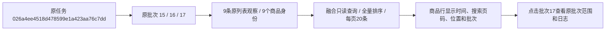

# 采集资料双入口说明

用途：记录已确认方案的第一阶段实现与展示边界。状态：代码和本地验证完成，页面待用户验收。日期：2026-10-25。适用：当前0005结构，不新增迁移，不修改业务记录。

## 页面与关系

搜索列表 `/collections/searches` 只按已发布列表批次组织任务及当时观察。商品详情 `/collections/details` 只按独立详情活动索引商品，包含已发布详情、详情入口和运行尝试；失败或仅入口仍可检查，列表独有商品不会假装有详情。

关系分为：明确详情入口（search_records.source_list_observation_id → list_observations.id，collection_runs.entry_record_id → search_records.id）、同任务同商品已有详情运行、其他时间同商品资料、暂无详情。后两类不制造本次来源关系。商品身份使用内部商品键并核对平台与平台商品号，不按标题匹配。

从列表进入详情，已确认运行的模块只取该run_id下的已发布批次；缺失模块明确提示，可手动查看其他历史批次。默认有效资料与最后一次尝试各自保留。详情基本信息取对应SKU模块；列表价格和标题单独作为来源观察展示，不互相覆盖。

关联搜索列表分页回查全部同商品观察，只表明出现记录，不宣称是实际详情入口。返回链接保存筛选、排序和网页页码，仅接受站内地址。任务、日志、问题回答入口也可返回来源页面。

文件预览只读核对当前原件是否存在及校验是否匹配，生成页面提示，不修改file_assets.availability或清理记录。所有页面状态均为现有字段的展示解释，不增加数据库状态值或JSON存储键。

## 验证与后续

独立临时样例覆盖列表独有、详情独有、仅入口、失败运行、部分保存、同任务共享、历史资料不填补本次缺失、错误商品来源拒绝、来源页返回、文件缺失及变化。相关自动检查40项通过；现有数据296个页面响应检查通过。正式库只读核对，不启动真实采集或补造来源；程序检查不等于人工验收。

网页发起任务、人工恢复、批量详情、失败重采等仍需后续任务执行功能。本阶段不展示不能执行的操作按钮，不承诺断点续采。

## 搜索词分类追加（2026-10-25）

搜索列表首页改按实际搜索词归类，进入后再按任务及页批次浏览。分类统计限定于已发布列表批次和当前日期条件；列表记录保留重复，去重商品数跨任务按内部商品身份计算。NULL与空字符串归入未记录分类，真实字面同名词不混并。同一任务包含多个搜索词时，分类内任务和任务详情都限定当前词，防止串入其他词的页批次。各层保留每页20条、排序和返回路径。此变更仅只读查询与页面展示，不改变数据库字段及采集流程。

## 搜索词直接查看商品（2026-10-25）

分类入口由“查看历次采集”改为“查看商品”，进入 `/collections/searches/products`。默认商品汇总在完整日期范围内用窗口排序选出每个内部商品身份的最近观察；无身份记录按观察编号单独分区。全部记录模式保留原观察，任务历史继续作为辅助入口。筛选、排序均在分页前执行，每页20条；详情、历史、来源位置和返回路径保留完整上下文。列表缩略图仅按批次、位置、list_image媒体引用确认，不从别的商品或其他时间详情图猜配。

自动验证45项通过；现有三个搜索词分别对应6商品/6记录、2商品/2记录、16商品/22记录，商品视图及正反排序60次响应检查通过。此为只读资料验证，不代表执行了新的平台采集或用户人工验收。

## 2026-10-25 采集来源批次融合

采集来源页将完整北京时间、搜索词、淘宝搜索页码、原始位置、批次编号放入每条商品行；批次编号打开原批次的范围、实际数量及关联任务/日志。顶部增加全部批次，移除大块重复摘要，保留紧凑统计及已知采集上限。序号是当前显示顺序，与原始格子位置分开。

本次任务范围内默认保留所有观察，不静默去重；统计分别列批次数、已知搜索页数、观察记录数、按商品身份去重数及身份未确认记录。重复搜索同一关键词同页的批次只算一个已知搜索页，未知页码另外提示。全部批次统一排序后再每页20条分页；默认时间降序，直接进入单批次保留原位置升序，兼容已有来源链接的分页锚点。页签切换保留显式排序/日期/返回地址并回第1页；日期查询回全部批次，空范围正常显示空状态；范围外批次拒绝。

36项相关单元检查通过，覆盖跨批次45条样例20/20/5分页、重复商品、未知身份、未发布批次排除、关键词与时间隔离、旧来源页码兼容及返回链接。浏览器通过Flask测试入口读取正式资料验证，不启动额外8000服务、不修改业务记录：任务026a4ee4518d478599e1a423aa76c7dd的批次15/16/17，全部范围3批次、3已知搜索页、9记录、9去重商品；选择批次17为3记录、3商品，完整时间2026-10-24 15:10:56，来源搜索第3页，原始位置1/2/3。排序、批次跳转后返回、无匹配日期空状态均通过。截图保留workspace/logs/search-batches-preview.png。最终统一上限行经模板只读复核。

这里的任务是一次采集执行，批次是原搜索页快照，观察是商品当次展示，去重商品依据内部商品身份；新页面只把原关联数据放在一起展示，不新增表/字段、不更改采集数据或图片文件。当前由用户终端运行的Web服务需手动重启后加载新路由和模板，本轮未关闭用户的服务或再启动同端口服务。
