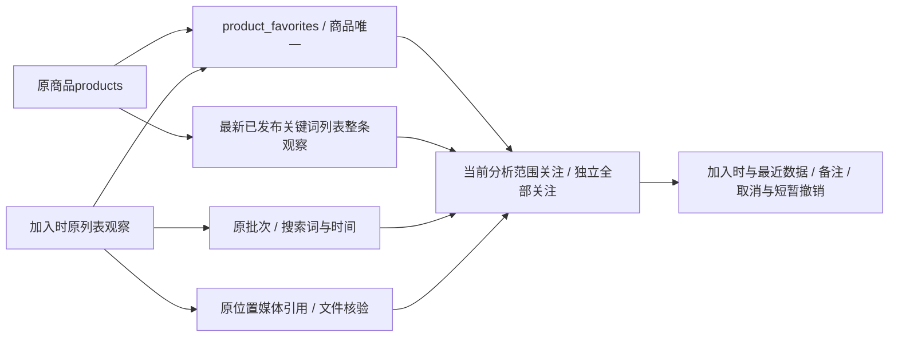

# 长期商品关注实施记录

2026-10-29用户确认执行：关注由标签页临时集合升级为数据库长期清单。旧关注不迁移，第一版全工作台共用，无自动采集、提醒、评分或专用导出。实现采用独立favorites业务和存储模块，原分析统计不参与关注写入。

## 保存、身份与来源

新增0010_product_favorites/schema_v10，0001～0009与旧冻结模型不改；只新增product_favorites及两条RESTRICT外键、商品唯一约束和关注时间索引。保存id、product_id、observation_id、source_keyword、note、created_at、updated_at，不复制价格、人数或图片。事务核对商品身份、观察同商品和published/list/keyword批次，搜索词从原批次读取；同商品行锁串行化重复添加及修改，重复添加不重置原记录。

原分析页星标和侧栏调用同一关注接口，后台状态是唯一依据，旧sessionStorage和saved参数不导入。分析页“我的关注”继续服从原关键词/范围/广告/明细条件；侧边栏/favorites独立查看全部关注，搜索标题或完整编号、筛选加入时词及最近店铺、按关注/采集时间排序，SQL计数和每页20件分页，无原200件限制。

备注普通文字最多500字，服务端校验和模板转义；操作成功才改变星标，写入失败保留原状态。写接口仅本机、同源JSON、当前Web令牌，GET不写关注。取消物理删除关注关系，不删除商品或资料；10秒签名撤销恢复原编号、依据、时间和备注，错商品/篡改/超时/已重新关注时拒绝。旧页面不能凭旧关注编号修改新记录，服务重启只影响尚未使用的临时撤销凭据，不影响已保存关注。原清理入口在删除依据前检查关联，外键最终保护。

## 数据对照与页面

加入时依据固定，最近观察从全关键词已发布列表按采集时间/批次/观察编号降序取同一条。查询用窗口与分页批量加载，图片仅关联该观察自己的批次和位置，缺价/缺图不补历史字段。暂存、隔离、非关键词批次不混入；依据不可见时保留关注，明确提示。

数据状态区分关注之后新采集、尚未重新采集，以及从旧观察关注但关注之前已有更新观察，避免用ID不同误称“加入后采集”。对照保留价格条件、人数原文/口径、店铺、来源词、时间和依据入口；同口径展示值可说明上升/下降，同“+”值不认为实际未变，口径不同不直接比较，差额不当新增销量。价格未核对SKU，不直接认定同规格涨跌。

公共favorites.js维护关注交互，CSS复用公共控件变量及主/次按钮，独立页手机卡片、两次数据纵向对照。备注/展开不跳页，取消后短暂撤销，过期刷新保留URL与滚动位置，末页自动回到有效页。多个取消提示独立保留，不因编辑其他备注清除撤销入口。

## 验证与正式数据

65项相关单元通过，覆盖关注幂等/归属/发布、旧参数不导入、全关键词整条观察、备注与页面转义、签名撤销及失效、203件SQL分页、最终页回退、冻结旧表结构，以及原分析/集中度/腰部/恢复边界。6项本地网页专项通过，覆盖关闭原标签后新标签仍保留、侧栏与星标、备注、对照、取消撤销、手机筛选、未知身份禁用、失败不假成功及原店铺/腰部操作。未跑无关全量回归。

验证库、正式库升级至0010，实际中文备注、列、索引、唯一/外键约束检查通过。升级前正式库无未完成任务和运行采集申请，并取得两平台资料锁；升级前后原25张业务表逐行哈希一致，两库关注表初始均0，无旧数据导入。另1项真实MySQL专项在_verify库事务内验证中文备注数据、唯一与引用拒绝、父记录删除保护，全部合成业务记录回滚。

正式站/favorites及分析页GET返回200，桌面1480及手机390的正式空清单与隔离样例有数据页检查无页面横向溢出，无前端异常；截图检查修正了手机标题区受全站header固定高度影响的问题。正式Web重启不启动采集，本轮未添加正式关注或访问真实平台。证据在workspace/output/reports/favorites/20261029/，不入Git；程序验证通过，人工验收待用户查看。

真实来源可沿用原粘毛器任务227ab3e0d5d348859bbf566961080fd4、批次145、观察70、商品60/平台868768981093；它们说明关注接口可关联的原商品/观察/批次层级，并未创建对应正式关注。加入时搜索词从批次读取，主图从原媒体引用匹配，合成测试不冒充真实关注。

