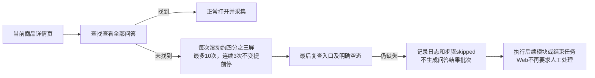

# 问大家入口缺失跳过说明

2026-10-26，按用户确认方案实施：每次向下约四分之三屏检查入口，最多10次；连续3次页面位置和高度不变时提前停止。仍无“查看全部问答”入口则记录日志并跳过，继续下一模块或正常结束任务。

## 入口和异常边界

入口一旦出现即停止滚动并打开。最后一次滚动后再次检查，避免遗漏第10次或第3次稳定滚动后刚出现的入口；明确暂无问答仍按原空态规则处理。

只有缺失入口可以跳过。商品变化、入口不唯一、问答结构无法识别、登录验证及打开后的内容错误仍由原守卫处理，不转为跳过。寻找入口只滚动当前详情页，不重新打开商品。

跳过发生在创建问答工作库、批次及导出文件之前：不写零条成功结果，不覆盖questions或questions_last_attempt，不更新问答有效指针。已保存问答保留，下次新任务仍会寻找入口。

## 记录与收尾

- INFO日志“未找到问大家入口，已跳过”，包含实际滚动次数和停止原因。统一事件为collection_module_skipped。
- 详情步骤requested=true、status=skipped、continuation_allowed=true；stop_reason=entry_not_found，entry_search保存scroll_count、max_scrolls=10、unchanged_count及scroll_limit_reached/stable_position。
- 运行使用既有complete_with_warnings，提示含跳过项目；其余模块正常处理后任务可以正常结束，不要求人工继续。
- Web单模块、指定多模块及补采任务都核对当前任务+商品的最新数据库步骤。有效采集valid与流程已处理satisfied分开，完成数量不包含跳过；没有结果批次不再把合法跳过误判为需人工处理。
- Web刷新及异常退出后的结果恢复保留跳过事实；旧任务、其他商品、旧运行和未经入库的本地进度不能冒充本次跳过。

不新增表或列，状态/JSON取值已登记[字段取值说明](../数据库字段取值说明.md#步骤状态及放行)，既有原生列备注覆盖步骤实际结束状态与放行依据，不改写旧迁移和旧记录。操作规则见[使用指南](../使用指南.md)。

## 隔离验证

使用临时配置、数据库样例、模拟依赖与拦截请求的浏览器页面，无真实淘宝采集，也不控制用户当前采集进程。

411项单元回归和59项问答/Web浏览器检查通过。覆盖10次上限、3次稳定提前结束、最后一次滚动挂载入口、明确空态、入口不唯一和验证不跳过；旧问答与全部文件保持不变；跳过汇总、单模块/多模块收尾、数据库归属与最新步骤核对、页面正常结束且可重新采集。回归既有问答展开、数量范围、媒体、发布回滚和Web任务交互。

此图表示本地验证的控制流程，不使用虚构编号代表真实采集记录。本机验证日志为workspace/questions-skip-regression.log、workspace/questions-skip-browser.log。人工平台验收仍以[功能逐项验收清单](../功能逐项验收清单.md)另行记录，不把本地模拟标记为真实验收通过。
