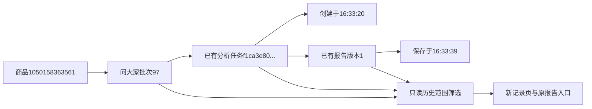

# 问大家分析记录统一样式

2026-10-31用户批准参照评价分析记录，并一并补充商品名称、来源跳转、失败原因、准确数量与时间说明及空状态。

## 页面

新增question_analysis_history模板，复用现有ra-history布局、公共表单、搜索下拉、按钮、状态和来源卡，不复制控件外观。标题区增加竞品研究/分析历史、商品名称及右侧返回问大家。筛选区左侧记录范围/查看，右侧分析问答仍打开原确认弹窗；待切换提示保留已应用范围，全部批次只浏览，具体完整且有问题的批次可分析。

成功报告卡独立显示，不受最近100条记录上限影响，新失败不遮盖旧成功；最新失败/部分/进程中断有独立进度说明。卡片按现有规则查找当前范围创建时间最近的成功任务，显示其模型/来源问题数和最新报告版本保存时间，不将创建时间当作报告保存时间，更不当作AI实际结束时间。

六列表格为创建时间、来源批次、模型、状态、问题数量、结果。来源批次链接回原问答；来源N个问题不混用回答数/人数。状态使用颜色和文字，失败/部分/中断可显示简短安全说明（优先取明确原因，最长64字），完整说明进入原进度页；完成有报告时查看报告，部分结果/失败/运行进度入口区分。顶部及表格均明确最近100条，不宣称是总条数。空记录、有失败但无成功、没有完整问题资料分别说明。

手机筛选独行、按钮并排，最新卡纵排，记录标题与条数换行，表格自身横向滚动并有提示，页面不整体溢出。缺失或陌生批次明确拒绝，不回退到其他商品/批次；当前报告/历史报告内容不改变。

## 数据与验证

history_page为纯读业务方法；历史SQL只选择显示字段，避免每行读取包含完整提示和发送计划的大JSON。latest_report_info只读报告id/version/created_at；无AI客户端、重查、统计回写或任务派发。现有repository历史/成功方法默认返回契约保留，display_only为新可选投影。数据库0019、原表/字段/备注/JSON语义和北京时间保持。

52项问答/卡片/评价V6/旧评价回归通过，覆盖商品批次隔离、全部范围禁分析、保存时间与创建时间不同、只读不改数据、101条新失败仍展示更早成功、空批次及原费用守卫。隔离浏览器1440/390/320核对未应用不改入口、应用全部后无分析入口、原弹窗、最近报告、简短原因、进度入口与无页面溢出。

实际商品1050158363561、批次97：现有任务f1ca3e80b7004fb99ba63a0ee5b9ae21，来源5个问题。表格创建时间2026-10-31 16:33:20，报告卡保存于2026-10-31 16:33:39、版本1，均直接读取已有元信息。三视口截图、只读核对、Web重启及两库32表前后行数/全行SHA256位于workspace/output/reports/question_history。无真实AI、采集或业务写入，数据指纹相同；只隐藏重启本项目Web，采集进程保持。

图中为已有记录的读取关联，未创建新任务或调用AI；人工样式验收待用户查看。
