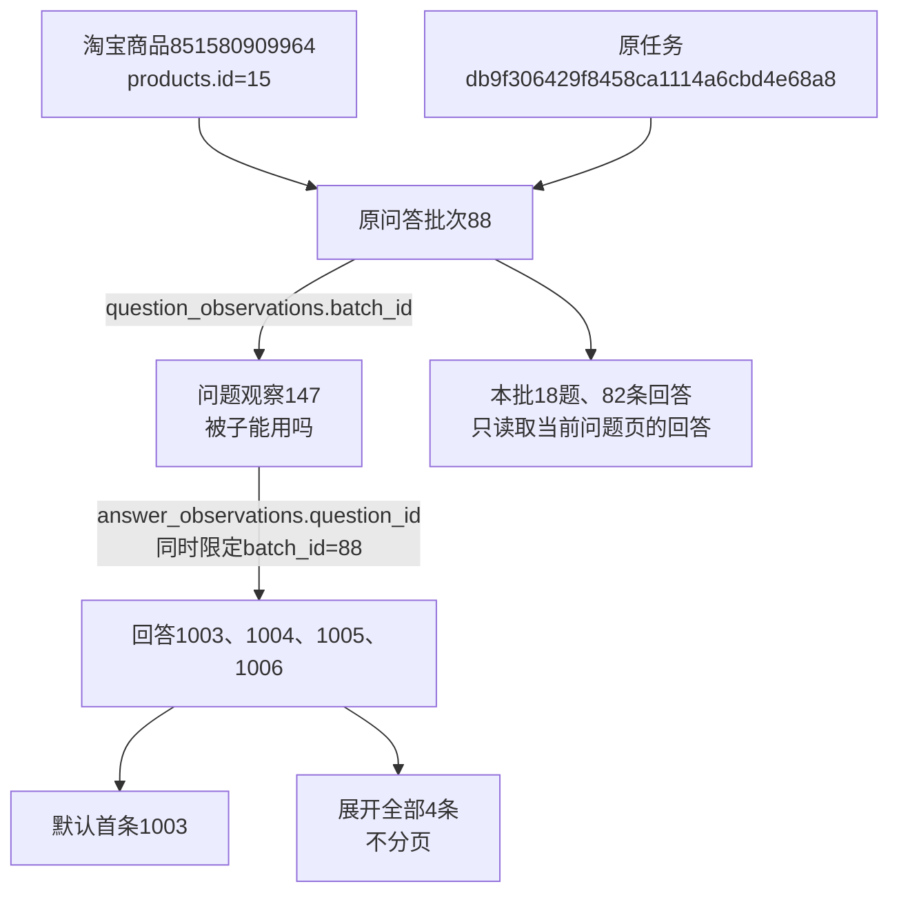

# 问大家卡片展示

2026-10-26，用户确认参考图的卡片展示，并明确展开的回答全部展示、不分页，随后下达执行命令。

## 展示和查询

商品问大家页、独立问答批次页统一使用问题卡片：橙色问标识、加粗问题，默认显示首条已保存回答。用户、完整回答、已有身份／购买标识、回答时间和规格分别展示，不补造头像、会员等级或日期，不把问题预览文字当作正式回答。

原生展开控件显示“查看全部已采集回答（N）”，N是本批实际保存数量。展开后全部显示，不经过原回答查询100／200条限制，也没有回答分页；点击收起恢复首条。没有回答、单条回答及回答采集未完成分别处理。展开不导航、不创建任务、不访问平台。

问题仍每页20条，保留原始顺序、内容、提问用户和采集时间排序，历史批次和列表关联运行范围沿用原查询。商品问答页提供原单模块采集入口及人工弹窗。媒体按同批、同回答编号读取，评论和回答共用安全地址整理及预览；本地文件必须校验，来源图片／视频限现有淘宝素材域名。图片使用全站本页放大，失效明确提示，不新增下载能力。

## 验证

- 38项单元检查通过：5项问答检查、8项评价检查和25项资料浏览回归。验证22题按20／2分页，单题225条回答完整返回，跨问题、跨批次回答与媒体不串入，HTML转义、预览不冒充回答、历史范围及本地文件访问正常。
- 12项既有浏览器检查通过：评价4项及Web采集8项。
- 问答4项浏览器检查最终通过：默认首条、展开225条、再次收起、问题排序分页、独立批次卡片、初始及隐藏回答图片的本页预览、缺少资料时派发当前商品问答及人工提示。
- 首轮图片等待检查受到页面现有CSP对字符串求值的限制，已改用函数形式等待并复核问答4项通过；没有放宽页面安全策略。

日志：workspace/output/reports/question_cards_unit_20261026.log、question_cards_browser_20261026.log及question_cards_browser_final_20261026.log。首轮浏览器日志保留检查错误，问答最终结果以final日志为准。隔离检查使用临时SQLite、合成媒体和模拟任务，不执行真实采集。

## 真实资料只读核对

商品851580909964，内部products.id=15；原任务db9f306429f8458ca1114a6cbd4e68a8，原问答批次88，采集时间2026-10-25 20:13:15（北京时间）。保存18个问题、82条回答，逐题核对页面包含该题全部已存回答，初始仅首条可见。

问题观察147的原文为“被子能用吗”，回答观察1003、1004、1005、1006共4条。默认回答1003，展开4条、收起恢复1条；未显示回答分页。姓名、回答内容、时间和购买规格均来自该批原记录。

平台商品号识别淘宝商品；内部商品号用于本库关联；任务代表原采集执行；批次是一次问答保存结果；问题与回答分别是各自观察，回答通过question_id归属问题。可选回答媒体通过answer_observation_id归属回答，本批没有已保存回答媒体引用，图片预览由合成媒体隔离验证，不宣称该批已下载图片。

无数据库结构及字段含义变化，业务数据新增0、修改0、删除0，19张业务表数量前后一致。原批次、全部问题／回答及媒体的完整快照SHA256前后均为9e302bfea80e3e6e00ccbc49b80bf46a3e4bffb2500a44b1f22791faaaaf9046。

只读报告：workspace/output/reports/question_cards_live_20261026.json。截图：question_cards_collapsed_20261026.png、question_cards_expanded_20261026.png、question_cards_page_20261026.png。没有重启用户原Web服务，重启并刷新后供人工查看确认。
