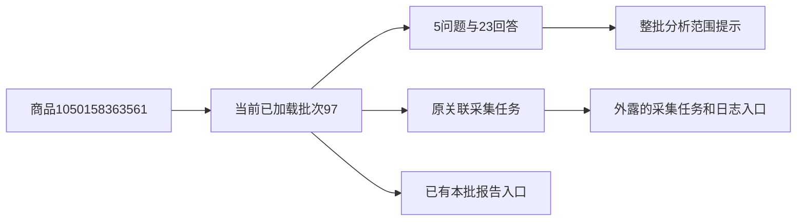

# 问大家采集操作外露

2026-10-31用户批准，参照评价明细将三个采集操作移出更多菜单，并统一按钮层次与移动布局。

## 最终页面

标题左侧“问大家”，右侧保留唯一module-job-status采集状态；静态已加载状态和动态任务状态使用同一组件，已确认成功简洁显示，异常/暂停仍按原规则完整显示。批次选择及查看靠左，重新采集问大家/查看采集任务/查看采集日志靠右；任务为浅色描边、日志为公共淡蓝样式，分析为深绿色主按钮。宽度不足整组换行，手机保留直接可见的按钮。

采集时间、当前批次和问题/回答数量集中在说明行；采集范围详情仍按需展开。浅绿区域左侧明确当前整批分析范围，右侧分析问答/分析记录。成功报告或任务进度在独立紧凑条显示，不重复占据主分析操作。原分页、排序、回答展开、媒体、已加载批次及费用规则保持。

查看采集任务和日志使用selected.task_id；选择其他批次但尚未查看时，链接和分析范围不变，点击查看后更新。没有关联任务时不伪造按钮。采集脚本继续只更新data-collection-actions，不会改写分析按钮；新增data-preserve-source-links仅控制问大家缺失日志入口的补入，其他批次的轮询结果不提供为当前批次日志。其他模块沿原默认行为。

## 验证

35项问答/卡片/评价V6相关检查通过。隔离浏览器1440/390/320核对三个按钮直接可见、无更多菜单、单一状态、异常说明完整、任务日志在待切换时保持原批次/应用后切换，以及原分析弹窗、费用守卫和报告阅读。实际商品1050158363561批次97（5问题/23回答）三视口只读核对按钮、报告、弹窗及窄屏无溢出；截图和重启记录位于workspace/output/reports/question_actions。

两库32业务表的行数及全行SHA256前后相同，0019不变，无真实AI或平台采集、业务写入。仅隐藏重启已核对的本项目Web进程；未停止采集进程。文档与本地提交同步，用户样式验收待刷新查看。

上述均为已有来源的读取展示，不创建采集任务或AI请求；重采按钮仍沿原入口由用户操作。
