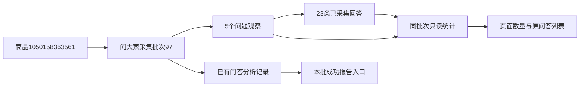

# 问大家页面整理

2026-10-31用户批准，将页面排版、状态表达及手机适配一次整理。数据库0019保持，不修改采集规则、AI提示、费用确认或已保存分析。

## 最终布局

顶部一张卡：问大家标题、整批问题/回答数、采集状态、更多操作；下面紧凑的批次搜索选择及“查看”，再是分析问答/本批成功报告/分析记录及状态。成功状态不显示重复进度按钮；活动/失败进度单独提供，旧成功报告始终保留。采集时间与采集范围说明位于底部，数量上限/停止依据按需展开。任务、日志和重采收在更多菜单，原关联用途保留。

列表上方使用可搜索的排序选择和升降序按钮；换排序回第一页且保持已应用批次。问题更突出，回答作者/日期/规格为次要信息，首条回答及其余展开保持。全部回答与媒体不截断，未采得回答不解释为平台零回答。整批回答未确认采全时提示，明细保留原完整性提示。无问题不显示分析启动入口，读取失败明确显示重试且不提供启动按钮；空批次分析记录也可正常查看。

切换下拉后显示待应用，原数量、列表、报告和分析范围不变，点击查看才加载新批次。查看/分析提交均有处理中反馈；分析原有费用守卫、重复任务选择和错误反馈保持。手机批次与操作自然换行，长名称省略显示且下拉可搜索，菜单进入顶层不裁切，列表自动换行。

## 数据与修复

records的with_question_counts为可选只读开关，仅questions可启用，在同一已核对批次读连接中统计全部问题、回答和未确认采全题数。回答通过question_id/batch_id双条件关联，异常跨批次样例不计入；排序/分页不改统计。分析摘要按商品/类型/批次返回轻量信息，每10秒仅在页面可见时刷新，成功报告不受100条历史限制；无AI请求。

collection.js原来在首个module-actions内寻找同batch链接，会误将data-qa-open分析入口改写为“查看资料”。本次使用明确的data-collection-actions，且候选排除分析入口；成功时不重复生成当前资料链接，问大家保留重采按钮。其他模块默认行为保留，错误/暂停消息不当作成功精简。操作和来源仍绑定各自任务/批次，不合并不同任务的日志。

新增product_questions模板与question_page脚本，使用公共表单/菜单/状态/搜索选择组件，模块CSS仅布局。原问答卡片复用于独立批次页，排序保留无脚本应用和方向切换入口。公共菜单增加可选次要样式，其他调用默认不变。

## 验证

693全量单元通过；最终51项问答/卡片/评价相关回归覆盖整批22题226回答与页间一致、错误回答归属不计数、空批次历史、读取异常禁用分析、新失败保留旧成功报告及原评价行为。隔离浏览器1440/390/320模拟采集任务状态，验证分析按钮不被改名、待应用不换范围、应用后换批、排序、原弹窗费用确认和报告定位。真实批次97读取为5问题/23回答，三视口检查本批报告、分析弹窗及更多菜单通过；无真实AI或采集。两库业务行数/指纹前后核对保留在workspace/output/reports/question_workspace。

本轮仅隐藏重启已核对的项目Web进程，未停止采集进程；人工阅读体验验收待用户刷新确认。

实际只读流转：

商品编号是平台身份，批次97是一次问大家采集资料，问题和回答是原始观察；统计不是销量或人数，已有分析记录是独立生成历史。本轮仅读取这些资料，未采集或调用AI。before.json/after.json核对两库32表完整内容及行数相同，0019保持。
