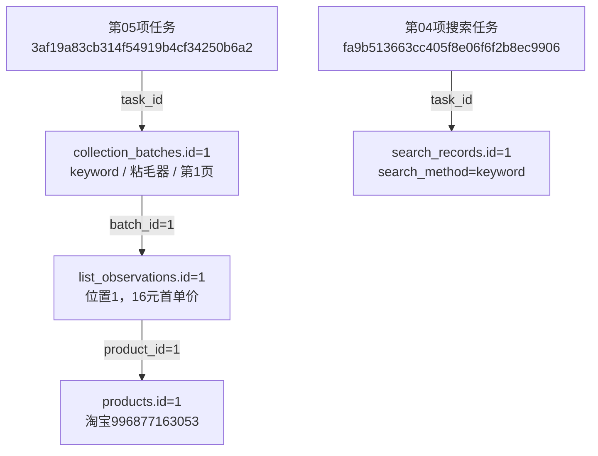

# 搜索来源字段升级验收报告

完成时间：2026-10-23T20:47:29.106244+08:00。正式库taobao_automation和独立验证库均为0003_search_origin，23张表、283字段、49外键，原生中文备注完整，schema_errors为空。

本次按用户确认仅修改数据库和数据填充。Web页面、路由与筛选没有修改；平台以图搜图尚未实现。第05项仍待人工验收，第06项未开始。

## 结构变更

两张表新增7列、2个图片外键、5个查询索引及7个来源检查约束；原有表、字段和关联保留。旧schema_v1、北京时间schema及0001/0002迁移文件校验值与升级前一致，运行时使用独立schema_v3。

| 表 | 新增字段 | 原生中文备注 |
|---|---|---|
| collection_batches | search_method | 搜索方式：keyword 关键词、image 以图搜图、unknown 已确认搜索但方式未知；NULL 表示未记录或不适用 |
| collection_batches | search_image_file_id | 搜索输入图片文件编号：关联 file_assets.id；关键词搜索或来源未提供时为空，不是结果商品主图 |
| collection_batches | search_keyword | 来源搜索词：实际提交的原文；新关键词搜索必填，纯图片搜索或来源未知时为空，不从商品标题推测 |
| collection_batches | page_number | 来源列表实际页码：从1开始；原记录未提供或不适用时为空，不默认第一页 |
| collection_batches | search_options | 实际附加搜索条件：JSON对象，保存已确认的筛选或未来图片裁剪参数；SQL NULL表示未知或未提供 |
| search_records | search_method | 搜索方式：keyword 关键词、image 以图搜图、unknown 已确认搜索但方式未知；NULL 表示未记录或不适用 |
| search_records | search_image_file_id | 搜索输入图片文件编号：关联 file_assets.id；关键词搜索或来源未提供时为空，不是结果商品主图 |

两个图片字段分别通过fk_batch_search_image、fk_page_search_image关联file_assets.id，可空，一文件可对应多个来源；更新和删除均RESTRICT。新方式值为keyword、image、unknown，NULL代表未记录或不适用。search_options缺少依据时保存SQL NULL。

## 正式库原记录前后值

业务记录新增0、删除0；现有两行补齐新增列，原有字段修改0。alembic_version版本记录从0002_beijing_time变为0003_search_origin。

| 表及主键 | 字段 | 升级前 | 升级后 |
|---|---|---|---|
| collection_batches.id=1 | search_method | 该列尚不存在 | keyword |
| collection_batches.id=1 | search_image_file_id | 该列尚不存在 | SQL NULL |
| collection_batches.id=1 | search_keyword | 该列尚不存在 | 粘毛器 |
| collection_batches.id=1 | page_number | 该列尚不存在 | 1 |
| collection_batches.id=1 | search_options | 该列尚不存在 | SQL NULL |
| search_records.id=1 | search_method | 该列尚不存在 | keyword |
| search_records.id=1 | search_image_file_id | 该列尚不存在 | SQL NULL |

collection_batches.id=1的来源词粘毛器、页码1来自第05项原记录；search_records.id=1属于第04项，其已有keyword=粘毛器、page_number=NULL保持原值。本次没有补造搜索记录，也没有将两次任务关联为同一次搜索。

## 各表业务数量

| 表 | 升级前 | 升级后 | 新增 | 删除 | 原有列修改 |
|---|---:|---:|---:|---:|---:|
| import_runs | 0 | 0 | 0 | 0 | 0 |
| tasks | 7 | 7 | 0 | 0 | 0 |
| products | 5 | 5 | 0 | 0 | 0 |
| collection_runs | 0 | 0 | 0 | 0 | 0 |
| collection_steps | 0 | 0 | 0 | 0 | 0 |
| collection_batches | 1 | 1 | 0 | 0 | 0 |
| product_current_sections | 0 | 0 | 0 | 0 | 0 |
| search_records | 1 | 1 | 0 | 0 | 0 |
| list_observations | 5 | 5 | 0 | 0 | 0 |
| sku_observations | 0 | 0 | 0 | 0 | 0 |
| parameter_observations | 0 | 0 | 0 | 0 | 0 |
| review_summaries | 0 | 0 | 0 | 0 | 0 |
| review_observations | 0 | 0 | 0 | 0 | 0 |
| question_observations | 0 | 0 | 0 | 0 | 0 |
| answer_observations | 0 | 0 | 0 | 0 | 0 |
| file_assets | 3 | 3 | 0 | 0 | 0 |
| media_references | 8 | 8 | 0 | 0 | 0 |
| collection_checkpoints | 0 | 0 | 0 | 0 | 0 |
| import_sources | 0 | 0 | 0 | 0 | 0 |
| import_row_mappings | 0 | 0 | 0 | 0 | 0 |
| import_issues | 0 | 0 | 0 | 0 | 0 |
| task_events | 121 | 121 | 0 | 0 | 0 |

## 新记录自动填充及兼容

- 新关键词搜索和列表采集明确生成search_method=keyword，来源JSON格式为3；列表已有关键词、页码继续使用。CSV格式保持原样。
- 数据库来源列由同一份业务来源解释，不改写旧规范快照的头或指纹；来源字段冲突时拒绝，旧缺失值不会清空已回填内容。
- 新显式搜索来源scope_contract版本为2，加入方式、输入图内容SHA-256及附加条件；旧记录继续版本1和旧scope_key。
- 图片输入文件关联和用途仅在独立库用合成文件验证，没有向正式库写入图片搜索假记录，也未执行平台以图搜图。

## 本轮真实数据流转

第05项任务为3af19a83cb314f54919b4cf34250b6a2，原批次号为3af19a83cb314f54919b4cf34250b6a2-694d54a9。第一件商品的商品身份、列表观察及16元首单价保持原样，只补齐所在批次的来源列。

上述task_id、batch_id、product_id为已有外键；两条搜索来源链互相独立，search_records与collection_batches没有直接外键。关键词方式的search_image_file_id都为空。

## 验证及证据

- 232项单元测试通过。MySQL相关集成测试24项通过，1项原有浏览器人工回调测试未额外启用；另有16项基础数据库检查全部通过。
- 来源迁移覆盖证据冲突在DDL前拒绝、首列创建后中断、版本提交前回滚、恢复重试和重复升级。旧北京时间迁移回归也通过，不再次偏移正式库时间。
- 新旧快照实际写入、重复重放、图片文件外键、非法方式/页码/缺词拒绝、原有采集和任务日志回归通过。
- 正式库原两份采集快照完成只读逐字段核验；7份原件和18个受保护代码文件校验值再次核对一致。所有原列、旧JSON和旧指纹均与基线一致。
- 验证库22张业务表最终均为0条；正式库没有新任务或新采集。真实浏览器新采集复测未启动，后续仍遵守第05项人工确认流程。

[升级前基线](../workspace/output/reports/search_origin_20261023_before.json)、[升级后完整记录](../workspace/output/reports/search_origin_20261023_after.json)、[验证库基础检查](../workspace/output/reports/search_origin_20261023_verify.json)、[人工核对只读SQL](../workspace/output/reports/search_origin_20261023_inspection.sql)。
