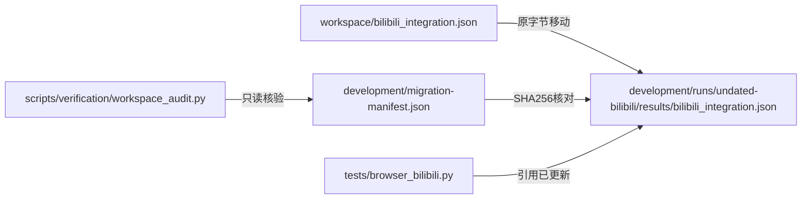

# workspace 文件整理与核验

`workspace` 保存本机运行资料，整体被 Git 忽略。源码在 `src`，可复用的只读验证工具放在 `scripts/verification` 并纳入版本管理。

## 目录用途

| 目录 | 用途与规则 |
|---|---|
| input | 商品表格、图片等输入资料，保持原路径 |
| output | 原始采集文件、处理结果、报告和分析回执，保持原路径 |
| storage | 登录资料、任务控制、数据库缓存和视频缓存，保持原路径 |
| models | 当前配置使用的分词器等资源，保持原路径 |
| logs | 正常运行日志，保持原路径；本轮不清理其内容 |
| development/runs | 按功能集中存放验证脚本、配置、日志、结果和截图 |
| development/archive | 暂时无法可靠归类的历史材料 |
| development/migration-manifest.json | 原路径、新路径、字节数、SHA256、状态及引用修改记录 |

新验证目录采用 `日期-功能-序号`；仅创建需要的子目录。历史 `undated-*` 表示执行日期未核实，不使用文件修改时间猜测执行日期。

## 本轮整理结果（2026-11-03）

- 移动 301 个文件，共 57,533,863 字节；每个文件移动前后 SHA256 一致，历史内容没有改写。
- 按可确认功能与未分类归档分成 58 组，各组附说明；workspace 根目录散落文件数为 0。
- 合并旧 `verification` 和 `verify` 的验证资料，移除搬空的目录。
- 更新 17 份历史文档与 2 个现用浏览器验收脚本的路径引用。
- 旧 JSON、日志、SQLite 内的历史路径作为证据原样保留；查找新位置使用清单。
- 历史一次性脚本可能带固定编号、旧路径、网络请求、数据库写入或重启命令，均只归档，没有执行。需要复用时重新核对范围和输入，不能直接运行。
- 另一个正在开发的菜单/数据库改动保留；本轮不改变业务源码、正式配置、运行资料路径或数据库结构。

## 只读核验

在项目根目录执行：

```cmd
.venv\Scripts\python.exe -B scripts\verification\workspace_audit.py
```

默认检查 `workspace/development/migration-manifest.json`。可使用 `--manifest` 指定项目内的另一份清单，`--root` 指定项目根目录。
输出 `verified_files` 是通过文件完整性核验的数量，`manifest_files` 是清单数量，`loose_files` 是根目录重新产生的散落文件，`errors` 是未完成、缺失、内容变化或旧位置重现等问题。
本轮结果为 301/301、`loose_files=[]`、`errors=[]`。工具不连接数据库、不访问网站、不删除或搬动文件。



这是实际文件迁移关系，不是业务采集或数据库任务流程。本轮没有创建采集任务/批次或分析记录，不用虚构编号代替业务证据。

## 验证与边界

- 6 项独立测试覆盖正确清单、同大小内容篡改、文件缺失、旧位置重现、路径越界和迁移未完成。
- 命令帮助正常；现有本机服务 `/health`、`/`、`/tasks` 均返回 200。
- 两个调整路径的浏览器验收脚本仅检查语法和输入文件可读性，没有重跑其中的真实缓存、保存或浏览器行为。
- 不调用 AI、不执行采集、不导入旧数据、不重跑历史脚本；未做正式/验证数据库全表内容指纹比较。其他并行开发与任务可能独立产生变化。
- 本轮只整理文件和引用，现有 Web 服务无需加载新的业务代码，保留运行服务及采集进程。

## 追溯与恢复

先停止涉及目标文件的开发验证任务，再按清单核对目标内容，将目标移回原路径。原路径已有文件时必须停止核对，禁止覆盖。
引用修改前副本在 `development/runs/2026-11-03-workspace-organization/reference-backups/`；恢复时只撤销本轮路径改动，不能覆盖后续新增内容。
归档目录不设置自动过期，不删除业务数据。以后需要清理时先生成预览，再明确范围。
