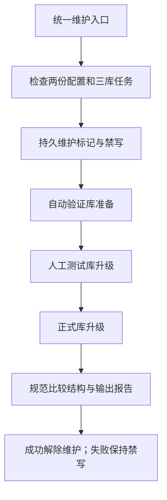

# 正式与测试环境

2026-11-03用户批准：共用一份代码，业务记录与运行资料分别存放；结构变更统一维护。MySQL沿用同一管理员，实际密码只在本机配置，不提交Git。

| 环境 | 配置 | 数据库 | 工作目录 | 网页 |
| --- | --- | --- | --- | --- |
| 正式 | config/settings.toml | taobao_automation | workspace | http://127.0.0.1:8000 |
| 人工测试 | config/settings.test.toml | taobao_automation_test | workspace_test | http://127.0.0.1:8001 |
| 自动验证 | 独立验证配置 | taobao_automation_verify | 测试临时目录 | 按测试需要 |

environment分别为production、test、verify。缺失时按已登记库名推导，其他旧独立配置使用空字符串；显式标识与库名不匹配会拒绝。人工测试的工作目录必须为项目内workspace_test，MySQL任务和采集后端均启用；登录资料和自定义临时目录必须位于该目录。测试与正式配置采用相同配置项，环境、目录、库和端口分别填写。人工测试首次需独立登录；原正式资料保留。

在项目根目录CMD启动：

```cmd
python main.py --config config/settings.toml web --port 8000
python main.py --config config/settings.test.toml web --port 8001
```

命令行显示环境与库名，网页公共页头显示环境。后台申请保存固定配置，恢复时核对库目标、工作目录和环境；旧申请不搬迁、不批量改写。任务、日志、采集、分析报告以及文件缓存各在所属环境保存。同一商品编号在不同库独立解释。AI公共模型配置仍读取config/ai.toml，其只读模型定义和服务凭据共用；测试分析仍连接真实AI服务，沿用已有费用确认。本轮不新增真实付费调用。测试CLI禁止--submit真实上架。

## 统一结构升级

正式或人工测试配置执行以下命令，会在同一轮准备验证库、升级人工测试库、立即升级正式库：

```cmd
python main.py database upgrade
```

固定加载两份本机配置，缺失、库名不符或服务不同即停止；正式库与验证库必须已存在，只有缺失的人工测试库允许创建空库。自动验证配置执行upgrade仅处理其选中的验证库，不触发正式维护。全部使用已有版本化迁移，冻结历史版本不改写，不复制业务记录。新测试库为空时从首版建立；正式库已为当前版本时检查并保持原记录。

维护入口持跨进程锁及两环境浏览器资源锁，检查任务运行状态。维护标记写入workspace/storage/schema_maintenance.json；引擎在每次SQL写入前检查标记，网页维护期间拒绝写请求。任务正在运行时等待其正常结束再重试，不强行停止任务。只读SQL继续可用。

每库升级后检查目标版本、完整字段、类型、可空性、默认值、索引、约束和中文备注，并按字段名称规范比较三库实际结构（历史物理列顺序不重排，语义等价检查表达式按语法树比较）；记录数和自增计数不参与比较。报告在workspace/output/reports/schema_upgrades，包含目标、原版本、结果和失败时实际版本，不含密码。升级开始后失败保留维护标记和禁写状态，重启不清除；修复后再次执行同一命令，全部核对成功才删除标记。不要手工删除标记或修改版本号掩盖差异。

两库顺序提交，不能保证异常时一起撤销。删字段、删表或数据转换等后续变更应在该轮方案中另行明确备份与恢复办法。数据库客户端手改造成的结构差异需登记迁移处理，不自动猜测或覆盖。



本轮不提供清空测试数据工具，不清理正式库历史测试记录，不复制两边业务数据。实际验证结果见本机workspace/output/reports/environment_split_20261103；详细字段含义继续维护于[数据库字段取值说明](../数据库字段取值说明.md)。

## 本轮验证结果（2026-11-03）

三库已达到0025_web_menu，逐库schema_errors为空，按字段名及约束语法树比较一致。历史库的collection_batches物理列顺序与全新建库不同，检查表达式也有_ascii/_utf8mb4等价表示；不重排旧库数据，比较保留逻辑定义、约束及备注。已有正式库和自动验证库各业务表的计数及完整内容摘要在维护前后相同；人工测试库tasks/products/collection_batches/analysis_tasks均为0。

841项完整单元通过；补充失败重试保护后80项相关复测通过。真实MySQL合成任务80545c1b700a4597a585bea9428d88bf仅在测试事务内可见，正式库查无该任务，事务已回滚；真实SQL维护阻断和只读可用、后台跨库恢复拒绝通过。CLI测试--submit已实际拒绝，未触发浏览器。两网页各6个入口200并包含正确环境标识；160份Markdown的857条本地引用通过。未执行真实淘宝采集或付费AI。维护标记已由成功重试正常解除。

## 网页环境识别

人工测试网页左上角品牌区和顶部提示使用橙色，显示“测试环境”和taobao_automation_test。正式环境保持原有外观；命令行标签及两库归属不变。详见[展示记录](../变更记录/测试环境橙色标识.md)。
