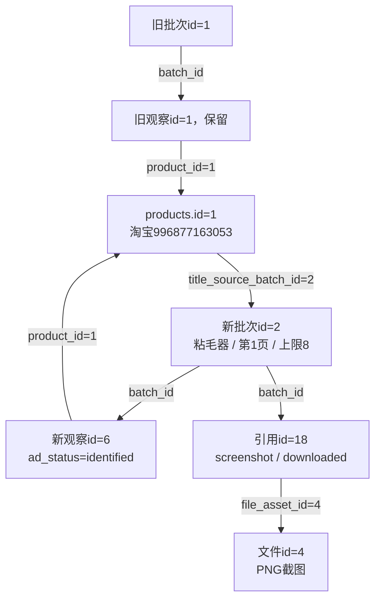

# 数据库字段取值说明

更新日期：2026-10-24。结构版本：`0003_search_origin`。本文件是所有数据库字段取值、中文含义、来源及空值规则的统一维护入口，覆盖22张业务表、1张迁移表，共283字段。

字段类型、原生备注和约束查[完整字段字典](数据库字段字典.md)；表间主外键及逻辑关联查[表关系说明](数据库表关系说明.md)。本文件集中说明“具体填什么、为什么这样填、如何查询”。以后所有字段及业务取值变化均须同步维护。

## 阅读约定

- 搜索表名、字段名或英文值，如list_observations、ad_status、identified。每表先给全字段规则，再展开状态、JSON和例子。
- “真实”例子来自2026-10-24第05项前8条保存阶段快照；独立搜索取测试前基线。它们是固定历史时点，不代表实时状态。证据见[本轮报告](../workspace/output/reports/manual_acceptance_20261024/05_list8_20261024_092729.md)、[阶段快照](../workspace/output/reports/manual_acceptance_20261024/05_list8_20261024_092729_current.json)、[测试前基线](../workspace/output/reports/manual_acceptance_20261024/05_list8_20261024_092729_before.json)。本文件补全不替代第05项人工确认。
- 没有真实记录的表标“格式”，不冒充已执行功能。原文、URL、编号、哈希按填写规则说明，不罗列所有商品标题或每条业务值。
- 区分数据库约束、程序生成、兼容保留、测试样例和预留。VARCHAR不是ENUM，开放来源不能用当前几个例子定义永久全部允许值。
- 全字段表的“中文用途”同步展示原生备注；个别备注为概括表达，更具体的实际取值及JSON规则见旁列和本表详解；数据库约束以完整字段字典为准。

## 通用取值规则

| 类别 | 填写及理解 |
|---|---|
| SQL NULL | 未提供/未知/不适用按具体字段区分，不一律解释成失败、0或确认无数据 |
| 空字符串、空数组、空对象 | 空字符串不是状态自动兜底；[]是明确保存的空列表；{}是明确保存的空对象；与未给分开 |
| JSON null | JSON字面null与SQL NULL分开；当前search_options的Python None写SQL NULL，其他25个旧JSON列默认写JSON null，读取都可得到None，详见下方实际查询 |
| 布尔 | 1/true是、0/false否；可空布尔NULL为未知/未给，不当false |
| 主键/外键 | 内部id可不连续；外键填已存在目标主键并满足商品/批次/模块/任务复合归属 |
| 平台编号 | 字符串保留前导零、不转浮点；淘宝商品当前1～25位数字且非全0 |
| 数量/位置 | 计数0与未知NULL分开，位置通常从1开始；格子位置与有效商品序号分别保存 |
| 价格 | 精确DECIMAL，常用(20,6)，最多14整数位/6小数位；结合币种、首单/补贴等口径，未知不是0 |
| 时间 | MySQL DATETIME(6)直接存北京时间UTC+08:00；CLI/API带+08:00；外部时间须有明确时区再转换，time_raw/日期原文/原文件保留来源 |
| 哈希与幂等 | 路径/内容/范围/业务源/持久操作各自规范化，不互换；补写沿用同一持久身份 |
| 预留能力 | image/search_input_image仅图片搜索契约；平台功能未实现，取值登记不代表人工验收通过 |

### JSON空值的当前实际写入口径

26个JSON字段中，仅collection_batches.search_options显式none_as_null=True，其Python None写SQL NULL；其余25个旧JSON字段使用默认none_as_null=False，Python None写JSON字面null。SQLAlchemy读取两者都可得到None，普通客户端也可能显示近似空值，必须查询区分。

原生备注中“SQL NULL表示源未提供”是设计说明；上述旧列的当前写入行为存在差别，本文按实际代码及正式库核对结果分别登记。本次只整理说明，保留现有结构、旧迁移及数据口径；若以后统一JSON空值，需要另行设计并同步迁移与写入规则。

本轮真实例子：批次2的completion_evidence IS NULL为0，JSON_TYPE为字符串NULL，即JSON null；search_options IS NULL为1，JSON_TYPE返回SQL NULL，即SQL空值。

```sql
SELECT id,
       completion_evidence IS NULL AS evidence_is_sql_null,
       JSON_TYPE(completion_evidence) AS evidence_json_type,
       search_options IS NULL AS options_is_sql_null,
       JSON_TYPE(search_options) AS options_json_type
FROM taobao_automation.collection_batches
WHERE id = 2;
```

## 按表查询目录

| 表 | 中文用途 | 字段数 |
|---|---|---:|
| [tasks](#tasks) | 任务记录表：保存任务生命周期、结果、执行资源和进程归属 | 12 |
| [task_events](#task_events) | 任务事件日志表：统一保存任务进度、日志、异常与人工提示，支持稳定任务游标 | 19 |
| [search_records](#search_records) | 页面搜索与入口记录表：保存搜索或详情入口的真实观察，不等于详情采集完成 | 14 |
| [products](#products) | 商品身份表：统一平台商品编号，标题仅为带来源的显示缓存 | 5 |
| [collection_batches](#collection_batches) | 采集模块批次表：保存实际采集结果、范围、覆盖依据、派生来源和发布状态 | 37 |
| [list_observations](#list_observations) | 列表商品观察表：保留商品在某次列表中的位置、展示字段与缺失状态 | 17 |
| [collection_runs](#collection_runs) | 商品采集运行表：某商品一次所选模块的整体汇总，不代替模块结果状态 | 10 |
| [collection_steps](#collection_steps) | 采集模块步骤表：记录模块选择、未执行原因、处理状态及放行依据 | 11 |
| [product_current_sections](#product_current_sections) | 商品当前有效结果表：按商品、分区与采集范围指向有效历史批次 | 7 |
| [sku_observations](#sku_observations) | 商品规格观察表：本批 SKU 组合、价格与图片确认状态，不制造全局 SKU 身份 | 18 |
| [parameter_observations](#parameter_observations) | 商品参数观察表：保留参数名称、值、原顺序与识别状态 | 9 |
| [review_summaries](#review_summaries) | 评价概览表：保存评价数量口径、好评率、统计周期和总结标签 | 11 |
| [review_observations](#review_observations) | 用户评价观察表：保存评价、追评及批次内身份依据 | 15 |
| [question_observations](#question_observations) | 商品问题观察表：保存问题、身份依据及回答采集完整性 | 15 |
| [answer_observations](#answer_observations) | 商品回答观察表：按内部问题主键保存回答、身份、规格和标签 | 14 |
| [file_assets](#file_assets) | 本地文件索引表：记录数据根目录下文件的位置、属性、校验和可用性 | 12 |
| [media_references](#media_references) | 媒体与证据引用表：关联源链接、用途、采集归属和可选本地文件 | 14 |
| [collection_checkpoints](#collection_checkpoints) | 采集检查点表：保留去重键、逐项状态与复用依据，不直接代表可断点续跑 | 7 |
| [import_runs](#import_runs) | 历史导入执行表：记录预览或导入的状态、范围、核对统计与解析版本 | 8 |
| [import_sources](#import_sources) | 导入来源文件表：登记一次导入使用的文件版本、格式和解析状态 | 9 |
| [import_row_mappings](#import_row_mappings) | 导入记录映射表：保留每份源记录与目标记录的逻辑映射及内容指纹 | 10 |
| [import_issues](#import_issues) | 导入问题记录表：保存输入缺失、内容冲突、格式异常和处理结果 | 8 |
| [alembic_version](#alembic_version) | 数据库迁移版本表：记录已完成的结构升级版本，无业务外键 | 1 |

## tasks

任务记录表：保存任务生命周期、结果、执行资源和进程归属。

本轮保存阶段/测试前基线真实记录；长文本/JSON只展示摘录，完整值见证据。

| 字段 | 中文用途 | 取值或填写规则 | 空值及默认值 | 例子 |
|---|---|---|---|---|
| `id` | 任务编号：32 位任务标识，保留原历史编号 | 32位UUID十六进制任务标识，保留原历史编号；不是自增数 | 不允许NULL；无数据库默认值 | 真实：538c46e0e87045dd97a33bd423766dec |
| `name` | 任务类型：业务入口名称，例如 collection.taobao.detail.open | 业务入口名；当前各入口代码及含义见本表详解 | 不允许NULL；无数据库默认值 | 真实：collection.taobao.collect |
| `status` | 任务状态：running、succeeded、failed、cancelled、needs_attention | running运行；succeeded成功；failed失败；cancelled取消；needs_attention需人工。最后一种是否结束还需看finished_at | 不允许NULL；无数据库默认值 | 真实：running |
| `started_at` | 任务开始时间：北京时间（UTC+08:00），微秒精度 | DATETIME(6)直接存北京时间UTC+08:00，微秒精度；按字段发生时点填，序列化带+08:00 | 不允许NULL；无数据库默认值 | 真实：2026-10-24T09:28:01.357709+08:00 |
| `finished_at` | 任务结束时间：北京时间（UTC+08:00），微秒精度；空值表示未发生或无法可靠确定 | DATETIME(6)直接存北京时间UTC+08:00，微秒精度；按字段发生时点填，序列化带+08:00 | 允许NULL：按本列用途解释未给/未知/不适用；无数据库默认值 | 真实：NULL |
| `message` | 任务结果说明：原始结论或等待处理原因 | 按用途保留来源文本或业务键；不是固定枚举，不用随意默认值代替未知 | 允许NULL：按本列用途解释未给/未知/不适用；无数据库默认值 | 真实：NULL |
| `origin` | 记录来源：live 实时或 historical 历史导入 | live实时；historical历史导入；数据库CHECK限制这两个值 | 不允许NULL；无数据库默认值 | 真实：live |
| `execution_key` | 执行资源键：浏览器资料目录的规范化指纹；历史未知时为空 | 浏览器资料目录规范化资源键SHA-256，用于互斥/恢复，不是登录凭证 | 允许NULL：按本列用途解释未给/未知/不适用；无数据库默认值 | 真实：9dbeff0798e901a7a2fc198eec329c4a808518bc2fec9a73c315db5d731806b9 |
| `owner_pid` | 所属进程编号：本机进程 ID，须结合进程启动时间核对；历史为空 | 本机进程ID，必须同时核对owner_process_started_at防止PID复用误判 | 允许NULL：按本列用途解释未给/未知/不适用；无数据库默认值 | 真实：16428 |
| `owner_process_started_at` | 所属进程启动时间：北京时间（UTC+08:00），微秒精度；空值表示未发生或无法可靠确定 | DATETIME(6)直接存北京时间UTC+08:00，微秒精度；按字段发生时点填，序列化带+08:00 | 允许NULL：按本列用途解释未给/未知/不适用；无数据库默认值 | 真实：2026-10-24T09:27:59.414796+08:00 |
| `last_event_sequence` | 已提交事件序号：同任务事务内分配，初始为 0 | 同任务已提交日志的最后序号；初始0，每新事件递增；不是全表日志数 | 不允许NULL；数据库默认0 | 真实：37 |
| `import_run_id` | 导入执行编号：关联 import_runs.id；实时记录为空 | 外键关联import_runs.id；保存目标主键，复合归属也需一致，不能编造编号 | 允许NULL：按本列用途解释未给/未知/不适用；无数据库默认值 | 真实：NULL |

### tasks.status与任务名称

| 值 | 中文含义 | 填写/判断规则 |
|---|---|---|
| running | 正在执行 | 已创建任务；保留浏览器等待查看时也可能仍在运行 |
| succeeded | 执行成功 | 执行器成功结束并填写finished_at；不替代用户人工验收 |
| failed | 执行失败 | 未处理的业务异常或执行错误 |
| cancelled | 用户取消 | 用户停止/中断，不能标成功 |
| needs_attention | 需人工处理 | finished_at为空可为等待；有时间可为本次以需人工处理结论结束 |

origin=live实时、historical历史导入；历史任务没有当前进程归属，不参与实时恢复。owner_pid与进程启动时间一起核对。

当前入口名：account.taobao.login/check为淘宝登录/检查；account.login/check为千牛登录/检查；collection.taobao.search独立搜索；collection.taobao.collect列表采集；collection.taobao.detail.open详情入口及所选模块；product.open/product.submit打开发布页/提交商品。字段为业务字符串，后续新增入口必须登记。

真实实例：任务538c46e0e87045dd97a33bd423766dec在保存快照时status=running、finished_at=NULL、last_event_sequence=37，8条商品已经保存。这是历史核对时点，不声明浏览器此刻状态。

### 只读查询

```sql
SELECT * FROM taobao_automation.tasks WHERE id = '538c46e0e87045dd97a33bd423766dec';
```

取值依据：[events.py](../src/ecommerce/infrastructure/tasks/events.py)；[runner.py](../src/ecommerce/infrastructure/tasks/runner.py)；[task_store.py](../src/ecommerce/infrastructure/storage/task_store.py)。

## task_events

任务事件日志表：统一保存任务进度、日志、异常与人工提示，支持稳定任务游标。

本轮保存阶段/测试前基线真实记录；长文本/JSON只展示摘录，完整值见证据。

| 字段 | 中文用途 | 取值或填写规则 | 空值及默认值 | 例子 |
|---|---|---|---|---|
| `id` | 内部编号：数据库自增主键，不代替平台业务编号 | MySQL自增内部编号，可有间隔，不代表平台编号或业务先后 | 不允许NULL；数据库自增 | 真实：156 |
| `task_id` | 所属任务编号：关联 tasks.id；无法可靠关联的历史日志为空 | 外键关联collection_batches.task_id、collection_runs.task_id、tasks.id；保存目标主键，复合归属也需一致，不能编造编号 | 允许NULL：按本列用途解释未给/未知/不适用；无数据库默认值 | 真实：538c46e0e87045dd97a33bd423766dec |
| `task_sequence` | 任务内提交序号：同任务锁内分配；无任务归属时为空 | 同任务从1递增的提交序号；task_id为空时也必须NULL；不同于全表id | 允许NULL：按本列用途解释未给/未知/不适用；无数据库默认值 | 真实：35 |
| `run_id` | 关联运行编号：关联 collection_runs.id；无该上下文时为空 | 外键关联collection_runs.id；保存目标主键，复合归属也需一致，不能编造编号 | 允许NULL：按本列用途解释未给/未知/不适用；无数据库默认值 | 真实：NULL |
| `batch_id` | 关联模块批次编号：关联 collection_batches.id；无该上下文时为空 | 外键关联collection_batches.id；保存目标主键，复合归属也需一致，不能编造编号 | 允许NULL：按本列用途解释未给/未知/不适用；无数据库默认值 | 真实：2 |
| `event_type` | 事件类型：log 或来源原事件代码，不由文本猜测控制动作 | 开放事件代码，当前代码与中文含义见本表详解；历史保留源代码 | 不允许NULL；无数据库默认值 | 真实：collection_saved |
| `level` | 日志级别：DEBUG、INFO、WARNING、ERROR、CRITICAL；源未提供可空 | DEBUG调试；INFO信息；WARNING警告；ERROR错误；CRITICAL严重错误。当前查询接受这五种，历史按源值保留 | 允许NULL：按本列用途解释未给/未知/不适用；无数据库默认值 | 真实：INFO |
| `logger_name` | 日志模块名称：历史源未提供时为空 | 按用途保留来源文本或业务键；不是固定枚举，不用随意默认值代替未知 | 允许NULL：按本列用途解释未给/未知/不适用；无数据库默认值 | 真实：NULL |
| `step` | 业务步骤名称：无上下文时为空 | 按用途保留来源文本或业务键；不是固定枚举，不用随意默认值代替未知 | 允许NULL：按本列用途解释未给/未知/不适用；无数据库默认值 | 真实：list |
| `message` | 事件提示或多行日志正文：保留必要摘要，不记录密钥 | 按用途保留来源文本或业务键；不是固定枚举，不用随意默认值代替未知 | 允许NULL：按本列用途解释未给/未知/不适用；无数据库默认值 | 真实：采集观察已保存 |
| `state` | 来源执行状态：与事件类型分开，未知为空 | 源执行状态；守卫常见running/needs_attention/resuming/stopped，任务事件另可有succeeded等；NULL表示未给状态结论 | 允许NULL：按本列用途解释未给/未知/不适用；无数据库默认值 | 真实：NULL |
| `occurred_at` | 事件发生时间：北京时间（UTC+08:00），微秒精度；空值表示未发生或无法可靠确定 | DATETIME(6)直接存北京时间UTC+08:00，微秒精度；按字段发生时点填，序列化带+08:00 | 允许NULL：按本列用途解释未给/未知/不适用；无数据库默认值 | 真实：2026-10-24T09:28:46.028997+08:00 |
| `recorded_at` | 事件入库时间：北京时间（UTC+08:00），微秒精度 | DATETIME(6)直接存北京时间UTC+08:00，微秒精度；按字段发生时点填，序列化带+08:00 | 不允许NULL；无数据库默认值 | 真实：2026-10-24T09:28:46.851006+08:00 |
| `time_raw` | 来源时间原文：无法确认时区时保留且不补造 UTC | 来源时间字符串原文，保留原时区；无法确定时区时不补造发生时间 | 允许NULL：按本列用途解释未给/未知/不适用；无数据库默认值 | 真实：2026-10-24T09:28:46.028997+08:00 |
| `time_basis` | 时间依据：explicit_offset、utc、unknown 等，说明是否可靠 | explicit_offset原时间有明确时区；unknown时间依据未知；utc为备注约定，当前写入分支不生成 | 不允许NULL；无数据库默认值 | 真实：explicit_offset |
| `details` | 进度、阻断类型、场景位置与来源记录定位等结构化上下文：JSON 对象或数组；SQL NULL 表示源未提供，原始文件另行保留 | operation_fingerprint，采集保存target/target_id/snapshot_sha256/issues；守卫进度/阻断/人工决定及历史来源定位；详见下文 | 允许SQL NULL；Python None当前写JSON null，读取同为None，需SQL区分；无数据库默认值 | 真实JSON摘录：{"issues":[],"target":"collection_batches","target_id":2,"snapshot_sha256":"96a4512fe1fa68… |
| `origin` | 事件来源：live 实时或 historical 历史导入 | live实时；historical历史；数据库CHECK限制这两个值 | 不允许NULL；无数据库默认值 | 真实：live |
| `event_key` | 事件幂等键：本地流水与数据库补写共用，不能使用每次重试的新编号 | 操作持久幂等键；实时UUID32位，恢复可带recovery:前缀，历史为稳定来源键；补写重试沿用 | 不允许NULL；无数据库默认值 | 真实：e6f1cfbece8c413b9e9daa820dd6fb5a |
| `import_run_id` | 导入执行编号：关联 import_runs.id；实时记录为空 | 外键关联import_runs.id；保存目标主键，复合归属也需一致，不能编造编号 | 允许NULL：按本列用途解释未给/未知/不适用；无数据库默认值 | 真实：NULL |

### task_events.event_type与state

event_type是开放来源代码。当前实时生成分支如下；历史按源代码保留，不从消息文字猜类型。

| 代码 | 中文含义 |
|---|---|
| task_started / task_progress / task_finished | 任务开始 / 状态进度 / 结束 |
| task_recovered | 原进程失效后记录人工核对结论 |
| log / progress | 普通日志 / 业务进度提示 |
| collection_saved | 采集快照及关联记录在同一事务保存 |
| storage_wait / storage_resumed | 等待数据库写入 / 写入恢复 |
| started / session_ended | 页面守卫会话开始 / 结束，与任务生命周期分别记录 |
| state_changed | 页面守卫状态变化 |
| document_requested | 受控页面导航请求 |
| blocked | 验证、弹窗、标签等阻断现场 |
| stale_feedback_ignored | 忽略过期人工反馈 |
| terminal_input_unavailable / input_unavailable | 终端输入通道不可用 / 人工输入不可用 |
| session_halted | 业务已因异常退出，浏览器仅保留现场；details.reason记录脱敏后的原始原因，state为needs_attention，不能原地恢复已退出的业务 |
| paced | 按操作节奏等待 |
| operation_started / operation_finished | 页面操作开始 / 完成 |
| operation_failed | 页面操作发生异常 |
| operation_verified_after_error | 异常后核对动作已完成，避免重放 |

state独立于事件类型：守卫running运行、needs_attention待人工、resuming恢复核对、stopped已停止；任务事件还可带succeeded/failed/cancelled。来源未给状态则NULL。

### task_events.details与时间依据

- operation_fingerprint为持久操作规范化SHA-256；event_key为幂等身份。补写沿用原身份及原内容。
- collection_saved含snapshot_sha256/target/target_id/issues。真实日志id=156、task_sequence=35、batch_id=2，target=collection_batches、target_id=2。
- 守卫保留脱敏time/task_id/event/state/step/progress，progress可有keyword/page_number/collected/target；阻断含kind/location/source/frame_location、截图及诊断。kind按来源，如tab标签、network网络、login登录、inspection无法检查、manual主动暂停、native原生弹窗、native_done弹窗已决定、resume_check恢复检查、business业务核对、operation动作异常，以及检测器的验证/弹窗类别。
- session_halted的reason来自导致退出的NeedsAttention异常，保留前先经日志脱敏；仅保存原因，不执行继续、重放或跳过。修复前通用保留现场分支也会记input_unavailable，不能只凭旧事件代码推断真实终端输入丢失；例如任务dfd4eff50123420fb52619b79d279503最终message为“本地事件确认文件无法核对，请保留现场；未重置或跳过记录”。其视频批次5已保存，主图批次6为interrupted且仅4/5张；SKU等6步骤not_run，旧参数有效批次仍4。2026-10-24已修正该通用分支：后续异常保留现场记录session_halted及needs_attention状态，原历史事件不改写。
- 人工决定decision按调用处记录受控值，不保存输入原文；历史可含source_record/source_fingerprint/source_kind/relative_path/record_key，不明时间文本可有time_zone_unknown/task_link_unknown=true。
- time_basis=explicit_offset原时间有明确时区；unknown发生时间依据未知；utc是备注约定，当前这些写入分支未生成。occurred_at/recorded_at仍按北京时间存，time_raw保留原文。历史时区不明不伪造发生时间。
- level采用大写DEBUG/INFO/WARNING/ERROR/CRITICAL；导入问题severity采用小写，属于不同字段。

### 只读查询

```sql
SELECT * FROM taobao_automation.task_events WHERE task_id = '538c46e0e87045dd97a33bd423766dec' ORDER BY task_sequence;
```

取值依据：[events.py](../src/ecommerce/infrastructure/tasks/events.py)；[verification.py](../src/ecommerce/platforms/taobao/verification.py)；[task_history_import.py](../src/ecommerce/infrastructure/storage/task_history_import.py)；[collection_store.py](../src/ecommerce/infrastructure/storage/collection_store.py)。

## search_records

页面搜索与入口记录表：保存搜索或详情入口的真实观察，不等于详情采集完成。

本轮保存阶段/测试前基线真实记录；长文本/JSON只展示摘录，完整值见证据。

| 字段 | 中文用途 | 取值或填写规则 | 空值及默认值 | 例子 |
|---|---|---|---|---|
| `id` | 内部编号：数据库自增主键，不代替平台业务编号 | MySQL自增内部编号，可有间隔，不代表平台编号或业务先后 | 不允许NULL；数据库自增 | 真实：1 |
| `task_id` | 所属任务编号：关联 tasks.id；未知时为空 | 外键关联tasks.id；保存目标主键，复合归属也需一致，不能编造编号 | 允许NULL：按本列用途解释未给/未知/不适用；无数据库默认值 | 真实：fa9b513663cc405f8e06f6f2b8ec9906 |
| `product_id` | 商品内部编号：关联 products.id；搜索页或身份未知时为空 | 外键关联products.id；保存目标主键，复合归属也需一致，不能编造编号 | 允许NULL：按本列用途解释未给/未知/不适用；无数据库默认值 | 真实：NULL |
| `record_type` | 记录类型：search 搜索或 detail_open 详情入口 | search独立搜索摘要；detail_open详情入口；CHECK限制这两种 | 不允许NULL；无数据库默认值 | 真实：search |
| `keyword` | 搜索关键词：详情入口无关键词时为空 | 实际搜索词，keyword方式必填；详情入口无搜索词时NULL，不从商品标题推测 | 允许NULL：按本列用途解释未给/未知/不适用；无数据库默认值 | 真实：粘毛器 |
| `page_number` | 页面页码：从 1 开始，未知为空 | 实际页码从1开始；未提供NULL，独立搜索摘要不凭默认界面猜第一页 | 允许NULL：按本列用途解释未给/未知/不适用；无数据库默认值 | 真实：NULL |
| `sort_label` | 观察到的页面排序：未知为空 | 摘要实际提供的页面排序原文；缺失NULL，不猜默认排序 | 允许NULL：按本列用途解释未给/未知/不适用；无数据库默认值 | 真实：NULL |
| `status` | 来源实际状态：入口打开不提升为采集成功 | results搜索结果已确认；empty明确无结果；opened_pending_dom_review入口打开待DOM核对；保留源值 | 不允许NULL；无数据库默认值 | 真实：results |
| `source_url` | 来源页面链接：公开必要路由 | 按用途保留源公开必要路由/媒体地址；不从标题推测，不将授权/跟踪信息作为身份 | 允许NULL：按本列用途解释未给/未知/不适用；无数据库默认值 | 真实：https://s.taobao.com/search?q=%E7%B2%98%E6%AF%9B%E5%99%A8 |
| `captured_at` | 页面检查或搜索记录时间：北京时间（UTC+08:00），微秒精度；空值表示未发生或无法可靠确定 | DATETIME(6)直接存北京时间UTC+08:00，微秒精度；按字段发生时点填，序列化带+08:00 | 允许NULL：按本列用途解释未给/未知/不适用；无数据库默认值 | 真实：2026-10-23T16:26:04.000000+08:00 |
| `payload` | 输入类型、入口字段采集标记、页面核对、截图及原始搜索摘要：JSON 对象或数组；SQL NULL 表示源未提供，原始文件另行保留 | record搜索/入口摘要；内部_logical_key/_fingerprint核对来源；input_type、product_fields_collected等键见下文 | 允许SQL NULL；Python None当前写JSON null，读取同为None，需SQL区分；无数据库默认值 | 真实JSON摘录：{"record":{"status":"results","keyword":"粘毛器","task_id":"fa9b513663cc405f8e06f6f2b8ec9906"… |
| `import_run_id` | 导入执行编号：关联 import_runs.id；实时记录为空 | 外键关联import_runs.id；保存目标主键，复合归属也需一致，不能编造编号 | 允许NULL：按本列用途解释未给/未知/不适用；无数据库默认值 | 真实：NULL |
| `search_method` | 搜索方式：keyword 关键词、image 以图搜图、unknown 已确认搜索但方式未知；NULL 表示未记录或不适用 | keyword关键词；image以图搜图（结构预留，平台功能未实现）；unknown确知搜索但方式未知；NULL表示未记录或不适用 | 允许NULL：按本列用途解释未给/未知/不适用；无数据库默认值 | 真实：keyword |
| `search_image_file_id` | 搜索输入图片文件编号：关联 file_assets.id；关键词搜索或来源未提供时为空，不是结果商品主图 | 关联输入搜索图file_assets.id；非结果主图，有值必须method=image；当前仅预留 | 允许NULL：按本列用途解释未给/未知/不适用；无数据库默认值 | 真实：NULL |

### 记录类型、搜索方式和JSON

record_type=search为独立搜索，status=results结果已确认、empty明确无结果；detail_open时当前status=opened_pending_dom_review，表示入口已打开待DOM核对，不是详情采集完成。

search_method=keyword关键词、image预留图片搜索、unknown确知搜索但方式未知；NULL表示未记录/不适用。keyword方式必须有实际关键词；search_image_file_id关联输入图，不是结果主图。当前平台以图搜图未实现。

payload.record：搜索含schema_version/search_method/search_options/keyword/status/visible_items/source_url/checked_at/screenshot/screenshot_note。visible_items为首屏探测到的商品入口数，不是采集明细数。详情入口含product_id/input_type/requested_url/product_fields_collected/document_title等；input_type=id或url，product_fields_collected=false表示没有采详情字段。内部_logical_key/_fingerprint核对稳定来源。

真实例子：id=1来自第04项粘毛器独立搜索，record_type=search、status=results、method=keyword。第05项批次2未新增本表。两表无直接外键，不能只因关键词相同推断同一次执行。

### 只读查询

```sql
SELECT * FROM taobao_automation.search_records WHERE id = 1;
```

取值依据：[service.py](../src/ecommerce/modules/collection/service.py)；[detail_service.py](../src/ecommerce/modules/collection/detail_service.py)；[database_records.py](../src/ecommerce/modules/collection/database_records.py)。

## products

商品身份表：统一平台商品编号，标题仅为带来源的显示缓存。

本轮保存阶段/测试前基线真实记录；长文本/JSON只展示摘录，完整值见证据。

| 字段 | 中文用途 | 取值或填写规则 | 空值及默认值 | 例子 |
|---|---|---|---|---|
| `id` | 内部编号：数据库自增主键，不代替平台业务编号 | MySQL自增内部编号，可有间隔，不代表平台编号或业务先后 | 不允许NULL；数据库自增 | 真实：1 |
| `platform` | 商品平台：例如 taobao，区分大小写 | 当前写taobao；身份唯一性由(platform,platform_product_id)确定；结构可保存其他平台代码 | 不允许NULL；无数据库默认值 | 真实：taobao |
| `platform_product_id` | 平台商品编号：字符串原值，不能转换为浮点数 | 平台编号字符串；淘宝校验1～25位数字且非全0，保留前导零，不转浮点 | 不允许NULL；无数据库默认值 | 真实：996877163053 |
| `display_title` | 显示标题：带来源的查询缓存，不覆盖各历史观察原文 | 带来源的显示标题缓存；原观察标题另存；按有效来源时间维护，不按id大小判断最新 | 允许NULL：按本列用途解释未给/未知/不适用；无数据库默认值 | 真实：粘毛器滚筒可撕式滚刷除床上灰尘替换纸卷沾猫毛衣服头发清理神器 |
| `title_source_batch_id` | 标题来源批次编号：关联 collection_batches.id；未知时为空 | 关联collection_batches.id；较新有效来源可推进，即使标题文字相同；来源须包含该商品 | 允许NULL：按本列用途解释未给/未知/不适用；无数据库默认值 | 真实：2 |

### 商品身份与标题来源

唯一身份为(platform,platform_product_id)，id是内部主键。重复采集复用身份，新增历史观察。

标题候选来自该批列表按位置的首条商品标题，或SKU源product_info.title。当前没有显示标题时可建立缓存；已有来源时间与新captured_at可比较且新时间更晚时推进。不会简单按较大id覆盖；较旧/相同时间不回退来源。

真实例子：淘宝996877163053复用products.id=1；旧观察id=1属于批次1，新观察id=6属于批次2。display_title文字相同，title_source_batch_id从1更新为2，两条观察原文都保留。

### 只读查询

```sql
SELECT * FROM taobao_automation.products WHERE id IN (1,2,3,5,6,7,8,9) ORDER BY id;
```

取值依据：[collection_store.py](../src/ecommerce/infrastructure/storage/collection_store.py)。

## collection_batches

采集模块批次表：保存实际采集结果、范围、覆盖依据、派生来源和发布状态。

本轮保存阶段/测试前基线真实记录；长文本/JSON只展示摘录，完整值见证据。

| 字段 | 中文用途 | 取值或填写规则 | 空值及默认值 | 例子 |
|---|---|---|---|---|
| `id` | 内部编号：数据库自增主键，不代替平台业务编号 | MySQL自增内部编号，可有间隔，不代表平台编号或业务先后 | 不允许NULL；数据库自增 | 真实：2 |
| `platform` | 采集平台：与所属商品平台一致 | 当前taobao，必须与商品平台一致 | 不允许NULL；无数据库默认值 | 真实：taobao |
| `source_batch_key` | 原模块批次编号：历史原值或带来源标记的导入键 | 源JSON batch_id或带来源标记的旧键；不是数据库id | 不允许NULL；无数据库默认值 | 真实：538c46e0e87045dd97a33bd423766dec-76989ccf |
| `task_id` | 所属任务编号：关联 tasks.id；未知时为空 | 外键关联collection_runs.task_id、tasks.id；保存目标主键，复合归属也需一致，不能编造编号 | 允许NULL：按本列用途解释未给/未知/不适用；无数据库默认值 | 真实：538c46e0e87045dd97a33bd423766dec |
| `run_id` | 所属运行编号：关联 collection_runs.id；独立模块或旧数据可空 | 外键关联collection_runs.id、collection_steps.run_id；保存目标主键，复合归属也需一致，不能编造编号 | 允许NULL：按本列用途解释未给/未知/不适用；无数据库默认值 | 真实：NULL |
| `step_id` | 所属模块步骤编号：关联 collection_steps.id；无整次汇总时可空 | 外键关联collection_steps.id；保存目标主键，复合归属也需一致，不能编造编号 | 允许NULL：按本列用途解释未给/未知/不适用；无数据库默认值 | 真实：NULL |
| `product_id` | 商品内部编号：关联 products.id；列表批次无单一商品时为空 | 外键关联collection_runs.product_id、products.id；保存目标主键，复合归属也需一致，不能编造编号 | 允许NULL：按本列用途解释未给/未知/不适用；无数据库默认值 | 真实：NULL |
| `module` | 模块名称：list 或已接入的八种详情模块 | list列表；video主视频；main_images主图；skus规格与价格；parameters参数；detail_images详情图；review_summary评价概览；reviews逐条评价；questions问题及回答；CHECK限制九种 | 不允许NULL；无数据库默认值 | 真实：list |
| `status` | 原结果状态：执行完成不等于平台全部数据已采集 | 按所属模块保留原结果状态；逐模块取值见本表详解 | 不允许NULL；无数据库默认值 | 真实：limit_reached |
| `scope` | 原采集范围名称：保留来源口径 | 来源范围名称，九种当前scope及中文含义见本表详解 | 允许NULL：按本列用途解释未给/未知/不适用；无数据库默认值 | 真实：first_page_loaded_cards |
| `scope_key` | 采集范围键：带版本的规范化条件 SHA-256，区分模式、上限、筛选和排序 | 带版本scope_contract规范化SHA-256，区分范围、上限、筛选、排序和来源；缺失与NULL分开 | 不允许NULL；无数据库默认值 | 真实：1a652b15068f557b88fde4253e7aaa7230d5652a7ee3028a60c1567440c561ec |
| `collection_mode` | 采集模式：原 limited、all 等值；未知为空 | limited限定数量；all当前页面提供范围；来源未声明mode时NULL，不能单独推断无限制 | 允许NULL：按本列用途解释未给/未知/不适用；无数据库默认值 | 真实：NULL |
| `requested_limit` | 本次记录数量上限：条或题；空值含义需结合模式区分无限制和未知 | 条/题数量上限；NULL需结合mode/module及来源解释；本轮8，不是页面总数 | 允许NULL：按本列用途解释未给/未知/不适用；无数据库默认值 | 真实：8 |
| `answer_limit` | 每题回答数量上限：条；空值需结合模式解释 | 每题回答数量上限；当前问答按每题完整性处理，未提供NULL，不猜0或已采全 | 允许NULL：按本列用途解释未给/未知/不适用；无数据库默认值 | 真实：NULL |
| `selection_filter` | 页面实际筛选条件：未知为空，不能默认全部 | 实际页面筛选原文，如全部；未提供NULL，不默认全部 | 允许NULL：按本列用途解释未给/未知/不适用；无数据库默认值 | 真实：NULL |
| `sort_label` | 页面实际排序名称：未知为空 | 实际确认的页面排序原文，如销量；未提供NULL | 允许NULL：按本列用途解释未给/未知/不适用；无数据库默认值 | 真实：销量 |
| `coverage_status` | 数据覆盖状态：limit_reached、visible_end_confirmed、manual_count_confirmed、confirmed_empty、incomplete、unknown | limit_reached达到上限；visible_end_confirmed可见末尾；manual_count_confirmed人工数量确认；confirmed_empty空态；incomplete未完整；unknown依据不足；优先级见下文 | 不允许NULL；无数据库默认值 | 真实：limit_reached |
| `stop_reason` | 采集停止原因：保留原 limit_reached、stable_bottom 等值 | 结束/暂停依据，limit_reached/end_of_list/stable_bottom/manual_confirmation等；也可保留诊断原文，详见下文 | 允许NULL：按本列用途解释未给/未知/不适用；无数据库默认值 | 真实：NULL |
| `end_confirmed` | 可见末尾是否确认：空值为来源未知，不等于平台全量 | 1确认可见末尾；0明确未确认；NULL未提供；不据此宣称平台全量 | 允许NULL：按本列用途解释未给/未知/不适用；无数据库默认值 | 真实：NULL |
| `completion_evidence` | 末尾或人工数量确认的证据与方法：JSON 对象或数组；SQL NULL 表示源未提供，原始文件另行保留 | 人工问答确认对象：method=manual_confirmation、confirmed_question_count确认题数、confirmed_at确认时间、note说明；其他证据按来源版本保留 | 允许SQL NULL；Python None当前写JSON null，读取同为None，需SQL区分；无数据库默认值 | 真实：JSON null（读取为None） |
| `captured_at` | 来源记录标注的采集时间：北京时间（UTC+08:00），微秒精度；空值表示未发生或无法可靠确定 | DATETIME(6)直接存北京时间UTC+08:00，微秒精度；按字段发生时点填，序列化带+08:00 | 允许NULL：按本列用途解释未给/未知/不适用；无数据库默认值 | 真实：2026-10-24T09:28:43.000000+08:00 |
| `observed_at` | 实际采集观察时间：北京时间（UTC+08:00），微秒精度；空值表示未发生或无法可靠确定 | DATETIME(6)直接存北京时间UTC+08:00，微秒精度；按字段发生时点填，序列化带+08:00 | 允许NULL：按本列用途解释未给/未知/不适用；无数据库默认值 | 真实：2026-10-24T09:28:43.000000+08:00 |
| `confirmed_at` | 人工确认时间：北京时间（UTC+08:00），微秒精度；空值表示未发生或无法可靠确定 | DATETIME(6)直接存北京时间UTC+08:00，微秒精度；按字段发生时点填，序列化带+08:00 | 允许NULL：按本列用途解释未给/未知/不适用；无数据库默认值 | 真实：NULL |
| `derived_from_batch_id` | 来源批次内部编号：关联本表 id，缺失时为空 | 同商品同模块父批内部id，禁止自引用/环；源缺失可NULL并保留原外部键 | 允许NULL：按本列用途解释未给/未知/不适用；无数据库默认值 | 真实：NULL |
| `upstream_batch_key` | 来源批次原编号：即使父批次缺失仍保留 | 源source_batch_id/resumed_from_batch_id原文，不是内部id | 允许NULL：按本列用途解释未给/未知/不适用；无数据库默认值 | 真实：NULL |
| `derivation_kind` | 派生方式：manual_confirmation、resume_reuse 等；非派生为空 | manual_confirmation人工确认派生；resume_reuse恢复复用；NULL未声明派生 | 允许NULL：按本列用途解释未给/未知/不适用；无数据库默认值 | 真实：NULL |
| `visibility` | 发布可见性：staging 暂存、published 已发布、quarantined 隔离 | staging暂存；published结果可查询；quarantined隔离。published不表示商品上架或全量完成 | 不允许NULL；数据库默认'staging' | 真实：published |
| `source_url` | 采集来源链接：受控保存原必要路由信息 | 按用途保留源公开必要路由/媒体地址；不从标题推测，不将授权/跟踪信息作为身份 | 允许NULL：按本列用途解释未给/未知/不适用；无数据库默认值 | 真实：https://s.taobao.com/search?q=%E7%B2%98%E6%AF%9B%E5%99%A8 |
| `schema_version` | 来源数据格式版本：未声明时为空 | 来源整数格式版本；旧模块常为1/2，新关键词记录3；不是数据库迁移版本 | 允许NULL：按本列用途解释未给/未知/不适用；无数据库默认值 | 真实：3 |
| `summary` | 批次计数、缺失项和采集口径摘要：JSON 对象或数组；SQL NULL 表示源未提供，原始文件另行保留 | 各模块计数对象；列表collected_count/field_gap_count/loaded_card_count，不同模块单位不同 | 允许SQL NULL；Python None当前写JSON null，读取同为None，需SQL区分；无数据库默认值 | 真实JSON摘录：{"collected_count":8,"field_gap_count":8,"loaded_card_count":46} |
| `result_payload` | 商品信息、规格组、兼容原结构的业务扩展；大体积原始证据保留在文件：JSON 对象或数组；SQL NULL 表示源未提供，原始文件另行保留 | record源元数据；scope_contract范围契约；内部_fingerprint/_current_sections/_export_sections/_last_attempt_selected详见下文 | 允许SQL NULL；Python None当前写JSON null，读取同为None，需SQL区分；无数据库默认值 | 真实JSON摘录：{"record":{"scope":"first_page_loaded_cards","counts":{"survey_count":1,"unknown_count":0,… |
| `import_run_id` | 导入执行编号：关联 import_runs.id；实时记录为空 | 外键关联import_runs.id；保存目标主键，复合归属也需一致，不能编造编号 | 允许NULL：按本列用途解释未给/未知/不适用；无数据库默认值 | 真实：NULL |
| `search_method` | 搜索方式：keyword 关键词、image 以图搜图、unknown 已确认搜索但方式未知；NULL 表示未记录或不适用 | keyword关键词；image以图搜图（结构预留，平台功能未实现）；unknown确知搜索但方式未知；NULL表示未记录或不适用 | 允许NULL：按本列用途解释未给/未知/不适用；无数据库默认值 | 真实：keyword |
| `search_image_file_id` | 搜索输入图片文件编号：关联 file_assets.id；关键词搜索或来源未提供时为空，不是结果商品主图 | 输入搜索图file_assets.id；有值须method=image；不是结果商品主图，当前仅数据契约 | 允许NULL：按本列用途解释未给/未知/不适用；无数据库默认值 | 真实：NULL |
| `search_keyword` | 来源搜索词：实际提交的原文；新关键词搜索必填，纯图片搜索或来源未知时为空，不从商品标题推测 | 实际输入搜索词1～100字符；keyword方式必填；纯图片/未知可NULL，不从商品标题推测 | 允许NULL：按本列用途解释未给/未知/不适用；无数据库默认值 | 真实：粘毛器 |
| `page_number` | 来源列表实际页码：从1开始；原记录未提供或不适用时为空，不默认第一页 | 实际页码整数≥1；未提供/不适用NULL，不默认第一页 | 允许NULL：按本列用途解释未给/未知/不适用；无数据库默认值 | 真实：1 |
| `search_options` | 实际附加搜索条件：JSON对象，保存已确认的筛选或未来图片裁剪参数；SQL NULL表示未知或未提供 | 实际附加条件对象，当前关键词为SQL NULL；未来价格/地区/裁剪键尚未定型，新增须登记单位及来源 | 允许SQL NULL；Python None当前写SQL NULL；无数据库默认值 | 真实：SQL NULL |

### collection_batches.module与scope

| module | 中文含义 | 当前scope及含义 |
|---|---|---|
| list | 列表 | first_page_loaded_cards：第一页已加载卡片 |
| video | 主视频 | main_gallery_video：主图区视频 |
| main_images | 主图 | main_gallery_images：主图画廊图片 |
| skus | 规格与价格 | product_info_and_skus：商品信息及规格组合 |
| parameters | 参数 | product_parameters：商品参数 |
| detail_images | 详情图 | description_images：描述图片 |
| review_summary | 评价概览 | detail_page_review_overview：详情页评价概览 |
| reviews | 逐条评价 | page_available_reviews：页面可提供评价 |
| questions | 问题及回答 | page_available_questions_and_answers：页面可提供问答 |

### collection_batches.status：必须结合module

状态保留来源字符串，不是统一任务状态枚举。当前主要来源如下，历史开放原值按来源版本保留。

| 模块 | 值 | 中文含义 |
|---|---|---|
| list | empty | 明确无搜索商品 |
| list | all_loaded_cards_collected | 当前页已加载有效卡片已采完 |
| list | limit_reached | 达到本次指定数量上限 |
| list | loaded_cards_below_limit | 当前已加载有效卡片少于上限 |
| video | detected | 已检测视频，尚未落地 |
| video | downloaded | 视频已保存 |
| video | no_video | 明确无视频 |
| video | unsupported_source | 当前不支持的媒体来源 |
| video | download_failed | 视频下载失败 |
| 图片/SKU等进度 | in_progress | 正在处理并保留进度 |
| 评价/问答进度 | running | 正在采集 |
| 图片/SKU/参数/评价/问答等 | complete | 满足本模块完成条件，仍需结合范围和停止原因 |
| 各模块部分记录 | partial | 部分结果或待处理问题 |
| 详情图 | no_images | 明确无详情图片 |
| 参数 | no_parameters | 明确无参数 |
| 评价 / 问答 | no_reviews / no_questions | 明确无评价 / 问答 |
| 中断/异常来源 | interrupted / failed / needs_attention | 中断 / 失败 / 需人工；按实际来源保留 |

逐图片pending/downloaded/reused/download_failed等在媒体原记录/检查点payload中，不一概代表整个批次status。

### collection_batches.coverage_status及优先级

| 值 | 中文含义 | 当前转换依据，按表格从上到下优先 |
|---|---|---|
| confirmed_empty | 明确空态 | status为no_video/no_images/no_parameters/no_reviews/no_questions/empty |
| manual_count_confirmed | 人工确认数量 | stop_reason=manual_confirmation |
| limit_reached | 达到本次上限 | stop_reason或status为limit_reached |
| visible_end_confirmed | 确认可见末尾 | end_confirmed=true |
| incomplete | 尚未完整 | status为partial/failed/interrupted/needs_attention |
| unknown | 依据不足 | 其他情况；不等于无数据 |

例如评价status=complete、reason=limit_reached仍是限定范围；列表all_loaded_cards_collected缺少末尾依据时不会自动提升为visible_end_confirmed。

第06项实际补充：参数批次3的status=complete，summary.total_count_confirmed=true、read_count=6、error_count=0；通用转换未从参数summary映射覆盖状态，且源未声明end_confirmed/stop_reason，所以coverage_status仍unknown。参数自身完整性及有效分区以其模块证据核对；该通用分类局限保持真实，不能把unknown直接当作参数采集失败，也不能擅自改成visible_end_confirmed。

### collection_batches.stop_reason、派生与发布

| 原值 | 中文含义 |
|---|---|
| collecting | 正在采集的进度原因 |
| limit_reached | 达到上限 |
| no_reviews / no_questions | 明确无评价 / 问题 |
| end_of_list | 明确列表末尾 |
| folded_visible_end | 可见评价已到末尾，平台另提示折叠 |
| stable_bottom | 问答经复核达到稳定可见底部 |
| manual_confirmation | 根据人工数量确认派生 |
| user_stopped | 用户停止 |
| collection_error | 采集异常 |
| NULL | 来源未提供；本轮列表status=limit_reached但此列仍NULL |

诊断暂停还可保留中文原因，stop_reason不是封闭枚举。derivation_kind=manual_confirmation人工确认派生、resume_reuse恢复复用；内部父id与外部原批次键分开。visibility=staging暂存、published可查询、quarantined隔离；published不代表采全或商品上架。

### JSON、版本和搜索来源

- completion_evidence当前人工问答确认为method=manual_confirmation、confirmed_question_count确认题数、confirmed_at确认时间、note人工说明；其他来源证据按原文及版本保留。
- result_payload.record保留去掉items/skus/images/raw_items/raw_html/image_results/unknown_fragments等大明细后的源元数据，原件仍保留。
- scope_contract.version=1含module/scope/mode/requested_limit/answer_limit/filter/sort/keyword/page_number/sort_label；缺失用{"missing":true}，与JSON null分开。
- 显式搜索来源scope_contract.version=2增加search_method/search_image_sha256/search_options；图片内容哈希用于跨库范围身份，不用数据库文件id替代。
- 内部_fingerprint核对快照，_current_sections标记已发布分区，_export_sections选择兼容导出分区，_last_attempt_selected选择最后尝试；公共查询过滤这些控制键。
- _current_sections可以保留该历史批次曾通过发布核对的标记，不会随新批次切换自动清空；确定“当前采用哪批”必须查product_current_sections。第07项中旧批次3的_export_sections从["parameters"]改[]，_current_sections仍保留["parameters"]，业务原文/指纹和旧观察均不变。
- search_options当前关键词为SQL NULL。未来价格、地区、裁剪参数键只有在实现且确认单位/来源后登记，不把示意键当已支持功能。
- schema_version是来源版本。新关键词为3；当前旧历史扫描接受未声明/1/2，不视为支持任意新来源格式。

真实实例：批次2，keyword方式、粘毛器、第1页、销量、上限8、status/coverage_status=limit_reached。collection_mode、stop_reason、search_image_file_id、search_options均NULL，分别按未声明/不适用解释。

### 只读查询

```sql
SELECT * FROM taobao_automation.collection_batches WHERE id = 2;
```

取值依据：[database_records.py](../src/ecommerce/modules/collection/database_records.py)；[service.py](../src/ecommerce/modules/collection/service.py)；[collection_store.py](../src/ecommerce/infrastructure/storage/collection_store.py)；[search_origin_v3.py](../src/ecommerce/infrastructure/storage/mysql_migrations/search_origin_v3.py)。

## list_observations

列表商品观察表：保留商品在某次列表中的位置、展示字段与缺失状态。

本轮保存阶段/测试前基线真实记录；长文本/JSON只展示摘录，完整值见证据。

| 字段 | 中文用途 | 取值或填写规则 | 空值及默认值 | 例子 |
|---|---|---|---|---|
| `id` | 内部编号：数据库自增主键，不代替平台业务编号 | MySQL自增内部编号，可有间隔，不代表平台编号或业务先后 | 不允许NULL；数据库自增 | 真实：6 |
| `batch_id` | 所属模块批次编号：关联 collection_batches.id | 外键关联collection_batches.id；保存目标主键，复合归属也需一致，不能编造编号 | 不允许NULL；无数据库默认值 | 真实：2 |
| `module` | 固定模块名称：list，用于数据库约束核对 | 固定list，默认值及CHECK核对，必须匹配所属批次module | 不允许NULL；数据库默认'list' | 真实：list |
| `product_id` | 商品内部编号：关联 products.id；身份未确认时为空 | products.id内部商品主键；payload.product_id是淘宝商品号，二者不能混用 | 允许NULL：按本列用途解释未给/未知/不适用；无数据库默认值 | 真实：1 |
| `slot_index` | 原始列表格子位置：同批次唯一，重复商品不同位置不合并 | 原页面格子位置，从1开始，同批唯一；非商品卡可使位置间隔 | 不允许NULL；无数据库默认值 | 真实：1 |
| `product_index` | 有效商品序号：保留来源顺序 | 有效商品序号，从1开始；与格子位置分开，重复商品位置各自保留 | 不允许NULL；无数据库默认值 | 真实：1 |
| `title` | 商品展示标题：本批列表原文 | 按用途保留来源文本或业务键；不是固定枚举，不用随意默认值代替未知 | 不允许NULL；无数据库默认值 | 真实：粘毛器滚筒可撕式滚刷除床上灰尘替换纸卷沾猫毛衣服头发清理神器 |
| `price_text` | 展示价格原文：保留条件与说明 | 完整展示价格原文，如¥16 首单价，保留币种及条件 | 允许NULL：按本列用途解释未给/未知/不适用；无数据库默认值 | 真实：¥16 首单价 |
| `price_value` | 已解析价格：币种见扩展中的 currency_symbol；空值不是 0 | 精确十进制，不经过浮点丢精度；单位按用途，未知不填0。常用DECIMAL(20,6)最多14整数位/6小数位 | 允许NULL：按本列用途解释未给/未知/不适用；无数据库默认值 | 真实：16.000000 |
| `price_label` | 价格口径标签：例如优惠前；不同口径不直接比较 | 首单价/优惠后/补贴后等页面口径原文；NULL不默认无条件售价 | 允许NULL：按本列用途解释未给/未知/不适用；无数据库默认值 | 真实：首单价 |
| `sales_text` | 销量提示原文：模糊数量不转换为精确销量 | 销量提示原文，如1万+人收货、本月行业热销；不转精确销量，NULL不是0 | 允许NULL：按本列用途解释未给/未知/不适用；无数据库默认值 | 真实：本月行业热销 |
| `shop_name` | 店铺显示名称：缺失时为空 | 按用途保留来源文本或业务键；不是固定枚举，不用随意默认值代替未知 | 允许NULL：按本列用途解释未给/未知/不适用；无数据库默认值 | 真实：优勤官方旗舰店 |
| `location_text` | 页面地区原文：缺失时为空 | 按用途保留来源文本或业务键；不是固定枚举，不用随意默认值代替未知 | 允许NULL：按本列用途解释未给/未知/不适用；无数据库默认值 | 真实：浙江 金华 |
| `ad_status` | 广告识别状态：未识别不等于确认非广告 | identified识别广告标记；not_identified未命中当前规则（不等于非广告）；unconfirmed源缺字段兜底；详见下文 | 不允许NULL；无数据库默认值 | 真实：identified |
| `identity_status` | 商品身份确认状态：保留原 verified 或 unconfirmed 等值 | verified平台编号依据已核对；unconfirmed未确认/缺字段兜底；不等于详情字段已核验 | 不允许NULL；无数据库默认值 | 真实：verified |
| `field_states` | 字段提供、未提供、未识别和不适用状态映射：JSON 对象或数组；SQL NULL 表示源未提供，原始文件另行保留 | 字段名→状态，provided已提供、not_provided未提供、not_identified存在但未识别；键清单见下文 | 允许SQL NULL；Python None当前写JSON null，读取同为None，需SQL区分；无数据库默认值 | 真实JSON摘录：{"shop_url":"not_provided","shop_name":"provided","video_url":"not_provided","rank_title":… |
| `payload` | 商品链接、主图链接、榜单、属性服务标签、广告依据及其他列表字段：JSON 对象或数组；SQL NULL 表示源未提供，原始文件另行保留 | 原单条商品扩展及_snapshot_sha，身份/价格/媒体/标签/广告依据等分组见下文 | 允许SQL NULL；Python None当前写JSON null，读取同为None，需SQL区分；无数据库默认值 | 真实JSON摘录：{"notes":["根据已确认商品ID生成普通入口，未打开详情验证"],"title":"粘毛器滚筒可撕式滚刷除床上灰尘替换纸卷沾猫毛衣服头发清理神器","ad_basis":"… |

### list_observations.ad_status

中文名称：广告识别状态。用途：记录本次列表采集时，是否识别到该商品卡片的广告标记；同商品不同采集批次可有不同结论。

| 取值 | 中文含义 | 何时填写 |
|---|---|---|
| identified | 已识别广告标记 | 命中已适配的标识图片，或识别“广告”文字 |
| not_identified | 未识别到广告标记 | 已执行识别但未命中；不代表确认非广告或自然排名 |
| unconfirmed | 未确认 | 源缺少ad_status键时，转换入库兜底 |

数据库不允许NULL，无默认值，空字符串无正常业务定义。正常页面识别生成前两种；明确传入NULL与缺少字段不同，不会自动兜底。测试夹具曾使用not_detected，属于合成输入原值，不列为当前正常采集状态或真实结果。

payload.ad_label说明标记；ad_basis=specified_image_url表示命中指定标识图；ad_marker_url为图地址。识别广告文字也可identified，此时图片依据可NULL。ad_recommendation布尔值专门表示指定图片标记是否命中，不能替代全部广告结论。

真实例子：观察id=6、batch_id=2、product_id=1，ad_status=identified，ad_label=广告推荐位，ad_basis=specified_image_url；观察id=7、product_id=2为not_identified。本轮3条identified、5条not_identified。

### identity_status、field_states与payload

identity_status=verified表示编号依据已核对，unconfirmed表示未确认/缺字段兜底。payload.link_status为canonicalized_from_list_link（列表直链清理参数）、constructed_from_corroborated_id（交叉依据构造）、constructed_from_dom_id（DOM编号构造）、unconfirmed（未确认）；构造入口不表示打开详情核验。

field_states当前值provided已提供、not_provided源未给、not_identified元素存在但未可靠识别。not_applicable不是本列表当前生成值。当前键包括main_image_url/price_value/currency_symbol/price_label/sales_text/shop_name/shop_url/location_text/rank_title/rank_position/attribute_tags/service_tags/video_url/title_icon_url/customer_service_icon_url/video_icon_url/sku_reference，各键独立判断。

payload分组：

- 身份：平台product_id/product_url、identity_status/link_status/notes；原生product_id则为内部主键。
- 位置与标题：position/slot_index/product_index/title/title_source，title_source当前title_attribute标题属性或visible_text可见文字。
- 价格：price_text/price_value/price_label/currency_symbol/price_integer_text/price_fraction_text；价格标签为页面原文，缺失不可补默认。
- 展示：sales_text/shop_name/shop_url/location_text/rank_title/rank_position/rank_position_text/sku_reference；attribute_tags/service_tags为属性/服务数组。
- 媒体：main_image_url/video_present/video_url/video_icon_url/title_icon_url/customer_service_icon_url；video_present=true可只有标识，视频地址仍NULL。
- 广告与诊断：ad_recommendation/ad_label/ad_status/ad_basis/ad_marker_url、field_states/missing_fields/notes；内部_snapshot_sha核对该规范快照。

真实对应：观察id=6的product_id=1，payload.product_id=996877163053，price_value=16.000000、price_label=首单价；旧观察id=1保留。主图通过相同batch_id、用途与position=slot_index逻辑配对，没有list_observation_id外键。

### 只读查询

```sql
SELECT * FROM taobao_automation.list_observations WHERE batch_id = 2 ORDER BY id;
```

取值依据：[cards.py](../src/ecommerce/platforms/taobao/cards.py)；[ad_markers.py](../src/ecommerce/platforms/taobao/ad_markers.py)；[database_records.py](../src/ecommerce/modules/collection/database_records.py)；[export.py](../src/ecommerce/modules/collection/export.py)。

## collection_runs

商品采集运行表：某商品一次所选模块的整体汇总，不代替模块结果状态。

第05项保存阶段快照中无此表真实业务记录，格式说明按当时代码/结构；后续真实例子见对应补充，不代表未测试分支已执行。

| 字段 | 中文用途 | 取值或填写规则 | 空值及默认值 | 例子 |
|---|---|---|---|---|
| `id` | 内部编号：数据库自增主键，不代替平台业务编号 | MySQL自增内部编号，可有间隔，不代表平台编号或业务先后 | 不允许NULL；数据库自增 | 格式：数据库生成 |
| `source_run_key` | 原运行汇总编号：保留 collection_summary 的原批次编号 | 按用途保留来源文本或业务键；不是固定枚举，不用随意默认值代替未知 | 不允许NULL；无数据库默认值 | 格式：按本列及下文规则 |
| `task_id` | 所属任务编号：关联 tasks.id；来源缺失时为空 | 外键关联tasks.id；保存目标主键，复合归属也需一致，不能编造编号 | 允许NULL：按本列用途解释未给/未知/不适用；无数据库默认值 | 格式：填已存在目标主键 |
| `product_id` | 商品内部编号：关联 products.id | 外键关联products.id；保存目标主键，复合归属也需一致，不能编造编号 | 不允许NULL；无数据库默认值 | 格式：填已存在目标主键 |
| `status` | 运行汇总状态：保留 complete_with_warnings、partial、failed 等原语义 | running运行；complete完成；complete_with_warnings完成含警告；partial部分；interrupted中断；needs_attention需人工；failed失败 | 不允许NULL；无数据库默认值 | 格式：按本列及下文规则 |
| `started_at` | 运行开始时间：北京时间（UTC+08:00），微秒精度；空值表示未发生或无法可靠确定 | DATETIME(6)直接存北京时间UTC+08:00，微秒精度；按字段发生时点填，序列化带+08:00 | 允许NULL：按本列用途解释未给/未知/不适用；无数据库默认值 | 格式：YYYY-MM-DD HH:MM:SS.ffffff |
| `finished_at` | 运行结束时间：北京时间（UTC+08:00），微秒精度；空值表示未发生或无法可靠确定 | DATETIME(6)直接存北京时间UTC+08:00，微秒精度；按字段发生时点填，序列化带+08:00 | 允许NULL：按本列用途解释未给/未知/不适用；无数据库默认值 | 格式：YYYY-MM-DD HH:MM:SS.ffffff |
| `warnings` | 各模块警告及对应模块名：JSON 对象或数组；SQL NULL 表示源未提供，原始文件另行保留 | 数组，module模块名及message/sku_name等警告；[]表示明确空列表 | 允许SQL NULL；Python None当前写JSON null，读取同为None，需SQL区分；无数据库默认值 | 格式：按本列JSON规则 |
| `error` | 运行错误类型与摘要：JSON 对象或数组；SQL NULL 表示源未提供，原始文件另行保留 | 源错误摘要，当前可为JSON字符串；error_type可在源汇总/步骤扩展保留；JSON不限对象或数组 | 允许SQL NULL；Python None当前写JSON null，读取同为None，需SQL区分；无数据库默认值 | 格式：按本列JSON规则 |
| `import_run_id` | 导入执行编号：关联 import_runs.id；实时记录为空 | 外键关联import_runs.id；保存目标主键，复合归属也需一致，不能编造编号 | 允许NULL：按本列用途解释未给/未知/不适用；无数据库默认值 | 格式：填已存在目标主键 |

### 整次运行状态和JSON

status逐值为running运行、complete完成、complete_with_warnings完成含警告、partial部分完成、interrupted中断、needs_attention需人工、failed失败。与tasks.status、模块批次status分别表达不同层级。

warnings为带module及原警告内容的数组；error保留源错误摘要，当前可能是JSON字符串，源还可在汇总/步骤保留error_type。NULL表示未给错误摘要，不限制所有JSON只能对象/数组。source_run_key保留源collection_summary原编号。

第05项列表没有创建此表记录，格式说明不代表已经执行详情验收。

### 只读查询

```sql
SELECT * FROM taobao_automation.collection_runs LIMIT 5;
```

取值依据：[detail_report.py](../src/ecommerce/modules/collection/detail_report.py)；[database_records.py](../src/ecommerce/modules/collection/database_records.py)。

## collection_steps

采集模块步骤表：记录模块选择、未执行原因、处理状态及放行依据。

第05项保存阶段快照中无此表真实业务记录，格式说明按当时代码/结构；后续真实例子见对应补充，不代表未测试分支已执行。

| 字段 | 中文用途 | 取值或填写规则 | 空值及默认值 | 例子 |
|---|---|---|---|---|
| `id` | 内部编号：数据库自增主键，不代替平台业务编号 | MySQL自增内部编号，可有间隔，不代表平台编号或业务先后 | 不允许NULL；数据库自增 | 格式：数据库生成 |
| `run_id` | 所属运行编号：关联 collection_runs.id | 外键关联collection_runs.id；保存目标主键，复合归属也需一致，不能编造编号 | 不允许NULL；无数据库默认值 | 格式：填已存在目标主键 |
| `module` | 模块名称：video、main_images、skus、parameters、detail_images、review_summary、reviews、questions | list列表；video主视频；main_images主图；skus规格与价格；parameters参数；detail_images详情图；review_summary评价概览；reviews逐条评价；questions问题及回答；详情汇总只含后八项 | 不允许NULL；无数据库默认值 | 格式：按本列固定模块值 |
| `requested` | 是否启用该模块：1 启用，0 未启用 | 1/true是，0/false否；具体对象按用途，不能与未知NULL混用 | 不允许NULL；无数据库默认值 | 格式：1或0 |
| `status` | 步骤状态：保留未启用、未开始、被阻断、运行及各模块实际结束状态 | pending待执行；not_requested未启用；not_run前序阻断未执行；running执行中；interrupted/needs_attention/failed中断/需人工/失败；其余保留模块结束状态，详见下文 | 不允许NULL；无数据库默认值 | 格式：按本列及下文规则 |
| `continuation_allowed` | 是否允许后续模块继续：不代表本模块结果完整 | 1放行后续；0不放行；允许继续仍可能有警告或部分缺失，不代表本模块完整 | 不允许NULL；数据库默认0 | 格式：1或0 |
| `started_at` | 步骤开始时间：北京时间（UTC+08:00），微秒精度；空值表示未发生或无法可靠确定 | DATETIME(6)直接存北京时间UTC+08:00，微秒精度；按字段发生时点填，序列化带+08:00 | 允许NULL：按本列用途解释未给/未知/不适用；无数据库默认值 | 格式：YYYY-MM-DD HH:MM:SS.ffffff |
| `finished_at` | 步骤结束时间：北京时间（UTC+08:00），微秒精度；空值表示未发生或无法可靠确定 | DATETIME(6)直接存北京时间UTC+08:00，微秒精度；按字段发生时点填，序列化带+08:00 | 允许NULL：按本列用途解释未给/未知/不适用；无数据库默认值 | 格式：YYYY-MM-DD HH:MM:SS.ffffff |
| `warnings` | 步骤警告：JSON 对象或数组；SQL NULL 表示源未提供，原始文件另行保留 | 步骤警告数组，常含sku_name/message；允许带警告继续与阻断分开 | 允许SQL NULL；Python None当前写JSON null，读取同为None，需SQL区分；无数据库默认值 | 格式：按本列JSON规则 |
| `blocking_issues` | 阻止继续的业务问题：JSON 对象或数组；SQL NULL 表示源未提供，原始文件另行保留 | 步骤阻断数组，常含sku_name/message；是否放行看continuation_allowed | 允许SQL NULL；Python None当前写JSON null，读取同为None，需SQL区分；无数据库默认值 | 格式：按本列JSON规则 |
| `payload` | 未执行原因、模块摘要与结果位置等扩展信息：JSON 对象或数组；SQL NULL 表示源未提供，原始文件另行保留 | record原步骤，含name/label/requested/status/reason/message/summary/stop_reason及文件位置；首步骤run_metadata保留原运行元数据 | 允许SQL NULL；Python None当前写JSON null，读取同为None，需SQL区分；无数据库默认值 | 格式：按本列JSON规则 |

### 步骤状态及放行

| 值 | 中文含义 |
|---|---|
| not_requested | 本次未启用 |
| pending | 启用但尚未执行 |
| not_run | 前序未通过或中断，后续未执行 |
| running | 当前执行中 |
| interrupted / needs_attention / failed | 中断 / 需人工 / 失败 |
| unconfirmed | 返回值缺status时兜底 |
| complete/downloaded/no_video/no_parameters/no_images/no_reviews/no_questions/partial等 | 保留实际模块结果，按批次状态表解释 |

requested=0表示未启用；continuation_allowed=1仅表示放行下一模块，SKU部分缺失保留警告后也可能放行。payload.record保留原步骤reason/message/summary/stop_reason/错误类型/结果路径；第一步骤run_metadata保留原汇总版本及位置。warnings与blocking_issues分别为警告和阻断数组。

### 只读查询

```sql
SELECT * FROM taobao_automation.collection_steps LIMIT 5;
```

取值依据：[detail_report.py](../src/ecommerce/modules/collection/detail_report.py)；[database_records.py](../src/ecommerce/modules/collection/database_records.py)。

## product_current_sections

商品当前有效结果表：按商品、分区与采集范围指向有效历史批次。

第05项保存阶段快照中无此表真实业务记录，格式说明按当时代码/结构；后续真实例子见对应补充，不代表未测试分支已执行。

| 字段 | 中文用途 | 取值或填写规则 | 空值及默认值 | 例子 |
|---|---|---|---|---|
| `product_id` | 商品内部编号：关联 products.id | 外键关联collection_batches.product_id、products.id；保存目标主键，复合归属也需一致，不能编造编号 | 不允许NULL；无数据库默认值 | 格式：填已存在目标主键 |
| `section` | 当前结果分区：product_info 和 sku_details 均对应 skus 模块 | product_info商品信息、sku_details规格均对应skus；其他分区与模块同名；完整清单见下文 | 不允许NULL；无数据库默认值 | 格式：按本列及下文规则 |
| `scope_key` | 采集范围键：必须与目标批次一致 | 与目标批次scope_key一致；同商品同分区不同范围可各有有效指针 | 不允许NULL；无数据库默认值 | 格式：按本列及下文规则 |
| `module` | 对应模块名称：用于复合外键核对分区映射和商品归属 | 与section匹配的实际模块，受复合CHECK与外键校验；不含list | 不允许NULL；无数据库默认值 | 格式：按本列固定模块值 |
| `batch_id` | 当前有效批次编号：关联 collection_batches.id | 外键关联collection_batches.id；保存目标主键，复合归属也需一致，不能编造编号 | 不允许NULL；无数据库默认值 | 格式：填已存在目标主键 |
| `published_at` | 原有效结果发布时间：北京时间（UTC+08:00），微秒精度；空值表示未发生或无法可靠确定 | DATETIME(6)直接存北京时间UTC+08:00，微秒精度；按字段发生时点填，序列化带+08:00 | 允许NULL：按本列用途解释未给/未知/不适用；无数据库默认值 | 格式：YYYY-MM-DD HH:MM:SS.ffffff |
| `publication_basis` | 发布依据：原分区恢复或已通过的完整性校验，不能由导入顺序推断 | module_completeness_checked实时完整性核对；source_current_section还原历史有效分区；不是上架依据 | 不允许NULL；无数据库默认值 | 格式：按本列及下文规则 |

### 当前有效分区及依据

section=product_info、sku_details均映射skus；video/main_images/parameters/detail_images/review_summary/reviews/questions与模块同名，不含list分区。

主键(product_id,section,scope_key)使不同范围各有有效指针；batch_id还须匹配同商品、模块和范围。publication_basis=module_completeness_checked实时完整性核对、source_current_section历史有效分区还原。

批次published不自动更新指针，还需完整性通过。当前准入状态complete/downloaded/no_video/no_images/no_parameters/no_reviews/no_questions；限定评价/问答保留其数量范围，不宣称全量。历史导入不会回退已有实时当前结果。第05项未新增此表记录。

### 只读查询

```sql
SELECT * FROM taobao_automation.product_current_sections LIMIT 5;
```

取值依据：[collection_store.py](../src/ecommerce/infrastructure/storage/collection_store.py)；[persistence.py](../src/ecommerce/modules/collection/persistence.py)。

## sku_observations

商品规格观察表：本批 SKU 组合、价格与图片确认状态，不制造全局 SKU 身份。

第05项保存阶段快照中无此表真实业务记录，格式说明按当时代码/结构；后续真实例子见对应补充，不代表未测试分支已执行。

| 字段 | 中文用途 | 取值或填写规则 | 空值及默认值 | 例子 |
|---|---|---|---|---|
| `id` | 内部编号：数据库自增主键，不代替平台业务编号 | MySQL自增内部编号，可有间隔，不代表平台编号或业务先后 | 不允许NULL；数据库自增 | 格式：数据库生成 |
| `batch_id` | 所属模块批次编号：关联 collection_batches.id | 外键关联collection_batches.id；保存目标主键，复合归属也需一致，不能编造编号 | 不允许NULL；无数据库默认值 | 格式：填已存在目标主键 |
| `module` | 固定模块名称：skus，用于数据库约束核对 | 固定skus，默认值及CHECK核对，必须匹配所属批次module | 不允许NULL；数据库默认'skus' | 格式：按本列固定模块值 |
| `position` | 候选组合序号：同批次唯一 | 整数，按原顺序/数量口径；位置通常从1开始，明确计数0与未知NULL分开 | 不允许NULL；无数据库默认值 | 格式：符合用途的整数 |
| `platform_sku_id` | 平台 SKU 编号：来源未明确提供时为空 | 平台SKU编号原字符串；无明确编号NULL，不由名称拼造 | 允许NULL：按本列用途解释未给/未知/不适用；无数据库默认值 | 格式：按本列及下文规则 |
| `sku_name` | SKU 完整名称：显示用途，不能单独作为跨批次身份 | 按用途保留来源文本或业务键；不是固定枚举，不用随意默认值代替未知 | 不允许NULL；无数据库默认值 | 格式：按本列及下文规则 |
| `properties` | 规格组合数组：每项保留 group、name、value_id：JSON 对象或数组；SQL NULL 表示源未提供，原始文件另行保留 | 规格属性组合数组；当前元素group规格组、name选项名、value_id选项标识；不替代页面组合确认 | 允许SQL NULL；Python None当前写JSON null，读取同为None，需SQL区分；无数据库默认值 | 格式：按本列JSON规则 |
| `price_text` | 本轮价格展示原文：缺失时为空 | 规格价格原文，也可为缺货说明；缺货不能将price_value填成0 | 允许NULL：按本列用途解释未给/未知/不适用；无数据库默认值 | 格式：按本列及下文规则 |
| `price_value` | 本轮已解析价格：币种见 currency；未确认时为空，不补 0 | 精确十进制，不经过浮点丢精度；单位按用途，未知不填0。常用DECIMAL(20,6)最多14整数位/6小数位 | 允许NULL：按本列用途解释未给/未知/不适用；无数据库默认值 | 格式：精确十进制数 |
| `price_label` | 本轮价格口径：例如优惠前 | 当前规格主价格口径标签，多价格在payload保留 | 允许NULL：按本列用途解释未给/未知/不适用；无数据库默认值 | 格式：按本列及下文规则 |
| `currency` | 币种：来源明确的货币代码或标记，未知为空 | 明确币种代码，当前人民币为CNY；未知NULL，不凭数字猜币种 | 允许NULL：按本列用途解释未给/未知/不适用；无数据库默认值 | 格式：按本列及下文规则 |
| `price_status` | 价格确认状态：collected、unavailable_unconfirmed 等来源值 | not_read未读；collected已采价；out_of_stock明确缺货；unavailable_unconfirmed不可选原因未确认；unconfirmed转换缺字段兜底 | 不允许NULL；无数据库默认值 | 格式：按本列及下文规则 |
| `stock_status` | 库存或可选状态：未知不等于无货 | unknown未知；selectable可选；out_of_stock明确缺货；unavailable_unconfirmed原因未确认；NULL未提供 | 允许NULL：按本列用途解释未给/未知/不适用；无数据库默认值 | 格式：按本列及下文规则 |
| `combination_confirmed` | 规格组合是否已在页面核对：1 是，0 否 | 1/true是，0/false否；具体对象按用途，不能与未知NULL混用 | 不允许NULL；无数据库默认值 | 格式：1或0 |
| `image_status` | 图片处理状态：下载、复用、失败或无图等实际结果 | not_read未读；pending待下载；downloading下载中；downloaded已保存（可含复用）；no_image确认无图；download_failed失败；interrupted中断 | 允许NULL：按本列用途解释未给/未知/不适用；无数据库默认值 | 格式：按本列及下文规则 |
| `captured_at` | SKU 采集时间：北京时间（UTC+08:00），微秒精度；空值表示未发生或无法可靠确定 | DATETIME(6)直接存北京时间UTC+08:00，微秒精度；按字段发生时点填，序列化带+08:00 | 允许NULL：按本列用途解释未给/未知/不适用；无数据库默认值 | 格式：YYYY-MM-DD HH:MM:SS.ffffff |
| `price_checked_at` | 本轮价格核对时间：北京时间（UTC+08:00），微秒精度；空值表示未发生或无法可靠确定 | DATETIME(6)直接存北京时间UTC+08:00，微秒精度；按字段发生时点填，序列化带+08:00 | 允许NULL：按本列用途解释未给/未知/不适用；无数据库默认值 | 格式：YYYY-MM-DD HH:MM:SS.ffffff |
| `payload` | 多价格展示数组、数量、不可选证据、规格身份与图片异常：JSON 对象或数组；SQL NULL 表示源未提供，原始文件另行保留 | prices多口径价格、quantity、stock_evidence/unavailability_evidence、price_reason、image_url/image_source/image_error等及_snapshot_sha；图片文件单独关联 | 允许SQL NULL；Python None当前写JSON null，读取同为None，需SQL区分；无数据库默认值 | 格式：按本列JSON规则 |

### SKU状态与JSON

price_status：not_read未读；collected已采价且应有可靠price_value；out_of_stock有明确缺货证据，价格可NULL而不是0；unavailable_unconfirmed不可选原因未确认；unconfirmed源缺字段兜底。

stock_status：unknown未知、selectable可选、out_of_stock明确缺货、unavailable_unconfirmed不可选原因未确认。image_status：not_read未读、pending待下载、downloading下载中、downloaded已保存、no_image确认无图、download_failed失败、interrupted中断。

SKU图片复用后image_status仍可为downloaded；媒体download_status=reused和原record.reused_from_batch_id才说明复用依据。图片恢复不复用旧价格，每次重新核对。

properties元素当前group规格组、name选项名、value_id选项标识。payload.prices为多口径价格，quantity为选择数量；stock_evidence/unavailability_evidence为缺货/不可选依据，price_reason为未读说明；image_source当前sku_option为选项图、explicit_large_image为明确大图地址、matched_main_image为与规格匹配的当前主图；image_error为错误。sku_identity_status当前not_provided未提供、explicit_dom_id明确DOM编号。批次恢复阶段在检查点phase记录prices/images/finished；源price_refresh_policy=always_current_run表示本轮重新采价。

组合确认、价格/缺货证据、图片结果等均通过才判断完整；不能只凭一列完成状态。第05项未真实采集SKU。

### 只读查询

```sql
SELECT * FROM taobao_automation.sku_observations LIMIT 5;
```

取值依据：[detail_skus.py](../src/ecommerce/platforms/taobao/detail_skus.py)；[detail_skus.py](../src/ecommerce/modules/collection/detail_skus.py)；[database_records.py](../src/ecommerce/modules/collection/database_records.py)。

## parameter_observations

商品参数观察表：保留参数名称、值、原顺序与识别状态。

第05项保存阶段快照中无此表真实业务记录，格式说明按当时代码/结构；后续真实例子见对应补充，不代表未测试分支已执行。

| 字段 | 中文用途 | 取值或填写规则 | 空值及默认值 | 例子 |
|---|---|---|---|---|
| `id` | 内部编号：数据库自增主键，不代替平台业务编号 | MySQL自增内部编号，可有间隔，不代表平台编号或业务先后 | 不允许NULL；数据库自增 | 格式：数据库生成 |
| `batch_id` | 所属模块批次编号：关联 collection_batches.id | 外键关联collection_batches.id；保存目标主键，复合归属也需一致，不能编造编号 | 不允许NULL；无数据库默认值 | 格式：填已存在目标主键 |
| `module` | 固定模块名称：parameters，用于数据库约束核对 | 固定parameters，默认值及CHECK核对，必须匹配所属批次module | 不允许NULL；数据库默认'parameters' | 格式：按本列固定模块值 |
| `position` | 参数原始序号：同批次唯一 | 整数，按原顺序/数量口径；位置通常从1开始，明确计数0与未知NULL分开 | 不允许NULL；无数据库默认值 | 格式：符合用途的整数 |
| `name` | 参数名称：规范化显示值 | 按用途保留来源文本或业务键；不是固定枚举，不用随意默认值代替未知 | 不允许NULL；无数据库默认值 | 格式：按本列及下文规则 |
| `name_raw` | 参数名称原文：未做语义合并 | 按用途保留来源文本或业务键；不是固定枚举，不用随意默认值代替未知 | 允许NULL：按本列用途解释未给/未知/不适用；无数据库默认值 | 格式：按本列及下文规则 |
| `value` | 参数值：保留来源原文 | 按用途保留来源文本或业务键；不是固定枚举，不用随意默认值代替未知 | 不允许NULL；无数据库默认值 | 格式：按本列及下文规则 |
| `status` | 参数识别状态：保留原值 | read已读；empty_value明确空值；missing_name缺名称；missing_value_node缺值节点；unrecognized_value非文本未识别；unrecognized_structure结构异常 | 不允许NULL；无数据库默认值 | 格式：按本列及下文规则 |
| `payload` | 参数来源、DOM 路径和原文片段：JSON 对象或数组；SQL NULL 表示源未提供，原始文件另行保留 | 原index/name/name_raw/value/status/source/name_source/value_source/dom_path/raw_text及_snapshot_sha；原HTML另存 | 允许SQL NULL；Python None当前写JSON null，读取同为None，需SQL区分；无数据库默认值 | 格式：按本列JSON规则 |

### parameter_observations.status

| 值 | 中文含义 | 来源判断 |
|---|---|---|
| read | 已读 | 名称及值结构识别正常 |
| empty_value | 明确空值 | 值节点存在，文本空且不是未适配媒体 |
| missing_name | 缺名称 | 无有效名称文本 |
| missing_value_node | 缺值节点 | 无对应值节点 |
| unrecognized_value | 未识别非文本值 | 空文本中有图片/canvas等未适配内容 |
| unrecognized_structure | 结构异常 | 如参数行嵌套等不明确结构 |

单项状态不同于批次complete/no_parameters/partial。name_raw保留原文、name为显示名称，重名按position保留。payload当前index/name/name_raw/value/status/source/name_source/value_source/dom_path/raw_text；source=emphasis强调参数或general普通参数；name_source/value_source=title_attribute标题属性或inner_text文本。原HTML在文件。

### 第06项参数真实例子

来源：2026-10-24 10:34:30，任务61d9de5e925f4e588b9e31cb35b91c9d，商品996877163053复用products.id=1。参数批次id=3、运行汇总id=1、参数步骤id=4；8个框架步骤中仅参数requested=true，其他7项not_requested。

| 参数观察id / position | name | value | status / source |
|---|---|---|---|
| 1 / 1 | 产地 | 中国大陆 | read / emphasis |
| 2 / 2 | 品牌 | 优勤 | read / emphasis |
| 3 / 3 | 材质 | 粘纸 | read / emphasis |
| 4 / 4 | 清洁用品种类 | 粘毛滚 | read / emphasis |
| 5 / 5 | 型号 | 粘毛器-YQ | read / general |
| 6 / 6 | 颜色 | 原页面title属性中的完整长文本，含颜色/款式及纸卷选项；全文见原JSON | read / general |

这6条的batch_id均为3，通过批次product_id=1关联商品；参数观察本身没有product_id列。name_source/value_source均title_attribute，source说明布局而非取值状态。summary.total_count=read_count=6、empty_value_count=error_count=unrecognized_fragment_count=0、total_count_confirmed=true。

本次新建product_current_sections的parameters分区，batch_id=3，publication_basis=module_completeness_checked；products.title_source_batch_id仍2，参数采集不更新标题来源。详情入口search_records.id=2保留进入页面时的opened_pending_dom_review及product_fields_collected=false，不因后来参数完成而改写原入口时点；本次参数结果查批次3。

媒体引用20为入口截图（task_id归属、batch_id=NULL、file_asset_id=6），21为参数HTML（batch_id=3、file_asset_id=7），22为参数源JSON（batch_id=3、file_asset_id=8），均downloaded。根商品JSON从数据库重建时省略原unknown_fragments大证据字段；原参数JSON完整保留，本次为空数组。

本次直接按商品ID打开天猫详情，search_method/search_keyword/page_number保留NULL；不从旧列表批次2复制粘毛器搜索来源，也不建立虚假的列表→参数批次派生外键。[本轮逐表增量、全部参数与流转图](../workspace/output/reports/manual_acceptance_20261024/06_parameters_20261024_103307.md)。第06项已由用户人工确认通过，空值/重名/未知结构等未出现分支另记未覆盖。

### 默认全模块联合采集的真实例子：2026-10-24

任务a16dab28e34249b581d6f8651c3d63ed按默认8模块采集，于12:45:52结束，collection_runs.id=4/status=complete_with_warnings；collection_steps.id=25至32均requested=true，模块批次7至14。tasks因保留浏览器人工查看仍为running、finished_at=NULL，业务运行结束与任务收尾分别记录，不将其改写为已结束。

SKU批次9：35项、33项价格、35张图；第1/26项不可选且无明确缺货依据，stock/price保留原未确认口径，price_value=NULL，不填0元或猜为缺货。批次status=partial，步骤27的continuation_allowed=true，记录2项sku_unavailable_unconfirmed警告，允许后续模块继续；不创建product_info或sku_details完整有效指针。商品1的title_source_batch_id从2更新到9，仅表示本次有效标题来源推进，display_title文字未变，不代表整个SKU批次完整。真实SKU观察2为“16cm清新粘毛器-奶白色*7卷”，batch_id=9、position=2、price_text=￥31、price_value=31.000000、price_status=collected、stock_status=selectable；35条platform_sku_id均未取得可靠平台编号，不能用观察id代替。

参数批次10：观察13至18共6项read，商品1的parameters有效指针由4改10；品牌观察14的name=品牌、value=优勤，旧批次4的品牌观察8及其5条同批参数仍保留。视频有效指针由5改7；新增main_images=8、detail_images=11、review_summary=12、reviews=13、questions=14，共7个当前有效分区。

评价概览批次12：review_summaries.count_raw=5000+、count_value=NULL、count_lower_bound=5000、count_is_exact=false，7个标签；5000是下界，不是本次明细采集数。评价批次13的collection_mode=limited、requested_limit=100、status=complete、stop_reason=limit_reached、coverage_status=limit_reached，观察1至100是本次样本，不表示全平台评价已采完。

问答批次14：collection_mode=limited、requested_limit=50、answer_limit=NULL，实际25题123回答，stop_reason=stable_bottom、end_confirmed=true、coverage_status=visible_end_confirmed，表示确认当前账号可见末尾，不把25当平台全部问题总数。问题观察1为“真的好用吗”，answers_complete=true、answer_stop_reason=expanded_all_visible；回答观察1的question_id=1、batch_id=14、content=“还不错，都大同小异”，通过外键关联该题。50限制问题数，不限制回答总数。

该轮86新文件、27旧原件、155规范快照和13组只读查询核对通过；951条阶段事件连续、待补写0。采集中的问答工作观察按倍增水位同步，可能暂时落后于终端逐题进度；最终导出与数据库25题123回答已逐项一致。评价/问答媒体仍为link_only，file_asset_id=NULL，不把源链接说成本地下载。

[完整逐表增量、字段前后值、真实流转图及查询](../workspace/output/reports/manual_acceptance_20261024/08_default_detail_20261024_122411.md)。用户尚未人工确认各模块通过。

### 主图恢复的真实例子：2026-10-24

任务a16dab28e34249b581d6f8651c3d63ed复测主图，products.id=1、collection_runs.id=4、collection_steps.id=26。新批次8的module=main_images、status=complete、visibility=published，derived_from_batch_id=6、upstream_batch_key=dfd4eff50123420fb52619b79d279503-fafd2015，表示校验并复用此前中断主图批次6的结果；原件resumed_from_batch_id使用同一来源批次字符串，与数据库内部数字id区分。

summary.expected_count=5、collected_count=5、reused_count=4、downloaded_count=1：本批最终保存5张，其中4张经校验复制旧图，只有1张本轮新下载；不能将5都解释为本轮网络下载。媒体37至41的role=main_image、position=1至5，file_asset_id=23至27；前4条download_status=reused、第5条downloaded。媒体36的role=source_json、file_asset_id=22，登记完整主图结果原件。

5张图均1440×1920，原件is_square=false，数据库file_assets.width/height与其一致；目录仍名为1-1主图，不代表数据库尺寸为正方形。第5张媒体41→文件27为944683字节，文件哈希与原件一致；第1张媒体37→文件23则为500646字节，复用前后哈希一致。

collection_checkpoints.id=5至9，batch_id=8、checkpoint_type=image_item、checkpoint_key为字符串1至5、source_sequence为数字1至5。新建商品1/main_images/对应scope_key的有效指针，batch_id=8，published_at=2026-10-24 12:25:03.902090；旧批次6仍为interrupted、4/5，只把result_payload._last_attempt_selected从true改false，其业务record、summary和旧图保留。该内部标记取消不等于删除历史。

[完整原因、真实流转图及核对材料](主图采集中断排查报告.md)。主图已完成程序及文件核对，人工验收仍待用户确认。

### 第07项完整链接重采：保留历史并更新有效指针

来源：2026-10-24 11:16:44，任务12d2ed505ea44812a8e8f00654813c41，输入https://detail.tmall.com/item.htm?id=996877163053。search_records.id=3的payload.record.input_type=url，requested_url与实际source_url一致；旧入口2的input_type=id继续保留。input_type是详情输入方式，不是search_method搜索方式。

商品身份仍products.id=1，标题来源仍2。本次新运行id=2、参数步骤id=12、新参数批次id=4，新增参数观察7至12。6项名称/值/顺序/status与旧观察1至6一致，但分别保存两个真实采集时点；旧观察没有更新或删除。例子：旧品牌观察2（batch_id=3）与新品牌观察8（batch_id=4）均为品牌=优勤。

同商品、parameters分区、相同scope_key对应同一条product_current_sections：batch_id从3改4，published_at从10:34:30.755524改11:16:44.497177。scope_key相同是因为采集模块和范围相同，id/url入口差别没有改变参数范围；不新增第二条同键有效指针。publication_basis仍module_completeness_checked。

旧collection_batches.id=3只修改result_payload._export_sections：["parameters"]→[]，表示商品兼容汇总不再选它。旧批业务record、状态、时间、原指纹、6条观察及原文件均保留；_current_sections作为曾发布标记仍在，当前以有效指针表为准。新批次4的两项标记均["parameters"]。商品根汇总JSON正常更新到新参数批次/运行2，与固定历史文件分开核对。

媒体23/24/25分别screenshot/html/source_json，文件9/10/11。新HTML文件10与旧文件7内容哈希相同，但批次路径不同，分别登记文件索引；文件身份按root_key＋路径键，不强制按内容哈希合并。JSON保留新的任务/批次/采集时间，内容哈希不同。[第07项真实增量、更新前后值及流程图](../workspace/output/reports/manual_acceptance_20261024/07_detail_url_20261024_111441.md)。本项待用户确认，不代表第08项已开始。

### 只读查询

```sql
SELECT * FROM taobao_automation.parameter_observations LIMIT 5;
```

取值依据：[detail_parameters.py](../src/ecommerce/platforms/taobao/detail_parameters.py)；[database_records.py](../src/ecommerce/modules/collection/database_records.py)。

## review_summaries

评价概览表：保存评价数量口径、好评率、统计周期和总结标签。

第05项保存阶段快照中无此表真实业务记录，格式说明按当时代码/结构；后续真实例子见对应补充，不代表未测试分支已执行。

| 字段 | 中文用途 | 取值或填写规则 | 空值及默认值 | 例子 |
|---|---|---|---|---|
| `batch_id` | 所属模块批次编号：关联 collection_batches.id | 外键关联collection_batches.id；保存目标主键，复合归属也需一致，不能编造编号 | 不允许NULL；无数据库默认值 | 格式：填已存在目标主键 |
| `module` | 固定模块名称：review_summary，用于数据库约束核对 | 固定review_summary，默认值及CHECK核对，必须匹配所属批次module | 不允许NULL；数据库默认'review_summary' | 格式：按本列固定模块值 |
| `count_raw` | 评价数量原文：例如 1万+ | 按用途保留来源文本或业务键；不是固定枚举，不用随意默认值代替未知 | 允许NULL：按本列用途解释未给/未知/不适用；无数据库默认值 | 格式：按本列及下文规则 |
| `count_value` | 解析数量：仅按原解析口径使用，未知为空 | 当前解析仅精确整数填写value；模糊量级此列NULL，display_value留在JSON；明确+的下界在count_lower_bound | 允许NULL：按本列用途解释未给/未知/不适用；无数据库默认值 | 格式：符合用途的整数 |
| `count_lower_bound` | 数量下界：模糊数量的保守下界，未知为空 | 有来源依据的保守数量下界，未知NULL | 允许NULL：按本列用途解释未给/未知/不适用；无数据库默认值 | 格式：符合用途的整数 |
| `count_is_exact` | 数量是否精确：未知为空，模糊数量不能标精确 | 1精确；0近似/下界；NULL未知；1万+不能标精确10000 | 允许NULL：按本列用途解释未给/未知/不适用；无数据库默认值 | 格式：1或0 |
| `positive_rate_raw` | 好评率原文：未知为空 | 按用途保留来源文本或业务键；不是固定枚举，不用随意默认值代替未知 | 允许NULL：按本列用途解释未给/未知/不适用；无数据库默认值 | 格式：按本列及下文规则 |
| `positive_rate_percent` | 好评率百分数：单位百分比，98 表示 98%；未知为空 | 范围0～100，单位百分比；98表示98%，不是0.98；NULL不是0% | 允许NULL：按本列用途解释未给/未知/不适用；无数据库默认值 | 格式：精确十进制数 |
| `period_raw` | 好评率统计时间范围原文：未知为空 | 按用途保留来源文本或业务键；不是固定枚举，不用随意默认值代替未知 | 允许NULL：按本列用途解释未给/未知/不适用；无数据库默认值 | 格式：按本列及下文规则 |
| `tags` | 评价总结标签数组：index、label、count_raw、count、status 等：JSON 对象或数组；SQL NULL 表示源未提供，原始文件另行保留 | 数组index/label/count_raw/count/status；count为数量解析对象，含raw/value/lower_bound/is_exact/status；不能将标签数加总当评价数 | 允许SQL NULL；Python None当前写JSON null，读取同为None，需SQL区分；无数据库默认值 | 格式：按本列JSON规则 |
| `payload` | 概览来源状态、原始展示、口径及诊断摘要：JSON 对象或数组；SQL NULL 表示源未提供，原始文件另行保留 | review_count数量解析、positive_rate原文/百分比/周期/状态及_snapshot_sha；内部状态见下文 | 允许SQL NULL；Python None当前写JSON null，读取同为None，需SQL区分；无数据库默认值 | 格式：按本列JSON规则 |

### 数量、好评率和标签内部取值

数量对象review_count及标签count含raw/value/display_value/lower_bound/is_exact/status。status为exact精确、lower_bound带+下界、approximate万/亿等近似量级、unparsed有原文未解析、not_displayed未展示；加载/结构诊断可为not_loaded未加载、unrecognized_structure未识别结构。

当前解析仅精确整数填写value；模糊量级保留display_value，明确+保留下界lower_bound，is_exact=false。格式示例非真实数据：1万+对应value=NULL、display_value=10000、lower_bound=10000、status=lower_bound；不是精确10000。原文1万无+时为approximate，没有明确下界则lower_bound=NULL。

positive_rate含raw/percent/period_raw/status；read已读、unparsed未解析、not_displayed未展示，诊断可not_loaded/unrecognized_structure；percent单位百分比，98代表98%。

tags元素index/label/count_raw/count/status；标签status=read已读或unrecognized_structure结构未识别。模块源tags_status=not_loaded/displayed/not_displayed，分别未加载/已展示/未展示。标签可能交叉，不能加总当总评价数。原生payload实际保留review_count/positive_rate；tags独立列，其他源元数据在批次record及文件。

### 只读查询

```sql
SELECT * FROM taobao_automation.review_summaries LIMIT 5;
```

取值依据：[detail_review_summary.py](../src/ecommerce/platforms/taobao/detail_review_summary.py)；[database_records.py](../src/ecommerce/modules/collection/database_records.py)。

## review_observations

用户评价观察表：保存评价、追评及批次内身份依据。

第05项保存阶段快照中无此表真实业务记录，格式说明按当时代码/结构；后续真实例子见对应补充，不代表未测试分支已执行。

| 字段 | 中文用途 | 取值或填写规则 | 空值及默认值 | 例子 |
|---|---|---|---|---|
| `id` | 内部编号：数据库自增主键，不代替平台业务编号 | MySQL自增内部编号，可有间隔，不代表平台编号或业务先后 | 不允许NULL；数据库自增 | 格式：数据库生成 |
| `batch_id` | 所属模块批次编号：关联 collection_batches.id | 外键关联collection_batches.id；保存目标主键，复合归属也需一致，不能编造编号 | 不允许NULL；无数据库默认值 | 格式：填已存在目标主键 |
| `module` | 固定模块名称：reviews，用于数据库约束核对 | 固定reviews，默认值及CHECK核对，必须匹配所属批次module | 不允许NULL；数据库默认'reviews' | 格式：按本列固定模块值 |
| `position` | 批次内原始序号：从 1 开始 | 整数，按原顺序/数量口径；位置通常从1开始，明确计数0与未知NULL分开 | 不允许NULL；无数据库默认值 | 格式：符合用途的整数 |
| `review_key` | 批次内记录键：平台编号或指纹加出现次数，不强制跨批次合并 | 当前id:平台编号或fp:哈希:出现次数；仅批次/父问题内唯一，不强制跨批合并 | 不允许NULL；无数据库默认值 | 格式：按本列及下文规则 |
| `platform_review_id` | 平台原始编号：未提供时为空 | 明确平台原编号字符串；无精确编号NULL，不把指纹当平台编号 | 允许NULL：按本列用途解释未给/未知/不适用；无数据库默认值 | 格式：按本列及下文规则 |
| `identity_method` | 身份识别方式：平台编号或 fingerprint_occurrence | review_id有明确平台编号；fingerprint_occurrence为内容指纹＋出现次数，不是精确平台身份 | 不允许NULL；无数据库默认值 | 格式：按本列及下文规则 |
| `identity_exact` | 身份是否可精确确认：指纹记录必须保留否 | 1平台编号可精确确认；0非精确指纹身份；不能按内容相似升级为同一人/同一条 | 不允许NULL；无数据库默认值 | 格式：1或0 |
| `author` | 用户显示名称：来源未提供时为空，不代表真实实名 | 按用途保留来源文本或业务键；不是固定枚举，不用随意默认值代替未知 | 允许NULL：按本列用途解释未给/未知/不适用；无数据库默认值 | 格式：按本列及下文规则 |
| `date_raw` | 页面日期原文：相对日期不强行推算成精确时间 | 页面日期原文；相对日期不强行换算成精确北京时间 | 允许NULL：按本列用途解释未给/未知/不适用；无数据库默认值 | 格式：按本列及下文规则 |
| `sku_text` | 购买规格原文：来源未提供时为空 | 按用途保留来源文本或业务键；不是固定枚举，不用随意默认值代替未知 | 允许NULL：按本列用途解释未给/未知/不适用；无数据库默认值 | 格式：按本列及下文规则 |
| `content` | 评价正文：保留原文，不合并匿名用户 | 按用途保留来源文本或业务键；不是固定枚举，不用随意默认值代替未知 | 不允许NULL；无数据库默认值 | 格式：按本列及下文规则 |
| `append_reviews` | 追加评价数组：保留正文、日期与原有媒体字段：JSON 对象或数组；SQL NULL 表示源未提供，原始文件另行保留 | 追评数组，content/date_raw/image_urls/video_urls/video_poster_urls等；不冒充独立平台评价 | 允许SQL NULL；Python None当前写JSON null，读取同为None，需SQL区分；无数据库默认值 | 格式：按本列JSON规则 |
| `captured_at` | 评价实际采集时间：北京时间（UTC+08:00），微秒精度；空值表示未发生或无法可靠确定 | DATETIME(6)直接存北京时间UTC+08:00，微秒精度；按字段发生时点填，序列化带+08:00 | 允许NULL：按本列用途解释未给/未知/不适用；无数据库默认值 | 格式：YYYY-MM-DD HH:MM:SS.ffffff |
| `payload` | 模板过滤口径、未展示媒体说明及兼容原评价扩展：JSON 对象或数组；SQL NULL 表示源未提供，原始文件另行保留 | 原评价扩展，作者、规格、身份、媒体及未展示说明、source等及_snapshot_sha；content/append_reviews有独立列 | 允许SQL NULL；Python None当前写JSON null，读取同为None，需SQL区分；无数据库默认值 | 格式：按本列JSON规则 |

### 评价身份、追评和媒体

identity_method=review_id平台编号；fingerprint_occurrence内容指纹加出现次数、identity_exact=false。review_key当前id:原编号或fp:哈希:出现次数；不把同正文、匿名用户跨批次强制合并。

payload保留原评价除独立content/append_reviews外字段，当前index/product_id/review_key/review_id/identity_method/identity_exact/author/date_raw/date/sku/meta_raw/image_urls/video_urls/video_poster_urls/unresolved_media/captured_at及_snapshot_sha。date只在完整年月日可解析时生成，date_raw继续保留原文。

append_reviews保留追评正文、日期及媒体/未解决媒体说明。role=review_image/review_video/review_poster为主评价媒体；append_image/append_video/append_poster为追评，payload.append_index标追评序号，position=append_index×1000000+用途内序号。未展示媒体的说明不等于确认没有媒体。

### 只读查询

```sql
SELECT * FROM taobao_automation.review_observations LIMIT 5;
```

取值依据：[detail_reviews.py](../src/ecommerce/modules/collection/detail_reviews.py)；[database_records.py](../src/ecommerce/modules/collection/database_records.py)。

## question_observations

商品问题观察表：保存问题、身份依据及回答采集完整性。

第05项保存阶段快照中无此表真实业务记录，格式说明按当时代码/结构；后续真实例子见对应补充，不代表未测试分支已执行。

| 字段 | 中文用途 | 取值或填写规则 | 空值及默认值 | 例子 |
|---|---|---|---|---|
| `id` | 内部编号：数据库自增主键，不代替平台业务编号 | MySQL自增内部编号，可有间隔，不代表平台编号或业务先后 | 不允许NULL；数据库自增 | 格式：数据库生成 |
| `batch_id` | 所属模块批次编号：关联 collection_batches.id | 外键关联collection_batches.id；保存目标主键，复合归属也需一致，不能编造编号 | 不允许NULL；无数据库默认值 | 格式：填已存在目标主键 |
| `module` | 固定模块名称：questions，用于数据库约束核对 | 固定questions，默认值及CHECK核对，必须匹配所属批次module | 不允许NULL；数据库默认'questions' | 格式：按本列固定模块值 |
| `position` | 批次内原始序号：从 1 开始 | 整数，按原顺序/数量口径；位置通常从1开始，明确计数0与未知NULL分开 | 不允许NULL；无数据库默认值 | 格式：符合用途的整数 |
| `question_key` | 批次内记录键：平台编号或指纹加出现次数，不强制跨批次合并 | 当前id:平台编号或fp:哈希:出现次数；仅批次/父问题内唯一，不强制跨批合并 | 不允许NULL；无数据库默认值 | 格式：按本列及下文规则 |
| `platform_question_id` | 平台原始编号：未提供时为空 | 明确平台原编号字符串；无精确编号NULL，不把指纹当平台编号 | 允许NULL：按本列用途解释未给/未知/不适用；无数据库默认值 | 格式：按本列及下文规则 |
| `identity_method` | 身份识别方式：平台编号或 fingerprint_occurrence | question_id有明确平台编号；fingerprint_occurrence为内容指纹＋出现次数，不是精确平台身份 | 不允许NULL；无数据库默认值 | 格式：按本列及下文规则 |
| `identity_exact` | 身份是否可精确确认：指纹记录必须保留否 | 1平台编号可精确确认；0非精确指纹身份；不能按内容相似升级为同一人/同一条 | 不允许NULL；无数据库默认值 | 格式：1或0 |
| `author` | 用户显示名称：来源未提供时为空，不代表真实实名 | 按用途保留来源文本或业务键；不是固定枚举，不用随意默认值代替未知 | 允许NULL：按本列用途解释未给/未知/不适用；无数据库默认值 | 格式：按本列及下文规则 |
| `date_raw` | 页面日期原文：相对日期不强行推算成精确时间 | 页面日期原文；相对日期不强行换算成精确北京时间 | 允许NULL：按本列用途解释未给/未知/不适用；无数据库默认值 | 格式：按本列及下文规则 |
| `question` | 问题正文：保留原文 | 按用途保留来源文本或业务键；不是固定枚举，不用随意默认值代替未知 | 不允许NULL；无数据库默认值 | 格式：按本列及下文规则 |
| `answers_complete` | 本题回答是否确认完整：只针对页面可提供范围 | 1本题页面可提供范围已确认完整；0尚未确认；不是全部问题/平台全量 | 不允许NULL；无数据库默认值 | 格式：1或0 |
| `answer_stop_reason` | 回答停止依据：如 exact_answer_count、explicit_end、not_expanded | not_expanded未展开；no_answers无回答；explicit_end明确末尾；exact_answer_count明确数量匹配；fully_visible_without_toggle无需展开完整可见；expanded_all_visible展开后完整；还可保留诊断原因 | 不允许NULL；无数据库默认值 | 格式：按本列及下文规则 |
| `captured_at` | 问题实际采集时间：北京时间（UTC+08:00），微秒精度；空值表示未发生或无法可靠确定 | DATETIME(6)直接存北京时间UTC+08:00，微秒精度；按字段发生时点填，序列化带+08:00 | 允许NULL：按本列用途解释未给/未知/不适用；无数据库默认值 | 格式：YYYY-MM-DD HH:MM:SS.ffffff |
| `payload` | 回答展示数量、预览、完整性依据及问题扩展：JSON 对象或数组；SQL NULL 表示源未提供，原始文件另行保留 | 原问题除answers外字段，当前preview_text、answer_count/answer_count_raw/answer_count_display、answer_display_mode和身份/完整性依据等及_snapshot_sha | 允许SQL NULL；Python None当前写JSON null，读取同为None，需SQL区分；无数据库默认值 | 格式：按本列JSON规则 |

### 问题身份与回答完整性

identity_method=question_id明确平台编号，fingerprint_occurrence指纹加出现次数，后者identity_exact=false。question_key按id:原编号或fp:哈希:出现次数，不能升级成精确跨批问题身份。

| answer_stop_reason | 中文含义 |
|---|---|
| not_expanded | 尚未展开并核对 |
| no_answers | 明确无回答 |
| explicit_end | 展开后有明确末尾 |
| exact_answer_count | 展开后实际数量匹配明确数量 |
| fully_visible_without_toggle | 无需展开，程序确认全部可见 |
| expanded_all_visible | 展开后确认可见回答完整 |

失去完整性时invalidate可保留诊断文字，因此不是封闭枚举。answers_complete=true只针对本题当前页面范围。payload保留原问题除answers外字段，当前preview_text、answer_count/answer_count_raw/answer_count_display、answer_display_mode及身份、完整性字段；answer_display_mode=preview仅预览、expanded已展开、full_without_toggle无需展开全可见；answer_count_display按数量解析口径，不把预览当正式回答。

### 只读查询

```sql
SELECT * FROM taobao_automation.question_observations LIMIT 5;
```

取值依据：[detail_questions.py](../src/ecommerce/modules/collection/detail_questions.py)；[database_records.py](../src/ecommerce/modules/collection/database_records.py)。

## answer_observations

商品回答观察表：按内部问题主键保存回答、身份、规格和标签。

第05项保存阶段快照中无此表真实业务记录，格式说明按当时代码/结构；后续真实例子见对应补充，不代表未测试分支已执行。

| 字段 | 中文用途 | 取值或填写规则 | 空值及默认值 | 例子 |
|---|---|---|---|---|
| `id` | 内部编号：数据库自增主键，不代替平台业务编号 | MySQL自增内部编号，可有间隔，不代表平台编号或业务先后 | 不允许NULL；数据库自增 | 格式：数据库生成 |
| `question_id` | 所属问题内部编号：关联 question_observations.id，不是平台问题编号 | 外键关联question_observations.id；保存目标主键，复合归属也需一致，不能编造编号 | 不允许NULL；无数据库默认值 | 格式：填已存在目标主键 |
| `batch_id` | 所属问答批次编号：与父问题批次一致，用于复合外键校验 | 外键关联question_observations.batch_id；保存目标主键，复合归属也需一致，不能编造编号 | 不允许NULL；无数据库默认值 | 格式：填已存在目标主键 |
| `position` | 批次内原始序号：从 1 开始 | 整数，按原顺序/数量口径；位置通常从1开始，明确计数0与未知NULL分开 | 不允许NULL；无数据库默认值 | 格式：符合用途的整数 |
| `answer_key` | 批次内记录键：平台编号或指纹加出现次数，不强制跨批次合并 | 当前id:平台编号或fp:哈希:出现次数；仅批次/父问题内唯一，不强制跨批合并 | 不允许NULL；无数据库默认值 | 格式：按本列及下文规则 |
| `platform_answer_id` | 平台原始编号：未提供时为空 | 明确平台原编号字符串；无精确编号NULL，不把指纹当平台编号 | 允许NULL：按本列用途解释未给/未知/不适用；无数据库默认值 | 格式：按本列及下文规则 |
| `identity_method` | 身份识别方式：平台编号或 fingerprint_occurrence | answer_id有明确平台编号；fingerprint_occurrence为内容指纹＋出现次数，不是精确平台身份 | 不允许NULL；无数据库默认值 | 格式：按本列及下文规则 |
| `identity_exact` | 身份是否可精确确认：指纹记录必须保留否 | 1平台编号可精确确认；0非精确指纹身份；不能按内容相似升级为同一人/同一条 | 不允许NULL；无数据库默认值 | 格式：1或0 |
| `author` | 用户显示名称：来源未提供时为空，不代表真实实名 | 按用途保留来源文本或业务键；不是固定枚举，不用随意默认值代替未知 | 允许NULL：按本列用途解释未给/未知/不适用；无数据库默认值 | 格式：按本列及下文规则 |
| `date_raw` | 页面日期原文：相对日期不强行推算成精确时间 | 页面日期原文；相对日期不强行换算成精确北京时间 | 允许NULL：按本列用途解释未给/未知/不适用；无数据库默认值 | 格式：按本列及下文规则 |
| `content` | 回答正文：保留原文 | 按用途保留来源文本或业务键；不是固定枚举，不用随意默认值代替未知 | 不允许NULL；无数据库默认值 | 格式：按本列及下文规则 |
| `sku_text` | 购买规格原文：来源未提供时为空 | 按用途保留来源文本或业务键；不是固定枚举，不用随意默认值代替未知 | 允许NULL：按本列用途解释未给/未知/不适用；无数据库默认值 | 格式：按本列及下文规则 |
| `captured_at` | 回答实际采集时间：北京时间（UTC+08:00），微秒精度；空值表示未发生或无法可靠确定 | DATETIME(6)直接存北京时间UTC+08:00，微秒精度；按字段发生时点填，序列化带+08:00 | 允许NULL：按本列用途解释未给/未知/不适用；无数据库默认值 | 格式：YYYY-MM-DD HH:MM:SS.ffffff |
| `payload` | 用户身份标签、购买时间标签、媒体说明及原回答扩展：JSON 对象或数组；SQL NULL 表示源未提供，原始文件另行保留 | 原回答及身份标签、购买时间标签、媒体数组/说明、采集时间及_snapshot_sha；以实际源键为准 | 允许SQL NULL；Python None当前写JSON null，读取同为None，需SQL区分；无数据库默认值 | 格式：按本列JSON规则 |

### 回答身份和父问题

question_id为父问题内部id，batch_id须与父题相同；answer_key在父问题内唯一，相同键在其他问题下各自保留。identity_method=answer_id明确平台回答编号或fingerprint_occurrence非精确指纹，按identity_exact区分。

payload保留原回答，当前包括answer_id/answer_key/question_key/index、author/content/meta_raw/date_raw/sku/captured_at、来源标签和媒体数组等；dom_index/errors/expanders执行期字段被排除。来源没给的购买时间或标签不补造。answer_image/answer_video/answer_poster分别表示回答图/视频/封面。

### 只读查询

```sql
SELECT * FROM taobao_automation.answer_observations LIMIT 5;
```

取值依据：[detail_questions.py](../src/ecommerce/modules/collection/detail_questions.py)；[database_records.py](../src/ecommerce/modules/collection/database_records.py)。

## file_assets

本地文件索引表：记录数据根目录下文件的位置、属性、校验和可用性。

本轮保存阶段/测试前基线真实记录；长文本/JSON只展示摘录，完整值见证据。

| 字段 | 中文用途 | 取值或填写规则 | 空值及默认值 | 例子 |
|---|---|---|---|---|
| `id` | 内部编号：数据库自增主键，不代替平台业务编号 | MySQL自增内部编号，可有间隔，不代表平台编号或业务先后 | 不允许NULL；数据库自增 | 真实：4 |
| `root_key` | 文件根目录配置键：例如 workspace，不保存固定盘符作为关联身份 | 当前workspace，指配置的工作目录，不保存固定盘符作为身份 | 不允许NULL；无数据库默认值 | 真实：workspace |
| `relative_path` | 相对文件路径：展示原路径，禁止越过配置根目录 | 根目录内相对文件路径，禁止越界..、盘符及绝对路径 | 不允许NULL；无数据库默认值 | 真实：logs/screenshots/taobao-collection-538c46e0e87045dd97a33bd423766dec-76989ccf.png |
| `path_key` | 规范路径键：根目录规则下相对路径 SHA-256；Windows 按大小写不敏感规则规范化 | Windows大小写不敏感规范路径SHA-256；不是文件内容哈希 | 不允许NULL；无数据库默认值 | 真实：98b7502c592ac44876f9719be425645b3ffbafc2dcdfa52ba4d76edd7aa62d13 |
| `size_bytes` | 文件大小：单位字节；未核实时为空 | 整数，单位字节；实际空文件才为0，未知不能填0 | 允许NULL：按本列用途解释未给/未知/不适用；无数据库默认值 | 真实：1160343 |
| `sha256` | 文件内容哈希：SHA-256 十六进制；未核实时为空 | 程序固定规范生成的SHA-256十六进制；各用途不同，不互换或手工猜测 | 允许NULL：按本列用途解释未给/未知/不适用；无数据库默认值 | 真实：fe98db384785a6e98857dfefa277f480a33524fe7fce4556f28dfd8deb555287 |
| `content_type` | 文件 MIME 类型：来源未知时为空 | MIME类型，如image/png、application/json、video/mp4；按响应或扩展名等登记，未知NULL | 允许NULL：按本列用途解释未给/未知/不适用；无数据库默认值 | 真实：image/png |
| `width` | 媒体宽度：单位像素；不适用或未知为空 | 整数，单位像素；仅明确测量/提供时填，未知不能填0 | 允许NULL：按本列用途解释未给/未知/不适用；无数据库默认值 | 真实：NULL |
| `height` | 媒体高度：单位像素；不适用或未知为空 | 整数，单位像素；仅明确测量/提供时填，未知不能填0 | 允许NULL：按本列用途解释未给/未知/不适用；无数据库默认值 | 真实：NULL |
| `duration_seconds` | 视频时长：单位秒；不适用或未知为空 | 精确十进制秒数；仅来源明确提供时填，未知NULL，不用0替代 | 允许NULL：按本列用途解释未给/未知/不适用；无数据库默认值 | 真实：NULL |
| `availability` | 文件可用状态：present、missing、unverified | present核对存在；missing缺失；unverified尚未核实（结构允许，当前file_record只生成前两种） | 不允许NULL；无数据库默认值 | 真实：present |
| `verified_at` | 最近文件核对时间：北京时间（UTC+08:00），微秒精度；空值表示未发生或无法可靠确定 | DATETIME(6)直接存北京时间UTC+08:00，微秒精度；按字段发生时点填，序列化带+08:00 | 允许NULL：按本列用途解释未给/未知/不适用；无数据库默认值 | 真实：2026-10-24T09:28:46.779219+08:00 |

### 文件定位、校验与可用性

root_key=workspace对应配置工作目录；relative_path为根内路径。path_key是规范路径哈希，sha256是内容哈希，不能互换。size_bytes单位字节，width/height像素，duration_seconds秒；未知NULL，不写0冒充测量。

availability=present核对存在、missing缺失、unverified尚未核实（结构允许，当前file_record生成前两种）。缺文件保留预期信息并隔离相关批次；verified_at在已有索引复用时可保留原值，不保证每次读取更新。日后是否仍存在要复核实际文件。

真实例子：file_assets.id=4为本轮PNG截图，id=5为JSON。CSV存在，但本列表流程未单独索引CSV；8主图和1视频只有链接，文件本体不在MySQL。

### 只读查询

```sql
SELECT * FROM taobao_automation.file_assets WHERE id IN (4,5) ORDER BY id;
```

取值依据：[collection_snapshot.py](../src/ecommerce/infrastructure/storage/collection_snapshot.py)；[collection_store.py](../src/ecommerce/infrastructure/storage/collection_store.py)。

## media_references

媒体与证据引用表：关联源链接、用途、采集归属和可选本地文件。

本轮保存阶段/测试前基线真实记录；长文本/JSON只展示摘录，完整值见证据。

| 字段 | 中文用途 | 取值或填写规则 | 空值及默认值 | 例子 |
|---|---|---|---|---|
| `id` | 内部编号：数据库自增主键，不代替平台业务编号 | MySQL自增内部编号，可有间隔，不代表平台编号或业务先后 | 不允许NULL；数据库自增 | 真实：18 |
| `reference_key` | 引用去重键：归属、用途及顺序的规范化 SHA-256 | 归属、用途、位置和明细身份规范化SHA-256去重键，不是商品号 | 不允许NULL；无数据库默认值 | 真实：554e6d1e3d142eab96dca2a5b9fa47fc23ef4f1f088517dfee5de6602f036d93 |
| `task_id` | 所属任务编号：关联 tasks.id；没有任务上下文时为空 | 外键关联collection_batches.task_id、tasks.id；保存目标主键，复合归属也需一致，不能编造编号 | 允许NULL：按本列用途解释未给/未知/不适用；无数据库默认值 | 真实：538c46e0e87045dd97a33bd423766dec |
| `batch_id` | 所属模块批次编号：关联 collection_batches.id；仅任务级证据时可空 | 外键关联answer_observations.batch_id、collection_batches.id、question_observations.batch_id、review_observations.batch_id、sku_observations.batch_id；保存目标主键，复合归属也需一致，不能编造编号 | 允许NULL：按本列用途解释未给/未知/不适用；无数据库默认值 | 真实：2 |
| `sku_observation_id` | 所属 SKU 观察编号：关联 sku_observations.id；最多填写一种具体明细归属 | 外键关联sku_observations.id；保存目标主键，复合归属也需一致，不能编造编号 | 允许NULL：按本列用途解释未给/未知/不适用；无数据库默认值 | 真实：NULL |
| `review_observation_id` | 所属评价观察编号：关联 review_observations.id；最多填写一种具体明细归属 | 外键关联review_observations.id；保存目标主键，复合归属也需一致，不能编造编号 | 允许NULL：按本列用途解释未给/未知/不适用；无数据库默认值 | 真实：NULL |
| `question_observation_id` | 所属问题观察编号：关联 question_observations.id；最多填写一种具体明细归属 | 外键关联question_observations.id；保存目标主键，复合归属也需一致，不能编造编号 | 允许NULL：按本列用途解释未给/未知/不适用；无数据库默认值 | 真实：NULL |
| `answer_observation_id` | 所属回答观察编号：关联 answer_observations.id；最多填写一种具体明细归属 | 外键关联answer_observations.id；保存目标主键，复合归属也需一致，不能编造编号 | 允许NULL：按本列用途解释未给/未知/不适用；无数据库默认值 | 真实：NULL |
| `role` | 引用用途：主图、SKU 图、详情图、视频、截图、HTML 或买家媒体等规范代码 | 媒体业务用途，全部当前用途代码及预留值见本表详解；不是扩展名 | 不允许NULL；无数据库默认值 | 真实：screenshot |
| `position` | 用途内显示顺序：保留原始顺序 | 同用途内顺序；列表图/视频按slot_index配对，截图/JSON的1不代表第1商品 | 不允许NULL；无数据库默认值 | 真实：1 |
| `source_url` | 原始媒体或证据链接：受控保存，Web 不直接推送签名参数 | 原媒体自身/证据网络地址；截图和JSON可NULL，通过file_asset_id找文件；地址和文件可同时有 | 允许NULL：按本列用途解释未给/未知/不适用；无数据库默认值 | 真实：NULL |
| `file_asset_id` | 本地文件编号：关联 file_assets.id；仅链接时为空 | 外键关联file_assets.id；保存目标主键，复合归属也需一致，不能编造编号 | 允许NULL：按本列用途解释未给/未知/不适用；无数据库默认值 | 真实：4 |
| `download_status` | 下载状态：link_only、downloaded、reused、failed、not_applicable | link_only仅链接；downloaded已落地；reused复用；failed失败；not_applicable不适用。当前写入情况详见下文 | 不允许NULL；无数据库默认值 | 真实：downloaded |
| `payload` | 媒体来源、封面、追评归属、复用校验与未识别说明：JSON 对象或数组；SQL NULL 表示源未提供，原始文件另行保留 | record媒体文件原属性；append_index追评序号；page_logical_key页面逻辑身份；原slot_index若提供；_snapshot_sha快照指纹 | 允许SQL NULL；Python None当前写JSON null，读取同为None，需SQL区分；无数据库默认值 | 真实JSON摘录：{"_snapshot_sha":"96a4512fe1fa6801ef4aac766206657ca3306cb80310ec651dbfa3400af397a1"} |

### media_references.role

| 值 | 中文含义 | 当前场景 |
|---|---|---|
| list_image / list_video | 列表主图 / 视频 | 实际读取到的链接 |
| main_image / main_video | 详情主图 / 主视频 | 对应详情模块 |
| sku_image / detail_image | SKU图 / 详情图 | 对应模块 |
| screenshot / html | 截图 / HTML证据 | 存在对应源文件时 |
| source_json | 原始来源JSON | 固定元数据，排除可变工作进度 |
| export_json / export_csv | 模块导出的JSON / CSV | files清单明确登记时，不是所有导出自动登记 |
| review_image / review_video / review_poster | 评价图 / 视频 / 封面 | 主评价媒体 |
| append_image / append_video / append_poster | 追评图 / 视频 / 封面 | append_index记录追评归属 |
| answer_image / answer_video / answer_poster | 回答图 / 视频 / 封面 | 回答媒体 |
| search_input_image | 搜索输入图 | 数据契约预留，平台以图搜图未实现 |

### media_references.source_url

保存媒体自身/证据网络地址。商品入口另在列表payload.product_url，搜索来源页在批次source_url。本地截图/JSON无原网络地址可NULL，通过file_asset_id找文件；地址与文件可同时有值。

### media_references.download_status

| 值 | 中文含义 | 当前分支/约束 |
|---|---|---|
| link_only | 仅登记链接 | 无文件传入时默认，本轮8主图＋1视频如此 |
| downloaded | 已保存文件 | 含下载及本地产生截图/JSON；必须file_asset_id |
| reused | 复用已有文件 | 有明确图片复用依据；必须file_asset_id |
| failed | 下载/保存失败 | 备注约定，当前转换不自动将模块失败映射为此值 |
| not_applicable | 不适用下载 | 备注约定，当前转换无直接生成分支 |

这些是VARCHAR约定，不是数据库ENUM。数据库文件约束要求downloaded/reused有file_asset_id，仍需结合availability及实际文件核对。

真实例子：id=9为list_image/link_only/file_asset_id=NULL；id=16为第7位置list_video/link_only；id=18为screenshot/source_url=NULL/downloaded/file_asset_id=4；id=19为source_json/NULL/downloaded/file_asset_id=5。

列表图/视频按同batch_id、用途、position=slot_index逻辑对应，未建立观察外键；截图/JSON的position=1不是商品位置。SKU/评价/问题/回答明细归属最多填一种。payload.record保存媒体原属性，append_index标追评，page_logical_key标页面逻辑身份，_snapshot_sha核对当前快照；page_logical_key不是search_records外键。

### 只读查询

```sql
SELECT * FROM taobao_automation.media_references WHERE batch_id = 2 ORDER BY id;
```

取值依据：[database_records.py](../src/ecommerce/modules/collection/database_records.py)；[collection_store.py](../src/ecommerce/infrastructure/storage/collection_store.py)。

## collection_checkpoints

采集检查点表：保留去重键、逐项状态与复用依据，不直接代表可断点续跑。

第05项保存阶段快照中无此表真实业务记录，格式说明按当时代码/结构；后续真实例子见对应补充，不代表未测试分支已执行。

| 字段 | 中文用途 | 取值或填写规则 | 空值及默认值 | 例子 |
|---|---|---|---|---|
| `id` | 内部编号：数据库自增主键，不代替平台业务编号 | MySQL自增内部编号，可有间隔，不代表平台编号或业务先后 | 不允许NULL；数据库自增 | 格式：数据库生成 |
| `batch_id` | 所属模块批次编号：关联 collection_batches.id | 外键关联collection_batches.id；保存目标主键，复合归属也需一致，不能编造编号 | 不允许NULL；无数据库默认值 | 格式：填已存在目标主键 |
| `checkpoint_type` | 检查点类型：如 review_seen、image_item、sku_phase | review_seen评价已见键；sku_item逐规格；image_item逐图片；备注sku_phase当前无生成分支 | 不允许NULL；无数据库默认值 | 格式：按本列及下文规则 |
| `checkpoint_key` | 同类型检查点键：保留批次内身份或来源规范化指纹 | 批次内同类型键；评价为原去重键，图片/规格为原序号字符串；不是恢复执行许可 | 不允许NULL；无数据库默认值 | 格式：按本列及下文规则 |
| `source_sequence` | 原处理顺序：未知为空 | 整数，按原顺序/数量口径；位置通常从1开始，明确计数0与未知NULL分开 | 允许NULL：按本列用途解释未给/未知/不适用；无数据库默认值 | 格式：符合用途的整数 |
| `payload` | 去重跳过标记、阶段、下载状态、来源清单及复用信息：JSON 对象或数组；SQL NULL 表示源未提供，原始文件另行保留 | review_seen.skipped；sku_item.price_status/image_status/phase；image_item.sha256/status/reused_from_batch_id；详见下文 | 允许SQL NULL；Python None当前写JSON null，读取同为None，需SQL区分；无数据库默认值 | 格式：按本列JSON规则 |
| `updated_at` | 检查点更新时间：北京时间（UTC+08:00），微秒精度；空值表示未发生或无法可靠确定 | DATETIME(6)直接存北京时间UTC+08:00，微秒精度；按字段发生时点填，序列化带+08:00 | 允许NULL：按本列用途解释未给/未知/不适用；无数据库默认值 | 格式：YYYY-MM-DD HH:MM:SS.ffffff |

### 检查点与内部状态

| checkpoint_type | key含义 | payload |
|---|---|---|
| review_seen | 原评价已见键 | skipped=true过滤跳过，false未跳过 |
| sku_item | 原规格序号字符串 | price_status/image_status同SKU；phase=prices采价、images处理图片、finished结束 |
| image_item | 原图序号字符串 | sha256校验；status按原图片实际阶段；reused_from_batch_id为外部来源键 |

图片原状态可pending待处理、downloaded已下载、reused复用、download_failed下载失败、failed失败、interrupted中断等，按原模块场景保留。备注sku_phase是示意，当前生成sku_item并在JSON内存phase。updated_at源未提供可NULL；检查点不等于已实现任意位置断点恢复。

2026-10-24 12:47:07真实快照：共173条，旧中断主图批次6为4条，新主图批次8为5条、SKU批次9为35条、详情图批次11为29条、评价批次13为100条，本轮新增169条。检查点按(batch_id,checkpoint_type,checkpoint_key)唯一，同一商品重采到不同批次可以各有“第1张”检查点。

真实主图检查点id=5、batch_id=8、checkpoint_type=image_item、checkpoint_key="1"、source_sequence=1，payload包含图片SHA-256、status=downloaded和reused_from_batch_id=dfd4eff50123420fb52619b79d279503-fafd2015，updated_at=NULL。当前image_item.status读取原图片条目的status，缺少该键时默认downloaded；因此不能单独据此判断本轮发起网络下载。本例媒体37的download_status=reused，来源键说明实际复用了旧批次6的第1张图；时间为空是当前转换没有提供更新时间，不表示条目未处理。_snapshot_sha为内部规范快照指纹，供一致性核对。

真实SKU检查点id=10、batch_id=9、checkpoint_type=sku_item、checkpoint_key="1"：phase=finished、image_status=downloaded、price_status=unavailable_unconfirmed，表示该项处理已结束但价格未确认，不能把finished理解为所有字段均成功。评价检查点id=74、batch_id=13、checkpoint_type=review_seen，checkpoint_key为以fp:开头的来源去重键，source_sequence=1、payload.skipped=false，表示已检查且未按模板过滤；不是平台评价编号，也不是review_observations.id。

本表集中保存过程依据供查询和排查；实际复用还须由模块核对历史清单、文件及来源，不能仅凭检查点就自动跳过业务或任意位置续采。

### 只读查询

```sql
SELECT * FROM taobao_automation.collection_checkpoints LIMIT 5;
```

取值依据：[database_records.py](../src/ecommerce/modules/collection/database_records.py)。

## import_runs

历史导入执行表：记录预览或导入的状态、范围、核对统计与解析版本。

第05项保存阶段快照中无此表真实业务记录，格式说明按当时代码/结构；后续真实例子见对应补充，不代表未测试分支已执行。

| 字段 | 中文用途 | 取值或填写规则 | 空值及默认值 | 例子 |
|---|---|---|---|---|
| `id` | 内部编号：数据库自增主键，不代替平台业务编号 | MySQL自增内部编号，可有间隔，不代表平台编号或业务先后 | 不允许NULL；数据库自增 | 格式：数据库生成 |
| `started_at` | 导入开始时间：北京时间（UTC+08:00），微秒精度 | DATETIME(6)直接存北京时间UTC+08:00，微秒精度；按字段发生时点填，序列化带+08:00 | 不允许NULL；无数据库默认值 | 格式：YYYY-MM-DD HH:MM:SS.ffffff |
| `finished_at` | 导入结束时间：北京时间（UTC+08:00），微秒精度；空值表示未发生或无法可靠确定 | DATETIME(6)直接存北京时间UTC+08:00，微秒精度；按字段发生时点填，序列化带+08:00 | 允许NULL：按本列用途解释未给/未知/不适用；无数据库默认值 | 格式：YYYY-MM-DD HH:MM:SS.ffffff |
| `status` | 导入状态：preview、running、committed、failed、partial | preview预览约定；running导入中；committed整批提交；failed失败；partial部分状态约定。当前预览只写报告，入库主流程使用running/committed/failed | 不允许NULL；无数据库默认值 | 格式：按本列及下文规则 |
| `scope` | 导入范围和源目录：JSON 对象或数组；SQL NULL 表示源未提供，原始文件另行保留 | kind=tasks_and_logs_only或collection_history；manifest固定来源清单；不同于采集scope | 允许SQL NULL；Python None当前写JSON null，读取同为None，需SQL区分；无数据库默认值 | 格式：按本列JSON规则 |
| `counts` | 各目标表新增、跳过、冲突与失败计数：JSON 对象或数组；SQL NULL 表示源未提供，原始文件另行保留 | 任务tasks_inserted/tasks_matched/events_inserted/events_matched/issues/conflicts；采集inserted对象（表名→新增数量）及issues/conflicts/quarantined_batches；失败rolled_back=true | 允许SQL NULL；Python None当前写JSON null，读取同为None，需SQL区分；无数据库默认值 | 格式：按本列JSON规则 |
| `manifest_sha256` | 来源清单哈希：SHA-256 十六进制，用于核对输入版本 | 程序固定规范生成的SHA-256十六进制；各用途不同，不互换或手工猜测 | 不允许NULL；无数据库默认值 | 格式：按本列及下文规则 |
| `parser_version` | 解析器版本：解释来源格式与规则的程序版本 | task_history_v1任务日志解析器；collection_history_v1采集解析器；不同于来源版本及结构版本 | 不允许NULL；无数据库默认值 | 格式：按本列及下文规则 |

### 导入状态、范围和计数

preview为预览约定（当前只写报告不插入根记录），running导入中，committed整批核对提交，failed失败回滚，partial部分状态约定（当前不作部分提交成功）。正常查询要求所属导入根committed才可见。

scope.kind=tasks_and_logs_only任务日志导入或collection_history采集历史；manifest指固定清单；parser_version分别task_history_v1/collection_history_v1。manifest_sha256核对来源版本。

counts任务导入使用tasks_inserted/tasks_matched/events_inserted/events_matched/issues/conflicts；采集导入使用inserted对象（表名→新增数量）、issues/conflicts/quarantined_batches；失败rolled_back=true。明确0与缺少统计键分开。此前旧业务数据已按用户要求清空，本文记录格式不构成重导旧数据的指令。

### 只读查询

```sql
SELECT * FROM taobao_automation.import_runs LIMIT 5;
```

取值依据：[task_history_import.py](../src/ecommerce/infrastructure/storage/task_history_import.py)；[history.py](../src/ecommerce/modules/collection/history.py)。

## import_sources

导入来源文件表：登记一次导入使用的文件版本、格式和解析状态。

第05项保存阶段快照中无此表真实业务记录，格式说明按当时代码/结构；后续真实例子见对应补充，不代表未测试分支已执行。

| 字段 | 中文用途 | 取值或填写规则 | 空值及默认值 | 例子 |
|---|---|---|---|---|
| `id` | 内部编号：数据库自增主键，不代替平台业务编号 | MySQL自增内部编号，可有间隔，不代表平台编号或业务先后 | 不允许NULL；数据库自增 | 格式：数据库生成 |
| `import_run_id` | 所属导入执行编号：关联 import_runs.id | 外键关联import_runs.id；保存目标主键，复合归属也需一致，不能编造编号 | 不允许NULL；无数据库默认值 | 格式：填已存在目标主键 |
| `root_key` | 来源根目录配置键：与配置的数据目录对应 | 当前历史导入写workspace，配合relative_path定位，非固定盘符 | 不允许NULL；无数据库默认值 | 格式：按本列及下文规则 |
| `relative_path` | 来源文件相对路径：保留文件版本位置 | 按用途保留来源文本或业务键；不是固定枚举，不用随意默认值代替未知 | 不允许NULL；无数据库默认值 | 格式：按本列及下文规则 |
| `sha256` | 来源内容哈希：SHA-256；文件追加变化不能导致旧业务记录重复导入 | 程序固定规范生成的SHA-256十六进制；各用途不同，不互换或手工猜测 | 不允许NULL；无数据库默认值 | 格式：按本列及下文规则 |
| `size_bytes` | 来源文件大小：单位字节 | 整数，单位字节；实际空文件才为0，未知不能填0 | 不允许NULL；无数据库默认值 | 格式：符合用途的整数 |
| `source_kind` | 来源类型：任务库、模块元数据、明细、进度库、事件或文本日志等 | task_sqlite旧任务库；taobao_events淘宝事件；text_log文本日志；metadata_json模块元数据；module_working_sqlite模块工作库；file其他文件 | 不允许NULL；无数据库默认值 | 格式：按本列及下文规则 |
| `schema_version` | 来源声明的格式版本：未声明时为空 | 来源自己声明的整数格式版本；不从解析器版本猜测 | 允许NULL：按本列用途解释未给/未知/不适用；无数据库默认值 | 格式：符合用途的整数 |
| `parse_status` | 解析状态：pending、parsed、failed、skipped 等 | pending待解析；parsed已解析；failed失败；skipped跳过；当前成功来源写parsed，其他为备注约定，失败可整批回滚 | 不允许NULL；无数据库默认值 | 格式：按本列及下文规则 |

### source_kind与parse_status

| source_kind | 中文含义 |
|---|---|
| task_sqlite | 旧任务SQLite |
| taobao_events | 原淘宝事件JSONL |
| text_log | 文本日志 |
| metadata_json | 模块元数据JSON |
| module_working_sqlite | 模块执行期工作库 |
| file | 其他媒体/HTML/导出等源文件 |

parse_status=pending待解析、parsed已解析、failed失败、skipped跳过；当前成功插入写parsed，其他是备注约定，失败可能整批回滚。schema_version取来源声明或SQLite PRAGMA user_version，未声明NULL，不与解析器版本混用。文件哈希变更不意味着旧追加日志业务记录应重复导入。

### 只读查询

```sql
SELECT * FROM taobao_automation.import_sources LIMIT 5;
```

取值依据：[task_history_import.py](../src/ecommerce/infrastructure/storage/task_history_import.py)；[history.py](../src/ecommerce/modules/collection/history.py)。

## import_row_mappings

导入记录映射表：保留每份源记录与目标记录的逻辑映射及内容指纹。

第05项保存阶段快照中无此表真实业务记录，格式说明按当时代码/结构；后续真实例子见对应补充，不代表未测试分支已执行。

| 字段 | 中文用途 | 取值或填写规则 | 空值及默认值 | 例子 |
|---|---|---|---|---|
| `id` | 内部编号：数据库自增主键，不代替平台业务编号 | MySQL自增内部编号，可有间隔，不代表平台编号或业务先后 | 不允许NULL；数据库自增 | 格式：数据库生成 |
| `source_id` | 来源文件编号：关联 import_sources.id | 外键关联import_sources.id；保存目标主键，复合归属也需一致，不能编造编号 | 不允许NULL；无数据库默认值 | 格式：填已存在目标主键 |
| `source_record_key` | 源记录位置或身份：行号、JSON 路径或旧主键 | 按用途保留来源文本或业务键；不是固定枚举，不用随意默认值代替未知 | 不允许NULL；无数据库默认值 | 格式：按本列及下文规则 |
| `source_record_hash` | 源记录键哈希：SHA-256，用于稳定的有界唯一索引 | 程序固定规范生成的SHA-256十六进制；各用途不同，不互换或手工猜测 | 不允许NULL；无数据库默认值 | 格式：按本列及下文规则 |
| `logical_key` | 业务逻辑身份哈希：不包含本次导入编号，支持跨次核对 | 程序固定规范生成的SHA-256十六进制；各用途不同，不互换或手工猜测 | 不允许NULL；无数据库默认值 | 格式：按本列及下文规则 |
| `target_table` | 目标表名：受控名单中的业务表，属于逻辑关联而非物理外键 | 受控逻辑目标表名：任务导入2表，采集导入16表，清单见本表；不是动态外键 | 不允许NULL；无数据库默认值 | 格式：按本列及下文规则 |
| `target_key` | 目标主键：规范化文本，复合主键使用明确字段的 JSON 对象 | 目标实际主键规范文本；数值id为字符串，任务保留原id，复合主键用带字段名的JSON文本 | 不允许NULL；无数据库默认值 | 格式：按本列及下文规则 |
| `target_key_hash` | 目标主键哈希：SHA-256，碰撞或内容不符须隔离核对 | 程序固定规范生成的SHA-256十六进制；各用途不同，不互换或手工猜测 | 不允许NULL；无数据库默认值 | 格式：按本列及下文规则 |
| `payload_fingerprint` | 源业务内容指纹：规范化内容 SHA-256，变更不能静默覆盖 | 程序固定规范生成的SHA-256十六进制；各用途不同，不互换或手工猜测 | 不允许NULL；无数据库默认值 | 格式：按本列及下文规则 |
| `result` | 映射结果：inserted、matched、skipped、conflict 等 | inserted新增；matched匹配；skipped跳过/conflict冲突为备注约定；当前成功映射生成前两种，内容冲突拒绝并回滚 | 不允许NULL；无数据库默认值 | 格式：按本列及下文规则 |

### 受控目标及映射结果

任务目标tasks/task_events；采集16表为products、collection_runs、collection_steps、collection_batches、product_current_sections、search_records、list_observations、sku_observations、parameter_observations、review_summaries、review_observations、question_observations、answer_observations、file_assets、media_references、collection_checkpoints。

target_key保存实际主键规范文本，复合主键JSON带字段名；target_key_hash核对目标键，source_record_hash核对来源键，payload_fingerprint核对业务原文，logical_key为跨次稳定身份。

result=inserted新增、matched匹配；skipped跳过/conflict冲突为备注约定，当前成功映射生成前两种，内容冲突拒绝回滚。目标表/主键是程序逻辑关联，没有动态外键。

### 只读查询

```sql
SELECT * FROM taobao_automation.import_row_mappings LIMIT 5;
```

取值依据：[task_history_import.py](../src/ecommerce/infrastructure/storage/task_history_import.py)；[history.py](../src/ecommerce/modules/collection/history.py)。

## import_issues

导入问题记录表：保存输入缺失、内容冲突、格式异常和处理结果。

第05项保存阶段快照中无此表真实业务记录，格式说明按当时代码/结构；后续真实例子见对应补充，不代表未测试分支已执行。

| 字段 | 中文用途 | 取值或填写规则 | 空值及默认值 | 例子 |
|---|---|---|---|---|
| `id` | 内部编号：数据库自增主键，不代替平台业务编号 | MySQL自增内部编号，可有间隔，不代表平台编号或业务先后 | 不允许NULL；数据库自增 | 格式：数据库生成 |
| `import_run_id` | 所属导入执行编号：关联 import_runs.id | 外键关联import_runs.id、import_sources.import_run_id；保存目标主键，复合归属也需一致，不能编造编号 | 不允许NULL；无数据库默认值 | 格式：填已存在目标主键 |
| `source_id` | 相关来源文件编号：关联 import_sources.id；全局问题可空 | 外键关联import_sources.id；保存目标主键，复合归属也需一致，不能编造编号 | 允许NULL：按本列用途解释未给/未知/不适用；无数据库默认值 | 格式：填已存在目标主键 |
| `source_record_key` | 相关源记录位置或身份：无法定位时为空 | 按用途保留来源文本或业务键；不是固定枚举，不用随意默认值代替未知 | 允许NULL：按本列用途解释未给/未知/不适用；无数据库默认值 | 格式：按本列及下文规则 |
| `severity` | 问题级别：info、warning、error | info信息；warning警告；error错误；不是日志的大写level | 不允许NULL；无数据库默认值 | 格式：按本列及下文规则 |
| `code` | 稳定问题代码：供分类查询与人工处理 | missing_file缺文件；unknown_task任务缺失；missing_upstream_batch父批缺失；unlinked_page_media缺归属；newer_current_preserved保留较新结果；entry_without_detail_data仅入口；batch_rolled_back回滚 | 不允许NULL；无数据库默认值 | 格式：按本列及下文规则 |
| `message` | 问题说明：不包含密码、Cookie 或令牌 | 按用途保留来源文本或业务键；不是固定枚举，不用随意默认值代替未知 | 不允许NULL；无数据库默认值 | 格式：按本列及下文规则 |
| `resolution` | 处理结论：未处理时为空 | 处理结论原文，NULL未登记；不是枚举，非NULL不自动表示所有问题已修复 | 允许NULL：按本列用途解释未给/未知/不适用；无数据库默认值 | 格式：按本列及下文规则 |

### 问题级别、代码及处理结论

| code | 中文含义 | 处理口径 |
|---|---|---|
| missing_file | 缺文件 | 保留预期路径/校验并隔离相关批次 |
| unknown_task | 原任务不存在 | 关联置空并保留源编号 |
| missing_upstream_batch | 父批缺失 | 保留外部来源键 |
| unlinked_page_media | 页面媒体无可靠归属 | 不制造错误任务关联 |
| newer_current_preserved | 保留较新有效分区 | 历史不回退现有结果 |
| entry_without_detail_data | 仅有详情入口 | 不制造详情明细 |
| batch_rolled_back | 整批回滚 | 保留固定来源及失败结论 |

severity为info信息、warning警告、error错误，区别于日志大写level。message/resolution为原文；resolution非NULL不自动表示业务问题完全修复；source_id可NULL表示全局/无法定位到单一来源。

### 只读查询

```sql
SELECT * FROM taobao_automation.import_issues LIMIT 5;
```

取值依据：[task_history_import.py](../src/ecommerce/infrastructure/storage/task_history_import.py)；[history.py](../src/ecommerce/modules/collection/history.py)；[collection_store.py](../src/ecommerce/infrastructure/storage/collection_store.py)。

## alembic_version

数据库迁移版本表：记录已完成的结构升级版本，无业务外键。

当前迁移定义版本。

| 字段 | 中文用途 | 取值或填写规则 | 空值及默认值 | 例子 |
|---|---|---|---|---|
| `version_num` | 当前结构版本：已成功执行的 Alembic 迁移编号 | 当前迁移头0003_search_origin；历史0001_mysql_foundation/0002_beijing_time；由迁移工具维护，不是业务状态 | 不允许NULL；无数据库默认值 | 当前定义：0003_search_origin |

### 迁移版本

version_num由迁移工具维护，当前单一头0003_search_origin。历史0001_mysql_foundation首版、0002_beijing_time北京时间口径。它与来源schema_version、parser_version、scope_contract.version分别表达不同版本，不能手改更高编号替代迁移。

### 只读查询

```sql
SELECT * FROM taobao_automation.alembic_version;
```

取值依据：[mysql.py](../src/ecommerce/infrastructure/storage/mysql.py)；[0003_search_origin.py](../src/ecommerce/infrastructure/storage/mysql_migrations/versions/0003_search_origin.py)。

## 跨表真实例子和通用查询

### 重复采集：复用商品，新增观察，推进标题来源



箭头表示字段关联，不表示写入顺序。截图position=1是截图用途顺序，没有与第1商品建立观察外键。

### 查看正式库字段原生备注

```sql
SELECT TABLE_NAME, COLUMN_NAME, COLUMN_TYPE, IS_NULLABLE, COLUMN_COMMENT
FROM information_schema.COLUMNS
WHERE TABLE_SCHEMA = 'taobao_automation'
ORDER BY TABLE_NAME, ORDINAL_POSITION;
```

### 查看实际出现过的广告识别值及媒体用途

```sql
SELECT ad_status, COUNT(*) AS observation_count
FROM taobao_automation.list_observations
GROUP BY ad_status;

SELECT role, download_status, COUNT(*) AS reference_count
FROM taobao_automation.media_references
GROUP BY role, download_status
ORDER BY role, download_status;
```

结果只代表已有数据，不包括尚未出现的分支或预留值，完整规则查本文。以后查其他批次，把对应查询的batch_id=2替换为实际批次内部id。

### 媒体关联文件

```sql
SELECT m.id, m.batch_id, m.role, m.position,
       m.source_url, m.download_status, m.file_asset_id,
       f.root_key, f.relative_path, f.availability
FROM taobao_automation.media_references AS m
LEFT JOIN taobao_automation.file_assets AS f ON f.id = m.file_asset_id
WHERE m.batch_id = 2
ORDER BY m.id;
```

## 以后所有字段取值的维护要求

1. 新增/删除/重命名表、字段时，同步更新本文件章节和目录，逐项核对当前模型的全部表/字段覆盖。
2. 新增状态、改变生成条件/含义、调整NULL/默认值/单位/时区/关联、修改JSON内部键或版本时，即使没有DDL，也同步维护本文件。
3. 有限状态逐值写英文、中文、产生条件及相关字段；开放原文登记来源和规则，不根据数据库DISTINCT推断全部合法值。
4. 区分实际生成、兼容保留、测试样例和预留；真实例子注明任务/批次和快照时点，格式示例明确标注，不虚构已执行结果。
5. 交付前比对模型、实际写入代码、备注及本文；同步字段字典/关系文档导航。字段字典自动生成结构，本文件单独维护业务解释，不能用纯结构生成结果覆盖掉取值说明。
6. 项目规范见[agent.md](../agent.md)。以后所有数据库取值含义统一维护在本文件，文档同步属于交付检查项。

## 本次核对记录

2026-10-24已按当前模型逐项核对：23张表、283字段各登记一次，26个JSON字段均有结构及取值规则；数据库CHECK中的代码均已覆盖。正式库结构、原生备注及约束与当前版本一致，文内28条SELECT查询已在只读事务实际执行。

文档导航和来源链接已检查；216份运行代码、测试、配置及原完整字段字典的校验值保持不变。真实广告例子核对为批次2中identified=3、not_identified=5，JSON空值区别也已实际查询确认。本次只补充说明与维护规范，第05项仍待人工确认，第06项未开始。

完整机器核对结果见[本次文档核对记录](../workspace/output/reports/field_value_docs_20261024/verification.json)。后续维护应重新核对当前模型及程序，不把该历史结果当成永久有效。
