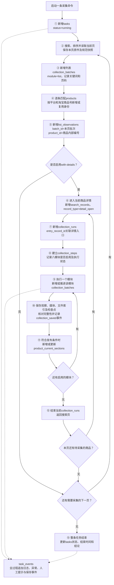
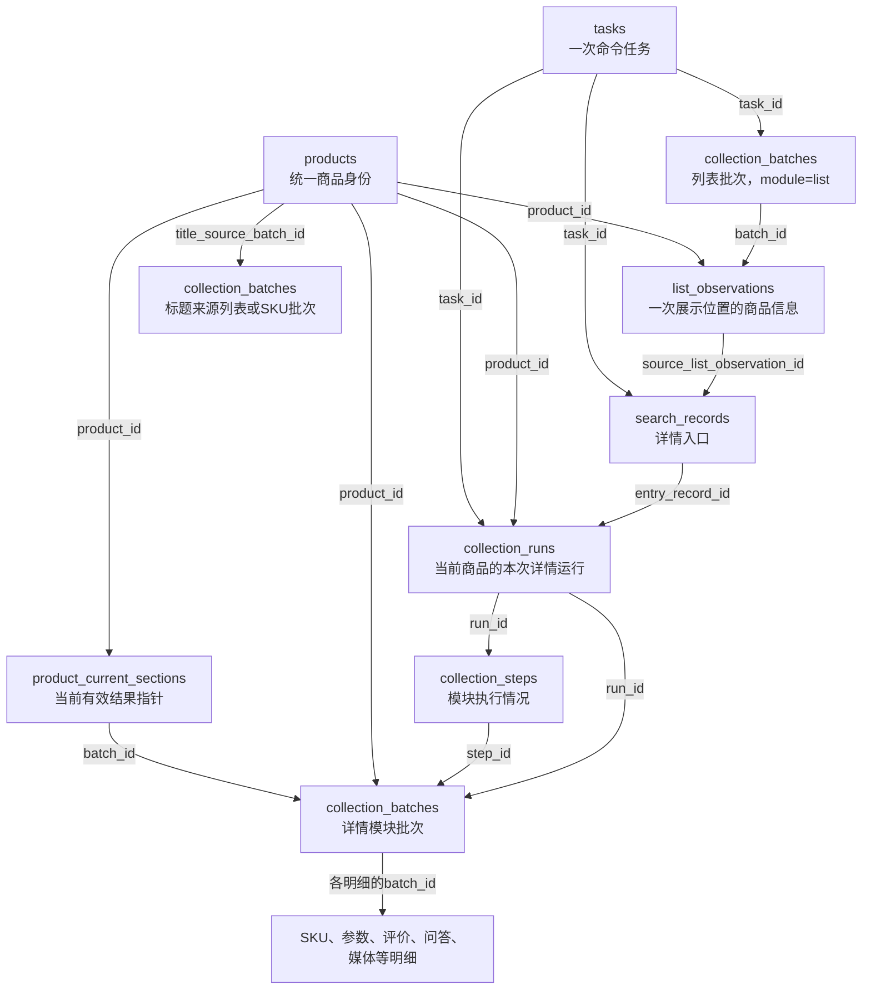
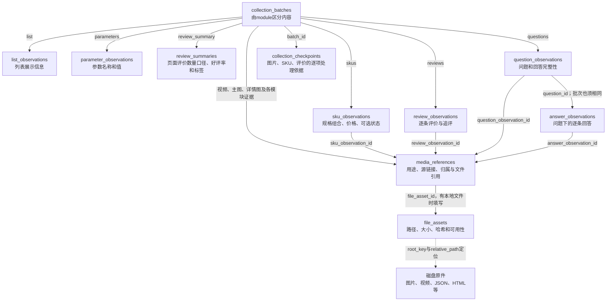
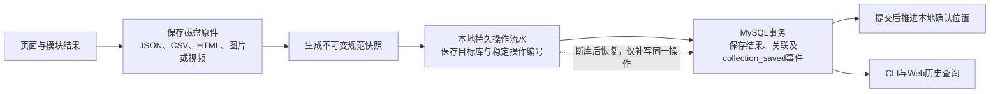
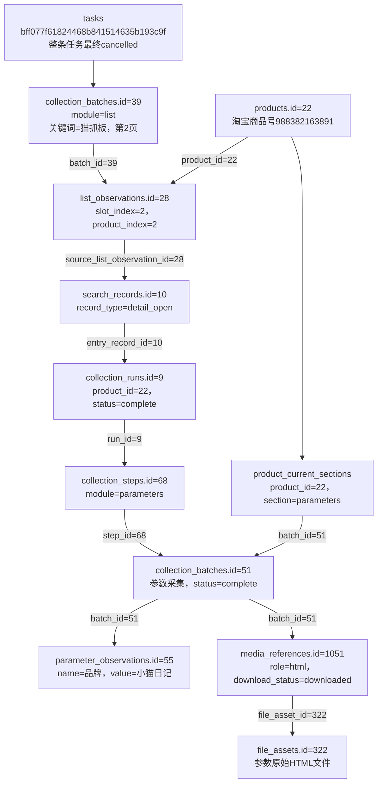
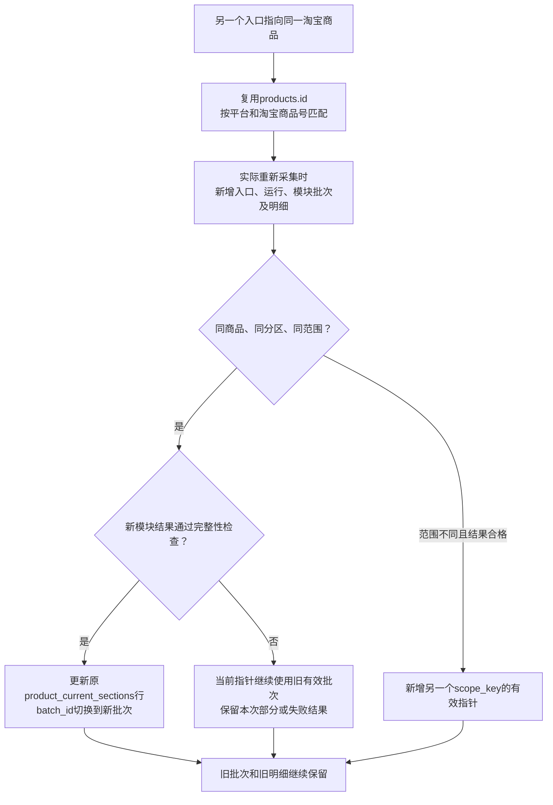

# 数据库数据流转图与字段阅读指南

适用版本：`0007_basic_info`。正式库：`taobao_automation`。2026-10-25只读核对：19张业务表、1张迁移版本表、262个字段、43个外键，结构与原生备注核对通过。

建议按“业务顺序 → 表关联 → 真实例子 → 字段速查 → 查询SQL”的顺序阅读。本页帮助理解数据流；全部字段取值及状态含义继续统一维护在[数据库字段取值说明](数据库字段取值说明.md)，字段类型及完整约束见[字段字典](数据库字段字典.md)，全部物理关系见[表关系说明](数据库表关系说明.md)。

## 1. 先分清四种对象

| 对象 | 回答的问题 | 对应表与编号 |
|---|---|---|
| 一次命令任务 | 这次操作整体是否结束、结果如何？ | tasks.id |
| 一个商品身份 | 这是淘宝上的哪个商品？ | products.id是内部编号；platform_product_id是淘宝商品号 |
| 一次商品详情运行 | 这次准备采集这个商品的哪些模块，分别完成了吗？ | collection_runs.id；下属collection_steps |
| 一个实际采集批次 | 本次某一页列表，或某一个详情模块采到了什么？ | collection_batches.id；下属观察、媒体等明细 |

一个任务可以有多个列表页、多个商品详情运行和多个模块批次。同一个商品可以被多次观察、反复采集；商品身份复用，各次采集结果分批保存。

## 2. 列表进入详情：实际写入顺序

下图箭头表示业务推进顺序，虚线表示全程产生的日志。列表批次和详情模块批次都存collection_batches，依靠module、product_id、run_id等字段区分。



图中“保存观察”等步骤发生在统一采集保存事务中；一个批次的明细、文件引用和collection_saved事件一起提交。不是每一步各自独立提交，也不是所有日志都等到采集结束才写入。

详情的默认模块顺序是：视频 → 主图 → SKU → 参数 → 详情图 → 评价概览 → 逐条评价 → 问大家。单独选择模块时，未启用的步骤保留not_requested；前序中断后尚未执行的步骤记录not_run。每个模块独立核对并发布，不必等所有模块结束才更新有效结果。

浏览器保留供查看时，采集结果可能已经保存、collection_runs已经结束，而tasks仍在运行；整条任务结束时间与模块保存时间要分别看。

## 3. 核心表之间怎样连接

本图展示主要记录关系，连接标签标明关联字段；它不表示SQL语句顺序。比如入口的source_list_observation_id指向列表观察，而当前结果的batch_id指向模块批次。复合外键还会同时核对商品、任务、模块和范围，完整42个外键见表关系说明。



关注两条不同的回查路径：

- 查看“这个结果从哪里来”：明细.batch_id → collection_batches → run_id/step_id → 详情入口.entry_record_id → 列表观察.source_list_observation_id → 原列表批次。
- 查看“当前应该使用哪份结果”：products.id → product_current_sections的product_id、section和scope_key → 当前batch_id → 该批次的明细。

直接输入商品ID或URL的独立详情入口，没有列表来源时source_list_observation_id为空；有可靠入口的新详情运行仍通过entry_record_id关联该入口。旧记录没有可靠证据时保持空，不按时间接近或关键词相同猜关联。

## 4. 各模块的数据分别流向哪里



视频、主图、详情图主要通过media_references与file_assets保存引用；没有另外的videos或images业务表。参数等模块的原始HTML、JSON也可以登记为媒体/证据引用。

评价图片、视频等可能只保存远程链接；没有本地文件时file_asset_id为空。download_status要结合role及实际来源理解，不能看到URL就认为下载成功。

列表主图引用没有list_observation_id外键，当前程序用“同batch_id且media_references.position对应list_observations.slot_index”建立逻辑对应。不要把列表观察画成有媒体直接外键的关系。

## 5. 从页面到数据库：文件和日志怎样经过



数据库保存结构化信息和文件索引，文件本体保存在磁盘。不是所有导出文件都会自动拥有file_assets记录，具体以该模块实际登记为准。

补写使用原操作编号，重复补写不会重复创建相同记录；它只补数据，不重新执行页面点击。四张历史导入表已移除，这条实时持久流水仍保留。

## 6. 18张业务表的核心字段速查

下面只列看数据流时最常用的字段；250个字段的完整规则仍以字段取值说明为准。

| 表 | 先看哪些字段 | 怎样理解 |
|---|---|---|
| [tasks](数据库字段取值说明.md#tasks) | id、name、status、started_at、finished_at、message | 一条命令的身份、类型、总体状态与起止时间 |
| [task_events](数据库字段取值说明.md#task_events) | task_id、task_sequence、event_type、level、message、run_id、batch_id、details | 哪个任务的第几条事件，发生了什么；run_id/batch_id仅在有明确上下文时填写 |
| [products](数据库字段取值说明.md#products) | id、platform、platform_product_id、display_title、title_source_batch_id | 统一商品身份；显示标题及其来源批次 |
| [search_records](数据库字段取值说明.md#search_records) | record_type、task_id、product_id、source_list_observation_id、search_method、keyword、page_number | 独立搜索摘要或详情入口；入口与来源列表观察的关联 |
| [collection_runs](数据库字段取值说明.md#collection_runs) | id、source_run_key、task_id、product_id、entry_record_id、status | 一个商品本次详情采集的运行汇总；source_run_key是原运行稳定键 |
| [collection_steps](数据库字段取值说明.md#collection_steps) | id、run_id、module、requested、status、continuation_allowed | 本次运行中启用了什么模块，是否执行，结果是否允许继续 |
| [collection_batches](数据库字段取值说明.md#collection_batches) | id、source_batch_key、task_id、product_id、run_id、step_id、module、status | 某页列表或某模块的实际批次；稳定来源键与数据库内部id不同 |
| [list_observations](数据库字段取值说明.md#list_observations) | id、batch_id、product_id、slot_index、product_index、title、price_value、ad_status | 某商品在某页某位置的展示快照；重复位置继续保存 |
| [sku_observations](数据库字段取值说明.md#sku_observations) | batch_id、position、platform_sku_id、sku_name、price_value、price_status、stock_status | 本次规格组合及价格口径；平台SKU编号未取得时可为空，不能用观察id代替 |
| [parameter_observations](数据库字段取值说明.md#parameter_observations) | id、batch_id、position、name、value、status | 某批次的一个参数名称和值；同名参数可按位置分别保存 |
| [review_summaries](数据库字段取值说明.md#review_summaries) | batch_id、count_raw、count_value、count_lower_bound、count_is_exact、tags | 页面显示的评价总量口径；如“1万+”是下界，不是本次采集条数 |
| [review_observations](数据库字段取值说明.md#review_observations) | id、batch_id、review_key、platform_review_id、content、append_reviews | 本批的一条评价、去重身份及追评；本批键与平台评价编号分开 |
| [question_observations](数据库字段取值说明.md#question_observations) | id、batch_id、question_key、question、answers_complete | 本批的一道问题，以及该题回答采集是否完成 |
| [answer_observations](数据库字段取值说明.md#answer_observations) | id、question_id、batch_id、answer_key、content | 这条回答属于哪道内部问题；批次也必须一致 |
| [media_references](数据库字段取值说明.md#media_references) | reference_key、batch_id、各观察外键、role、position、source_url、file_asset_id、download_status | 媒体或证据属于谁、用于什么、源地址及本地文件关联 |
| [file_assets](数据库字段取值说明.md#file_assets) | id、root_key、relative_path、path_key、sha256、availability | 如何定位文件、核对文件内容及可用性；path_key为路径键，sha256为内容指纹 |
| [collection_checkpoints](数据库字段取值说明.md#collection_checkpoints) | batch_id、checkpoint_type、checkpoint_key、source_sequence、payload | 逐项处理结果与辅助标记；实际复用仍由模块核对文件和来源 |
| [product_current_sections](数据库字段取值说明.md#product_current_sections) | product_id、section、scope_key、module、batch_id、published_at | 同商品、同分区、同范围，当前采用哪个合格批次 |

alembic_version是额外的技术表，version_num记录已执行的结构版本；它不参与商品采集流。review_summaries以batch_id为主键，product_current_sections以(product_id,section,scope_key)为主键，这两张表没有独立的id字段。

### collection_batches里还需要认识的字段

| 字段 | 看数据流时的作用 |
|---|---|
| search_method、search_keyword、page_number、search_options | 本次搜索从什么方式、关键词、页面和条件而来；详情批次继承触发入口的来源 |
| scope、scope_key | 采集范围的文字说明及规范范围键；详情范围不会仅因入口搜索词不同而拆成新范围 |
| requested_limit、answer_limit | 本次请求上限；列表为每页上限，评价为有效评价上限，问题与回答上限分别解释 |
| status | 当前模块结果状态，必须结合module理解 |
| coverage_status、stop_reason、end_confirmed | 覆盖到哪里、为何停止、是否确认可见末尾；限定样本不当作平台全量 |
| visibility | 批次的查询可见性；存在记录不代表完整有效，缺少原件的批次可能被隔离 |
| captured_at | 本批结果记录的采集时间；不是整个任务的开始或结束时间 |
| derived_from_batch_id、upstream_batch_key | 同模块确认派生或复用的来源；列表入口来源不写成详情模块的派生批次 |
| summary、result_payload | 结构化统计及原模块扩展结果；原文和内部保存标记按字段说明解释 |

### 容易混淆的编号

数据库中的product_id通常关联products.id；原始JSON里的product_id通常是淘宝商品号。先看所在表或文件，不能直接比较二者。

batch_id通常关联collection_batches.id；但本地原件的batch_id是稳定来源字符串，入库后对应source_batch_key或source_run_key。不同表的自增id互不通用，数值相同也不代表有关联。

slot_index是页面格子位置；product_index是本页有效商品序号。页面中夹有调查卡等内容时，两者可能不相等。

payload保存补充的结构化数据，具体含义随表和模块变化；它不仅供人阅读，部分键还参与保存逻辑。比如检查点的skipped记录评价是否被模板规则过滤，_snapshot_sha用于识别本批次当前保存的快照版本。task_events使用details，collection_batches使用result_payload，不应把它们都当成同一个payload字段。

## 7. 一条目前数据库中存在的真实记录链

只读快照时点：2026-10-25 07:18:32，北京时间。以下编号和值均来自正式库，不是示意编号，也没有为制作文档新采集数据。本机查询证据见[只读快照](../workspace/output/reports/database_flow_20261025/example.json)。



顺着图读：命令搜索“猫抓板”，第2页列表批次39记录了第2个商品；观察28关联商品身份22。通过该展示位进入详情，入口为10，详情运行为9。该运行的参数步骤是68，实际参数批次是51；参数观察55记录“品牌=小猫日记”。当前有效参数指针仍指向51，参数HTML证据通过媒体1051关联文件322。

本批共有11项参数，参数观察id=49～59；参数55的position=7。另一份证据为media_references.id=1052、role=source_json、file_asset_id=323，指向参数JSON原件。

这里tasks.status=cancelled，而collection_runs.id=9/status=complete、参数批次51/status=complete可以同时成立：整条多商品任务后来停止，已经完成的这个商品及其有效参数仍然保留。不能仅凭外层任务取消就把全部已存商品判断为失败。

### 同一运行的八个模块

| 模块 | collection_steps.id | collection_batches.id | 本次批次status | 覆盖口径 |
|---|---:|---:|---|---|
| video | 65 | 48 | downloaded | unknown |
| main_images | 66 | 49 | complete | unknown |
| skus | 67 | 50 | complete | unknown |
| parameters | 68 | 51 | complete | unknown |
| detail_images | 69 | 52 | complete | unknown |
| review_summary | 70 | 53 | complete | unknown |
| reviews | 71 | 54 | complete | limit_reached |
| questions | 72 | 55 | complete | visible_end_confirmed |

上述批次均属于run_id=9、product_id=22。coverage_status=unknown不能单独当成失败；它与模块完成状态是两个口径。评价批次54完成的是本次限定范围，问答批次55确认的是当前可见末尾。

问答中的真实关联是：question_observations.id=142、batch_id=55，问题为“能不能洗？”；answer_observations.id=972、question_id=142、batch_id=55，回答为“纸壳，当然不能洗了……”。注意参数观察的id=55与问答批次的id=55属于不同表，关联含义完全不同。

## 8. 重复采集时：哪些新增，哪些更新



| 表或记录 | 新一轮实际采集的处理 |
|---|---|
| products | 相同平台商品号复用原身份；符合标题更新条件时更新显示标题及来源 |
| list_observations | 重新出现的展示位置仍新增观察；多个关键词、不同页或重复位置分别保留 |
| search_records、collection_runs、collection_steps | 实际新开详情并执行采集时，分别建立本次入口、运行和步骤 |
| collection_batches及明细 | 新一轮建立新批次和明细；同一工作批次的进度快照按原身份更新，不把每次进度都当新批次 |
| product_current_sections | 同键的合格结果更新batch_id；不同范围分别保存；部分结果不替换旧有效结果 |
| media_references、file_assets | 依据媒体用途和文件路径登记或复用；旧引用原件保留，文件复用须核对内容与来源 |
| task_events | 持续追加过程事件；同一持久操作重复补写时按稳定事件键去重 |

同一次with-details任务中，某商品已有成功详情时，后续重复展示复用本次运行，不再新开详情、创建第二个运行或采同一组模块；其列表观察仍保留。跨任务重新采集会产生新一轮详情记录。

products.display_title和title_source_batch_id是显示标题缓存。它们从列表或SKU结果中取得符合条件的较新标题；它们的更新不要求整个SKU批次完整，因此不能用标题来源更新来推断SKU全部成功。当前有效SKU应查看product_current_sections中的product_info/sku_details；这两个分区都对应skus模块。

## 9. 不同操作会写哪些表

| 操作 | 主要写入 |
|---|---|
| 登录、检查登录状态 | tasks与task_events；不因此新增商品采集批次 |
| 独立关键词搜索 | tasks、task_events、record_type=search的search_records，以及实际登记的文件和证据引用 |
| 列表采集 | 每页collection_batches、每位置list_observations、商品身份、媒体/文件引用、任务与日志；不为每页额外新增独立搜索摘要 |
| 只打开详情入口 | record_type=detail_open的search_records、商品身份及实际证据；没有选定采集模块时不创建详情运行 |
| 详情模块采集 | collection_runs、collection_steps、各模块collection_batches及明细；合格后更新对应有效分区 |
| 只读查询 | 读取已有记录；不启动采集或创建新采集批次 |

因此，看到search_records新增，只能说明独立搜索或入口事实已记录；是否采到了详情要继续查collection_runs、collection_steps、collection_batches及其明细。

## 10. 你可以复制执行的只读查询

### 10.1 从真实参数反查搜索来源

```sql
SELECT p.id AS internal_product_id, p.platform_product_id,
       lb.id AS list_batch_id, lb.search_method, lb.search_keyword, lb.page_number,
       lo.id AS list_observation_id, lo.slot_index, lo.product_index,
       sr.id AS entry_record_id, cr.id AS run_id,
       cb.id AS parameter_batch_id, po.id AS parameter_id, po.name, po.value
FROM taobao_automation.parameter_observations po
JOIN taobao_automation.collection_batches cb ON cb.id = po.batch_id
JOIN taobao_automation.products p ON p.id = cb.product_id
JOIN taobao_automation.collection_runs cr ON cr.id = cb.run_id
JOIN taobao_automation.search_records sr ON sr.id = cr.entry_record_id
JOIN taobao_automation.list_observations lo ON lo.id = sr.source_list_observation_id
JOIN taobao_automation.collection_batches lb ON lb.id = lo.batch_id
WHERE po.id = 55;
```

本例应得到商品内部22、淘宝988382163891、列表批次39、关键词猫抓板、第2页、观察28、入口10、运行9、参数批次51，以及“品牌=小猫日记”。INNER JOIN适用于这条已明确有关联的记录；查旧记录或独立入口时可使用LEFT JOIN显示不存在的上游关联。

### 10.2 查看某商品当前有效结果

```sql
SELECT p.id AS internal_product_id, p.platform_product_id,
       c.section, c.scope_key, c.batch_id,
       b.module, b.status, b.coverage_status, b.captured_at, c.published_at
FROM taobao_automation.products p
JOIN taobao_automation.product_current_sections c ON c.product_id = p.id
JOIN taobao_automation.collection_batches b
  ON b.id = c.batch_id AND b.product_id = c.product_id
 AND b.module = c.module AND b.scope_key = c.scope_key
WHERE p.platform = 'taobao' AND p.platform_product_id = '988382163891'
ORDER BY c.section, c.scope_key;
```

### 10.3 查看某次运行的模块、批次及状态

```sql
SELECT r.id AS run_id, r.status AS run_status,
       s.id AS step_id, s.module, s.requested, s.status AS step_status,
       b.id AS batch_id, b.status AS batch_status, b.coverage_status, b.stop_reason
FROM taobao_automation.collection_runs r
JOIN taobao_automation.collection_steps s ON s.run_id = r.id
LEFT JOIN taobao_automation.collection_batches b
  ON b.run_id = r.id AND b.step_id = s.id AND b.module = s.module
WHERE r.id = 9
ORDER BY s.id, b.id;
```

没有开始执行的步骤可能没有批次；同一步骤如存在多个实际批次，会返回多行。结合requested、step_status和batch_status阅读，不把“没有批次”一律解释为采集失败。

## 11. 继续查阅

- [数据库字段取值说明](数据库字段取值说明.md)：英文状态、空值、JSON内部键和全部字段解释。
- [数据库字段字典](数据库字段字典.md)：类型、中文备注、主键、唯一键、检查约束与外键。
- [数据库表关系说明](数据库表关系说明.md)：完整物理关系及归属核对规则。
- [历史导入能力精简记录](变更记录/历史导入能力精简记录.md)：0005删除范围与数据保持一致的证据。

全部MySQL DATETIME及本页时间按北京时间解释。真实例子为上述快照时点，后续重采可能推进有效指针；查最新结果应执行当前有效结果查询。


0006列表销量：原sales_text经共享解析器生成sales_count、sales_precision、sales_metric、sales_period、sales_parse_status，保存在同一条list_observations中；不改变本图主外键链。历史回填只修改五个新字段，新采集同时写原文和结构化值，规则见[字段取值说明](数据库字段取值说明.md#2026-10-25-结构化列表销量0006)。


## 基本信息独立拆分（0007）

新增product_info_observations，基本信息单独采集和发布；SKU只保存规格。历史信息转换未访问淘宝，完整真实编号数据图见[拆分记录](变更记录/基本信息与SKU拆分实施记录.md)，字段取值统一见[基本信息观察](数据库字段取值说明.md#product_info_observations商品基本信息观察表)。
