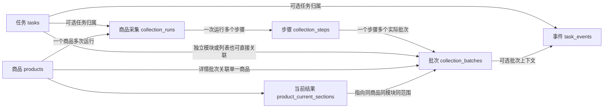
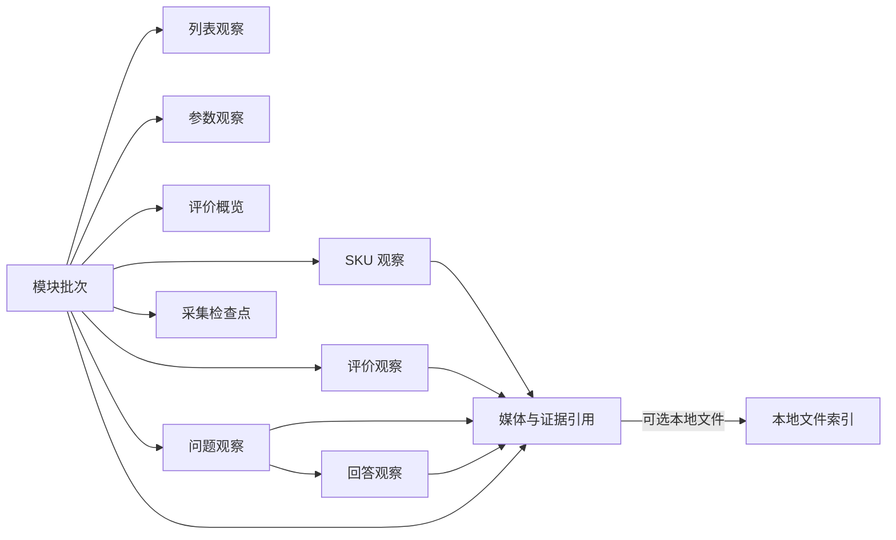

# 数据库表关系说明与备注要求

当前数据状态：2026-10-23 已按用户要求清空两库旧业务数据及旧资料，随后开始逐项测试；本轮新产生的数据继续保留。历史验收数量与证据位置不代表当前数据，见 [从零测试说明](历史记录/从零测试说明.md)及[功能逐项验收清单](功能逐项验收清单.md)。

日期：2026-10-24。当前模型版本`0005_remove_history_import`包含18张业务表、1张迁移版本表、245个字段、42个实际外键。0005移除历史导入能力，实时采集与CLI/Web历史查询继续保留，Web来源筛选仍留待后续。列表到详情来源关系沿用0004。实际字段见[完整字段字典](数据库字段字典.md)，迁移与核对见[精简记录](变更记录/历史导入能力精简记录.md)。

2026-10-23 时间口径调整：`0002_beijing_time`完成时间转换，`0003_search_origin`继续沿用北京时间。13张表的21个`DATETIME(6)`字段直接保存北京时间（固定UTC+08:00），CLI/API返回带`+08:00`的时间。旧UTC值只转换一次；原始time_raw、JSON/文件和旧幂等指纹保留，详见[北京时间统一调整说明](变更记录/北京时间统一调整说明.md)。

查询所有字段取值的中文含义、生成条件、空值规则和例子，见[数据库字段取值说明](数据库字段取值说明.md)；当前覆盖19张表、245个字段，逐表提供只读查询。以后状态或JSON等业务取值变化，即使不改表，也必须同步维护该文件。

## 1. 以后建表和改表的固定交付要求

每次数据库结构变更必须同时交付：

1. **数据库表备注**：写入中文名称和业务用途，如 `tasks` 的备注为“任务记录表：保存任务状态、起止时间、结果及执行归属”。
2. **数据库字段备注**：每个字段写清中文名称和含义。状态说明口径，数量和价格说明单位，时间说明时区，外键注明目标，空值说明未知或未关联的含义。
3. **完整字段字典**：包括英文表名/字段名、中文名称、类型与长度/精度、是否可空、默认值、业务含义、单位/时区、状态取值及主键/唯一键/外键。JSON 字段还要说明内部业务结构、版本和未知值规则。
4. **每张表的关联说明**：上游和下游表、对应字段、关联基数、可空性、物理外键或逻辑关联、更新和删除规则，以及必要的归属校验；独立表明确注明。
5. **实际结构核对结果**：对照数据库中的备注、字段和约束复查文档，不能出现文档有备注但数据库没有备注的情况。
6. **字段取值说明**：统一维护[数据库字段取值说明](数据库字段取值说明.md)，覆盖所有字段的取值/填写规则，说明状态代码、中文含义、产生条件、空值、单位、时区及JSON内部结构；区分约束、实际生成、兼容、测试与预留。业务取值改变但没有DDL时同样维护。

表名和字段名继续使用现有英文命名规范，中文名称通过备注与字典表达。备注须写入MySQL原生`COMMENT`；代码注释只作补充。SQLAlchemy模型与有序迁移同步保存备注。[完整逐字段字典](数据库字段字典.md)覆盖当前245个字段，后续表结构变更同步维护。

备注示例：

| 对象 | 中文名称 | 备注应表达的内容 |
|---|---|---|
| `tasks.id` | 任务编号 | 32 位任务标识，保留历史编号，主键 |
| `task_events.task_id` | 所属任务编号 | 关联 `tasks.id`；空值表示无法可靠确定任务归属 |
| `sku_observations.price_value` | 已解析价格 | 定点数，币种见同记录 `currency`；空值表示未取得可靠数值，不等同于 0 |
| `task_events.occurred_at` | 事件发生时间 | 北京时间（UTC+08:00）；历史时间无可靠时区时为空，原文见 `time_raw` |
| `product_current_sections.scope_key` | 采集范围键 | 按带版本的规范化采集条件生成，区分限定样本、筛选和排序范围 |

## 2. 全部 18 张业务表的名称与关联

下表给出每张表的建议中文名称（用于表备注的开头）、用途、上游和下游。箭头表示业务引用方向，具体列见后续各节。当前不包含历史导入管理表。

| 英文表名 | 中文名称 | 业务用途 | 上游引用 | 下游引用 |
|---|---|---|---|---|
| `tasks` | 任务记录表 | 任务状态、结果、执行资源和进程归属 | 无业务必需父表，由统一任务执行器创建 | 事件、整次商品采集、模块批次、页面记录、媒体引用 |
| `task_events` | 任务事件日志表 | 进度、日志、异常、人工提示及任务内顺序 | 可选任务、整次采集、模块批次 | 无直接业务子表，作为历史查询与未来实时显示的数据源 |
| `products` | 商品身份表 | 平台与商品编号的统一身份 | 可选标题来源批次 | 整次采集、模块批次、页面记录、列表观察、当前结果指针 |
| `collection_runs` | 商品采集运行表 | 某商品本次所选模块的整体汇总 | 商品、可选任务、详情入口 | 模块步骤、模块批次、事件 |
| `collection_steps` | 采集模块步骤表 | 未启用、未执行、运行和结束等步骤状态 | 整次商品采集 | 该步骤的一个或多个模块批次 |
| `collection_batches` | 采集模块批次表 | 模块实际结果、搜索来源、采集范围和覆盖状态 | 可选任务、商品、运行、步骤、来源批次、搜索输入图片文件 | 各类采集明细、媒体、检查点、当前结果指针、事件、派生批次、标题来源引用 |
| `product_current_sections` | 商品当前有效结果表 | 各模块和范围的最新有效批次指针 | 商品、模块批次 | 无直接子表；查询时解析到批次结果 |
| `search_records` | 页面搜索与入口记录表 | 搜索方式、搜索词或详情入口的观察记录 | 可选任务、商品、来源列表观察、搜索输入图片文件 | 商品详情运行；截图通过同任务媒体引用与page_logical_key追溯 |
| `list_observations` | 列表商品观察表 | 商品在某批列表中的位置与展示字段 | 列表批次、可选商品 | 来源详情入口；媒体链接保留在该观察记录中 |
| `sku_observations` | 商品规格观察表 | 本批 SKU 组合、价格和确认状态 | SKU 批次 | SKU 媒体引用 |
| `parameter_observations` | 商品参数观察表 | 本批参数名称、值和顺序 | 参数批次 | 无直接子表 |
| `review_summaries` | 评价概览表 | 本批评价数量、好评率和总结标签 | 评价概览批次 | 无直接子表；标签先存 JSON |
| `review_observations` | 用户评价观察表 | 本批评价正文、身份依据、规格和追评 | 评价明细批次 | 评价媒体引用 |
| `question_observations` | 商品问题观察表 | 本批问题及回答采集完整性 | 问答批次 | 回答明细、问题媒体引用 |
| `answer_observations` | 商品回答观察表 | 问题下的回答、身份、标签与规格 | 问题明细 | 回答媒体引用 |
| `file_assets` | 本地文件索引表 | 本地文件路径、校验值与可用状态 | 无业务必需父表，通过媒体引用关联采集来源 | 一个文件可被多个媒体、证据、搜索记录或采集批次引用 |
| `media_references` | 媒体与证据引用表 | 源链接、用途、顺序与本地文件的关联 | 可选任务、批次、具体明细、本地文件 | 无直接子表 |
| `collection_checkpoints` | 采集检查点表 | 去重键、逐项处理状态、阶段及复用信息 | 模块批次 | 无直接子表；恢复仍由业务独立核对 |

业务表总数为18。另有技术表`alembic_version`，中文备注为“数据库迁移版本表：记录已完成的结构升级版本，无业务外键”，主键`version_num`带中文说明；当前版本为`0005_remove_history_import`。该表不计入18张业务表。

## 3. 任务与采集主链

| 引用字段（子表） | 目标字段（父表） | 关系与可空性 | 计划约束及业务核对 |
|---|---|---|---|
| `task_events.task_id` | `tasks.id` | 一任务多事件；可空 | 外键；无可靠归属的旧日志允许为空；有任务时事件序号在任务内唯一 |
| `task_events.run_id` | `collection_runs.id` | 一运行多事件；可空 | 外键；同时有任务时须与运行的任务归属一致 |
| `task_events.batch_id` | `collection_batches.id` | 一批次多事件；可空 | 外键；事件上下文不能关联其他任务或商品的批次 |
| `collection_runs.task_id` | `tasks.id` | 一任务多商品运行；可空 | 外键；旧数据没有原任务时保留未知 |
| `collection_runs.product_id` | `products.id` | 一商品多次运行；非空 | 外键；商品归属固定 |
| `collection_steps.run_id` | `collection_runs.id` | 一运行多步骤；非空 | 外键；`(run_id,module)` 唯一 |
| `collection_batches.task_id` | `tasks.id` | 一任务多批次；可空 | 外键；与其运行/步骤的任务归属一致 |
| `collection_batches.run_id` | `collection_runs.id` | 一运行多批次；可空 | 外键；无整次汇总的旧模块允许为空 |
| `collection_batches.step_id` | `collection_steps.id` | 一步骤多批次；可空 | 外键及步骤/运行归属约束；模块与步骤匹配 |
| `collection_batches.product_id` | `products.id` | 一商品多详情批次；列表批次可空 | 外键；列表的具体商品由列表明细关联 |
| `collection_batches.derived_from_batch_id` | `collection_batches.id` | 一来源批次可产生多派生批次；可空 | 自引用外键；禁止自身引用或循环派生，核对同商品和适用模块；源缺失时只保留 `upstream_batch_key` |
| `product_current_sections.product_id` | `products.id` | 一商品多模块/范围指针；非空 | 外键；`(product_id,section,scope_key)` 唯一 |
| `product_current_sections.batch_id` | `collection_batches.id` | 一批次可支持一个或多个合法分区指针；非空 | 外键及归属校验；只指向已发布且范围相同的有效批次 |
| `products.title_source_batch_id` | `collection_batches.id` | 一个批次可提供多个商品标题来源；可空 | 外键；详情批次须属于该商品，列表来源须实际包含该商品的列表观察 |
| `search_records.task_id` | `tasks.id` | 一任务多页面记录；可空 | 外键；入口打开不代表详情已采集 |
| `search_records.product_id` | `products.id` | 一商品多入口观察；可空 | 外键；搜索页一般没有单一商品归属 |

当前根 JSON 的分区名与模块名并非全部相同，关系校验必须使用明确映射：

| 当前分区 `section` | 批次模块 `module` |
|---|---|
| `video` | `video` |
| `main_images` | `main_images` |
| `product_info`、`sku_details` | `skus` |
| `parameters` | `parameters` |
| `detail_images` | `detail_images` |
| `review_summary` | `review_summary` |
| `reviews` | `reviews` |
| `questions` | `questions` |

`last_attempt` 属于历史尝试与检查点，不建立完整结果指针。`collection_summary` 进入运行汇总，不当成采集内容分区。商品信息与 SKU 如同时发布，维持同一事务中的整体发布规则。

## 4. 明细、媒体与文件

| 引用字段（子表） | 目标字段（父表） | 关系与可空性 | 计划约束及业务核对 |
|---|---|---|---|
| `list_observations.batch_id` | `collection_batches.id` | 一列表批次多条观察；非空 | 外键；批次模块必须为列表采集，`(batch_id,slot_index)` 唯一 |
| `list_observations.product_id` | `products.id` | 一商品可有多次列表观察；可空 | 外键；未确认平台身份不丢弃该观察，也不制造商品 ID |
| `sku_observations.batch_id` | `collection_batches.id` | 一 SKU 批次多组合；非空 | 外键；模块匹配；位置、身份与价格确认分别保存 |
| `parameter_observations.batch_id` | `collection_batches.id` | 一参数批次多参数；非空 | 外键；同名参数可并存，以批次内位置区分 |
| `review_summaries.batch_id` | `collection_batches.id` | 一个概览批次至多一条概览；非空 | 该字段既是主键也是外键；标签先存 JSON |
| `review_observations.batch_id` | `collection_batches.id` | 一评价批次多评价；非空 | 外键；批次内位置、评价键分别唯一，不跨批次按指纹强制合并 |
| `question_observations.batch_id` | `collection_batches.id` | 一问答批次多问题；非空 | 外键；批次内位置、问题键分别唯一 |
| `answer_observations.question_id` | `question_observations.id` | 一问题多回答；非空 | 外键；使用数据库内部问题主键，不能误连平台编号；问题内位置、回答键分别唯一 |
| `collection_checkpoints.batch_id` | `collection_batches.id` | 一批次多检查点；非空 | 外键；`(batch_id,checkpoint_type,checkpoint_key)` 唯一 |
| `media_references.task_id` | `tasks.id` | 一任务多媒体/证据引用；可空 | 外键；允许仅任务级截图，不能错误归入商品采集结果 |
| `media_references.batch_id` | `collection_batches.id` | 一批次多媒体/证据引用；可空 | 外键；模块级主图、视频、HTML 等按批次关联 |
| `media_references.sku_observation_id` | `sku_observations.id` | 一 SKU 可关联多个媒体；可空 | 外键；如同时有批次，必须属于同批次 |
| `media_references.review_observation_id` | `review_observations.id` | 一评价可关联多个媒体；可空 | 外键；追评媒体的归属位置另在引用扩展结构中标明 |
| `media_references.question_observation_id` | `question_observations.id` | 一问题可关联多个媒体；可空 | 外键；不可同时当成另一回答的直接媒体 |
| `media_references.answer_observation_id` | `answer_observations.id` | 一回答可关联多个媒体；可空 | 外键；通过问题核对批次归属 |
| `media_references.file_asset_id` | `file_assets.id` | 一个本地文件可被多处引用；可空 | 外键；仅有远程链接时为空，不能因此标成已下载 |

媒体引用的四种具体明细外键最多填写一种；至少具备任务、批次或一种具体明细归属。多层上下文同时填写时，任务、商品和批次必须一致。约束由数据库外键/检查约束及必要的事务归属校验共同保证，正式迁移文档注明各项的实现方式。

本地文件逻辑上按 `(root_key,relative_path)` 唯一；实际索引为 `(root_key,path_key)`，`path_key` 是按文件系统规则规范化的相对路径 SHA-256，避免长路径超过索引长度。完整路径仍保留，写入服务须核对路径哈希与原路径不冲突，不能将内容哈希当成业务身份。历史批次指向独立历史文件，最新副本单独登记；不因内容相同就删除另一用途或另一历史批次的文件。原始JSON等文件通过媒体引用、任务/批次归属和文件哈希追溯。

## 5. 历史导入能力退役（0005）

import_runs、import_sources、import_row_mappings、import_issues已移除；tasks、task_events、search_records、collection_runs、collection_batches的import_run_id及其外键同步移除。没有替代的导入表或隐含导入关联。

实时数据继续按任务、商品、入口、运行、批次和明细外键追溯。批次visibility和当前有效分区完整性规则保留；正常历史查询不再依赖导入状态。本地持久流水仅补写已经执行的实时操作，属于保留能力。

旧关系及取值仅适用于0001～0004，见[退役功能说明](历史记录/历史导入功能说明（0001至0004）.md)；本次迁移范围与数据核对见[精简记录](变更记录/历史导入能力精简记录.md)。

## 6. 全局更新、删除和关系校验规则

- 主键默认不可修改；计划中的业务外键默认限制删除与更新。父记录仍被历史明细、当前指针、事件或来源引用时，不级联删除历史资料。未来若需要例外，必须在对应迁移与本关系文档中明确列出。
- 允许为空的外键必须说明原因；原平台编号或来源批次缺失不以 `0`、空字符串或虚构父记录替代。
- 任务、运行、步骤、批次、商品的多层归属需核对一致。可由复合唯一键/复合外键表达的关系优先落实为数据库约束，不能只验证单个 ID 存在。
- 自引用派生来源必须避免循环；数据库外键与程序维护的逻辑关系明确区分。
- 没有直接业务子表的字典、记录或技术表也必须出现在完整表清单中；“无直接子表”不等于可以省略用途、来源及生命周期说明。
- 备注、字段含义或关联含义有变化时，通过新增有序迁移同步数据库和文档；不修改已经应用的旧迁移假装历史结构已变。

## 7. 正式建表时的核对方式

按数据库实际结构导出全部表与字段的备注、类型、可空性、默认值、主键、唯一键和外键，再核对本关系说明与完整字段字典。表备注或任一字段备注为空，或实际外键与文档不一致，都需要修正后才视为数据库变更交付完成。

基础阶段及采集切换均核对正式库与验证库：结构版本 `0001_mysql_foundation`，23 张实际表、276 个字段、47 个外键；全部中文备注完整，字段类型、可空性、默认值、主键、唯一键、外键、检查约束及查询索引一致。合成验证覆盖错误商品/运行归属、模块不匹配、错误当前指针、无归属媒体、父记录删除和重复事件等拒绝行为。采集阶段复用原结构，没有改写已执行迁移或新增物理字段；应用 JSON 约定见第 10 节。

MySQL 原生表/字段备注支持见 [建表语法](https://dev.mysql.com/doc/refman/8.4/en/create-table.html)；实际备注分别从 [TABLES 元数据](https://dev.mysql.com/doc/refman/8.4/en/information-schema-tables-table.html) 和 [COLUMNS 元数据](https://dev.mysql.com/doc/refman/8.4/en/information-schema-columns-table.html) 核对。物理外键和更新/删除规则参考 [外键约束文档](https://dev.mysql.com/doc/refman/8.4/en/create-table-foreign-keys.html)。

## 8. 已接入的任务与日志结构口径

本节源自任务与日志接入阶段，说明应用实际使用的JSON键；0002_beijing_time调整DATETIME口径和原生备注，0003_search_origin增加独立搜索来源字段。当前模型为0005_remove_history_import；本节既有JSON口径沿用，首版模型和已执行迁移保持冻结，来源JSON不重写。

| 字段/文件 | 结构及版本口径 |
|---|---|
| `task_events.details`，实时普通日志 | `operation_fingerprint` 为整条持久操作的规范化 SHA-256；用于补写核对，不作为公共接口内容。人工反馈可另含受控的 `decision`，不录制输入原文 |
| `task_events.details`，淘宝实时结构化事件 | 保留脱敏的 `time/task_id/event/state/step/progress`；按事件可含 `kind/location/source/frame_location`、截图及诊断位置；再追加 `operation_fingerprint`。未提供的键不填造数据 |
| `task_events.details`，历史事件 | `source_fingerprint` 为原来源记录指纹，`source_kind/relative_path/record_key` 定位来源；结构化日志额外保留脱敏 `source_record`。文本日志使用 `time_zone_unknown/task_link_unknown=true`，无可靠发生时间和任务关联 |
| `workspace/logs/events/*.jsonl` | 本地操作结构为 `op/database/task_id/event_key/time/event_type/message/state/level/step/details`，创建操作另含任务及进程归属；日志操作可含 `logger_name`。只补写绑定数据库，确认文件在数据库提交后才推进 |

任务事件序号在任务行锁内分配，事件和对应状态变更在同一事务提交。历史任务保留状态、起止时间和结论，`origin=historical` 且无当前进程归属，不进入执行恢复。无归属历史文本日志的 `task_id/task_sequence` 均为空，不能仅从消息文字推定关联。

0005已移除历史导入与导入可见性判断；旧事件扩展结构仅作历史格式解释，当前运行不生成新的历史导入事件。

本地活动描述及确认位置属于可核对的运行资料，不充当第二份正式任务状态。任务正式状态由 MySQL 提供，数据库不可用时仅依照已核实进程身份传递停止请求。本节记录任务日志阶段约定，采集阶段的实际写入与关系口径如下。

## 9. 采集数据结构口径

不可变实时采集快照format_version=1，来源自身schema_version单独保留。独立关键词搜索摘要为schema_version=3，新列表导出为schema_version=4并明确search_method=keyword。快照供事务入库、核对和断库补写使用；0005不再提供旧文件扫描导入。独立来源字段和范围版本见第10节。

2026-10-24分页口径：一个tasks任务关联多个module=list的collection_batches，每页独立批次，原生page_number记录实际页码；list_observations通过batch_id归属页面、product_id复用商品身份。跨页重复展示继续保留，不创建详情collection_runs/collection_steps，也不为各页额外创建search_records。每页原件与采集快照确认入库后才翻下一页，前页结果不因后页中断撤销。分页JSON与事件取值统一见[字段取值说明的分页口径](数据库字段取值说明.md#搜索列表分页口径2026-10-24)。

| 字段/结构 | 实际键与含义 |
|---|---|
| `collection_batches.result_payload.record` | 模块原元数据，包括原任务/商品/批次、状态、时间、数量、完整性、历史文件位置及派生依据；items、skus、images 明细分别进入观察表或媒体表；raw_items、raw_html 等大型证据保留文件 |
| `collection_batches.result_payload.scope_contract` | `version=1,module,scope,mode,requested_limit,answer_limit,filter,sort,keyword,page_number,sort_label`；缺失条件使用 `{"missing":true}`，区别于 null 或无限制。规范化 SHA-256 对应原生 `scope_key` |
| 批次内部控制 | `_fingerprint` 核对快照；`_current_sections` 表示曾正式发布，阻止后续异文覆盖；`_export_sections` 选择兼容根文档的有效分区，读取时核对原生当前指针；`_last_attempt_selected` 选择最后尝试。公共查询不返回这些内部键 |
| 列表、SKU、参数、评价、问题、回答的 `payload` | 保留对应原观察；SKU 包含属性、价格标签与确认依据，评价包含追评等，问题包含回答完整性。原生外键仍负责实际父子归属，不能只靠 JSON 键关联 |
| `review_summaries.payload/tags` | 原 `review_count/positive_rate` 及标签；模糊数量、下界、精确数量分别保存，不把“1万+”解析成精确 10000 |
| 子记录内部 `_snapshot_sha` | 标识同一实时工作批次的当前快照版本；增量替换只清理属于该批次且不在新快照内的旧工作行，已发布结果保持不可变 |
| `collection_steps.payload` | `record` 保留原步骤；第一条步骤另存 `run_metadata`，用于保留汇总原 schema_version、文件位置、创建/更新时间等元数据；运行汇总与模块批次通过原生 `run_id/step_id` 关联 |
| `media_references.payload` | 主图、详情图、SKU 图的 `record` 保留原文件及复用依据；追评媒体用 `append_index` 标记；页面截图用 `page_logical_key` 回指页面逻辑身份。`reference_key` 来自批次/页面逻辑身份、用途、位置和具体明细归属 |
| `collection_checkpoints.payload` | SKU 的 price_status/image_status/phase，图片的 sha256/status/reused_from_batch_id，评价已见键的 skipped；模块进度缓存仍由原业务核对后决定是否可恢复 |
| `search_records.payload` | `record` 保留原搜索/详情入口摘要；`_logical_key/_fingerprint` 核对稳定页面来源；截图通过同任务媒体引用及 page_logical_key 关联，后者是逻辑关系而非页面外键 |
| `task_events.details`，collection_saved | `operation_fingerprint/snapshot_sha256/target/target_id/issues`；事件原生 `batch_id/run_id` 填写真实数据库归属，与采集写入在同一事务提交 |
| 采集持久操作 | 在任务操作基础上增加 `op=collection,snapshot,context`；snapshot 有 relative_path/sha256/size_bytes/record_count，context 有 sections/last_attempt/report_key；补写只应用固定快照，不重放浏览器动作 |

关系执行规则：

- 运行、步骤、批次、商品、任务的归属在同一事务核对；派生批次同商品同模块且无环。回答连向问题内部主键；相同回答键在不同问题下分别保存。
- 列表重复位置、重名参数和不同范围的批次各自保留。价格 null 与 0 区分，使用精确十进制，来源及价格口径保留。
- 当前指针按商品、section、scope_key 唯一；只有通过模块完整性校验的结果才更新。部分 SKU 保留最后尝试，不替换完整有效指针。
- 文件索引先核对原大小和 SHA-256；缺失则标记 missing 并隔离相关批次，不登记为可用下载。文件本体不放入 MySQL。
- reviews-progress.json、questions-progress.json、sku_progress.json 属于可变工作文件，不将其登记为固定证据；当时元数据随规范快照持久保存，固定原件由媒体引用与文件索引追溯。
- Playwright 同步事件回调使用同线程任务绑定补足 ContextVar；不把当前任务关联传播到其他线程，退出作用域时恢复原绑定。

## 10. 独立搜索来源与数据填充

`0003_search_origin`仅在两张表新增7列、2个外键及必要索引。`collection_batches`新增`search_method/search_keyword/page_number/search_image_file_id/search_options`；`search_records`新增`search_method/search_image_file_id`，沿用已有keyword、page_number和sort_label。

搜索方式代码为keyword、image、unknown；NULL表示未记录或不适用，不能把所有NULL归类为确定非搜索。关键词使用实际输入，图片附加文字也保留原文；不从商品标题推测来源。页码从1开始，未知为空。search_options为实际附加条件对象，SQL NULL为来源未知或未提供。

| 外键名称 | 子表字段 | 父表字段 | 基数、可空与更新删除规则 |
|---|---|---|---|
| fk_batch_search_image | collection_batches.search_image_file_id | file_assets.id | 一个文件可被多批次引用；单批次关联零或一个输入文件；可空，更新/删除RESTRICT |
| fk_page_search_image | search_records.search_image_file_id | file_assets.id | 一个文件可被多条搜索记录引用；单记录关联零或一个输入文件；可空，更新/删除RESTRICT |

以上是数据库实际外键；search_records与collection_batches之间没有直接外键，不按相同关键词或时间接近推断关联。商品通过list_observations.batch_id取得该次来源；同一商品多个词、多个批次分别保留观察，products不增加唯一搜索词。

新关键词搜索与列表采集明确写search_method=keyword。原始数据生成、不可变规范快照、来源解释和事务入库分工：规范快照继续保留源业务与旧哈希格式，新增数据库列在写入时按证据解释；旧快照缺少新增列不会用默认空值清除已回填来源。同一来源的新旧值矛盾时拒绝写入。

新显式来源的scope_contract版本为2，在旧范围字段外加入search_method、search_image_sha256、search_options；旧记录继续版本1和旧scope_key。未来图片来源使用输入图片内容SHA-256，不使用数据库文件id作为跨库去重身份。媒体用途search_input_image指实际输入图，与list_image结果图分开；当前仅验证数据契约，未实现平台以图搜图功能。

回填从历史payload.record提取已确认关键词与页码，独立来源列不改写旧payload、原文件或指纹。重复升级核对既有列类型、备注、外键和索引；DDL部分完成时版本仍旧，回填与新版本号在同一事务提交，可核对后重试。升级前必须结束任务，使用database upgrade持有两平台资源锁和数据库迁移锁。

所有迁移依赖固定版本模型：首版schema_v1、北京时间schema和来源schema_v3分别保留；运行时和字典使用schema_v5，旧迁移不引用会改变版本号的当前别名。本次Web页面、路由和来源筛选未修改；现有查询仅作读取兼容回归。

## 列表到详情的新增物理关联（0004）

| 子表字段 | 目标 | 基数、空值与规则 |
|---|---|---|
| search_records.source_list_observation_id | list_observations.id | 原生外键，一观察对多个入口；可空，无默认值；更新/删除RESTRICT。CHECK限制有值时record_type=detail_open；程序另外检查同任务、同商品、来源列表已发布且关键词/方式/页码/条件一致 |
| collection_runs.entry_record_id | search_records.id | 原生外键，一入口对多个运行；可空，无默认值；更新/删除RESTRICT。程序检查入口类型detail_open、同任务同商品；旧记录不推测回填 |

两字段分别有ix_page_list_observation和ix_run_entry_record索引。列表详情的首次触发观察为直接来源；同任务后续重复展示的复用关系写统一事件及本地汇总中的source_run_key，是明确逻辑关联，不是第三个新外键。详情批次仍通过run_id/step_id关联其运行，搜索来源字段沿入口继承，不改变详情覆盖范围或当前有效指针；禁止把列表批次作为详情模块的derived_from_batch_id。

持久文件使用list_source的原批次键、product_index与平台商品号及entry_key，在目标库解析新字段，避免内部编号错配。当前实时流水按列表→入口→运行→详情模块保存；0004曾提供的文件模式历史导入已由0005退役。0004当时升级和原数据核对见[接入记录](变更记录/列表到详情采集接入记录.md)，新JSON及全部取值统一见[字段取值说明](数据库字段取值说明.md#列表进入详情的来源与汇总口径2026-10-24)。
