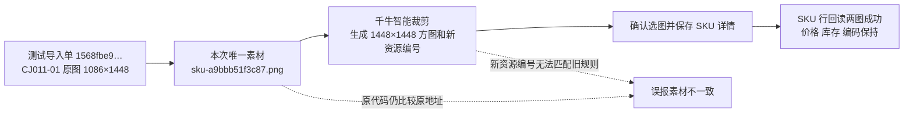

# SKU 智能裁剪 Playwright 诊断

2026-11-19；本轮只复现、取证和讨论修复，不表示正式代码已经修复。

本文保留修复前的诊断快照；用户随后确认实施，后续进展见 [SKU智能裁剪校验修复](../变更记录/SKU智能裁剪校验修复.md)。

## 范围与资料

- 使用项目 Playwright、千牛验证和弹窗守卫、测试配置及该环境已登记的独立账号会话；不使用桌面接管。
- 资料来源：正式封存单 `9f1302634ef74238bb5ccf83c0025397`，不修改其原件；测试导入单 `1568fbe937654659880abfa358ca4b29`，该单只有预检，没有启动网页上架任务。
- 商品 CJ011，只创建第一项测试规格，编码 CJ011-01，价格 57 元、库存 10；不是全部 8 项 SKU 或完整上架验收。
- 原图：`【24cm珍珠白】1手柄+3卷纸（共180撕）.png`，1086 × 1448。本次素材库唯一名称 `sku-a9bbb51f3c87.png`。
- 已人工登录并通过程序核对账号及店铺，保存测试登录状态。未生成真实商品、未点击商品提交、未调用付费 AI。

## 实际结果

| 检查点 | 本轮观察 |
| --- | --- |
| 素材选择 | 当前 SKU 唯一选中，本次唯一素材名对应卡片的复选框已选中 |
| 智能裁剪 | 选择器中的开关 `aria-checked=true`，目标比例 1:1 |
| 搜索主图原流程 | 点击素材后，右侧预览已出现新地址；程序仍按原素材地址断言，30 秒后报不一致，未点击批量窗口的确定 |
| Playwright 明确点击该批量窗口的确定 | 窗口正常关闭，详情内读到方图；原图 1086 × 1448，结果图 1448 × 1448 |
| 商品规格图片原流程 | 正确选中同一素材、点击单图选择器确定后窗口关闭；原地址校验仍报不一致，详情里实际已有新图 |
| 保存 SKU 详情 | 两个图片位都保存到 SKU 行；两个结果都是 1448 × 1448 PNG，原规格、57.00 元、库存 10、CJ011-01 及启用状态保持 |

这次千牛产生的是新资源编号，而不只是给原地址增加 `~crop,...~` 或缩略尺寸后缀。原有裁剪标记兼容无法识别本次结果。

| 资源 | CDN 资源编号（省略公共主机、目录与卖家后缀） |
| --- | --- |
| 本次上传原图 | `O1CN01qhu85jqcXzD2CiCk` |
| SKU 搜索主图结果 | `O1CN01c9csSIToBpB2wHTs` |
| 商品规格图片结果 | `O1CN01QRss9CcITEI2wHTs` |

图中导入单编号表示本地预检资料，不是千牛商品 ID，也不是数据库采集批次。CJ011-01 是这条 SKU 的商家编码；素材名用于定位本次上传，CDN 编号标识平台图片资源，均不是数据库外键。

## 后续修复方案，待确认

1. 两个图片位统一核对当前 SKU 和本次唯一素材，防止错选或批量覆盖其他规格。
2. 明确发生智能裁剪时，核对本次选择与生成结果的关联，记录裁剪结果地址；搜索主图不能在确认前仅因地址改变而退出。
3. 点击正确选择器的确定后，核对窗口关闭、详情图片，再保存详情并回读 SKU 行；后两次按已核实的裁剪结果校验。
4. 没有明确裁剪依据、素材不符、裁剪失败或保存超时，继续走现有人工处理、跳过及 3 分钟超时机制。不能仅因为出现一张图片就报成功。
5. 日志区分原素材、裁剪结果和保存结果。补充新资源编号、非裁剪错图、确认失败和保存后换图的回归，再在测试环境验收。

## 现场

本地证据位于 `workspace_test/logs/sku-crop-playwright/`：`picker-dom.json`、`image-comparison.json`、`images.json`、`saved.json`、原图和两张结果图，以及选图、保存后的截图。目录受 Git 忽略，不将真实商品图片或登录资料纳入提交。

诊断脚本没有调用数据库写入接口，未修改数据库结构；未做逐表前后内容指纹比对。此前网页失败尝试 `ac57ec6b520f411387c6c975d53cae14` 已结束，不作为本次 Playwright 选图成功的任务记录。

生产流程的临时诊断改动已撤回，本轮不更新 8000、不宣称业务修复或全流程验收通过。
