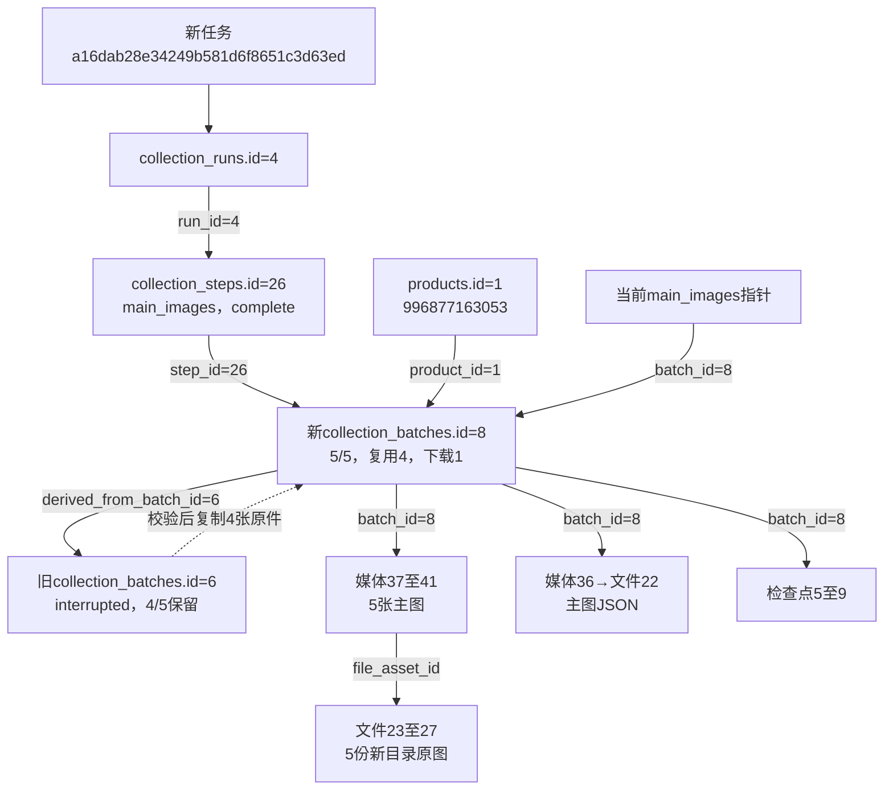

# 主图采集中断排查报告

用途：2026-10-24主图中断的真实原因、修复与复测记录。修复完成不等于所有模块人工验收通过，当前进度见[功能验收清单](../功能逐项验收清单.md)。

日期：2026-10-24，北京时间。商品：996877163053，数据库身份products.id=1。结论：已取得本轮原始错误，并复现Windows确认文件并发占用；修复后主图真实复测5/5成功，4张复用、1张新下载，独立文件及数据库核对通过。整轮8模块已结束并核对，SKU保留2项警告，等待用户分别验收。

## 原始现场及原因

原任务dfd4eff50123420fb52619b79d279503于11:40:16.959335开始，按用户确认默认启用全部8模块。视频步骤17完成，视频批次5已发布；主图步骤18中断，主图批次6为interrupted，expected_count=5、collected_count=4，第5项image_results.status=pending。SKU、参数等后6步骤均not_run。

用户正常关闭保留现场窗口后，任务于12:15:25.118260结束，最终status=needs_attention、60条事件连续且待补写为0；message明确为：

> 本地事件确认文件无法核对，请保留现场；未重置或跳过记录

该错误由EventJournal._offset读取本地*.ack.json确认文件时产生。主图批次6第5张仍为pending，应用尚未进入它的下载步骤；中断点在业务动作前的事件存储检查。此前“人工输入不可用”的提示来自通用保留现场分支，未准确表达原始原因。

确认文件由后台事件入库线程原子替换，浏览器主线程同时读取确认位置。修复前这两条路径没有协调文件访问。独立临时文件并发复现600次写入时，观察到33次读取PermissionError(errno=13)和157次替换PermissionError(WinError=5)；文件内容本身均由完整合法JSON生成。此复现与本次确认文件读取异常吻合，不据此声称已取得旧进程丢失的底层异常堆栈。

## 已实施修复

- 同一EventJournal实例的追加、逐行读取、确认位置读取及确认文件替换共用线程锁，避免入库线程与浏览器线程争用；数据库提交不占用该线程锁。
- 确认文件读取和原子替换遇到PermissionError时最多尝试3次，间隔20/40毫秒；持续失败仍抛出原始错误。JSON损坏、位置异常、其他错误保持阻断，不重置确认位置、不丢弃流水、不自动重放采集动作。
- 通用异常保留现场时立即记录needs_attention，并以session_halted事件的details.reason保存脱敏后的真实原因，提示“任务已中断，原因……”，不再一律归因于输入不可用。原历史事件保持原文。
- 统一字段取值说明及使用指南同步说明该事件、字段和人工处理方式，表结构及既有迁移未改。

## 已完成验证

1. 54项任务事件、淘宝守卫、浏览器启动和登录单元检查通过；其中33项事件/守卫检查在加入读写协调后再次通过，包含占用恢复、最多3次、永久失败、损坏JSON、旧确认保留和真实暂停原因记录。
2. 26项使用临时浏览器及脱敏页面的主图检查全部通过，覆盖顺序、数量、文件校验、部分采集后复用和完整结果发布；不访问真实商品或正式库。
3. 使用实际EventJournal追加、补写、并发读取流程及内存存储复测：600条事件全部确认，23626次并发读取，错误0、pending=false。结果在workspace/output/reports/manual_acceptance_20261024/main_images_ack_contention_after_fix_journal.json。中间仅增加有限重试时仍有高频写占用，已据此补充读写协调，未将该中间结果宣称无错误。
4. 原任务结束快照核对18份既有原件哈希均不变；原业务行无修改或删除。新视频及4张主图、模块原件和日志均保留，批次6未误发布为完整主图。

## 真实复测安排及记录

沿用用户已确认的默认全模块命令，不传--all或单模块开关，评价最多100条、问题最多50个，默认保留浏览器。若主图来源清单一致，校验旧批次6的4份图片并复制到新批次，再补采第5张；旧批次6及文件保留。来源变化时按新来源采集，不混用旧图。

修复后执行前基线：2026-10-24 12:24:11，tasks=11、task_events=314、collection_runs=3、collection_steps=24、collection_batches=6、products=9、search_records=4、parameter_observations=12、product_current_sections=2、file_assets=18、media_references=32、collection_checkpoints=4、list_observations=13，其他业务表0。结构0003_search_origin、23表/283字段/49外键及中文备注正常，无活动任务/待补写；27份历史原件登记校验值。

新任务a16dab28e34249b581d6f8651c3d63ed于12:24:16.731866开始；运行汇总4登记8个启用步骤。视频步骤25/批次7已下载；主图步骤26/批次8已complete，captured_at=12:24:53、有效指针published_at=12:25:03.902090。

主图批次8的source_batch_key为a16dab28e34249b581d6f8651c3d63ed-1eecbbc3；derived_from_batch_id=6，upstream_batch_key为旧批次dfd4eff50123420fb52619b79d279503-fafd2015。来源清单核对一致后复制旧4张文件至新历史目录，实际新下载第5张；expected_count=collected_count=5、reused_count=4、downloaded_count=1。旧批次6及其4份图保持原样，只将内部_last_attempt_selected从true改false。

### 主图模块自身的数据增量

| 数据表 | 本次主图模块贡献 | 实际编号及字段含义 |
|---|---|---|
| collection_batches | 新增1条 | 批次8，关联商品1、运行4、步骤26；指向恢复来源批次6 |
| media_references | 新增6条 | 36为原JSON，37至41为5张主图；position=1至5，前4条reused，第5条downloaded |
| file_assets | 新增6条 | 文件22为主图JSON，23至27为5张图片，登记新批次内的路径、大小、校验值和尺寸 |
| collection_checkpoints | 新增5条 | id=5至9，batch_id=8、checkpoint_type=image_item、source_sequence=1至5 |
| product_current_sections | 新增1条 | 商品1的main_images有效指针，batch_id=8，publication_basis=module_completeness_checked |
| collection_batches旧行 | 更新1条内部标记 | 旧批次6的result_payload._last_attempt_selected=true→false，业务record、summary、status和历史图片均保留 |

这是主图模块的增量；整轮任务还包含视频、SKU等模块，其任务、日志、标题来源等变动以整轮字段快照另行核对。

### 真实流转及文件例子

实线为字段关联，虚线为程序逻辑。例子：第5张主图为媒体41，role=main_image、position=5、download_status=downloaded、file_asset_id=27；文件27的size_bytes=944683、尺寸1440×1920、SHA-256为c97f699dcdba562f1188355dcfa7bb65e90e20ad6598fa431806d3177571a83e。第1张则是媒体37→文件23，download_status=reused，复制前后哈希一致，旧原件保留。

本商品5张原图均为1440×1920，is_square=false；目录名称沿用1-1主图，采集保存原图，没有裁成正方形。5图及JSON的数据库文件信息与原件一致，兼容导出图的哈希也一致；27份旧原件保持不变。8份主图规范快照校验通过，9组只读SQL已实际执行，返回新旧批次2条、主图媒体/文件6条、当前主图指针1条、主图检查点5条等。

未执行或未人工确认的模块不标通过。整轮任务后续状态在功能逐项验收清单和当前快照中更新。

整轮业务已于12:45:52结束，运行4为complete_with_warnings，8模块均已执行。评价100条、问答25题123回答已保存；SKU35项中33项价格、35张图，2项不可选且无明确缺货依据，保留partial并允许继续。新批次7至14，86新文件/27旧原件/155规范快照及13组只读SQL核对通过，951条阶段日志连续、待补写0；本轮未再出现确认文件占用中断。任务因浏览器保留仍running，用户查看结束后再收尾。[完整结果、字段前后值和真实流转图](../../workspace/output/reports/manual_acceptance_20261024/08_default_detail_20261024_122411.md)。

[原中断任务最终快照](../../workspace/output/reports/manual_acceptance_20261024/08_default_detail_20261024_114007_final.json)

[修复后复测基线](../../workspace/output/reports/manual_acceptance_20261024/08_default_detail_20261024_122411_before.json)

[主图复测SQL](../../workspace/output/reports/manual_acceptance_20261024/main_images_retest.sql)

[主图独立核对及全部文件校验值](../../workspace/output/reports/manual_acceptance_20261024/main_images_retest_audit.json)
