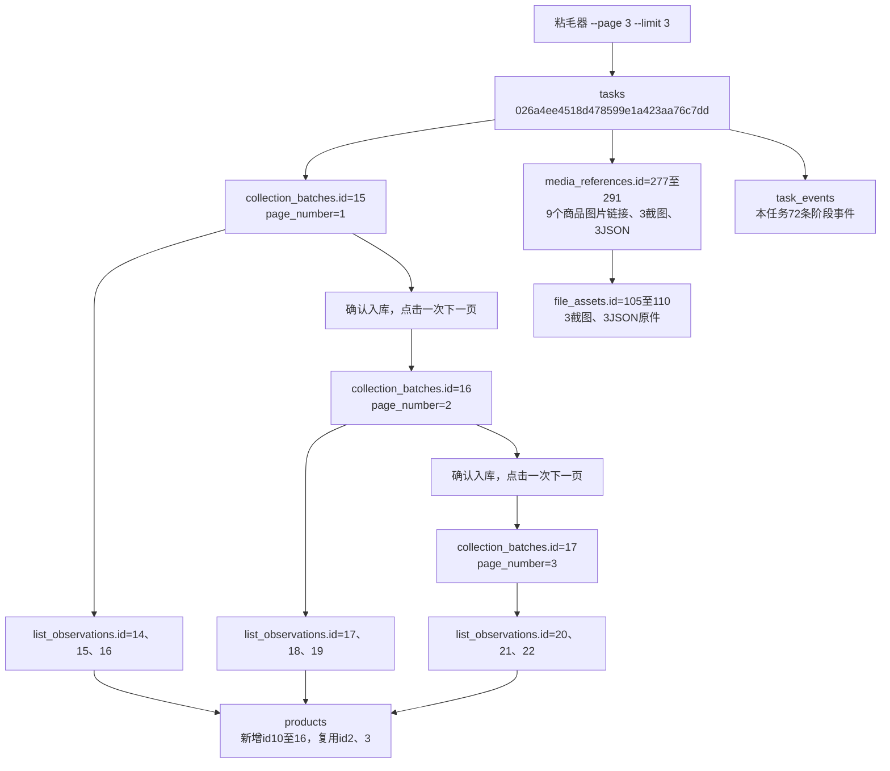

# 搜索列表分页采集测试记录

日期：2026-10-24，北京时间。记录范围：代码与真实3页×3条程序核对、用户人工确认和任务正常收尾。下文保留15:12阶段快照，最终结果见末节。当前进度只在[功能验收清单](../功能逐项验收清单.md)维护；本次为用户授权追加的分页验证，不替代原第16项整页采集。

## 执行范围与结果

用户要求先验证下一页，再以`--page 3 --limit 3`采集，关键词沿用粘毛器。默认不传--page仍只采第一页，--limit为每页上限。

先行探测：首次任务328eeb8ebfb14adca47f8e0349c84231在沙箱浏览器连接时失败，未执行页面动作。正常浏览器环境的任务b30fb6e726bb450c9c74b9d42cb33be1单次点击第1页至第2页，页码、关键词、销量和列表更新核对通过，随后正常关闭。

正式采集进程于15:09:41启动，任务026a4ee4518d478599e1a423aa76c7dd的tasks.started_at为15:09:43.050044，分别在15:10:25、15:10:42、15:10:56保存三页。阶段快照2026-10-24T15:12:40.380037+08:00共3批次、9条观察；当时浏览器保留在第3页，任务尚待查看结束后收尾。

| 页码 | collection_batches.id | 原批次键 | list_observations.id |
|---|---|---|---|
| 1 | 15 | 026a4ee4518d478599e1a423aa76c7dd-7cb75f4f | 14、15、16 |
| 2 | 16 | 026a4ee4518d478599e1a423aa76c7dd-bbab757b | 17、18、19 |
| 3 | 17 | 026a4ee4518d478599e1a423aa76c7dd-69a532aa | 20、21、22 |

## 字段与实际增量

表结构、中文备注和约束不变，仍为0003_search_origin、23表/283字段/49外键。正式采集截至15:12阶段、相对其执行前基线：tasks+1，task_events+72，collection_batches+3，list_observations+9，products新增7且更新旧行2，file_assets+6，media_references+15，其余表无变化、删除0。探测另有tasks+2、task_events+32，不能与正式采集混算。

各批次page_number分别1/2/3；search_method=keyword、search_keyword=粘毛器、requested_limit=3、scope=search_page_loaded_cards、status/coverage_status=limit_reached。任务汇总结束原因为requested_pages_reached，表示达到请求3页；各页limit_reached表示达到每页3条上限，两者口径不同。

products.id2/3复用原商品身份，title_source_batch_id由2变为15，标题文字不变；新商品内部id10至16。三页9个不同商品没有跨页重复，旧观察和106份旧文件保持不变。

## 真实关联图

## 人工核对入口

- [完整数据流转、九条商品、逐表增量与字段前后值](../../workspace/output/reports/pagination_20261024/分页测试与数据流转.md)
- [正式采集前基线](../../workspace/output/reports/pagination_20261024/before_collect.json)、[完整阶段快照](../../workspace/output/reports/pagination_20261024/current_collect.json)
- [9组人工核对SQL](../../workspace/output/reports/pagination_20261024/分页人工核对.sql)、[独立审计](../../workspace/output/reports/pagination_20261024/audit.json)
- [全部字段取值与分页JSON解释](../数据库字段取值说明.md#搜索列表分页口径2026-10-24)

40项离线检查、30项本地浏览器检查、9组正式库只读查询、3份采集快照和原件核对通过；15:12阶段尚待人工确认，后续反馈见末节。末页、重复商品、验证和断库等未在本轮真实页面出现的分支，只记本地模拟覆盖。

## 人工确认与正常收尾

2026-10-24用户回复“确认没有问题”，随后按提示关闭本次淘宝窗口并回复“已关闭”。本次追加分页测试标记通过；其他待验收项保持原状态，没有开始新的采集。

任务最终status=succeeded，finished_at=2026-10-24T15:32:15.997248+08:00，命令行退出码0。相对15:12阶段，仅tasks本行结束状态及信息更新、task_events新增2条：id1372/task_sequence73为session_ended，id1373/task_sequence74为task_finished。本任务最终74条事件连续，正式库task_events累计1373条；活动任务0、待补写0。批次15/16/17、观察14至22、商品、媒体、文件及原件均未发生收尾变动，原生结构不变。

收尾证据：[最终只读快照](../../workspace/output/reports/pagination_20261024/acceptance_snapshot.json)、[人工确认与收尾核对](../../workspace/output/reports/pagination_20261024/acceptance.json)。阶段审计和72条事件快照保留，便于区分采集完成、保留窗口查看与任务结束三个时点。
